Cyber Jawara (CJ) is one of the biggest annual CTF competitions in Indonesia. Originally scheduled for December 2024, the event was postponed, and the qualification round began in January 2025. By the end of the qualification period, several challenges remained unsolved, including one reversing challenge "MFA", which caught my interest. After the competition ended, I decided to revisit it and attempt to solve it just for fun.

The challenge was written in Rust, the meta programming language for CTF reversing challenges nowadays, lmao. The only "nice" thing about it was that the author gave us a non-stripped binary. But even that doesn't really feel like a kindness when you see this graph.

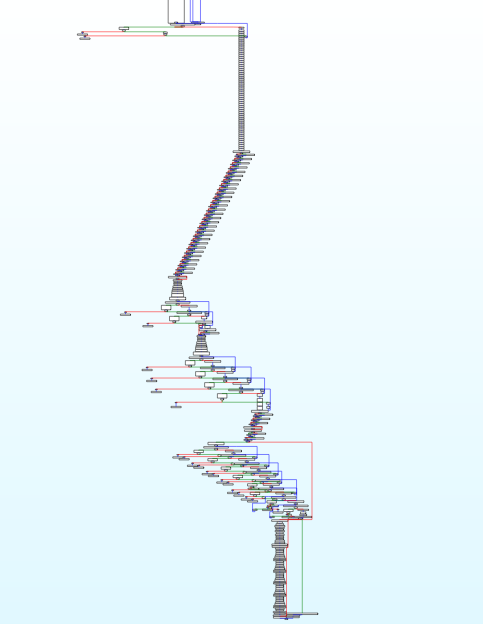

That's huge, but bear with me because this challenge is actually kind of interesting (in its own way).

Oh, and by the way IDA couldn't decompile it because of `stack frame is too big` error, However, as explained [here](https://hex-rays.com/blog/igors-tip-of-the-week-147-fixing-stack-frame-is-too-big), it can be fixed. Fortunately, you don’t encounter this issue when using Ghidra. For me, though, I just use that graph as my go-to tool to understand the program itself.

## Program Flow

When the program run it give use this 3 input : 

```bash
➜  yqroo mfa ./chall
Enter Username :
bb
Enter Password :
bb
Enter Security Key :
bb
```

Looking at the graph, we can see that the inputs are being hashed.

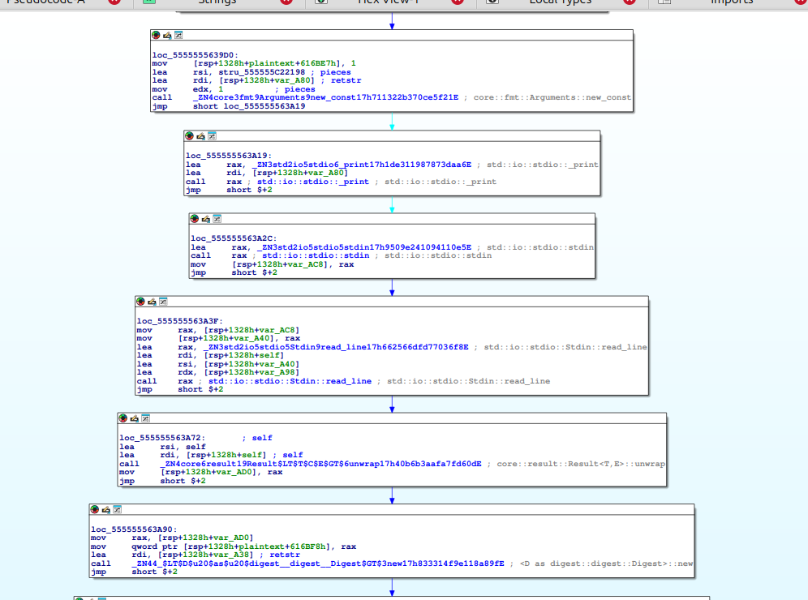

Each input is hashed with a different algorithm. To determine which hash algorithm is being used, we can set a breakpoint and examine the constant values

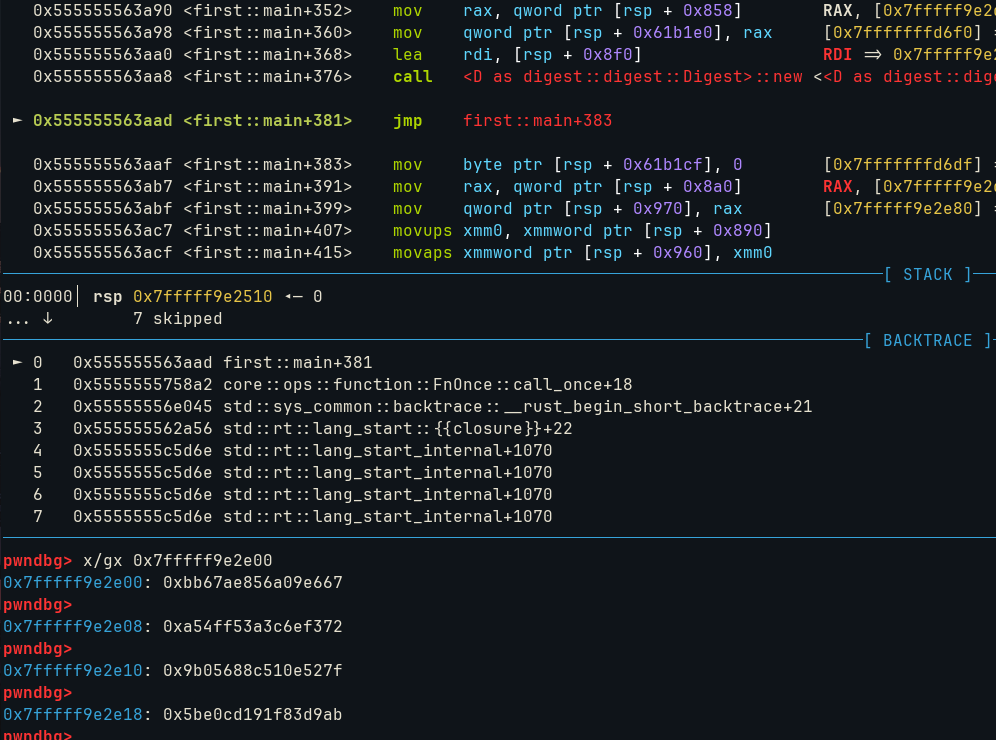

By searching these values online, we recognize that they correspond to SHA-256 constants. Each input uses a different algorithm, so repeating this process for other inputs will help you figure out the rest.

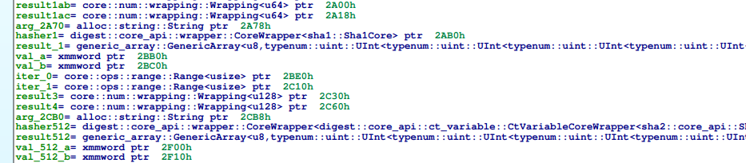

Additionally, we can observe some variable initialization that explicitly states the hash algorithm being used.

If the inputs are being hashed, there's no way to retrieve the original input even if we have the correct hash, unless there are clues about the original input, such as a checker that verifies the input before hashing. However, it seems that the check is only used to validate the hashed value, not the original input itself.

After analyzing the hashing process, we notice this recurring graph pattern. Keep this in mind, as you'll see this pattern frequently in the sections that follow.

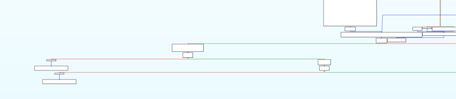

This is essentially just Rust’s .into_iter(), which copies the hash value for comparison purposes. However, before the comparison, there are some operations that resemble encryption, though they’re primarily just arithmetic functions applied to the hash value.

These functions handle the operations, and while I’ve already named them, they were originally labeled `algo0` and `algo1`, respectively.

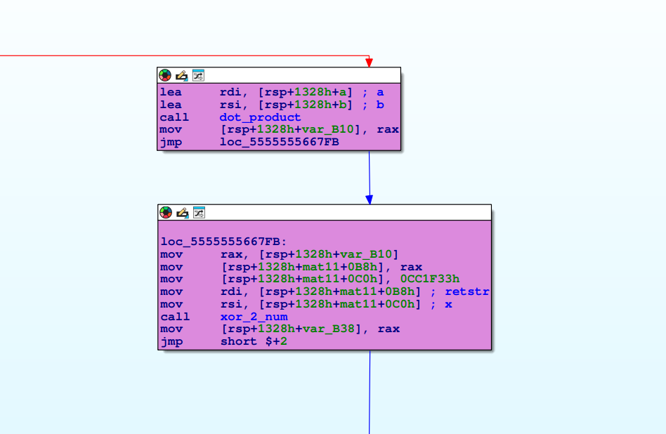

`algo0` was straightforward it’s simply a dot product, nothing more to say about it.

```rust
while ( 1 )
{
    v13 = core::iter::range::<impl core::iter::traits::iterator::Iterator for core::ops::range::Range<A>>::next(&v12);
    if ( !*(_QWORD *)v13.gap0 )
    break;
    v18 = *(_QWORD *)&v13.gap0[8];
    if ( *(_QWORD *)&v13.gap0[8] >= 0x1EuLL )
    core::panicking::panic_bounds_check();
    v5 = (*a)[*(_QWORD *)&v13.gap0[8]];
    v4 = (*b)[*(_QWORD *)&v13.gap0[8]] * v5;
    if ( !is_mul_ok((*b)[*(_QWORD *)&v13.gap0[8]], v5) )
    core::panicking::panic();
    if ( __CFADD__(v8, v4) )
    core::panicking::panic();
    v8 += v4;
}
```

If you're still confused by the decompilation, a little help from an LLM can simplify things.

And `algo1` is actually obfuscated with a mix of boolean arithmetic expressions, making it difficult to recognize that the function is essentially just performing XOR operation.

```rust
  v3.__0 = <core::num::wrapping::Wrapping<u64> as core::ops::bit::BitAnd>::bitand(
             (core::num::wrapping::Wrapping<u64>)retstr,
             x).__0;
  v4.__0 = <core::num::wrapping::Wrapping<u64> as core::ops::bit::Not>::not(v3).__0;
  v5.__0 = <core::num::wrapping::Wrapping<u64> as core::ops::bit::BitXor>::bitxor(
             (core::num::wrapping::Wrapping<u64>)retstr,
             v4).__0;
  v16 = <core::num::wrapping::Wrapping<u64> as core::ops::arith::Mul>::mul((core::num::wrapping::Wrapping<u64>)-2LL, v5).__0;
  v15 = <core::num::wrapping::Wrapping<u64> as core::ops::bit::BitAnd>::bitand(
          (core::num::wrapping::Wrapping<u64>)retstr,
          x).__0;
  v6.__0 = <core::num::wrapping::Wrapping<u64> as core::ops::bit::Not>::not((core::num::wrapping::Wrapping<u64>)retstr).__0;
  v7.__0 = <core::num::wrapping::Wrapping<u64> as core::ops::bit::BitAnd>::bitand(
             (core::num::wrapping::Wrapping<u64>)v15,
             v6).__0;
  v8.__0 = <core::num::wrapping::Wrapping<u64> as core::ops::bit::Not>::not(v7).__0;
  v9.__0 = <core::num::wrapping::Wrapping<u64> as core::ops::arith::Mul>::mul(
             (core::num::wrapping::Wrapping<u64>)2LL,
             v8).__0;
  v17 = <core::num::wrapping::Wrapping<u64> as core::ops::arith::Add>::add((core::num::wrapping::Wrapping<u64>)v16, v9).__0;
  v10.__0 = <core::num::wrapping::Wrapping<u64> as core::ops::bit::BitAnd>::bitand(
              (core::num::wrapping::Wrapping<u64>)retstr,
              x).__0;
  v11.__0 = <core::num::wrapping::Wrapping<u64> as core::ops::bit::BitOr>::bitor(
              v10,
              (core::num::wrapping::Wrapping<u64>)retstr).__0;
  v12.__0 = <core::num::wrapping::Wrapping<u64> as core::ops::arith::Mul>::mul(
              (core::num::wrapping::Wrapping<u64>)-1LL,
              v11).__0;
  v13.__0 = <core::num::wrapping::Wrapping<u64> as core::ops::arith::Add>::add(
              (core::num::wrapping::Wrapping<u64>)v17,
              v12).__0;
  return (core::num::wrapping::Wrapping<u64> *)<core::num::wrapping::Wrapping<u64> as core::ops::arith::Add>::add(
                                                 v13,
                                                 x).__0;
```

To deobfuscate it, we could either attach a debugger and call the function with values like 0 or 1, or simply reimplement the whole thing. I ended up reimplementing the function in Python:

```python
v3 = inp & x
v4 = ~v3
v5 = v4 ^ inp
v16 = -2 * v5
v15 = inp & x
v6 = ~inp
v7 = v15 & v6
v8 = ~v7
v9 = 2 * v8
v17 = v16 + v9
v10 = inp & x
v11 = v10 | inp
v12 = -v11
v13 = v17 + v12
ret = v13 + x
```

But when I tested it with inputs like 1 and 0, that's when I realized the function was obfuscated. After that I changed it into xor.

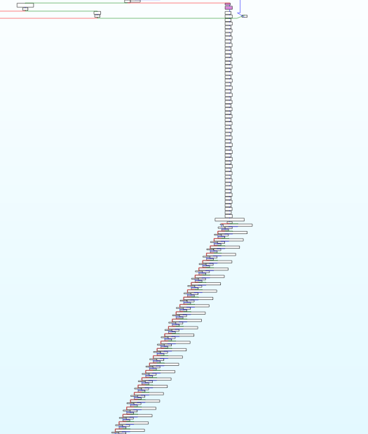

That long line is essentially just a combination of dot products and XOR operations. With 30 variables and 30 equations, this is a linear system that can be treated as a matrix.

Just take the compared values, XOR them, and then solve using Sage or invert the matrix. You know the drill.

Now, while SHA-1 typically results in a 32-byte hash, our recovered hash is only 30 bytes. I initially thought I’d need to perform some brute force later, but as I'll explain further, we actually don’t need to do that.

For the next input, the same pattern follows: hash, copy, perform some operations, and then compare.

For the second input, it’s added to a constant value. `algo2` is also obfuscated with MBA expressions, but in reality, it just performs an addition. To recover the correct hash, we simply subtract the compared value from the constant value. However, I noticed something was off with just subtracting it, perhaps due to handling overflow bits and other details. After some debugging, we were able to recover the correct second hash, and this time, there was no truncation.

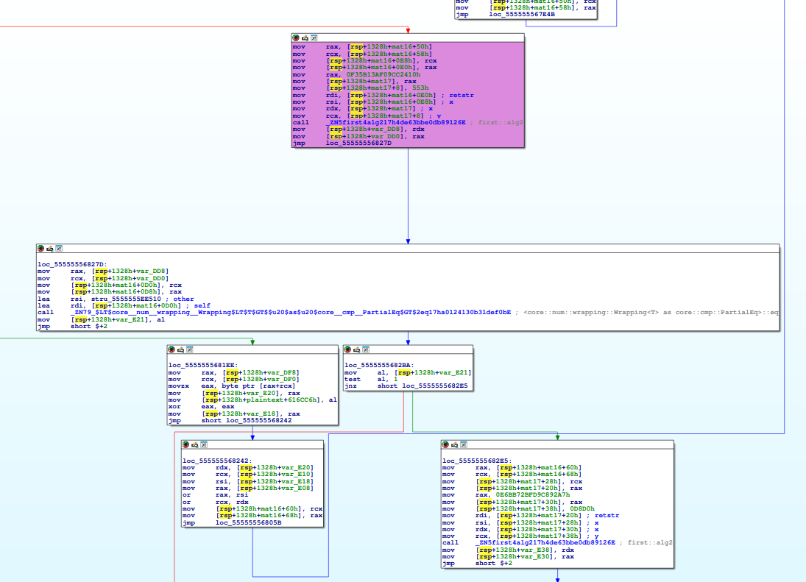

For the third input (though not the final one, since there’s another input after passing all the checks), it's simply XORed with a constant. The function algo3 is also obfuscated with MBA expressions, but recovering the correct hash was straightforward it’s just an XOR operation after all.

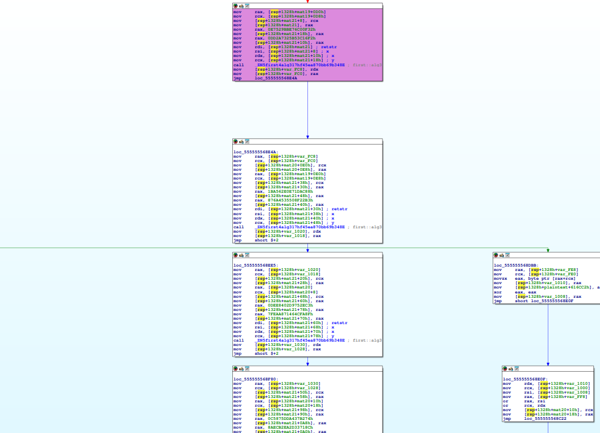

My script that helps me recovering the correct hash : 

```python
from hashlib import sha256, sha1, sha512
from ctypes import c_uint64 as u64, c_int64 as i64

"""
INPUT USERNAME

"""
test = [
...snip...
]

inp = sha256(b'bb\n').digest()

# print(hex(len(inp)))

"""
algo0:
dot product

i'm afraid that this is matrix operation (the whole thing)
"""
# inp = sum(i * inp[j] for j,i in enumerate(test[0]))
# print(hex(inp ^ 0xcc1f33))

print("first orig hash",sha256(b'bb\n').hexdigest())

print("DEBUGGGING FUCKKK")

print(sha256(b'bb\n').hexdigest()[:-4])

for i in range(30):
    dd = sum(i * inp[j] for j,i in enumerate(test[i]))
    # print(hex(dd ^ 0xcc1f33))
    print(hex(dd))


print("END DEBUGGING FUCCKKK")

"""
algo1 basically XOR with 0xcc1f33

algo1:
v3 = inp & x
v4 = ~v3
v5 = v4 ^ inp
v16 = -2 * v5
v15 = inp & x
v6 = ~inp
v7 = v15 & v6
v8 = ~v7
v9 = 2 * v8
v17 = v16 + v9
v10 = inp & x
v11 = v10 | inp
v12 = -v11
v13 = v17 + v12
ret = v13 + x
"""
x = 0xcc1f33

xx = [0x0000000000caedf8,0x0000000000ca5009,0x0000000000cade96,0x0000000000c9e72e,0x0000000000ca1ec4,0x0000000000c9f588,0x0000000000cb41aa,0x0000000000ca956a,0x0000000000cb2001,0x0000000000cbd72b,0x0000000000ca39d6,0x0000000000cad747,0x0000000000ca6f75,0x0000000000c93589,0x0000000000ca31c3,0x0000000000cb1d08,0x0000000000caec07,0x0000000000cb1fb4,0x0000000000ca1862,0x0000000000cb4cd1,0x0000000000cb167a,0x0000000000cb5b84,0x0000000000cbba16,0x0000000000cb8d2b,0x0000000000ca6882,0x0000000000ca7935,0x0000000000ca886f,0x0000000000cacc55,0x0000000000ca8cc7,0x0000000000ca921d]
xx = list(map(lambda y: y ^ x, xx))
# print(list(map(lambda y: f'{y:x}', xx[::-1])))
print(xx)
print("correct one is 78377cb973f32892de30178463b991312699b5a322494aa750b40c2deb1a use matrix solve_right")
print("Still missing 2 byte")

"""
INPUT PASSWORD

"""

pw = sha1(b'bb\n').digest()
pt1_1 = int.from_bytes(pw[:10][:2],'big')
pt1_2 = int.from_bytes(pw[:10][2:], 'big')
pt2_1 = int.from_bytes(pw[10:][:2],'big')
pt2_2 = int.from_bytes(pw[10:][2:], 'big')
rdx = 0xf35b13af09cc2410
rcx = 0x553
"""
algo2: basically add 

v5 = (~rdx, ~rcx)
v6 = pt1_1
v8 = pt1_2 | v5[0]
v9 = v6 | v5[1]
v10 = -v8
v11 = -v9
v12 = rdx | pt1_2
v13 = rcx | pt1_1
v14 = rdx & v12 
v15 = rcx & v13
v16 = ~pt1_2
v17 = ~pt1_1
v18 = pt1_2 & v14
v19 = pt1_1 & v15
v20 = v18 ^ v16
v21 = v19 ^ v17
v22 = v20 | v14
v23 = v21 | v15
v24 = v22 + v10
v25 = v23 + v11
v26 = i64(pt1_2 * 2).value
v27 = i64(pt1_1 * 2).value 
v28 = v24 + v26
v29 = v25 + v27
"""
cmp2 = [(0x60438048f4e810f2, 0x0000000000001c3e),(0xc285eb9eb35b3b51, 0x0000000000010a64)]
# cmp2 = [(0x9d0e1c7cf5ba6506,0x9b6c),(0xffba63b4aaa6bbe0,0x1a7c0)]
# print(hex(u64(v28).value), hex(u64(v29).value))

sulbe = []

res1 = u64(rdx + pt1_2).value
res2 = u64(rcx + pt1_1).value
print("orig hash2", sha1(b'bb\n').hexdigest())
print(hex(res1), hex(res2))

sulbe.append(u64(cmp2[0][1] - rcx).value)
sulbe.append(u64(cmp2[0][0] - rdx).value)

rdx = 0x0E6BB72BFD9C892A7
rcx = 0x0D8D0
res1_2 = u64(rdx + pt2_2).value
res2_2 = u64(rcx + pt2_1).value
print(hex(res1_2), hex(res2_2))

sulbe.append(u64(cmp2[1][1] - rcx).value)
sulbe.append(u64(cmp2[1][0] - rdx).value)


print(sulbe)
print("second hash should be -->",''.join(map(lambda y: f'{y:x}', sulbe)))

curbe = [5866, 7847641759023361250, 12691, 15837603938130110634 ]
print("second hash should be -->",''.join(map(lambda y: f'{y:x}', curbe)))

"""
INPUT SEC KEY

algo3: also XOR
"""

inp = sha512(b'bb\n').digest()

tf = []

a,b = inp[:8], inp[8:16]
a = int.from_bytes(a, 'big')
b = int.from_bytes(b, 'big')

a ^= 0xe7529bbe76c00f32
b ^= 0xdd2a7325b53c16f2

print(hex(a), hex(b))

c,d = inp[16:24], inp[24:32]
c = int.from_bytes(c, 'big')
d = int.from_bytes(d, 'big')

c ^= 0x1BA562E0E71DAC88
d ^= 0x876A4535508F22B3

print(hex(c), hex(d))

e, f = inp[32:40], inp[40:48]
e = int.from_bytes(e, 'big')
f = int.from_bytes(f, 'big')

e ^= 0x0DEE8402D9752EC3
f ^= 0x7FEAA871464CFA8F

print(hex(e), hex(f))

g, h = inp[48:56], inp[56:64]
g = int.from_bytes(g, 'big')
h = int.from_bytes(h, 'big')

g ^= 0x0C5875DDA437B274
h ^= 0x8AECB2EA2D33718C

print(hex(g), hex(h))


xorkey = [
0xe7529bbe76c00f32,
0xdd2a7325b53c16f2,

0x1BA562E0E71DAC88,
0x876A4535508F22B3,

0x0DEE8402D9752EC3,
0x7FEAA871464CFA8F,

0x0C5875DDA437B274,
0x8AECB2EA2D33718C,
]

enc = [
0xfa4ffd1b9e6ea504,
0x79167017d72fb3c7,

0xe64c7dfc44047f34,
0x5f56f85a9a2378b7,

0x145ef5c95cbe2c65,
0xfa5cd5f4cfd6994c,

0x9207ce9001569b59,
0x070a688e7b7d5980,
]

hash3 = [enc[i] ^ xorkey[i] for i in range(8)]

print("orig third hash -->", sha512(b'bb\n').hexdigest())
print(list(map(lambda y: f'{y:x}',hash3)))
print("third hash should be -->",''.join(map(lambda y: f'{y:x}',hash3)))
```

>Note : second hash output from the script is slightly wrong, the correct one was on another script.

After obtaining the correct hash, we eventually encounter this step. As we know, the left part follows the Rust iterator pattern. If our input is correct, we proceed down that path.

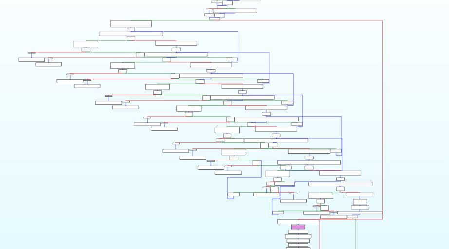

After those iteration we got 

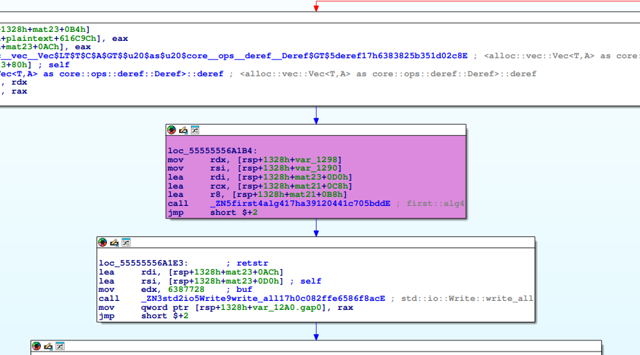

To keep it brief, `algo4` is just AES. I didn’t bother figuring out which AES variant it uses, because in the end, it simply writes the result to a file. I can just take the written file and proceed from there, since what happens next is a process being spawned for that file, as it is executable.

## Debugging Hell

So now we understand the flow of execution and how to pass all the checks. However, I haven’t gone into detail about the debugging part, which actually plays a crucial role in solving this challenge.

GDB was extremely helpful, but manually typing commands over and over was time-consuming. Instead, I used a GDB script to manage breakpoints and trigger functions that were actually useful. For example, I could set new values to specific addresses, print values, or even trace the execution more efficiently.

Remember when I mentioned that the first hash we recovered was actually missing 2 bytes? And when I said it didn’t matter? That’s because I traced the execution of the iterator and observed which values it was accessing from the hash, all with the help of the GDB script.

```bash
Iter 1 0x7fffff9e5038:  0x1beb996ce86cea16 0
Iter 1 0x7fffff9e5038:  0x1beb996ce86cea16 1
Iter 1 0x7fffff9e5038:  0x1beb996ce86cea16 2
Iter 1 0x7fffff9e5038:  0x1beb996ce86cea16 3
iter 2 0x7fffff9e2e90:  0x9228f373b97c3778 4
iter 2 0x7fffff9e2e90:  0x9228f373b97c3778 5
iter 2 0x7fffff9e2e90:  0x9228f373b97c3778 6
iter 2 0x7fffff9e2e90:  0x9228f373b97c3778 7
Iter 3 0x7fffff9e5038:  0x1beb996ce86cea16 8
Iter 3 0x7fffff9e5038:  0x1beb996ce86cea16 9
Iter 3 0x7fffff9e5038:  0x1beb996ce86cea16 10
Iter 3 0x7fffff9e5038:  0x1beb996ce86cea16 11
Iter 4 0x7fffff9e52f0:  0x36aaaee8a5661d1d 12
Iter 4 0x7fffff9e52f0:  0x36aaaee8a5661d1d 13
Iter 4 0x7fffff9e52f0:  0x36aaaee8a5661d1d 14
Iter 4 0x7fffff9e52f0:  0x36aaaee8a5661d1d 15
Iter 5 0x7fffff9e52f0:  0x36aaaee8a5661d1d 0
Iter 5 0x7fffff9e52f0:  0x36aaaee8a5661d1d 1
Iter 5 0x7fffff9e52f0:  0x36aaaee8a5661d1d 2
Iter 5 0x7fffff9e52f0:  0x36aaaee8a5661d1d 3
Iter 6 0x7fffff9e52f0:  0x36aaaee8a5661d1d 4
Iter 6 0x7fffff9e52f0:  0x36aaaee8a5661d1d 5
Iter 6 0x7fffff9e52f0:  0x36aaaee8a5661d1d 6
Iter 6 0x7fffff9e52f0:  0x36aaaee8a5661d1d 7
Iter 7 0x7fffff9e2e90:  0x9228f373b97c3778 8
Iter 7 0x7fffff9e2e90:  0x9228f373b97c3778 9
Iter 7 0x7fffff9e2e90:  0x9228f373b97c3778 10
Iter 7 0x7fffff9e2e90:  0x9228f373b97c3778 11
Iter 8 0x7fffff9e5038:  0x1beb996ce86cea16 12
Iter 8 0x7fffff9e5038:  0x1beb996ce86cea16 13
Iter 8 0x7fffff9e5038:  0x1beb996ce86cea16 14
Iter 8 0x7fffff9e5038:  0x1beb996ce86cea16 15
algo4 (last algo)
WRITE /tmp/last_validation.bin
```

This is the traced output from the iteration. These are the correct hashes because I modified all the inputs being hashed, with the help of the GDB script. At this point, I just took the last_validation.bin and continued reversing the second stage of the challenge.

And here’s the script with all the commentary:

```python
import gdb

class Debugger:
    def __init__(self, binary):
        self.binary = binary
        self.breakpoints = {}
        self.setup_binary()
    
    def setup_binary(self):
        gdb.execute('set follow-fork-mode parent') # make sure we doesn't follow the execution of execve, or in this case Rust std::process::Command
        gdb.execute(f'file {self.binary}')
    
    def add_break(self, address, action=None, stop=False):
        class Handler(gdb.Breakpoint):
            def stop(self):
                if action:
                    action()
                return stop
                
        self.breakpoints[address] = Handler(f'*{address}')
        
    def clear_breaks(self): # might as well just run gdb.execute('d')
        for bp in self.breakpoints.values():
            bp.delete()
        self.breakpoints.clear()

    def run_debug(self):
        gdb.execute('run')

# To patch the jne jump
def modify_eflags():
    gdb.execute('set $eflags = $eflags & 0xFFBF') # Clear ZF

# Actually patch the input hash, because it used as key and iv for aes decrypt
def mod_hash1():
    correct_hash = bytes.fromhex('78377cb973f32892de30178463b991312699b5a322494aa750b40c2deb1a')
    for i in range(0, len(correct_hash), 8):
        print(gdb.parse_and_eval(f'$rax + {i}').cast(gdb.lookup_type('uint64_t').pointer()), hex(int.from_bytes(correct_hash[i:i+8], "little")))
        gdb.execute(f'set *(($rax + {i}) as *mut u64) = {int.from_bytes(correct_hash[i:i+8], "little")}')

def mod_hash2():
    correct_hash = bytes.fromhex('16ea6ce86c99eb1bece23193dbca78ded992a8aa')
    for i in range(0, len(correct_hash), 8):
        print(gdb.parse_and_eval(f'$rax + {i}').cast(gdb.lookup_type('uint64_t').pointer()), hex(int.from_bytes(correct_hash[i:i+8], "little")))
        gdb.execute(f'set *(($rax + {i}) as *mut u64) = {int.from_bytes(correct_hash[i:i+8], "little")}')

def mod_hash3():
    correct_hash = bytes.fromhex('1d1d66a5e8aeaa36a43c03326213a535fde91f1ca319d3bcd83cbd6fcaac5a0419b071cb85cb02a685b67d85899a63c39e5fbb4da561292d8de6da64564e280c')
    for i in range(0, len(correct_hash), 8):
        print(gdb.parse_and_eval(f'$rax + {i}').cast(gdb.lookup_type('uint64_t').pointer()), hex(int.from_bytes(correct_hash[i:i+8], "little")))
        gdb.execute(f'set *(($rax + {i}) as *mut u64) = {int.from_bytes(correct_hash[i:i+8], "little")}')

# I tried to patch the hash before the comparison, but we need to actually patch the actuall input hash (different address)
def corr_hash_input2():
    pt_hash = [7847641759023361250, 5866, 15837603938130110634, 12691] # 5866 is 5867 and 12691 is 12692, maybe because overflow or something so 1 is added
    for idx, hash in enumerate(pt_hash):
        print(gdb.parse_and_eval(f'$rsp + {0x2ba8 + 8 * idx}').cast(gdb.lookup_type('uint64_t').pointer()), hex(hash))
        gdb.execute(f'set *(($rsp + {0x2ba8 + 8 * idx}) as *mut u64) = {hash}')

def corr_hash_input3():
    pt_hash = [11834337435751523637, 2097945864183917110, 15581537098634385924, 18296189169025274812, 9635026465298473923, 1851104565786247846, 10225100128470837260, 11412045922941610285]
    print("from corr_hash_input3")
    for idx, hash in enumerate(pt_hash):
        print(gdb.parse_and_eval(f'$rsp + {0x2ef8 + 8 * idx}').cast(gdb.lookup_type('uint64_t').pointer()), hex(hash))
        gdb.execute(f'set *(($rsp + {0x2ef8 + 8 * idx}) as *mut u64) = {hash}')

# This function is used to trace the value of rdi and rdx
def trace(msg):
    def inner():
        print(msg, gdb.execute('x/gx $rdi', to_string=True).replace('\n', ''), gdb.parse_and_eval('$rdx'))
    return inner

dbg = Debugger('./chall')

# dbg.add_break(0x0000555555567457, lambda:print('CMP algo0 + algo1 res'), stop=True)
dbg.add_break(0x0000555555563B73, mod_hash1)
dbg.add_break(0x0000555555567DB6, mod_hash2)
# dbg.add_break(0x00005555555680A9, corr_hash_input2) # doesn't need this anymore
dbg.add_break(0x00005555555682AC, lambda:print('CMP algo2 res'), stop=False)
dbg.add_break(0x000055555556852d, mod_hash3)
# dbg.add_break(0x0000555555568c70, corr_hash_input3, stop=True) # doesn't need this anymore
dbg.add_break(0x000055555556904A, lambda:print('CMP algo3 res'), stop=False)
# dbg.add_break(0x0000555555569226, modify_eflags) # still work if disable this
dbg.add_break(0x0000555555569393, trace('Iter 1'), stop=False) # Value are used for algo4 (key & iv)
dbg.add_break(0x0000555555569540, trace('iter 2'), stop=False)
dbg.add_break(0x00005555555696E1, trace('Iter 3'), stop=False)
dbg.add_break(0x0000555555569882, trace('Iter 4'), stop=False)
dbg.add_break(0x0000555555569A23, trace('Iter 5'), stop=False)
dbg.add_break(0x0000555555569C08, trace('Iter 6'), stop=False)
dbg.add_break(0x0000555555569DA9, trace('Iter 7'), stop=False)
dbg.add_break(0x0000555555569F6E, trace('Iter 8'), stop=False)

dbg.add_break(0x000055555556A1DC, lambda:print('algo4 (last algo)'), stop=False) # AES decrypt

# Stop because i don't want to go further, just get the binary and quit.
dbg.add_break(0x000055555556A1F8, lambda:print('WRITE /tmp/last_validation.bin'), stop=True)
dbg.run_debug()
```

I also learned the trick of using breakpoint handlers by reading a bit of the GDB script documentation.

## Second Stage

Enough with the Rust reversing, right? Well, not quite, because the second stage is also written in Rust.

First look at this, and we’re already greeted with Big Integers being initialized everywhere.

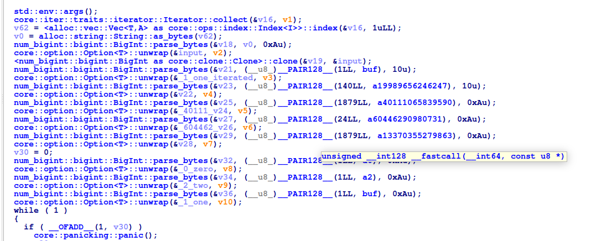

Speaking of Big Integers, we might know how regular integers are stored in memory, but how are Big Integers stored? To answer that question, we can just pull up (once again) our trusty GDB.

Put breakpoint on unwrap call, and we could see this

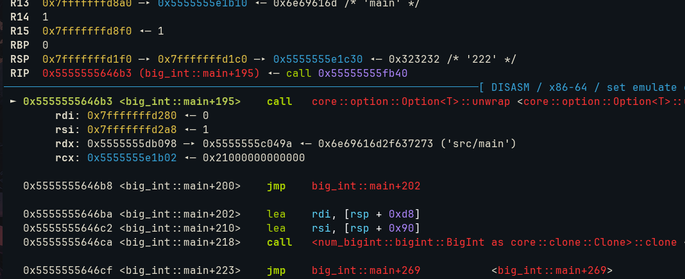

The RDI register holds the stack address of a struct, which itself contains a heap address.

```bash
pwndbg> x/gx 0x7fffffffd2a8
0x7fffffffd2a8: 0x0000000000000001
pwndbg>
0x7fffffffd2b0: 0x00005555555e1ce0
pwndbg>
0x7fffffffd2b8: 0x0000000000000001
```

After calling unwrap, the heap address will hold the value of our Big Integer. For a number larger than 8 bytes, it is stored across multiple consecutive 8-byte chunks in memory. For example, the Big Integer `18446744073709551616` or `0x10000000000000000` (hex) would be stored in little-endian format like this: 

```bash
pwndbg> x/2gx 0x00005555555e1ce0
0x5555555e1ce0: 0x0000000000000000      0x0000000000000001
```

But what does the binary actually do? It performs a loop that applies operations based on our input, sometimes it multiplies, sometimes it divides. To make things clearer, I simplified and rewrote the logic in Python:

```python
while True:
    tmp = 0
    v30 += 1
    if inp & 2 == 0:
        tmp += 2
    else:
        tmp += v26 + 2
    
    if inp & 1 == 0:
        # print(hex(v35), hex(tmp), 'MUL')
        v35 *= tmp
    else:
        # print(hex(v35), hex(tmp), 'DIV')
        v35 //= tmp


    t0 = v35 & v24
    t1 = t0 * v26
    v35 = v35 + t1

    if v30 == 231:
        break

    inp >>= 1
    inp >>= 1
```

The decompilation itself looked something like this : 

```rust
 while ( 1 )
  {
    if ( __OFADD__(1, v30) )
      core::panicking::panic();
    ++v30;
    num_bigint::bigint::BigInt::parse_bytes(&v38, (__u8_)__PAIR128__(1LL, a0), 0xAu);
    core::option::Option<T>::unwrap(&v37, v11);
    num_bigint::bigint::bits::<impl core::ops::bit::BitAnd<&num_bigint::bigint::BigInt> for &num_bigint::bigint::BigInt>::bitand(
      &v39,
      &input,
      &_2_two);
    v15 = <num_bigint::bigint::BigInt as core::cmp::PartialEq>::eq(&v39, &_0_zero);// check x & 2 == 0
    core::ptr::drop_in_place<num_bigint::bigint::BigInt>(&v39);
    if ( v15 )
    {
      num_bigint::bigint::addition::<impl core::ops::arith::Add<&num_bigint::bigint::BigInt> for &num_bigint::bigint::BigInt>::add(
        &v40,
        &_0_zero,
        &_2_two);
      core::ptr::drop_in_place<num_bigint::bigint::BigInt>(&v37);
      v37 = v40;
    }
    else                                        // if ODD
    {
      num_bigint::bigint::addition::<impl core::ops::arith::Add<&num_bigint::bigint::BigInt> for &num_bigint::bigint::BigInt>::add(
        &v41,
        &_604462_v26,
        &_2_two);
      core::ptr::drop_in_place<num_bigint::bigint::BigInt>(&v37);
      v37 = v41;
    }
    num_bigint::bigint::bits::<impl core::ops::bit::BitAnd<&num_bigint::bigint::BigInt> for &num_bigint::bigint::BigInt>::bitand(
      &v42,
      &input,
      &_1_one);
    v14 = <num_bigint::bigint::BigInt as core::cmp::PartialEq>::eq(&v42, &_0_zero);
    core::ptr::drop_in_place<num_bigint::bigint::BigInt>(&v42);
    if ( v14 )
    {
      num_bigint::bigint::multiplication::<impl core::ops::arith::Mul<&num_bigint::bigint::BigInt> for &num_bigint::bigint::BigInt>::mul(
        &v43,
        &_1_one_iterated,
        &v37);
      core::ptr::drop_in_place<num_bigint::bigint::BigInt>(&_1_one_iterated);
      _1_one_iterated = v43;
    }
    else
    {
      num_bigint::bigint::division::<impl core::ops::arith::Div<&num_bigint::bigint::BigInt> for &num_bigint::bigint::BigInt>::div(
        &v44,
        &_1_one_iterated,
        &v37);
      core::ptr::drop_in_place<num_bigint::bigint::BigInt>(&_1_one_iterated);
      _1_one_iterated = v44;
    }
    num_bigint::bigint::bits::<impl core::ops::bit::BitAnd<&num_bigint::bigint::BigInt> for &num_bigint::bigint::BigInt>::bitand(
      &v47,
      &_1_one_iterated,
      &_40111_v24);
    num_bigint::bigint::multiplication::<impl core::ops::arith::Mul<&num_bigint::bigint::BigInt> for num_bigint::bigint::BigInt>::mul(
      &v46,
      v12,
      &v47);
    num_bigint::bigint::addition::<impl core::ops::arith::Add<num_bigint::bigint::BigInt> for &num_bigint::bigint::BigInt>::add(
      &v45,
      &_1_one_iterated,
      v13);
    core::ptr::drop_in_place<num_bigint::bigint::BigInt>(&_1_one_iterated);
    _1_one_iterated = v45;
    if ( v30 == 231 )
      break;
    num_bigint::bigint::division::<impl core::ops::arith::Div<&num_bigint::bigint::BigInt> for &num_bigint::bigint::BigInt>::div(
      &v48,
      &input,
      &_2_two);
    core::ptr::drop_in_place<num_bigint::bigint::BigInt>(&input);
    input = v48;
    num_bigint::bigint::division::<impl core::ops::arith::Div<&num_bigint::bigint::BigInt> for &num_bigint::bigint::BigInt>::div(
      &v49,
      &input,
      &_2_two);
    core::ptr::drop_in_place<num_bigint::bigint::BigInt>(&input);
    input = v49;
    core::ptr::drop_in_place<num_bigint::bigint::BigInt>(&v37);
  }
```

Without the debug symbols, reversing Rust was an absolute disaster.

Our goal was to make this return True, of course. 
```rust
if ( core::cmp::impls::<impl core::cmp::PartialEq<&B> for &A>::eq(&p__1_one_iterated, &v51) )
```

v51 is this number :

```python
1337035527986336705440600066870122289331822342886611021245810790106708631004779447946382497323073453993313359496908718270827316913565898575703209599861969197407572168857751222835386539355861761700862957648204344641256023697334430570512710347431321005578140655200534444683201305664785839042866167879946606390851148335816616103782834297457672172186598144395816021406579017405574705694792560746000990190128539848166633507300866228267312875436468992638653237509385593977220839850613007106037816383421090599251908655632684030213987593078156505557018873402369999021688393036403416251120824692951902575897389349167790132031207280194021940268614873728749419526973350225826676852203623624717263760359725137631125739218760714150704490289335269721632454531575658794113276283869640856496874668633827305212225783736235957040037846940131286706071065109134168197353151363490740918074329594976065162080491082288592967491051010341384444230525133944285243897101248146155504542398181577946807870396517875372047448347514239995538307906686388562200404052460156393653484758864446586595524778015250525618410886624107466826461985333945889271634301014591707156160812849960759206117784473174980525775786445048069689126007922513844601517029524124338077347958682764513689852245486718407586997452284457840855289700311042341772643629747955838933897874259352006567256538760449109762518725532205647351210170544654984311823876962506857867952955510888424215691920806432234747977921844117735795613276770979423849075506345700701489732337196991919271613841762279952902711627713099200854928113698627491404778892830629376148674392676299643829147830178316196514473856781586672985886922393771151335928037145113670495822322891648284716775893926592111416315464268528978536216027185105363014208003075719773387805332908933232449201222594181192333923073415629172295545451082626319410597356312528742634808161448479110241189888
```

While `p__1_one_iterated` (v35 in python version) is just a variable I named, it actually represents the output of the while loop from earlier.

I wasn't very sure what that while loop was doing, until I started analyzing those Big Integers.

The hex representation of v51 looks like this : 

```python
0x800000000000000000000000000000000000000000000000000000000000000000000000000000000000000000000000000000000000000000000000000000000000000000000000000000000000000000000000000000000000000000000000000000000000000000000000000000000000000000000000000000000000000000000000000000000000000000000000000000000000000000000000000000000000000000000000000000000000000000000000000000000000000000000000000000000000000000000000000000000000000000000000000000000000000000000000000000000000000000000000000000000000000000000000000000000000000000000000000000000000000000000000000000000000000000000000000000000000000000000000000000000000000000000000000000000000000000000000000000000000000000000000000000000000000000000000000000000000000000000000000000000000000000000000000000000000000000000000000000000000000000000000000000000000000000000000000000000000000000000000000000000000000000000000000000000000000000000000000000000000000000000000000000000000000000000000000000000000000000000000000000000000000000000000000000000000000000000000000000000000000000000000000000000000000000000000000000000000000000000000000000000000000000000000000000000000000000000000000000000000000000000000000000000000000000000000000000000000000000000000000000000000000000000000000000000000000000000000000000000000000000000000000000000000000000000000000000000000000000000000000000000000000000000000000000000000000000000000000000000000000000000000000000000000000000000000000000000000000000000000000000000000000000000000000000000000000000000000000000000000000000000000000000000000000000000000000000000000000000000000
```

and v26 + 2 in hex looks like this : 

```python
0x80000000000000000000
```

Looking again at the while loop, we see that each iteration takes 2 bits of our input.

```python

...snip see above...

if inp & 2 == 0:
    tmp += 2
else:
    tmp += v26 + 2

if inp & 1 == 0:
    # print(hex(v35), hex(tmp), 'MUL')
    v35 *= tmp
else:
    # print(hex(v35), hex(tmp), 'DIV')
    v35 //= tmp

...snip see above...

inp >>= 1
inp >>= 1
```

So, if the input is `10` (binary), it will give v35, which initially is 1, it will be multiplied by v26 + 2. If the input is `00`, it will be multiplied by 2. But there's a catch after that, there's this block:

```python
t0 = v35 & v24
t1 = t0 * v26
v35 = v35 + t1
```

If the result of v35 & v24 is not zero, it will add more value to v35. However, we don't need that because when multiplied with v26 + 2, and with 2 itself, it will make v35 equal to v51. Adding another value will prevent v35 from being equal to v51, so we want to avoid v35 & v24 being non-zero at all costs.

So if you haven't already realized what kind of problem we're dealing with, perhaps it's time to look at the binary representation of this, let's look at the v24 (just some couple lsb) and v35 when we performing `10` : 

```python
0b1110001000001000001000001000001000101000100010100000100000101010001010000010000001111111111111111111111111111111111111111111111111111111111111111111111111111110
0b0000000000000000000000000000000000000000000000000000000000000000000000000000000010000000000000000000000000000000000000000000000000000000000000000000000000000000
```

If we input `10`, it will actually give us `v35 & v24 == 0`, so we just need to ensure that the bit we set doesn't end up in a position where there's already a 1. What a great way to hide maze challenge, that a-maze me.

## Let's end this

After realizing this was just a maze challenge, it became straightforward. I converted v24 into binary and to make it easier to solve, instead of dealing with a 1-dimensional maze, I turned it into a 2-dimensional maze and coded the solution [here](https://gist.github.com/UnoArroefy/3b2a392b696c4c7d8b10db7f029d2872).

Flag : `CJ{An0th3r_k1nD_0f_1nV151bl3_m4z3?_fd4cc05e4e8c0cfa55d5508b0d}`