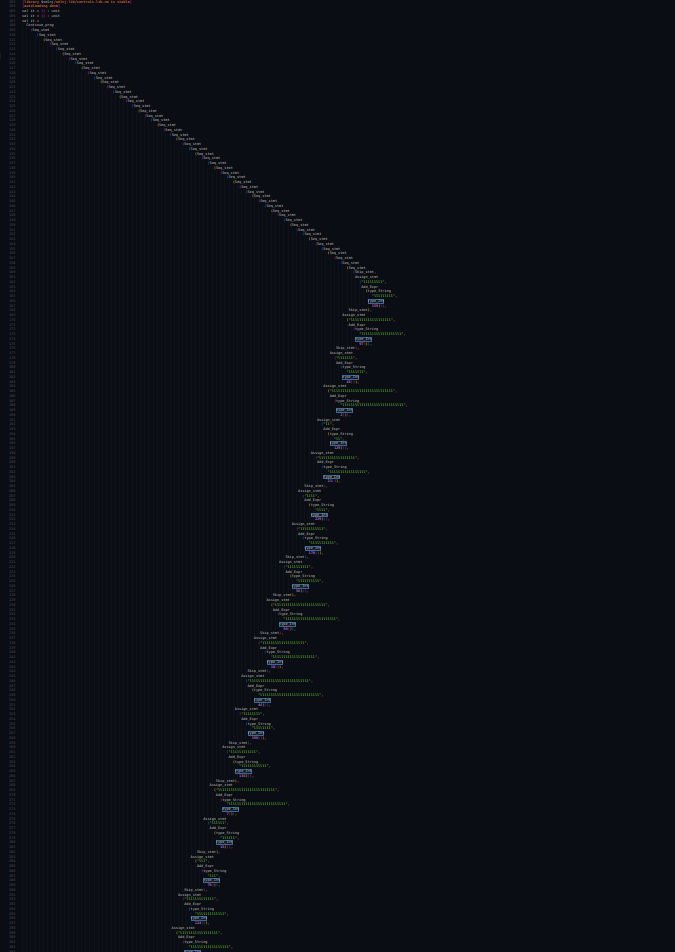

This week, I participated in TRX CTF 2025 by `TheRomanXpl0it`. I joined a bit late, thinking the CTF would run for two days, but it was actually one day CTF. 
I solved a challenge an hour after the competition ended, so I contributed 0 points to my team lol. But I had fun solving the challenge, so I decided to write a writeup for it.

## Initial Analysis

Given a file named `LLL.sml`, I found out that it's a Standard ML file. All the datatype and function names are named in a weird way, full of `l` and `ll` and `lll` and `llll` and so on. Maybe that's why the challenge is called `LLL`. Here's the full code:

```bash
open SMLofNJ.Cont;

datatype lllllllllllllllllllllllllllllll = llllllllllllllllllllllllllllllll of int | lllllllllllllllllllllllllllllllll of string | llllllllllllllllllllllllllllllllll of lllllllllllllllllllllllllllllll * lllllllllllllllllllllllllllllll | lllllllllllllllllllllllllllllllllll of lllllllllllllllllllllllllllllll * lllllllllllllllllllllllllllllll | llllllllllllllllllllllllllllllllllll of lllllllllllllllllllllllllllllll * lllllllllllllllllllllllllllllll | lllllllllllllllllllllllllllllllllllll of lllllllllllllllllllllllllllllll * lllllllllllllllllllllllllllllll;
datatype llllllllllllllllllllllllllllllllllllll = lllllllllllllllllllllllllllllllllllllll | llllllllllllllllllllllllllllllllllllllll | lllllllllllllllllllllllllllllllllllllllll of llllllllllllllllllllllllllllllllllllll * llllllllllllllllllllllllllllllllllllll | llllllllllllllllllllllllllllllllllllllllll of llllllllllllllllllllllllllllllllllllll * llllllllllllllllllllllllllllllllllllll | lllllllllllllllllllllllllllllllllllllllllll of llllllllllllllllllllllllllllllllllllll | llllllllllllllllllllllllllllllllllllllllllll of lllllllllllllllllllllllllllllll * lllllllllllllllllllllllllllllll | lllllllllllllllllllllllllllllllllllllllllllll of lllllllllllllllllllllllllllllll * lllllllllllllllllllllllllllllll | llllllllllllllllllllllllllllllllllllllllllllll of lllllllllllllllllllllllllllllll * lllllllllllllllllllllllllllllll;
datatype lllllllllllllllllllllllllllllllllllllllllllllll = llllllllllllllllllllllllllllllllllllllllllllllll | lllllllllllllllllllllllllllllllllllllllllllllllll of lllllllllllllllllllllllllllllllllllllllllllllll * lllllllllllllllllllllllllllllllllllllllllllllll | llllllllllllllllllllllllllllllllllllllllllllllllll of string * lllllllllllllllllllllllllllllll | lllllllllllllllllllllllllllllllllllllllllllllllllll of llllllllllllllllllllllllllllllllllllll * lllllllllllllllllllllllllllllllllllllllllllllll * lllllllllllllllllllllllllllllllllllllllllllllll | llllllllllllllllllllllllllllllllllllllllllllllllllll of llllllllllllllllllllllllllllllllllllll * lllllllllllllllllllllllllllllllllllllllllllllll | lllllllllllllllllllllllllllllllllllllllllllllllllllll | llllllllllllllllllllllllllllllllllllllllllllllllllllll of lllllllllllllllllllllllllllllllllllllllllllllll;
datatype lllllllllllllllllllllllllllllllllllllllllllllllllllllll = llllllllllllllllllllllllllllllllllllllllllllllllllllllll | lllllllllllllllllllllllllllllllllllllllllllllllllllllllll of lllllllllllllllllllllllllllllllllllllllllllllll * lllllllllllllllllllllllllllllllllllllllllllllllllllllll;

exception llllllllllllllllllllllllllllllllllllllllllllllllllllllllll;

fun lllllllllllllllllllllllllllllllllllllllllllllllllllllllllll(l: string, ll: (string * int) list): int =
	case ll of
		[] => raise llllllllllllllllllllllllllllllllllllllllllllllllllllllllll
		| (lll,llll) :: lllll =>
			if lll = l then
				llll
			else
				lllllllllllllllllllllllllllllllllllllllllllllllllllllllllll(l, lllll);


fun llllllllllllllllllllllllllllllllllllllllllllllllllllllllllll(l:(string * int) list, ll:lllllllllllllllllllllllllllllll):int = 
	case ll of
		llllllllllllllllllllllllllllllll lll => lll
		| lllllllllllllllllllllllllllllllll llll => lllllllllllllllllllllllllllllllllllllllllllllllllllllllllll(llll, l)
		| llllllllllllllllllllllllllllllllll (lllll, llllll) => llllllllllllllllllllllllllllllllllllllllllllllllllllllllllll(l, lllll) + llllllllllllllllllllllllllllllllllllllllllllllllllllllllllll(l, llllll)
		| lllllllllllllllllllllllllllllllllll (lllll, llllll) => llllllllllllllllllllllllllllllllllllllllllllllllllllllllllll(l, lllll) - llllllllllllllllllllllllllllllllllllllllllllllllllllllllllll(l, llllll)
		| llllllllllllllllllllllllllllllllllll (lllll, llllll) => llllllllllllllllllllllllllllllllllllllllllllllllllllllllllll(l, lllll) * llllllllllllllllllllllllllllllllllllllllllllllllllllllllllll(l, llllll)
		| lllllllllllllllllllllllllllllllllllll (lllll, llllll) => llllllllllllllllllllllllllllllllllllllllllllllllllllllllllll(l, lllll) div llllllllllllllllllllllllllllllllllllllllllllllllllllllllllll(l, llllll);


fun lllllllllllllllllllllllllllllllllllllllllllllllllllllllllllll(l:(string * int) list, ll:llllllllllllllllllllllllllllllllllllll):bool =
	case ll of
		lllllllllllllllllllllllllllllllllllllll => true 
		| llllllllllllllllllllllllllllllllllllllll => false
		| lllllllllllllllllllllllllllllllllllllllll (lll,llll) => lllllllllllllllllllllllllllllllllllllllllllllllllllllllllllll(l, lll) andalso lllllllllllllllllllllllllllllllllllllllllllllllllllllllllllll(l, llll)
		| llllllllllllllllllllllllllllllllllllllllll (lll,llll) => lllllllllllllllllllllllllllllllllllllllllllllllllllllllllllll(l, lll) orelse lllllllllllllllllllllllllllllllllllllllllllllllllllllllllllll(l, llll)
		| lllllllllllllllllllllllllllllllllllllllllll lll => not(lllllllllllllllllllllllllllllllllllllllllllllllllllllllllllll(l, lll))
		| llllllllllllllllllllllllllllllllllllllllllll (lll,llll) => llllllllllllllllllllllllllllllllllllllllllllllllllllllllllll(l, lll) = llllllllllllllllllllllllllllllllllllllllllllllllllllllllllll(l, llll)
		| lllllllllllllllllllllllllllllllllllllllllllll (lll,llll) => llllllllllllllllllllllllllllllllllllllllllllllllllllllllllll(l, lll) > llllllllllllllllllllllllllllllllllllllllllllllllllllllllllll(l, llll)
		| llllllllllllllllllllllllllllllllllllllllllllll (lll,llll) => llllllllllllllllllllllllllllllllllllllllllllllllllllllllllll(l, lll) < llllllllllllllllllllllllllllllllllllllllllllllllllllllllllll(l, llll);


fun llllllllllllllllllllllllllllllllllllllllllllllllllllllllllllll(l:(string * int) list, ll:lllllllllllllllllllllllllllllllllllllllllllllll):((string * int) list) = 
	case ll of
		llllllllllllllllllllllllllllllllllllllllllllllll => l
		| lllllllllllllllllllllllllllllllllllllllllllllllll (lll,llll) => llllllllllllllllllllllllllllllllllllllllllllllllllllllllllllll(llllllllllllllllllllllllllllllllllllllllllllllllllllllllllllll(l, lll), llll)
		| llllllllllllllllllllllllllllllllllllllllllllllllll (lllll, llllll) => (lllll, llllllllllllllllllllllllllllllllllllllllllllllllllllllllllll(l,llllll)) :: l
		| lllllllllllllllllllllllllllllllllllllllllllllllllll (lllllll, llllllll, lllllllll) => if lllllllllllllllllllllllllllllllllllllllllllllllllllllllllllll(l, lllllll) then llllllllllllllllllllllllllllllllllllllllllllllllllllllllllllll(l, llllllll) else llllllllllllllllllllllllllllllllllllllllllllllllllllllllllllll(l, lllllllll)
		| llllllllllllllllllllllllllllllllllllllllllllllllllll (lllllll, lll) => if lllllllllllllllllllllllllllllllllllllllllllllllllllllllllllll(l, lllllll) then llllllllllllllllllllllllllllllllllllllllllllllllllllllllllllll(l, lllllllllllllllllllllllllllllllllllllllllllllllll(lll, ll)) else l
		| llllllllllllllllllllllllllllllllllllllllllllllllllllll lll => llllllllllllllllllllllllllllllllllllllllllllllllllllllllllllll(l, lll)
		| lllllllllllllllllllllllllllllllllllllllllllllllllllll => l;


fun lllllllllllllllllllllllllllllllllllllllllllllllllllllllllllllll(l:(string * int) list, ll:lllllllllllllllllllllllllllllllllllllllllllllll, lll) =
	case ll of
		llllllllllllllllllllllllllllllllllllllllllllllll => throw lll (l, llllllllllllllllllllllllllllllllllllllllllllllll)
		| lllllllllllllllllllllllllllllllllllllllllllllllll (llll,lllll) => throw lll let 
			val (llllll, lllllll) = 
				callcc(fn llllllll => lllllllllllllllllllllllllllllllllllllllllllllllllllllllllllllll(l, llll, llllllll))
			in
				if lllllll <> llllllllllllllllllllllllllllllllllllllllllllllll then
					(llllll, lllllllllllllllllllllllllllllllllllllllllllllllll(lllllll, lllll))
				else
					(llllll, lllll)
			end
		| llllllllllllllllllllllllllllllllllllllllllllllllll (lllllllll, llllllllll) => throw lll ((lllllllll, llllllllllllllllllllllllllllllllllllllllllllllllllllllllllll(l,llllllllll)) :: l, llllllllllllllllllllllllllllllllllllllllllllllll)
		| lllllllllllllllllllllllllllllllllllllllllllllllllll (lllllllllll, llllllllllll, lllllllllllll) => if lllllllllllllllllllllllllllllllllllllllllllllllllllllllllllll(l, lllllllllll) then throw lll (l, llllllllllll) else throw lll (l, lllllllllllll)
		| llllllllllllllllllllllllllllllllllllllllllllllllllll (lllllllllll, llll) => if lllllllllllllllllllllllllllllllllllllllllllllllllllllllllllll(l, lllllllllll) then throw lll (l, lllllllllllllllllllllllllllllllllllllllllllllllll(llll, ll)) else throw lll (l, llllllllllllllllllllllllllllllllllllllllllllllll)
		| llllllllllllllllllllllllllllllllllllllllllllllllllllll llll => throw lll (llllllllllllllllllllllllllllllllllllllllllllllllllllllllllllll(l, llll), llllllllllllllllllllllllllllllllllllllllllllllll)
		| lllllllllllllllllllllllllllllllllllllllllllllllllllll => throw lll (l, ll);

fun llllllllllllllllllllllllllllllllllllllllllllllllllllllllllllllll(l:lllllllllllllllllllllllllllllllllllllllllllllllllllllll): bool = 
	case l of
		llllllllllllllllllllllllllllllllllllllllllllllllllllllll => true
		| lllllllllllllllllllllllllllllllllllllllllllllllllllllllll (ll, lll) => (ll = llllllllllllllllllllllllllllllllllllllllllllllll) andalso llllllllllllllllllllllllllllllllllllllllllllllllllllllllllllllll lll;


fun lllllllllllllllllllllllllllllllllllllllllllllllllllllllllllllllll(l:lllllllllllllllllllllllllllllllllllllllllllllllllllllll): bool =
	case l of
		llllllllllllllllllllllllllllllllllllllllllllllllllllllll => true
		| lllllllllllllllllllllllllllllllllllllllllllllllllllllllll (ll, lll) => (
			case ll of
				llllllllllllllllllllllllllllllllllllllllllllllll => false
				| lllllllllllllllllllllllllllllllllllllllllllllllll (llll,lllll) => lllllllllllllllllllllllllllllllllllllllllllllllllllllllllllllllll(lllllllllllllllllllllllllllllllllllllllllllllllllllllllll(llll, llllllllllllllllllllllllllllllllllllllllllllllllllllllll))
				| llllllllllllllllllllllllllllllllllllllllllllllllll (llllll, lllllll) => false
				| lllllllllllllllllllllllllllllllllllllllllllllllllll (llllllll, l, lllllllll) => false
				| llllllllllllllllllllllllllllllllllllllllllllllllllll (llllllll, llll) => false
				| llllllllllllllllllllllllllllllllllllllllllllllllllllll llll => false
				| lllllllllllllllllllllllllllllllllllllllllllllllllllll => true
			) andalso lllllllllllllllllllllllllllllllllllllllllllllllllllllllllllllllll lll;


fun llllllllllllllllllllllllllllllllllllllllllllllllllllllllllllllllll(l:lllllllllllllllllllllllllllllllllllllllllllllll):lllllllllllllllllllllllllllllllllllllllllllllll = 
	case l of
		lllllllllllllllllllllllllllllllllllllllllllllllllllll => llllllllllllllllllllllllllllllllllllllllllllllll
		| lllllllllllllllllllllllllllllllllllllllllllllllll (ll,lll) => lllllllllllllllllllllllllllllllllllllllllllllllll(llllllllllllllllllllllllllllllllllllllllllllllllllllllllllllllllll ll, lll);


fun lllllllllllllllllllllllllllllllllllllllllllllllllllllllllllllllllll(l:lllllllllllllllllllllllllllllllllllllllllllllllllllllll):lllllllllllllllllllllllllllllllllllllllllllllllllllllll = 
	case l of 
		llllllllllllllllllllllllllllllllllllllllllllllllllllllll => llllllllllllllllllllllllllllllllllllllllllllllllllllllll
		| lllllllllllllllllllllllllllllllllllllllllllllllllllllllll (ll, lll) => lllllllllllllllllllllllllllllllllllllllllllllllllllllllll(llllllllllllllllllllllllllllllllllllllllllllllllllllllllllllllllll ll, lllllllllllllllllllllllllllllllllllllllllllllllllllllllllllllllllll lll)


fun llllllllllllllllllllllllllllllllllllllllllllllllllllllllllllllllllll(l:(string * int) list, ll:lllllllllllllllllllllllllllllllllllllllllllllllllllllll) = 
	case ll of 
		llllllllllllllllllllllllllllllllllllllllllllllllllllllll => (l, llllllllllllllllllllllllllllllllllllllllllllllllllllllll)
		| lllllllllllllllllllllllllllllllllllllllllllllllllllllllll(lll, llll) => 
			let
				val (lllll, llllll) = callcc(fn lllllll => lllllllllllllllllllllllllllllllllllllllllllllllllllllllllllllll(l, lll, lllllll))
				val (llllllll, lllllllll) = llllllllllllllllllllllllllllllllllllllllllllllllllllllllllllllllllll(lllll, llll)
			in
				(llllllll, lllllllllllllllllllllllllllllllllllllllllllllllllllllllll(llllll, lllllllll))
			end;


fun lllllllllllllllllllllllllllllllllllllllllllllllllllllllllllllllllllll(l:(string * int) list, ll: lllllllllllllllllllllllllllllllllllllllllllllllllllllll): ((string * int) list) =
	case ll of 
		llllllllllllllllllllllllllllllllllllllllllllllllllllllll => l
		| lllllllllllllllllllllllllllllllllllllllllllllllllllllllll (lll, llll) => 
			let
				val (lllll, llllll) = llllllllllllllllllllllllllllllllllllllllllllllllllllllllllllllllllll(l, lllllllllllllllllllllllllllllllllllllllllllllllllllllllll(lll, llll))
			in
				if lllllllllllllllllllllllllllllllllllllllllllllllllllllllllllllllll llllll then
					lllllllllllllllllllllllllllllllllllllllllllllllllllllllllllllllllllll(lllll, lllllllllllllllllllllllllllllllllllllllllllllllllllllllllllllllllll llllll)
				else
					if not(llllllllllllllllllllllllllllllllllllllllllllllllllllllllllllllll llllll) then
						lllllllllllllllllllllllllllllllllllllllllllllllllllllllllllllllllllll(lllll, llllll)
					else
						lllll
			end;


fun llllllllllllllllllllllllllllllllllllllllllllllllllllllllllllllllllllll(l: int): string =
	if l <= 0 then ""
	else "l" ^ llllllllllllllllllllllllllllllllllllllllllllllllllllllllllllllllllllll (l - 1)


val lllll = 29;


fun lllllllllllllllllllllllllllllllllllllllllllllllllllllllllllllllllllllll(l: string) =
	let
		val ll = String.size l
	in
		if ll = lllll then
			let
				val lll = Array.array (lllll + 1, ("", 0)) 
				fun llll llllll =
					if llllll < lllll then
						(Array.update (lll, llllll, ((llllllllllllllllllllllllllllllllllllllllllllllllllllllllllllllllllllll (llllll+1)), Char.ord (String.sub (l, llllll))));
						 llll (llllll + 1))
					else if llllll = lllll then
						(Array.update (lll, llllll, ("llllllllllllllllllllllllllllll", 1));
						 llll (llllll + 1))
					else
						lll
				fun lllllll lll = Array.foldr (op ::) [] lll
			in
				lllllll (llll 0)
			end
		else
			raise Fail "Flag length mismatch"
	end;


fun llllllllllllllllllllllllllllllllllllllllllllllllllllllllllllllllllllllll(llll:(string * int) list) =
	let
		val llllllllllllllllllllllllllllll = lllllllllllllllllllllllllllllllllllllllllllllllllllllllllll("llllllllllllllllllllllllllllll", llll)
	in
		if llllllllllllllllllllllllllllll = 1 then
			print "Correct!\n"
		else
			print "Skill Issue!\n"
	end;


val l = Option.getOpt (TextIO.inputLine TextIO.stdIn, "NONE\n");
val ll = lllllllllllllllllllllllllllllllllllllllllllllllllllllllllllllllllllllll l;
val lll = lllllllllllllllllllllllllllllllllllllllllllllllllllllllll(lllllllllllllllllllllllllllllllllllllllllllllllll(lllllllllllllllllllllllllllllllllllllllllllllllll(lllllllllllllllllllllllllllllllllllllllllllllllll(lllllllllllllllllllllllllllllllllllllllllllllllll(lllllllllllllllllllllllllllllllllllllllllllllllll(lllllllllllllllllllllllllllllllllllllllllllllllll(lllllllllllllllllllllllllllllllllllllllllllllllll(lllllllllllllllllllllllllllllllllllllllllllllllll(lllllllllllllllllllllllllllllllllllllllllllllllll(lllllllllllllllllllllllllllllllllllllllllllllllll(lllllllllllllllllllllllllllllllllllllllllllllllll(lllllllllllllllllllllllllllllllllllllllllllllllll(lllllllllllllllllllllllllllllllllllllllllllllllll(lllllllllllllllllllllllllllllllllllllllllllllllll(lllllllllllllllllllllllllllllllllllllllllllllllll(lllllllllllllllllllllllllllllllllllllllllllllllll(lllllllllllllllllllllllllllllllllllllllllllllllll(lllllllllllllllllllllllllllllllllllllllllllllllll(lllllllllllllllllllllllllllllllllllllllllllllllll(lllllllllllllllllllllllllllllllllllllllllllllllll(lllllllllllllllllllllllllllllllllllllllllllllllll(lllllllllllllllllllllllllllllllllllllllllllllllll(lllllllllllllllllllllllllllllllllllllllllllllllll(lllllllllllllllllllllllllllllllllllllllllllllllll(lllllllllllllllllllllllllllllllllllllllllllllllll(lllllllllllllllllllllllllllllllllllllllllllllllll(lllllllllllllllllllllllllllllllllllllllllllllllll(lllllllllllllllllllllllllllllllllllllllllllllllll(lllllllllllllllllllllllllllllllllllllllllllllllll(lllllllllllllllllllllllllllllllllllllllllllllllll(lllllllllllllllllllllllllllllllllllllllllllllllll(lllllllllllllllllllllllllllllllllllllllllllllllll(lllllllllllllllllllllllllllllllllllllllllllllllll(lllllllllllllllllllllllllllllllllllllllllllllllll(lllllllllllllllllllllllllllllllllllllllllllllllll(lllllllllllllllllllllllllllllllllllllllllllllllll(lllllllllllllllllllllllllllllllllllllllllllllllll(lllllllllllllllllllllllllllllllllllllllllllllllll(lllllllllllllllllllllllllllllllllllllllllllllllll(lllllllllllllllllllllllllllllllllllllllllllllllll(lllllllllllllllllllllllllllllllllllllllllllllllll(lllllllllllllllllllllllllllllllllllllllllllllllll(lllllllllllllllllllllllllllllllllllllllllllllllll(lllllllllllllllllllllllllllllllllllllllllllllllll(lllllllllllllllllllllllllllllllllllllllllllllllll(lllllllllllllllllllllllllllllllllllllllllllllllll(lllllllllllllllllllllllllllllllllllllllllllllllll(lllllllllllllllllllllllllllllllllllllllllllllllll(lllllllllllllllllllllllllllllllllllllllllllllllll(lllllllllllllllllllllllllllllllllllllllllllllllll(lllllllllllllllllllllllllllllllllllllllllllllllll(llllllllllllllllllllllllllllllllllllllllllllllll, llllllllllllllllllllllllllllllllllllllllllllllllll("lllllllll", llllllllllllllllllllllllllllllllll(lllllllllllllllllllllllllllllllll "lllllllll", llllllllllllllllllllllllllllllll 159))), llllllllllllllllllllllllllllllllllllllllllllllll), llllllllllllllllllllllllllllllllllllllllllllllllll("lllllllllllllllllll", llllllllllllllllllllllllllllllllll(lllllllllllllllllllllllllllllllll "lllllllllllllllllll", llllllllllllllllllllllllllllllll 97))), llllllllllllllllllllllllllllllllllllllllllllllll), llllllllllllllllllllllllllllllllllllllllllllllllll("lllllll", llllllllllllllllllllllllllllllllll(lllllllllllllllllllllllllllllllll "lllllll", llllllllllllllllllllllllllllllll 45))), llllllllllllllllllllllllllllllllllllllllllllllllll("lllllllllllllllllllllllllllll", llllllllllllllllllllllllllllllllll(lllllllllllllllllllllllllllllllll "lllllllllllllllllllllllllllll", llllllllllllllllllllllllllllllll 2))), llllllllllllllllllllllllllllllllllllllllllllllllll("ll", llllllllllllllllllllllllllllllllll(lllllllllllllllllllllllllllllllll "ll", llllllllllllllllllllllllllllllll 129))), llllllllllllllllllllllllllllllllllllllllllllllllll("lllllllllllllllll", llllllllllllllllllllllllllllllllll(lllllllllllllllllllllllllllllllll "lllllllllllllllll", llllllllllllllllllllllllllllllll 21))), llllllllllllllllllllllllllllllllllllllllllllllll), llllllllllllllllllllllllllllllllllllllllllllllllll("llll", llllllllllllllllllllllllllllllllll(lllllllllllllllllllllllllllllllll "llll", llllllllllllllllllllllllllllllll 229))), llllllllllllllllllllllllllllllllllllllllllllllllll("lllllllllll", llllllllllllllllllllllllllllllllll(lllllllllllllllllllllllllllllllll "lllllllllll", llllllllllllllllllllllllllllllll 170))), llllllllllllllllllllllllllllllllllllllllllllllll), llllllllllllllllllllllllllllllllllllllllllllllllll("llllllllll", llllllllllllllllllllllllllllllllll(lllllllllllllllllllllllllllllllll "llllllllll", llllllllllllllllllllllllllllllll 56))), llllllllllllllllllllllllllllllllllllllllllllllll), llllllllllllllllllllllllllllllllllllllllllllllllll("llllllllllllllllllllllll", llllllllllllllllllllllllllllllllll(lllllllllllllllllllllllllllllllll "llllllllllllllllllllllll", llllllllllllllllllllllllllllllll 90))), llllllllllllllllllllllllllllllllllllllllllllllll), llllllllllllllllllllllllllllllllllllllllllllllllll("llllllllllllllllllll", llllllllllllllllllllllllllllllllll(lllllllllllllllllllllllllllllllll "llllllllllllllllllll", llllllllllllllllllllllllllllllll 18))), llllllllllllllllllllllllllllllllllllllllllllllll), llllllllllllllllllllllllllllllllllllllllllllllllll("llllllllllllllllllllllllllll", llllllllllllllllllllllllllllllllll(lllllllllllllllllllllllllllllllll "llllllllllllllllllllllllllll", llllllllllllllllllllllllllllllll 44))), llllllllllllllllllllllllllllllllllllllllllllllllll("llllllll", llllllllllllllllllllllllllllllllll(lllllllllllllllllllllllllllllllll "llllllll", llllllllllllllllllllllllllllllll 198))), llllllllllllllllllllllllllllllllllllllllllllllll), llllllllllllllllllllllllllllllllllllllllllllllllll("llllllllllll", llllllllllllllllllllllllllllllllll(lllllllllllllllllllllllllllllllll "llllllllllll", llllllllllllllllllllllllllllllll 134))), llllllllllllllllllllllllllllllllllllllllllllllll), llllllllllllllllllllllllllllllllllllllllllllllllll("lllllllllllllllllllllllllll", llllllllllllllllllllllllllllllllll(lllllllllllllllllllllllllllllllll "lllllllllllllllllllllllllll", llllllllllllllllllllllllllllllll 7))), llllllllllllllllllllllllllllllllllllllllllllllllll("llllll", llllllllllllllllllllllllllllllllll(lllllllllllllllllllllllllllllllll "llllll", llllllllllllllllllllllllllllllll 16))), llllllllllllllllllllllllllllllllllllllllllllllll), llllllllllllllllllllllllllllllllllllllllllllllllll("lll", llllllllllllllllllllllllllllllllll(lllllllllllllllllllllllllllllllll "lll", llllllllllllllllllllllllllllllll 76))), llllllllllllllllllllllllllllllllllllllllllllllll), llllllllllllllllllllllllllllllllllllllllllllllllll("lllllllllllll", llllllllllllllllllllllllllllllllll(lllllllllllllllllllllllllllllllll "lllllllllllll", llllllllllllllllllllllllllllllll 124))), llllllllllllllllllllllllllllllllllllllllllllllllll("llllllllllllllllll", llllllllllllllllllllllllllllllllll(lllllllllllllllllllllllllllllllll "llllllllllllllllll", llllllllllllllllllllllllllllllll 124))), llllllllllllllllllllllllllllllllllllllllllllllll), llllllllllllllllllllllllllllllllllllllllllllllllll("llllllllllllllll", llllllllllllllllllllllllllllllllll(lllllllllllllllllllllllllllllllll "llllllllllllllll", llllllllllllllllllllllllllllllll 44))), llllllllllllllllllllllllllllllllllllllllllllllll), llllllllllllllllllllllllllllllllllllllllllllllllll("lllll", llllllllllllllllllllllllllllllllll(lllllllllllllllllllllllllllllllll "lllll", llllllllllllllllllllllllllllllll 181))), llllllllllllllllllllllllllllllllllllllllllllllllll("llllllllllllll", llllllllllllllllllllllllllllllllll(lllllllllllllllllllllllllllllllll "llllllllllllll", llllllllllllllllllllllllllllllll 64))), llllllllllllllllllllllllllllllllllllllllllllllll), llllllllllllllllllllllllllllllllllllllllllllllllll("lllllllllllllllllllllll", llllllllllllllllllllllllllllllllll(lllllllllllllllllllllllllllllllll "lllllllllllllllllllllll", llllllllllllllllllllllllllllllll 133))), llllllllllllllllllllllllllllllllllllllllllllllll), llllllllllllllllllllllllllllllllllllllllllllllllll("l", llllllllllllllllllllllllllllllllll(lllllllllllllllllllllllllllllllll "l", llllllllllllllllllllllllllllllll 138))), llllllllllllllllllllllllllllllllllllllllllllllll), llllllllllllllllllllllllllllllllllllllllllllllllll("llllllllllllllllllllllllll", llllllllllllllllllllllllllllllllll(lllllllllllllllllllllllllllllllll "llllllllllllllllllllllllll", llllllllllllllllllllllllllllllll 175))), llllllllllllllllllllllllllllllllllllllllllllllll), llllllllllllllllllllllllllllllllllllllllllllllllll("lllllllllllllllllllllllll", llllllllllllllllllllllllllllllllll(lllllllllllllllllllllllllllllllll "lllllllllllllllllllllllll", llllllllllllllllllllllllllllllll 157))), llllllllllllllllllllllllllllllllllllllllllllllll), llllllllllllllllllllllllllllllllllllllllllllllllll("lllllllllllllllllllll", llllllllllllllllllllllllllllllllll(lllllllllllllllllllllllllllllllll "lllllllllllllllllllll", llllllllllllllllllllllllllllllll 160))), llllllllllllllllllllllllllllllllllllllllllllllll), llllllllllllllllllllllllllllllllllllllllllllllllll("lllllllllllllll", llllllllllllllllllllllllllllllllll(lllllllllllllllllllllllllllllllll "lllllllllllllll", llllllllllllllllllllllllllllllll 167))), llllllllllllllllllllllllllllllllllllllllllllllllll("llllllllllllllllllllll", llllllllllllllllllllllllllllllllll(lllllllllllllllllllllllllllllllll "llllllllllllllllllllll", llllllllllllllllllllllllllllllll 19))), lllllllllllllllllllllllllllllllllllllllllllllllllllll), lllllllllllllllllllllllllllllllllllllllllllllllllllll), lllllllllllllllllllllllllllllllllllllllllllllllllllll), lllllllllllllllllllllllllllllllllllllllllllllllllllllllll(lllllllllllllllllllllllllllllllllllllllllllllllll(lllllllllllllllllllllllllllllllllllllllllllllllll(lllllllllllllllllllllllllllllllllllllllllllllllll(lllllllllllllllllllllllllllllllllllllllllllllllllllll, llllllllllllllllllllllllllllllllllllllllllllllllllllll(lllllllllllllllllllllllllllllllllllllllllllllllll(lllllllllllllllllllllllllllllllllllllllllllllllll(lllllllllllllllllllllllllllllllllllllllllllllllll(lllllllllllllllllllllllllllllllllllllllllllllllll(lllllllllllllllllllllllllllllllllllllllllllllllll(lllllllllllllllllllllllllllllllllllllllllllllllll(lllllllllllllllllllllllllllllllllllllllllllllllll(lllllllllllllllllllllllllllllllllllllllllllllllll(lllllllllllllllllllllllllllllllllllllllllllllllll(lllllllllllllllllllllllllllllllllllllllllllllllll(lllllllllllllllllllllllllllllllllllllllllllllllll(lllllllllllllllllllllllllllllllllllllllllllllllll(lllllllllllllllllllllllllllllllllllllllllllllllll(lllllllllllllllllllllllllllllllllllllllllllllllll(lllllllllllllllllllllllllllllllllllllllllllllllll(lllllllllllllllllllllllllllllllllllllllllllllllll(lllllllllllllllllllllllllllllllllllllllllllllllll(lllllllllllllllllllllllllllllllllllllllllllllllll(lllllllllllllllllllllllllllllllllllllllllllllllll(lllllllllllllllllllllllllllllllllllllllllllllllll(lllllllllllllllllllllllllllllllllllllllllllllllll(lllllllllllllllllllllllllllllllllllllllllllllllll(lllllllllllllllllllllllllllllllllllllllllllllllll(lllllllllllllllllllllllllllllllllllllllllllllllll(lllllllllllllllllllllllllllllllllllllllllllllllll(lllllllllllllllllllllllllllllllllllllllllllllllll(lllllllllllllllllllllllllllllllllllllllllllllllll(lllllllllllllllllllllllllllllllllllllllllllllllll(lllllllllllllllllllllllllllllllllllllllllllllllll(lllllllllllllllllllllllllllllllllllllllllllllllll(lllllllllllllllllllllllllllllllllllllllllllllllll(lllllllllllllllllllllllllllllllllllllllllllllllll(lllllllllllllllllllllllllllllllllllllllllllllllll(lllllllllllllllllllllllllllllllllllllllllllllllll(lllllllllllllllllllllllllllllllllllllllllllllllll(lllllllllllllllllllllllllllllllllllllllllllllllll(lllllllllllllllllllllllllllllllllllllllllllllllll(lllllllllllllllllllllllllllllllllllllllllllllllll(lllllllllllllllllllllllllllllllllllllllllllllllll(lllllllllllllllllllllllllllllllllllllllllllllllll(lllllllllllllllllllllllllllllllllllllllllllllllll(lllllllllllllllllllllllllllllllllllllllllllllllll(lllllllllllllllllllllllllllllllllllllllllllllllll(lllllllllllllllllllllllllllllllllllllllllllllllll(lllllllllllllllllllllllllllllllllllllllllllllllll(lllllllllllllllllllllllllllllllllllllllllllllllll(lllllllllllllllllllllllllllllllllllllllllllllllll(llllllllllllllllllllllllllllllllllllllllllllllllll("llllllllllllllllllllll", llllllllllllllllllllllllllllllllllll(lllllllllllllllllllllllllllllllll "llllllllllllllllllllll", llllllllllllllllllllllllllllllll 8)), llllllllllllllllllllllllllllllllllllllllllllllll), llllllllllllllllllllllllllllllllllllllllllllllllll("llllll", llllllllllllllllllllllllllllllllllll(lllllllllllllllllllllllllllllllll "llllll", llllllllllllllllllllllllllllllll 6))), llllllllllllllllllllllllllllllllllllllllllllllll), llllllllllllllllllllllllllllllllllllllllllllllllll("lllllllllllllllllllllll", llllllllllllllllllllllllllllllllllll(lllllllllllllllllllllllllllllllll "lllllllllllllllllllllll", llllllllllllllllllllllllllllllll 6))), llllllllllllllllllllllllllllllllllllllllllllllllll("llll", llllllllllllllllllllllllllllllllllll(lllllllllllllllllllllllllllllllll "llll", llllllllllllllllllllllllllllllll 8))), llllllllllllllllllllllllllllllllllllllllllllllll), llllllllllllllllllllllllllllllllllllllllllllllllll("llllllllll", llllllllllllllllllllllllllllllllllll(lllllllllllllllllllllllllllllllll "llllllllll", llllllllllllllllllllllllllllllll 2))), llllllllllllllllllllllllllllllllllllllllllllllllll("lllllllllllllllllllllllllllll", llllllllllllllllllllllllllllllllllll(lllllllllllllllllllllllllllllllll "lllllllllllllllllllllllllllll", llllllllllllllllllllllllllllllll 5))), llllllllllllllllllllllllllllllllllllllllllllllll), llllllllllllllllllllllllllllllllllllllllllllllllll("lllllllllllllllllllllllll", llllllllllllllllllllllllllllllllllll(lllllllllllllllllllllllllllllllll "lllllllllllllllllllllllll", llllllllllllllllllllllllllllllll 5))), llllllllllllllllllllllllllllllllllllllllllllllllll("llllllllllllll", llllllllllllllllllllllllllllllllllll(lllllllllllllllllllllllllllllllll "llllllllllllll", llllllllllllllllllllllllllllllll 5))), llllllllllllllllllllllllllllllllllllllllllllllllll("lllll", llllllllllllllllllllllllllllllllllll(lllllllllllllllllllllllllllllllll "lllll", llllllllllllllllllllllllllllllll 6))), llllllllllllllllllllllllllllllllllllllllllllllll), llllllllllllllllllllllllllllllllllllllllllllllllll("llllllll", llllllllllllllllllllllllllllllllllll(lllllllllllllllllllllllllllllllll "llllllll", llllllllllllllllllllllllllllllll 6))), llllllllllllllllllllllllllllllllllllllllllllllllll("lll", llllllllllllllllllllllllllllllllllll(lllllllllllllllllllllllllllllllll "lll", llllllllllllllllllllllllllllllll 9))), llllllllllllllllllllllllllllllllllllllllllllllll), llllllllllllllllllllllllllllllllllllllllllllllllll("lllllllllllllllllllll", llllllllllllllllllllllllllllllllllll(lllllllllllllllllllllllllllllllll "lllllllllllllllllllll", llllllllllllllllllllllllllllllll 8))), llllllllllllllllllllllllllllllllllllllllllllllllll("l", llllllllllllllllllllllllllllllllllll(lllllllllllllllllllllllllllllllll "l", llllllllllllllllllllllllllllllll 3))), llllllllllllllllllllllllllllllllllllllllllllllll), llllllllllllllllllllllllllllllllllllllllllllllllll("lllllllllllllllll", llllllllllllllllllllllllllllllllllll(lllllllllllllllllllllllllllllllll "lllllllllllllllll", llllllllllllllllllllllllllllllll 5))), llllllllllllllllllllllllllllllllllllllllllllllllll("llllllllllllllllllllllll", llllllllllllllllllllllllllllllllllll(lllllllllllllllllllllllllllllllll "llllllllllllllllllllllll", llllllllllllllllllllllllllllllll 4))), llllllllllllllllllllllllllllllllllllllllllllllllll("lllllllllllllllllll", llllllllllllllllllllllllllllllllllll(lllllllllllllllllllllllllllllllll "lllllllllllllllllll", llllllllllllllllllllllllllllllll 7))), llllllllllllllllllllllllllllllllllllllllllllllll), llllllllllllllllllllllllllllllllllllllllllllllllll("llllllllllllllllllllllllll", llllllllllllllllllllllllllllllllllll(lllllllllllllllllllllllllllllllll "llllllllllllllllllllllllll", llllllllllllllllllllllllllllllll 9))), llllllllllllllllllllllllllllllllllllllllllllllll), llllllllllllllllllllllllllllllllllllllllllllllllll("lllllll", llllllllllllllllllllllllllllllllllll(lllllllllllllllllllllllllllllllll "lllllll", llllllllllllllllllllllllllllllll 4))), llllllllllllllllllllllllllllllllllllllllllllllll), llllllllllllllllllllllllllllllllllllllllllllllllll("llllllllllllllll", llllllllllllllllllllllllllllllllllll(lllllllllllllllllllllllllllllllll "llllllllllllllll", llllllllllllllllllllllllllllllll 9))), llllllllllllllllllllllllllllllllllllllllllllllll), llllllllllllllllllllllllllllllllllllllllllllllllll("llllllllllllllllllll", llllllllllllllllllllllllllllllllllll(lllllllllllllllllllllllllllllllll "llllllllllllllllllll", llllllllllllllllllllllllllllllll 9))), llllllllllllllllllllllllllllllllllllllllllllllll), llllllllllllllllllllllllllllllllllllllllllllllllll("llllllllllllllllllllllllllll", llllllllllllllllllllllllllllllllllll(lllllllllllllllllllllllllllllllll "llllllllllllllllllllllllllll", llllllllllllllllllllllllllllllll 9))), llllllllllllllllllllllllllllllllllllllllllllllllll("lllllllllllll", llllllllllllllllllllllllllllllllllll(lllllllllllllllllllllllllllllllll "lllllllllllll", llllllllllllllllllllllllllllllll 4))), llllllllllllllllllllllllllllllllllllllllllllllllll("ll", llllllllllllllllllllllllllllllllllll(lllllllllllllllllllllllllllllllll "ll", llllllllllllllllllllllllllllllll 9))), llllllllllllllllllllllllllllllllllllllllllllllll), llllllllllllllllllllllllllllllllllllllllllllllllll("lllllllllll", llllllllllllllllllllllllllllllllllll(lllllllllllllllllllllllllllllllll "lllllllllll", llllllllllllllllllllllllllllllll 7))), llllllllllllllllllllllllllllllllllllllllllllllll), llllllllllllllllllllllllllllllllllllllllllllllllll("llllllllllll", llllllllllllllllllllllllllllllllllll(lllllllllllllllllllllllllllllllll "llllllllllll", llllllllllllllllllllllllllllllll 3))), llllllllllllllllllllllllllllllllllllllllllllllll), llllllllllllllllllllllllllllllllllllllllllllllllll("lllllllll", llllllllllllllllllllllllllllllllllll(lllllllllllllllllllllllllllllllll "lllllllll", llllllllllllllllllllllllllllllll 5))), llllllllllllllllllllllllllllllllllllllllllllllll), llllllllllllllllllllllllllllllllllllllllllllllllll("llllllllllllllllll", llllllllllllllllllllllllllllllllllll(lllllllllllllllllllllllllllllllll "llllllllllllllllll", llllllllllllllllllllllllllllllll 3))), llllllllllllllllllllllllllllllllllllllllllllllll), llllllllllllllllllllllllllllllllllllllllllllllllll("lllllllllllllll", llllllllllllllllllllllllllllllllllll(lllllllllllllllllllllllllllllllll "lllllllllllllll", llllllllllllllllllllllllllllllll 8))), llllllllllllllllllllllllllllllllllllllllllllllll), llllllllllllllllllllllllllllllllllllllllllllllllll("lllllllllllllllllllllllllll", llllllllllllllllllllllllllllllllllll(lllllllllllllllllllllllllllllllll "lllllllllllllllllllllllllll", llllllllllllllllllllllllllllllll 10))), llllllllllllllllllllllllllllllllllllllllllllllll))), lllllllllllllllllllllllllllllllllllllllllllllllllllll), lllllllllllllllllllllllllllllllllllllllllllllllllllll), lllllllllllllllllllllllllllllllllllllllllllllllllllllllll(lllllllllllllllllllllllllllllllllllllllllllllllll(lllllllllllllllllllllllllllllllllllllllllllllllll(lllllllllllllllllllllllllllllllllllllllllllllllll(lllllllllllllllllllllllllllllllllllllllllllllllll(lllllllllllllllllllllllllllllllllllllllllllllllll(lllllllllllllllllllllllllllllllllllllllllllllllll(lllllllllllllllllllllllllllllllllllllllllllllllll(lllllllllllllllllllllllllllllllllllllllllllllllll(lllllllllllllllllllllllllllllllllllllllllllllllll(lllllllllllllllllllllllllllllllllllllllllllllllll(lllllllllllllllllllllllllllllllllllllllllllllllll(lllllllllllllllllllllllllllllllllllllllllllllllll(lllllllllllllllllllllllllllllllllllllllllllllllll(lllllllllllllllllllllllllllllllllllllllllllllllll(lllllllllllllllllllllllllllllllllllllllllllllllll(lllllllllllllllllllllllllllllllllllllllllllllllll(lllllllllllllllllllllllllllllllllllllllllllllllll(lllllllllllllllllllllllllllllllllllllllllllllllll(lllllllllllllllllllllllllllllllllllllllllllllllll(lllllllllllllllllllllllllllllllllllllllllllllllll(lllllllllllllllllllllllllllllllllllllllllllllllll(lllllllllllllllllllllllllllllllllllllllllllllllll(lllllllllllllllllllllllllllllllllllllllllllllllll(lllllllllllllllllllllllllllllllllllllllllllllllll(lllllllllllllllllllllllllllllllllllllllllllllllll(lllllllllllllllllllllllllllllllllllllllllllllllll(lllllllllllllllllllllllllllllllllllllllllllllllll(lllllllllllllllllllllllllllllllllllllllllllllllll(lllllllllllllllllllllllllllllllllllllllllllllllll(lllllllllllllllllllllllllllllllllllllllllllllllll(lllllllllllllllllllllllllllllllllllllllllllllllll(lllllllllllllllllllllllllllllllllllllllllllllllll(lllllllllllllllllllllllllllllllllllllllllllllllll(lllllllllllllllllllllllllllllllllllllllllllllllll(lllllllllllllllllllllllllllllllllllllllllllllllll(lllllllllllllllllllllllllllllllllllllllllllllllll(lllllllllllllllllllllllllllllllllllllllllllllllll(lllllllllllllllllllllllllllllllllllllllllllllllll(lllllllllllllllllllllllllllllllllllllllllllllllll(lllllllllllllllllllllllllllllllllllllllllllllllll(lllllllllllllllllllllllllllllllllllllllllllllllll(lllllllllllllllllllllllllllllllllllllllllllllllll(lllllllllllllllllllllllllllllllllllllllllllllllll(lllllllllllllllllllllllllllllllllllllllllllllllll(lllllllllllllllllllllllllllllllllllllllllllllllll(lllllllllllllllllllllllllllllllllllllllllllllllllllll, llllllllllllllllllllllllllllllllllllllllllllllllll("lllllllllllllllllllll", lllllllllllllllllllllllllllllllllll(lllllllllllllllllllllllllllllllll "lllllllllllllllllllll", llllllllllllllllllllllllllllllll 1274))), llllllllllllllllllllllllllllllllllllllllllllllllll("lllllllllllllllllllllllllll", lllllllllllllllllllllllllllllllllll(lllllllllllllllllllllllllllllllll "lllllllllllllllllllllllllll", llllllllllllllllllllllllllllllll 31))), llllllllllllllllllllllllllllllllllllllllllllllll), llllllllllllllllllllllllllllllllllllllllllllllllll("l", lllllllllllllllllllllllllllllllllll(lllllllllllllllllllllllllllllllll "l", llllllllllllllllllllllllllllllll 557))), llllllllllllllllllllllllllllllllllllllllllllllllll("llllllllll", lllllllllllllllllllllllllllllllllll(lllllllllllllllllllllllllllllllll "llllllllll", llllllllllllllllllllllllllllllll 152))), llllllllllllllllllllllllllllllllllllllllllllllll), llllllllllllllllllllllllllllllllllllllllllllllllll("llllllllllllll", lllllllllllllllllllllllllllllllllll(lllllllllllllllllllllllllllllllll "llllllllllllll", llllllllllllllllllllllllllllllll 639))), llllllllllllllllllllllllllllllllllllllllllllllllll("llllll", lllllllllllllllllllllllllllllllllll(lllllllllllllllllllllllllllllllll "llllll", llllllllllllllllllllllllllllllll 501))), llllllllllllllllllllllllllllllllllllllllllllllll), llllllllllllllllllllllllllllllllllllllllllllllllll("lllllllllll", lllllllllllllllllllllllllllllllllll(lllllllllllllllllllllllllllllllll "lllllllllll", llllllllllllllllllllllllllllllll 280))), llllllllllllllllllllllllllllllllllllllllllllllll), llllllllllllllllllllllllllllllllllllllllllllllllll("lllllllllllllllllllllllll", lllllllllllllllllllllllllllllllllll(lllllllllllllllllllllllllllllllll "lllllllllllllllllllllllll", llllllllllllllllllllllllllllllll 673))), llllllllllllllllllllllllllllllllllllllllllllllll), llllllllllllllllllllllllllllllllllllllllllllllllll("llllllllllllllll", lllllllllllllllllllllllllllllllllll(lllllllllllllllllllllllllllllllll "llllllllllllllll", llllllllllllllllllllllllllllllll 667))), llllllllllllllllllllllllllllllllllllllllllllllllll("llllllllllllllllllllllll", lllllllllllllllllllllllllllllllllll(lllllllllllllllllllllllllllllllll "llllllllllllllllllllllll", llllllllllllllllllllllllllllllll 760))), llllllllllllllllllllllllllllllllllllllllllllllll), llllllllllllllllllllllllllllllllllllllllllllllllll("lllllll", lllllllllllllllllllllllllllllllllll(lllllllllllllllllllllllllllllllll "lllllll", llllllllllllllllllllllllllllllll 335))), llllllllllllllllllllllllllllllllllllllllllllllllll("lllll", lllllllllllllllllllllllllllllllllll(lllllllllllllllllllllllllllllllll "lllll", llllllllllllllllllllllllllllllll 42))), llllllllllllllllllllllllllllllllllllllllllllllllll("llllllllllllllllllllllllll", lllllllllllllllllllllllllllllllllll(lllllllllllllllllllllllllllllllll "llllllllllllllllllllllllll", llllllllllllllllllllllllllllllll 1623))), llllllllllllllllllllllllllllllllllllllllllllllll), llllllllllllllllllllllllllllllllllllllllllllllllll("llll", lllllllllllllllllllllllllllllllllll(lllllllllllllllllllllllllllllllll "llll", llllllllllllllllllllllllllllllll 2572))), llllllllllllllllllllllllllllllllllllllllllllllll), llllllllllllllllllllllllllllllllllllllllllllllllll("lllllllllllllllllllllll", lllllllllllllllllllllllllllllllllll(lllllllllllllllllllllllllllllllll "lllllllllllllllllllllll", llllllllllllllllllllllllllllllll 391))), llllllllllllllllllllllllllllllllllllllllllllllll), llllllllllllllllllllllllllllllllllllllllllllllllll("ll", lllllllllllllllllllllllllllllllllll(lllllllllllllllllllllllllllllllll "ll", llllllllllllllllllllllllllllllll 424))), llllllllllllllllllllllllllllllllllllllllllllllllll("llllllllllllllllllllll", lllllllllllllllllllllllllllllllllll(lllllllllllllllllllllllllllllllll "llllllllllllllllllllll", llllllllllllllllllllllllllllllll 749))), llllllllllllllllllllllllllllllllllllllllllllllllll("llllllll", lllllllllllllllllllllllllllllllllll(lllllllllllllllllllllllllllllllll "llllllll", llllllllllllllllllllllllllllllll 243))), llllllllllllllllllllllllllllllllllllllllllllllll), llllllllllllllllllllllllllllllllllllllllllllllllll("llllllllllllllllllllllllllll", lllllllllllllllllllllllllllllllllll(lllllllllllllllllllllllllllllllll "llllllllllllllllllllllllllll", llllllllllllllllllllllllllllllll 619))), llllllllllllllllllllllllllllllllllllllllllllllll), llllllllllllllllllllllllllllllllllllllllllllllllll("lll", lllllllllllllllllllllllllllllllllll(lllllllllllllllllllllllllllllllll "lll", llllllllllllllllllllllllllllllll 1234))), llllllllllllllllllllllllllllllllllllllllllllllllll("lllllllll", lllllllllllllllllllllllllllllllllll(lllllllllllllllllllllllllllllllll "lllllllll", llllllllllllllllllllllllllllllll 1221))), llllllllllllllllllllllllllllllllllllllllllllllll), llllllllllllllllllllllllllllllllllllllllllllllllll("llllllllllllllllll", lllllllllllllllllllllllllllllllllll(lllllllllllllllllllllllllllllllll "llllllllllllllllll", llllllllllllllllllllllllllllllll 72))), llllllllllllllllllllllllllllllllllllllllllllllllll("llllllllllllllllllll", lllllllllllllllllllllllllllllllllll(lllllllllllllllllllllllllllllllll "llllllllllllllllllll", llllllllllllllllllllllllllllllll 377))), llllllllllllllllllllllllllllllllllllllllllllllllll("lllllllllllllllllll", lllllllllllllllllllllllllllllllllll(lllllllllllllllllllllllllllllllll "lllllllllllllllllll", llllllllllllllllllllllllllllllll 581))), llllllllllllllllllllllllllllllllllllllllllllllllll("lllllllllllllllllllllllllllll", lllllllllllllllllllllllllllllllllll(lllllllllllllllllllllllllllllllll "lllllllllllllllllllllllllllll", llllllllllllllllllllllllllllllll 12))), llllllllllllllllllllllllllllllllllllllllllllllllll("lllllllllllllll", lllllllllllllllllllllllllllllllllll(lllllllllllllllllllllllllllllllll "lllllllllllllll", llllllllllllllllllllllllllllllll 616))), llllllllllllllllllllllllllllllllllllllllllllllllll("lllllllllllllllll", lllllllllllllllllllllllllllllllllll(lllllllllllllllllllllllllllllllll "lllllllllllllllll", llllllllllllllllllllllllllllllll 222))), llllllllllllllllllllllllllllllllllllllllllllllll), llllllllllllllllllllllllllllllllllllllllllllllllll("llllllllllll", lllllllllllllllllllllllllllllllllll(lllllllllllllllllllllllllllllllll "llllllllllll", llllllllllllllllllllllllllllllll 55))), llllllllllllllllllllllllllllllllllllllllllllllll), llllllllllllllllllllllllllllllllllllllllllllllllll("lllllllllllll", lllllllllllllllllllllllllllllllllll(lllllllllllllllllllllllllllllllll "lllllllllllll", llllllllllllllllllllllllllllllll 793))), lllllllllllllllllllllllllllllllllllllllllllllllllllll), lllllllllllllllllllllllllllllllllllllllllllllllllllll), lllllllllllllllllllllllllllllllllllllllllllllllllllllllll(lllllllllllllllllllllllllllllllllllllllllllllllll(lllllllllllllllllllllllllllllllllllllllllllllllll(lllllllllllllllllllllllllllllllllllllllllllllllll(lllllllllllllllllllllllllllllllllllllllllllllllll(lllllllllllllllllllllllllllllllllllllllllllllllll(lllllllllllllllllllllllllllllllllllllllllllllllll(lllllllllllllllllllllllllllllllllllllllllllllllll(lllllllllllllllllllllllllllllllllllllllllllllllll(lllllllllllllllllllllllllllllllllllllllllllllllll(lllllllllllllllllllllllllllllllllllllllllllllllll(lllllllllllllllllllllllllllllllllllllllllllllllll(lllllllllllllllllllllllllllllllllllllllllllllllll(lllllllllllllllllllllllllllllllllllllllllllllllll(lllllllllllllllllllllllllllllllllllllllllllllllll(lllllllllllllllllllllllllllllllllllllllllllllllll(lllllllllllllllllllllllllllllllllllllllllllllllll(lllllllllllllllllllllllllllllllllllllllllllllllll(lllllllllllllllllllllllllllllllllllllllllllllllll(lllllllllllllllllllllllllllllllllllllllllllllllll(lllllllllllllllllllllllllllllllllllllllllllllllll(lllllllllllllllllllllllllllllllllllllllllllllllll(lllllllllllllllllllllllllllllllllllllllllllllllll(lllllllllllllllllllllllllllllllllllllllllllllllll(lllllllllllllllllllllllllllllllllllllllllllllllll(lllllllllllllllllllllllllllllllllllllllllllllllll(lllllllllllllllllllllllllllllllllllllllllllllllll(lllllllllllllllllllllllllllllllllllllllllllllllll(lllllllllllllllllllllllllllllllllllllllllllllllll(lllllllllllllllllllllllllllllllllllllllllllllllll(lllllllllllllllllllllllllllllllllllllllllllllllll(lllllllllllllllllllllllllllllllllllllllllllllllll(lllllllllllllllllllllllllllllllllllllllllllllllll(lllllllllllllllllllllllllllllllllllllllllllllllll(lllllllllllllllllllllllllllllllllllllllllllllllll(lllllllllllllllllllllllllllllllllllllllllllllllll(lllllllllllllllllllllllllllllllllllllllllllllllll(lllllllllllllllllllllllllllllllllllllllllllllllll(lllllllllllllllllllllllllllllllllllllllllllllllll(lllllllllllllllllllllllllllllllllllllllllllllllll(lllllllllllllllllllllllllllllllllllllllllllllllll(lllllllllllllllllllllllllllllllllllllllllllllllll(lllllllllllllllllllllllllllllllllllllllllllllllll(lllllllllllllllllllllllllllllllllllllllllllllllll(lllllllllllllllllllllllllllllllllllllllllllllllll(lllllllllllllllllllllllllllllllllllllllllllllllll(lllllllllllllllllllllllllllllllllllllllllllllllll(lllllllllllllllllllllllllllllllllllllllllllllllll(lllllllllllllllllllllllllllllllllllllllllllllllll(lllllllllllllllllllllllllllllllllllllllllllllllll(lllllllllllllllllllllllllllllllllllllllllllllllll(lllllllllllllllllllllllllllllllllllllllllllllllll(lllllllllllllllllllllllllllllllllllllllllllllllllllll, llllllllllllllllllllllllllllllllllllllllllllllll), llllllllllllllllllllllllllllllllllllllllllllllllll("llllllllllllllllllllllllllll", llllllllllllllllllllllllllllllllll(lllllllllllllllllllllllllllllllll "llllllllllllllllllllllllllll", llllllllllllllllllllllllllllllll 1208))), llllllllllllllllllllllllllllllllllllllllllllllllll("llllllllllllllllllllllll", llllllllllllllllllllllllllllllllll(lllllllllllllllllllllllllllllllll "llllllllllllllllllllllll", llllllllllllllllllllllllllllllll 111))), llllllllllllllllllllllllllllllllllllllllllllllll), llllllllllllllllllllllllllllllllllllllllllllllllll("llllllllllllll", llllllllllllllllllllllllllllllllll(lllllllllllllllllllllllllllllllll "llllllllllllll", llllllllllllllllllllllllllllllll 215))), llllllllllllllllllllllllllllllllllllllllllllllll), llllllllllllllllllllllllllllllllllllllllllllllllll("llllllllllll", llllllllllllllllllllllllllllllllll(lllllllllllllllllllllllllllllllll "llllllllllll", llllllllllllllllllllllllllllllll 802))), llllllllllllllllllllllllllllllllllllllllllllllll), llllllllllllllllllllllllllllllllllllllllllllllllll("lllllllllllllllll", llllllllllllllllllllllllllllllllll(lllllllllllllllllllllllllllllllll "lllllllllllllllll", llllllllllllllllllllllllllllllll 725))), llllllllllllllllllllllllllllllllllllllllllllllll), llllllllllllllllllllllllllllllllllllllllllllllllll("lllllllllllllllllllll", llllllllllllllllllllllllllllllllll(lllllllllllllllllllllllllllllllll "lllllllllllllllllllll", llllllllllllllllllllllllllllllll 704))), llllllllllllllllllllllllllllllllllllllllllllllllll("llll", llllllllllllllllllllllllllllllllll(lllllllllllllllllllllllllllllllll "llll", llllllllllllllllllllllllllllllll 177))), llllllllllllllllllllllllllllllllllllllllllllllll), llllllllllllllllllllllllllllllllllllllllllllllllll("lll", llllllllllllllllllllllllllllllllll(lllllllllllllllllllllllllllllllll "lll", llllllllllllllllllllllllllllllll 369))), llllllllllllllllllllllllllllllllllllllllllllllll), llllllllllllllllllllllllllllllllllllllllllllllllll("lllllllllllll", llllllllllllllllllllllllllllllllll(lllllllllllllllllllllllllllllllll "lllllllllllll", llllllllllllllllllllllllllllllll 181))), llllllllllllllllllllllllllllllllllllllllllllllllll("lllllllll", llllllllllllllllllllllllllllllllll(lllllllllllllllllllllllllllllllll "lllllllll", llllllllllllllllllllllllllllllll 109))), llllllllllllllllllllllllllllllllllllllllllllllllll("lllllllllllllllllllllllll", llllllllllllllllllllllllllllllllll(lllllllllllllllllllllllllllllllll "lllllllllllllllllllllllll", llllllllllllllllllllllllllllllll 1278))), llllllllllllllllllllllllllllllllllllllllllllllll), llllllllllllllllllllllllllllllllllllllllllllllllll("llllllllllllllllllllll", llllllllllllllllllllllllllllllllll(lllllllllllllllllllllllllllllllll "llllllllllllllllllllll", llllllllllllllllllllllllllllllll 68))), llllllllllllllllllllllllllllllllllllllllllllllll), llllllllllllllllllllllllllllllllllllllllllllllllll("llllll", llllllllllllllllllllllllllllllllll(lllllllllllllllllllllllllllllllll "llllll", llllllllllllllllllllllllllllllll 295))), llllllllllllllllllllllllllllllllllllllllllllllllll("llllllllllllllllllllllllll", llllllllllllllllllllllllllllllllll(lllllllllllllllllllllllllllllllll "llllllllllllllllllllllllll", llllllllllllllllllllllllllllllll 1311))), llllllllllllllllllllllllllllllllllllllllllllllll), llllllllllllllllllllllllllllllllllllllllllllllllll("llllllllllllllll", llllllllllllllllllllllllllllllllll(lllllllllllllllllllllllllllllllll "llllllllllllllll", llllllllllllllllllllllllllllllll 1173))), llllllllllllllllllllllllllllllllllllllllllllllll), llllllllllllllllllllllllllllllllllllllllllllllllll("llllllll", llllllllllllllllllllllllllllllllll(lllllllllllllllllllllllllllllllll "llllllll", llllllllllllllllllllllllllllllll 977))), llllllllllllllllllllllllllllllllllllllllllllllll), llllllllllllllllllllllllllllllllllllllllllllllllll("lllllllllll", llllllllllllllllllllllllllllllllll(lllllllllllllllllllllllllllllllll "lllllllllll", llllllllllllllllllllllllllllllll 895))), llllllllllllllllllllllllllllllllllllllllllllllll), llllllllllllllllllllllllllllllllllllllllllllllllll("lllllllllllllllllll", llllllllllllllllllllllllllllllllll(lllllllllllllllllllllllllllllllll "lllllllllllllllllll", llllllllllllllllllllllllllllllll 940))), llllllllllllllllllllllllllllllllllllllllllllllll), llllllllllllllllllllllllllllllllllllllllllllllllll("lllllllllllllllllllllllllll", llllllllllllllllllllllllllllllllll(lllllllllllllllllllllllllllllllll "lllllllllllllllllllllllllll", llllllllllllllllllllllllllllllll 1690))), llllllllllllllllllllllllllllllllllllllllllllllllll("llllllllllllllllll", llllllllllllllllllllllllllllllllll(lllllllllllllllllllllllllllllllll "llllllllllllllllll", llllllllllllllllllllllllllllllll 431))), llllllllllllllllllllllllllllllllllllllllllllllllll("lllllllllllllll", llllllllllllllllllllllllllllllllll(lllllllllllllllllllllllllllllllll "lllllllllllllll", llllllllllllllllllllllllllllllll 3282))), llllllllllllllllllllllllllllllllllllllllllllllllll("llllllllll", llllllllllllllllllllllllllllllllll(lllllllllllllllllllllllllllllllll "llllllllll", llllllllllllllllllllllllllllllll 30))), llllllllllllllllllllllllllllllllllllllllllllllll), llllllllllllllllllllllllllllllllllllllllllllllllll("lllll", llllllllllllllllllllllllllllllllll(lllllllllllllllllllllllllllllllll "lllll", llllllllllllllllllllllllllllllll 3079))), llllllllllllllllllllllllllllllllllllllllllllllll), llllllllllllllllllllllllllllllllllllllllllllllllll("l", llllllllllllllllllllllllllllllllll(lllllllllllllllllllllllllllllllll "l", llllllllllllllllllllllllllllllll 104))), llllllllllllllllllllllllllllllllllllllllllllllll), llllllllllllllllllllllllllllllllllllllllllllllllll("lllllllllllllllllllllllllllll", llllllllllllllllllllllllllllllllll(lllllllllllllllllllllllllllllllll "lllllllllllllllllllllllllllll", llllllllllllllllllllllllllllllll 38))), llllllllllllllllllllllllllllllllllllllllllllllll), llllllllllllllllllllllllllllllllllllllllllllllllll("lllllllllllllllllllllll", llllllllllllllllllllllllllllllllll(lllllllllllllllllllllllllllllllll "lllllllllllllllllllllll", llllllllllllllllllllllllllllllll 438))), llllllllllllllllllllllllllllllllllllllllllllllllll("ll", llllllllllllllllllllllllllllllllll(lllllllllllllllllllllllllllllllll "ll", llllllllllllllllllllllllllllllll 1929))), llllllllllllllllllllllllllllllllllllllllllllllll), llllllllllllllllllllllllllllllllllllllllllllllllll("lllllll", llllllllllllllllllllllllllllllllll(lllllllllllllllllllllllllllllllll "lllllll", llllllllllllllllllllllllllllllll 494))), llllllllllllllllllllllllllllllllllllllllllllllllll("llllllllllllllllllll", llllllllllllllllllllllllllllllllll(lllllllllllllllllllllllllllllllll "llllllllllllllllllll", llllllllllllllllllllllllllllllll 1385))), llllllllllllllllllllllllllllllllllllllllllllllll), lllllllllllllllllllllllllllllllllllllllllllllllllllll), lllllllllllllllllllllllllllllllllllllllllllllllllllll), lllllllllllllllllllllllllllllllllllllllllllllllllllllllll(lllllllllllllllllllllllllllllllllllllllllllllllll(lllllllllllllllllllllllllllllllllllllllllllllllll(lllllllllllllllllllllllllllllllllllllllllllllllll(lllllllllllllllllllllllllllllllllllllllllllllllll(lllllllllllllllllllllllllllllllllllllllllllllllll(lllllllllllllllllllllllllllllllllllllllllllllllll(lllllllllllllllllllllllllllllllllllllllllllllllll(lllllllllllllllllllllllllllllllllllllllllllllllll(lllllllllllllllllllllllllllllllllllllllllllllllll(lllllllllllllllllllllllllllllllllllllllllllllllll(lllllllllllllllllllllllllllllllllllllllllllllllll(lllllllllllllllllllllllllllllllllllllllllllllllll(lllllllllllllllllllllllllllllllllllllllllllllllll(lllllllllllllllllllllllllllllllllllllllllllllllll(lllllllllllllllllllllllllllllllllllllllllllllllll(lllllllllllllllllllllllllllllllllllllllllllllllll(lllllllllllllllllllllllllllllllllllllllllllllllll(lllllllllllllllllllllllllllllllllllllllllllllllll(lllllllllllllllllllllllllllllllllllllllllllllllll(lllllllllllllllllllllllllllllllllllllllllllllllll(lllllllllllllllllllllllllllllllllllllllllllllllll(lllllllllllllllllllllllllllllllllllllllllllllllll(lllllllllllllllllllllllllllllllllllllllllllllllll(lllllllllllllllllllllllllllllllllllllllllllllllll(lllllllllllllllllllllllllllllllllllllllllllllllll(lllllllllllllllllllllllllllllllllllllllllllllllll(lllllllllllllllllllllllllllllllllllllllllllllllll(lllllllllllllllllllllllllllllllllllllllllllllllll(lllllllllllllllllllllllllllllllllllllllllllllllll(lllllllllllllllllllllllllllllllllllllllllllllllll(lllllllllllllllllllllllllllllllllllllllllllllllll(lllllllllllllllllllllllllllllllllllllllllllllllll(lllllllllllllllllllllllllllllllllllllllllllllllll(lllllllllllllllllllllllllllllllllllllllllllllllll(lllllllllllllllllllllllllllllllllllllllllllllllll(lllllllllllllllllllllllllllllllllllllllllllllllll(lllllllllllllllllllllllllllllllllllllllllllllllll(lllllllllllllllllllllllllllllllllllllllllllllllll(lllllllllllllllllllllllllllllllllllllllllllllllll(lllllllllllllllllllllllllllllllllllllllllllllllll(lllllllllllllllllllllllllllllllllllllllllllllllll(lllllllllllllllllllllllllllllllllllllllllllllllll(lllllllllllllllllllllllllllllllllllllllllllllllll(lllllllllllllllllllllllllllllllllllllllllllllllll(lllllllllllllllllllllllllllllllllllllllllllllllll(lllllllllllllllllllllllllllllllllllllllllllllllll(lllllllllllllllllllllllllllllllllllllllllllllllll(lllllllllllllllllllllllllllllllllllllllllllllllll(lllllllllllllllllllllllllllllllllllllllllllllllll(lllllllllllllllllllllllllllllllllllllllllllllllll(lllllllllllllllllllllllllllllllllllllllllllllllll(lllllllllllllllllllllllllllllllllllllllllllllllllllll, llllllllllllllllllllllllllllllllllllllllllllllll), llllllllllllllllllllllllllllllllllllllllllllllllll("llllllllllllllllllllllllll", lllllllllllllllllllllllllllllllllll(lllllllllllllllllllllllllllllllll "llllllllllllllllllllllllll", llllllllllllllllllllllllllllllll 1921))), llllllllllllllllllllllllllllllllllllllllllllllll), llllllllllllllllllllllllllllllllllllllllllllllllll("llllllllllllllll", lllllllllllllllllllllllllllllllllll(lllllllllllllllllllllllllllllllll "llllllllllllllll", llllllllllllllllllllllllllllllll 274))), llllllllllllllllllllllllllllllllllllllllllllllll), llllllllllllllllllllllllllllllllllllllllllllllllll("llllllllllllllllllllll", lllllllllllllllllllllllllllllllllll(lllllllllllllllllllllllllllllllll "llllllllllllllllllllll", llllllllllllllllllllllllllllllll 93))), llllllllllllllllllllllllllllllllllllllllllllllll), llllllllllllllllllllllllllllllllllllllllllllllllll("llllll", lllllllllllllllllllllllllllllllllll(lllllllllllllllllllllllllllllllll "llllll", llllllllllllllllllllllllllllllll 255))), llllllllllllllllllllllllllllllllllllllllllllllllll("lllllllllllllllllllllllllllll", lllllllllllllllllllllllllllllllllll(lllllllllllllllllllllllllllllllll "lllllllllllllllllllllllllllll", llllllllllllllllllllllllllllllll 44))), llllllllllllllllllllllllllllllllllllllllllllllllll("lllllllllllllllllll", lllllllllllllllllllllllllllllllllll(lllllllllllllllllllllllllllllllll "lllllllllllllllllll", llllllllllllllllllllllllllllllll 1558))), llllllllllllllllllllllllllllllllllllllllllllllll), llllllllllllllllllllllllllllllllllllllllllllllllll("llllllllllll", lllllllllllllllllllllllllllllllllll(lllllllllllllllllllllllllllllllll "llllllllllll", llllllllllllllllllllllllllllllll 34))), llllllllllllllllllllllllllllllllllllllllllllllll), llllllllllllllllllllllllllllllllllllllllllllllllll("llllllllllllllllllll", lllllllllllllllllllllllllllllllllll(lllllllllllllllllllllllllllllllll "llllllllllllllllllll", llllllllllllllllllllllllllllllll 377))), llllllllllllllllllllllllllllllllllllllllllllllll), llllllllllllllllllllllllllllllllllllllllllllllllll("lllllllllllllll", lllllllllllllllllllllllllllllllllll(lllllllllllllllllllllllllllllllll "lllllllllllllll", llllllllllllllllllllllllllllllll 1881))), llllllllllllllllllllllllllllllllllllllllllllllll), llllllllllllllllllllllllllllllllllllllllllllllllll("lllllllllllllllllllll", lllllllllllllllllllllllllllllllllll(lllllllllllllllllllllllllllllllll "lllllllllllllllllllll", llllllllllllllllllllllllllllllll 1051))), llllllllllllllllllllllllllllllllllllllllllllllllll("lllllll", lllllllllllllllllllllllllllllllllll(lllllllllllllllllllllllllllllllll "lllllll", llllllllllllllllllllllllllllllll 530))), llllllllllllllllllllllllllllllllllllllllllllllllll("lllllllllllll", lllllllllllllllllllllllllllllllllll(lllllllllllllllllllllllllllllllll "lllllllllllll", llllllllllllllllllllllllllllllll 121))), llllllllllllllllllllllllllllllllllllllllllllllllll("llllllllllllllllllllllllllll", lllllllllllllllllllllllllllllllllll(lllllllllllllllllllllllllllllllll "llllllllllllllllllllllllllll", llllllllllllllllllllllllllllllll 1690))), llllllllllllllllllllllllllllllllllllllllllllllll), llllllllllllllllllllllllllllllllllllllllllllllllll("llll", lllllllllllllllllllllllllllllllllll(lllllllllllllllllllllllllllllllll "llll", llllllllllllllllllllllllllllllll 126))), llllllllllllllllllllllllllllllllllllllllllllllll), llllllllllllllllllllllllllllllllllllllllllllllllll("llllllll", lllllllllllllllllllllllllllllllllll(lllllllllllllllllllllllllllllllll "llllllll", llllllllllllllllllllllllllllllll 2296))), llllllllllllllllllllllllllllllllllllllllllllllll), llllllllllllllllllllllllllllllllllllllllllllllllll("lllll", lllllllllllllllllllllllllllllllllll(lllllllllllllllllllllllllllllllll "lllll", llllllllllllllllllllllllllllllll 2539))), llllllllllllllllllllllllllllllllllllllllllllllll), llllllllllllllllllllllllllllllllllllllllllllllllll("llllllllllllllllllllllll", lllllllllllllllllllllllllllllllllll(lllllllllllllllllllllllllllllllll "llllllllllllllllllllllll", llllllllllllllllllllllllllllllll 64))), llllllllllllllllllllllllllllllllllllllllllllllll), llllllllllllllllllllllllllllllllllllllllllllllllll("lll", lllllllllllllllllllllllllllllllllll(lllllllllllllllllllllllllllllllll "lll", llllllllllllllllllllllllllllllll 271))), llllllllllllllllllllllllllllllllllllllllllllllll), llllllllllllllllllllllllllllllllllllllllllllllllll("llllllllll", lllllllllllllllllllllllllllllllllll(lllllllllllllllllllllllllllllllll "llllllllll", llllllllllllllllllllllllllllllll 118))), llllllllllllllllllllllllllllllllllllllllllllllll), llllllllllllllllllllllllllllllllllllllllllllllllll("llllllllllllllllll", lllllllllllllllllllllllllllllllllll(lllllllllllllllllllllllllllllllll "llllllllllllllllll", llllllllllllllllllllllllllllllll 778))), llllllllllllllllllllllllllllllllllllllllllllllllll("llllllllllllll", lllllllllllllllllllllllllllllllllll(lllllllllllllllllllllllllllllllll "llllllllllllll", llllllllllllllllllllllllllllllll 289))), llllllllllllllllllllllllllllllllllllllllllllllll), llllllllllllllllllllllllllllllllllllllllllllllllll("lllllllllllllllllllllllll", lllllllllllllllllllllllllllllllllll(lllllllllllllllllllllllllllllllll "lllllllllllllllllllllllll", llllllllllllllllllllllllllllllll 1332))), llllllllllllllllllllllllllllllllllllllllllllllll), llllllllllllllllllllllllllllllllllllllllllllllllll("lllllllllllllllllllllll", lllllllllllllllllllllllllllllllllll(lllllllllllllllllllllllllllllllll "lllllllllllllllllllllll", llllllllllllllllllllllllllllllll 832))), llllllllllllllllllllllllllllllllllllllllllllllll), llllllllllllllllllllllllllllllllllllllllllllllllll("l", lllllllllllllllllllllllllllllllllll(lllllllllllllllllllllllllllllllll "l", llllllllllllllllllllllllllllllll 129))), llllllllllllllllllllllllllllllllllllllllllllllll), llllllllllllllllllllllllllllllllllllllllllllllllll("lllllllllllllllll", lllllllllllllllllllllllllllllllllll(lllllllllllllllllllllllllllllllll "lllllllllllllllll", llllllllllllllllllllllllllllllll 265))), llllllllllllllllllllllllllllllllllllllllllllllll), llllllllllllllllllllllllllllllllllllllllllllllllll("ll", lllllllllllllllllllllllllllllllllll(lllllllllllllllllllllllllllllllll "ll", llllllllllllllllllllllllllllllll 1820))), llllllllllllllllllllllllllllllllllllllllllllllllll("lllllllllllllllllllllllllll", lllllllllllllllllllllllllllllllllll(lllllllllllllllllllllllllllllllll "lllllllllllllllllllllllllll", llllllllllllllllllllllllllllllll 934))), llllllllllllllllllllllllllllllllllllllllllllllllll("lllllllll", lllllllllllllllllllllllllllllllllll(lllllllllllllllllllllllllllllllll "lllllllll", llllllllllllllllllllllllllllllll 115))), llllllllllllllllllllllllllllllllllllllllllllllllll("lllllllllll", lllllllllllllllllllllllllllllllllll(lllllllllllllllllllllllllllllllll "lllllllllll", llllllllllllllllllllllllllllllll 898))), lllllllllllllllllllllllllllllllllllllllllllllllllllll), lllllllllllllllllllllllllllllllllllllllllllllllllllll), lllllllllllllllllllllllllllllllllllllllllllllllllllllllll(lllllllllllllllllllllllllllllllllllllllllllllllll(lllllllllllllllllllllllllllllllllllllllllllllllll(lllllllllllllllllllllllllllllllllllllllllllllllll(lllllllllllllllllllllllllllllllllllllllllllllllll(lllllllllllllllllllllllllllllllllllllllllllllllll(lllllllllllllllllllllllllllllllllllllllllllllllll(lllllllllllllllllllllllllllllllllllllllllllllllll(lllllllllllllllllllllllllllllllllllllllllllllllll(lllllllllllllllllllllllllllllllllllllllllllllllll(lllllllllllllllllllllllllllllllllllllllllllllllll(lllllllllllllllllllllllllllllllllllllllllllllllll(lllllllllllllllllllllllllllllllllllllllllllllllll(lllllllllllllllllllllllllllllllllllllllllllllllll(lllllllllllllllllllllllllllllllllllllllllllllllll(lllllllllllllllllllllllllllllllllllllllllllllllll(lllllllllllllllllllllllllllllllllllllllllllllllll(lllllllllllllllllllllllllllllllllllllllllllllllll(lllllllllllllllllllllllllllllllllllllllllllllllll(lllllllllllllllllllllllllllllllllllllllllllllllll(lllllllllllllllllllllllllllllllllllllllllllllllll(lllllllllllllllllllllllllllllllllllllllllllllllll(lllllllllllllllllllllllllllllllllllllllllllllllll(lllllllllllllllllllllllllllllllllllllllllllllllll(lllllllllllllllllllllllllllllllllllllllllllllllll(lllllllllllllllllllllllllllllllllllllllllllllllll(lllllllllllllllllllllllllllllllllllllllllllllllll(lllllllllllllllllllllllllllllllllllllllllllllllll(lllllllllllllllllllllllllllllllllllllllllllllllll(lllllllllllllllllllllllllllllllllllllllllllllllll(lllllllllllllllllllllllllllllllllllllllllllllllll(lllllllllllllllllllllllllllllllllllllllllllllllll(lllllllllllllllllllllllllllllllllllllllllllllllll(lllllllllllllllllllllllllllllllllllllllllllllllll(lllllllllllllllllllllllllllllllllllllllllllllllll(lllllllllllllllllllllllllllllllllllllllllllllllll(lllllllllllllllllllllllllllllllllllllllllllllllll(lllllllllllllllllllllllllllllllllllllllllllllllll(lllllllllllllllllllllllllllllllllllllllllllllllll(lllllllllllllllllllllllllllllllllllllllllllllllll(lllllllllllllllllllllllllllllllllllllllllllllllll(lllllllllllllllllllllllllllllllllllllllllllllllll(lllllllllllllllllllllllllllllllllllllllllllllllll(lllllllllllllllllllllllllllllllllllllllllllllllll(lllllllllllllllllllllllllllllllllllllllllllllllll(lllllllllllllllllllllllllllllllllllllllllllllllll(lllllllllllllllllllllllllllllllllllllllllllllllll(lllllllllllllllllllllllllllllllllllllllllllllllll(lllllllllllllllllllllllllllllllllllllllllllllllll(lllllllllllllllllllllllllllllllllllllllllllllllll(lllllllllllllllllllllllllllllllllllllllllllllllllllll, llllllllllllllllllllllllllllllllllllllllllllllll), llllllllllllllllllllllllllllllllllllllllllllllllll("lllllllllllllllllllllllllll", lllllllllllllllllllllllllllllllllll(lllllllllllllllllllllllllllllllll "lllllllllllllllllllllllllll", llllllllllllllllllllllllllllllll 587))), llllllllllllllllllllllllllllllllllllllllllllllllll("lllll", lllllllllllllllllllllllllllllllllll(lllllllllllllllllllllllllllllllll "lllll", llllllllllllllllllllllllllllllll 1567))), llllllllllllllllllllllllllllllllllllllllllllllllll("ll", lllllllllllllllllllllllllllllllllll(lllllllllllllllllllllllllllllllll "ll", llllllllllllllllllllllllllllllll 1137))), llllllllllllllllllllllllllllllllllllllllllllllll), llllllllllllllllllllllllllllllllllllllllllllllllll("llllllllllllllllllllllll", lllllllllllllllllllllllllllllllllll(lllllllllllllllllllllllllllllllll "llllllllllllllllllllllll", llllllllllllllllllllllllllllllll 7))), llllllllllllllllllllllllllllllllllllllllllllllll), llllllllllllllllllllllllllllllllllllllllllllllllll("l", lllllllllllllllllllllllllllllllllll(lllllllllllllllllllllllllllllllll "l", llllllllllllllllllllllllllllllll 4))), llllllllllllllllllllllllllllllllllllllllllllllll), llllllllllllllllllllllllllllllllllllllllllllllllll("lllllllllllllllllllllll", lllllllllllllllllllllllllllllllllll(lllllllllllllllllllllllllllllllll "lllllllllllllllllllllll", llllllllllllllllllllllllllllllll 575))), llllllllllllllllllllllllllllllllllllllllllllllllll("llllllllllllllllllllllllllll", lllllllllllllllllllllllllllllllllll(lllllllllllllllllllllllllllllllll "llllllllllllllllllllllllllll", llllllllllllllllllllllllllllllll 44))), llllllllllllllllllllllllllllllllllllllllllllllllll("llllllllllll", lllllllllllllllllllllllllllllllllll(lllllllllllllllllllllllllllllllll "llllllllllll", llllllllllllllllllllllllllllllll 216))), llllllllllllllllllllllllllllllllllllllllllllllll), llllllllllllllllllllllllllllllllllllllllllllllllll("lllllllllllllllllllll", lllllllllllllllllllllllllllllllllll(lllllllllllllllllllllllllllllllll "lllllllllllllllllllll", llllllllllllllllllllllllllllllll 122))), llllllllllllllllllllllllllllllllllllllllllllllllll("llllllllllllllllllll", lllllllllllllllllllllllllllllllllll(lllllllllllllllllllllllllllllllll "llllllllllllllllllll", llllllllllllllllllllllllllllllll 138))), llllllllllllllllllllllllllllllllllllllllllllllll), llllllllllllllllllllllllllllllllllllllllllllllllll("llllllllllllll", lllllllllllllllllllllllllllllllllll(lllllllllllllllllllllllllllllllll "llllllllllllll", llllllllllllllllllllllllllllllll 61))), llllllllllllllllllllllllllllllllllllllllllllllllll("lllllllll", lllllllllllllllllllllllllllllllllll(lllllllllllllllllllllllllllllllll "lllllllll", llllllllllllllllllllllllllllllll 32))), llllllllllllllllllllllllllllllllllllllllllllllllll("lllllllllllllllll", lllllllllllllllllllllllllllllllllll(lllllllllllllllllllllllllllllllll "lllllllllllllllll", llllllllllllllllllllllllllllllll 711))), llllllllllllllllllllllllllllllllllllllllllllllll), llllllllllllllllllllllllllllllllllllllllllllllllll("llllll", lllllllllllllllllllllllllllllllllll(lllllllllllllllllllllllllllllllll "llllll", llllllllllllllllllllllllllllllll 193))), llllllllllllllllllllllllllllllllllllllllllllllll), llllllllllllllllllllllllllllllllllllllllllllllllll("llllllllllllllllllllllllll", lllllllllllllllllllllllllllllllllll(lllllllllllllllllllllllllllllllll "llllllllllllllllllllllllll", llllllllllllllllllllllllllllllll 26))), llllllllllllllllllllllllllllllllllllllllllllllllll("lllllllllll", lllllllllllllllllllllllllllllllllll(lllllllllllllllllllllllllllllllll "lllllllllll", llllllllllllllllllllllllllllllll 218))), llllllllllllllllllllllllllllllllllllllllllllllll), llllllllllllllllllllllllllllllllllllllllllllllllll("llllllllllllllllll", lllllllllllllllllllllllllllllllllll(lllllllllllllllllllllllllllllllll "llllllllllllllllll", llllllllllllllllllllllllllllllll 153))), llllllllllllllllllllllllllllllllllllllllllllllllll("lllllllllllllllllll", lllllllllllllllllllllllllllllllllll(lllllllllllllllllllllllllllllllll "lllllllllllllllllll", llllllllllllllllllllllllllllllll 75))), llllllllllllllllllllllllllllllllllllllllllllllll), llllllllllllllllllllllllllllllllllllllllllllllllll("lllllllllllllll", lllllllllllllllllllllllllllllllllll(lllllllllllllllllllllllllllllllll "lllllllllllllll", llllllllllllllllllllllllllllllll 2024))), llllllllllllllllllllllllllllllllllllllllllllllll), llllllllllllllllllllllllllllllllllllllllllllllllll("llllllllllllllll", lllllllllllllllllllllllllllllllllll(lllllllllllllllllllllllllllllllll "llllllllllllllll", llllllllllllllllllllllllllllllll 144))), llllllllllllllllllllllllllllllllllllllllllllllllll("llllllll", lllllllllllllllllllllllllllllllllll(lllllllllllllllllllllllllllllllll "llllllll", llllllllllllllllllllllllllllllll 51))), llllllllllllllllllllllllllllllllllllllllllllllllll("lllllllllllll", lllllllllllllllllllllllllllllllllll(lllllllllllllllllllllllllllllllll "lllllllllllll", llllllllllllllllllllllllllllllll 119))), llllllllllllllllllllllllllllllllllllllllllllllll), llllllllllllllllllllllllllllllllllllllllllllllllll("lllllllllllllllllllllllllllll", lllllllllllllllllllllllllllllllllll(lllllllllllllllllllllllllllllllll "lllllllllllllllllllllllllllll", llllllllllllllllllllllllllllllll 3))), llllllllllllllllllllllllllllllllllllllllllllllll), llllllllllllllllllllllllllllllllllllllllllllllllll("llllllllllllllllllllll", lllllllllllllllllllllllllllllllllll(lllllllllllllllllllllllllllllllll "llllllllllllllllllllll", llllllllllllllllllllllllllllllll 41))), llllllllllllllllllllllllllllllllllllllllllllllll), llllllllllllllllllllllllllllllllllllllllllllllllll("lll", lllllllllllllllllllllllllllllllllll(lllllllllllllllllllllllllllllllll "lll", llllllllllllllllllllllllllllllll 40))), llllllllllllllllllllllllllllllllllllllllllllllll), llllllllllllllllllllllllllllllllllllllllllllllllll("lllllll", lllllllllllllllllllllllllllllllllll(lllllllllllllllllllllllllllllllll "lllllll", llllllllllllllllllllllllllllllll 143))), llllllllllllllllllllllllllllllllllllllllllllllll), llllllllllllllllllllllllllllllllllllllllllllllllll("lllllllllllllllllllllllll", lllllllllllllllllllllllllllllllllll(lllllllllllllllllllllllllllllllll "lllllllllllllllllllllllll", llllllllllllllllllllllllllllllll 553))), llllllllllllllllllllllllllllllllllllllllllllllll), llllllllllllllllllllllllllllllllllllllllllllllllll("llllllllll", lllllllllllllllllllllllllllllllllll(lllllllllllllllllllllllllllllllll "llllllllll", llllllllllllllllllllllllllllllll 2))), llllllllllllllllllllllllllllllllllllllllllllllllll("llll", lllllllllllllllllllllllllllllllllll(lllllllllllllllllllllllllllllllll "llll", llllllllllllllllllllllllllllllll 70))), llllllllllllllllllllllllllllllllllllllllllllllll), lllllllllllllllllllllllllllllllllllllllllllllllllllll), lllllllllllllllllllllllllllllllllllllllllllllllllllll), lllllllllllllllllllllllllllllllllllllllllllllllllllllllll(lllllllllllllllllllllllllllllllllllllllllllllllll(lllllllllllllllllllllllllllllllllllllllllllllllll(lllllllllllllllllllllllllllllllllllllllllllllllll(lllllllllllllllllllllllllllllllllllllllllllllllllllll, lllllllllllllllllllllllllllllllllllllllllllllllllllll), llllllllllllllllllllllllllllllllllllllllllllllllllllll(lllllllllllllllllllllllllllllllllllllllllllllllll(lllllllllllllllllllllllllllllllllllllllllllllllll(lllllllllllllllllllllllllllllllllllllllllllllllll(lllllllllllllllllllllllllllllllllllllllllllllllll(lllllllllllllllllllllllllllllllllllllllllllllllll(lllllllllllllllllllllllllllllllllllllllllllllllll(lllllllllllllllllllllllllllllllllllllllllllllllll(lllllllllllllllllllllllllllllllllllllllllllllllll(lllllllllllllllllllllllllllllllllllllllllllllllll(lllllllllllllllllllllllllllllllllllllllllllllllll(lllllllllllllllllllllllllllllllllllllllllllllllll(lllllllllllllllllllllllllllllllllllllllllllllllll(lllllllllllllllllllllllllllllllllllllllllllllllll(lllllllllllllllllllllllllllllllllllllllllllllllll(lllllllllllllllllllllllllllllllllllllllllllllllll(lllllllllllllllllllllllllllllllllllllllllllllllll(lllllllllllllllllllllllllllllllllllllllllllllllll(lllllllllllllllllllllllllllllllllllllllllllllllll(lllllllllllllllllllllllllllllllllllllllllllllllll(lllllllllllllllllllllllllllllllllllllllllllllllll(lllllllllllllllllllllllllllllllllllllllllllllllll(lllllllllllllllllllllllllllllllllllllllllllllllll(lllllllllllllllllllllllllllllllllllllllllllllllll(lllllllllllllllllllllllllllllllllllllllllllllllll(lllllllllllllllllllllllllllllllllllllllllllllllll(lllllllllllllllllllllllllllllllllllllllllllllllll(lllllllllllllllllllllllllllllllllllllllllllllllll(lllllllllllllllllllllllllllllllllllllllllllllllll(lllllllllllllllllllllllllllllllllllllllllllllllll(lllllllllllllllllllllllllllllllllllllllllllllllll(lllllllllllllllllllllllllllllllllllllllllllllllll(lllllllllllllllllllllllllllllllllllllllllllllllll(lllllllllllllllllllllllllllllllllllllllllllllllll(lllllllllllllllllllllllllllllllllllllllllllllllll(lllllllllllllllllllllllllllllllllllllllllllllllll(lllllllllllllllllllllllllllllllllllllllllllllllll(lllllllllllllllllllllllllllllllllllllllllllllllll(lllllllllllllllllllllllllllllllllllllllllllllllll(lllllllllllllllllllllllllllllllllllllllllllllllll(lllllllllllllllllllllllllllllllllllllllllllllllll(lllllllllllllllllllllllllllllllllllllllllllllllll(lllllllllllllllllllllllllllllllllllllllllllllllll(llllllllllllllllllllllllllllllllllllllllllllllll, llllllllllllllllllllllllllllllllllllllllllllllllll("lllllllllllllllllllllll", llllllllllllllllllllllllllllllllllll(lllllllllllllllllllllllllllllllll "lllllllllllllllllllllll", llllllllllllllllllllllllllllllll 9))), llllllllllllllllllllllllllllllllllllllllllllllll), llllllllllllllllllllllllllllllllllllllllllllllllll("lllll", llllllllllllllllllllllllllllllllllll(lllllllllllllllllllllllllllllllll "lllll", llllllllllllllllllllllllllllllll 4))), llllllllllllllllllllllllllllllllllllllllllllllllll("ll", llllllllllllllllllllllllllllllllllll(lllllllllllllllllllllllllllllllll "ll", llllllllllllllllllllllllllllllll 3))), llllllllllllllllllllllllllllllllllllllllllllllll), llllllllllllllllllllllllllllllllllllllllllllllllll("llllllllllll", llllllllllllllllllllllllllllllllllll(lllllllllllllllllllllllllllllllll "llllllllllll", llllllllllllllllllllllllllllllll 9))), llllllllllllllllllllllllllllllllllllllllllllllllll("llllllllllllllllllllllllllll", llllllllllllllllllllllllllllllllllll(lllllllllllllllllllllllllllllllll "llllllllllllllllllllllllllll", llllllllllllllllllllllllllllllll 6))), llllllllllllllllllllllllllllllllllllllllllllllllll("llllllllll", llllllllllllllllllllllllllllllllllll(lllllllllllllllllllllllllllllllll "llllllllll", llllllllllllllllllllllllllllllll 7))), llllllllllllllllllllllllllllllllllllllllllllllll), llllllllllllllllllllllllllllllllllllllllllllllllll("lll", llllllllllllllllllllllllllllllllllll(lllllllllllllllllllllllllllllllll "lll", llllllllllllllllllllllllllllllll 6))), llllllllllllllllllllllllllllllllllllllllllllllllll("llll", llllllllllllllllllllllllllllllllllll(lllllllllllllllllllllllllllllllll "llll", llllllllllllllllllllllllllllllll 9))), llllllllllllllllllllllllllllllllllllllllllllllllll("lllllllllll", llllllllllllllllllllllllllllllllllll(lllllllllllllllllllllllllllllllll "lllllllllll", llllllllllllllllllllllllllllllll 8))), llllllllllllllllllllllllllllllllllllllllllllllll), llllllllllllllllllllllllllllllllllllllllllllllllll("lllllllllllllllllllllllllllll", llllllllllllllllllllllllllllllllllll(lllllllllllllllllllllllllllllllll "lllllllllllllllllllllllllllll", llllllllllllllllllllllllllllllll 10))), llllllllllllllllllllllllllllllllllllllllllllllllll("llllllllllllllllllllllll", llllllllllllllllllllllllllllllllllll(lllllllllllllllllllllllllllllllll "llllllllllllllllllllllll", llllllllllllllllllllllllllllllll 7))), llllllllllllllllllllllllllllllllllllllllllllllll), llllllllllllllllllllllllllllllllllllllllllllllllll("l", llllllllllllllllllllllllllllllllllll(lllllllllllllllllllllllllllllllll "l", llllllllllllllllllllllllllllllll 3))), llllllllllllllllllllllllllllllllllllllllllllllll), llllllllllllllllllllllllllllllllllllllllllllllllll("lllllllllllllllllll", llllllllllllllllllllllllllllllllllll(lllllllllllllllllllllllllllllllll "lllllllllllllllllll", llllllllllllllllllllllllllllllll 8))), llllllllllllllllllllllllllllllllllllllllllllllllll("llllll", llllllllllllllllllllllllllllllllllll(lllllllllllllllllllllllllllllllll "llllll", llllllllllllllllllllllllllllllll 8))), llllllllllllllllllllllllllllllllllllllllllllllll), llllllllllllllllllllllllllllllllllllllllllllllllll("lllllllllllllllllllllllll", llllllllllllllllllllllllllllllllllll(lllllllllllllllllllllllllllllllll "lllllllllllllllllllllllll", llllllllllllllllllllllllllllllll 2))), llllllllllllllllllllllllllllllllllllllllllllllll), llllllllllllllllllllllllllllllllllllllllllllllllll("lllllllllllllllllllll", llllllllllllllllllllllllllllllllllll(lllllllllllllllllllllllllllllllll "lllllllllllllllllllll", llllllllllllllllllllllllllllllll 5))), llllllllllllllllllllllllllllllllllllllllllllllll), llllllllllllllllllllllllllllllllllllllllllllllllll("llllllllllllll", llllllllllllllllllllllllllllllllllll(lllllllllllllllllllllllllllllllll "llllllllllllll", llllllllllllllllllllllllllllllll 6))), llllllllllllllllllllllllllllllllllllllllllllllllll("lllllllllllllll", llllllllllllllllllllllllllllllllllll(lllllllllllllllllllllllllllllllll "lllllllllllllll", llllllllllllllllllllllllllllllll 4))), llllllllllllllllllllllllllllllllllllllllllllllllll("llllllllllllllllllllll", llllllllllllllllllllllllllllllllllll(lllllllllllllllllllllllllllllllll "llllllllllllllllllllll", llllllllllllllllllllllllllllllll 8))), llllllllllllllllllllllllllllllllllllllllllllllllll("lllllllllllll", llllllllllllllllllllllllllllllllllll(lllllllllllllllllllllllllllllllll "lllllllllllll", llllllllllllllllllllllllllllllll 4))), llllllllllllllllllllllllllllllllllllllllllllllllll("llllllllllllllllllll", llllllllllllllllllllllllllllllllllll(lllllllllllllllllllllllllllllllll "llllllllllllllllllll", llllllllllllllllllllllllllllllll 8))), llllllllllllllllllllllllllllllllllllllllllllllllll("lllllllllllllllllllllllllll", llllllllllllllllllllllllllllllllllll(lllllllllllllllllllllllllllllllll "lllllllllllllllllllllllllll", llllllllllllllllllllllllllllllll 8))), llllllllllllllllllllllllllllllllllllllllllllllll), llllllllllllllllllllllllllllllllllllllllllllllllll("llllllllllllllllll", llllllllllllllllllllllllllllllllllll(lllllllllllllllllllllllllllllllll "llllllllllllllllll", llllllllllllllllllllllllllllllll 2))), llllllllllllllllllllllllllllllllllllllllllllllllll("lllllllll", llllllllllllllllllllllllllllllllllll(lllllllllllllllllllllllllllllllll "lllllllll", llllllllllllllllllllllllllllllll 2))), llllllllllllllllllllllllllllllllllllllllllllllll), llllllllllllllllllllllllllllllllllllllllllllllllll("lllllll", llllllllllllllllllllllllllllllllllll(lllllllllllllllllllllllllllllllll "lllllll", llllllllllllllllllllllllllllllll 5))), llllllllllllllllllllllllllllllllllllllllllllllll), llllllllllllllllllllllllllllllllllllllllllllllllll("llllllllllllllll", llllllllllllllllllllllllllllllllllll(lllllllllllllllllllllllllllllllll "llllllllllllllll", llllllllllllllllllllllllllllllll 10))), llllllllllllllllllllllllllllllllllllllllllllllllll("llllllllllllllllllllllllll", llllllllllllllllllllllllllllllllllll(lllllllllllllllllllllllllllllllll "llllllllllllllllllllllllll", llllllllllllllllllllllllllllllll 3))), llllllllllllllllllllllllllllllllllllllllllllllllll("lllllllllllllllll", llllllllllllllllllllllllllllllllllll(lllllllllllllllllllllllllllllllll "lllllllllllllllll", llllllllllllllllllllllllllllllll 5))), llllllllllllllllllllllllllllllllllllllllllllllllll("llllllll", llllllllllllllllllllllllllllllllllll(lllllllllllllllllllllllllllllllll "llllllll", llllllllllllllllllllllllllllllll 6))), llllllllllllllllllllllllllllllllllllllllllllllll))), lllllllllllllllllllllllllllllllllllllllllllllllllllll), lllllllllllllllllllllllllllllllllllllllllllllllllllllllll(lllllllllllllllllllllllllllllllllllllllllllllllll(lllllllllllllllllllllllllllllllllllllllllllllllll(lllllllllllllllllllllllllllllllllllllllllllllllll(lllllllllllllllllllllllllllllllllllllllllllllllll(lllllllllllllllllllllllllllllllllllllllllllllllll(lllllllllllllllllllllllllllllllllllllllllllllllll(lllllllllllllllllllllllllllllllllllllllllllllllll(lllllllllllllllllllllllllllllllllllllllllllllllll(lllllllllllllllllllllllllllllllllllllllllllllllll(lllllllllllllllllllllllllllllllllllllllllllllllll(lllllllllllllllllllllllllllllllllllllllllllllllll(lllllllllllllllllllllllllllllllllllllllllllllllll(lllllllllllllllllllllllllllllllllllllllllllllllll(lllllllllllllllllllllllllllllllllllllllllllllllll(lllllllllllllllllllllllllllllllllllllllllllllllll(lllllllllllllllllllllllllllllllllllllllllllllllll(lllllllllllllllllllllllllllllllllllllllllllllllll(lllllllllllllllllllllllllllllllllllllllllllllllll(lllllllllllllllllllllllllllllllllllllllllllllllll(lllllllllllllllllllllllllllllllllllllllllllllllll(lllllllllllllllllllllllllllllllllllllllllllllllll(lllllllllllllllllllllllllllllllllllllllllllllllll(lllllllllllllllllllllllllllllllllllllllllllllllll(lllllllllllllllllllllllllllllllllllllllllllllllll(lllllllllllllllllllllllllllllllllllllllllllllllll(lllllllllllllllllllllllllllllllllllllllllllllllll(lllllllllllllllllllllllllllllllllllllllllllllllll(lllllllllllllllllllllllllllllllllllllllllllllllll(lllllllllllllllllllllllllllllllllllllllllllllllll(lllllllllllllllllllllllllllllllllllllllllllllllll(lllllllllllllllllllllllllllllllllllllllllllllllll(lllllllllllllllllllllllllllllllllllllllllllllllll(lllllllllllllllllllllllllllllllllllllllllllllllll(lllllllllllllllllllllllllllllllllllllllllllllllll(lllllllllllllllllllllllllllllllllllllllllllllllll(lllllllllllllllllllllllllllllllllllllllllllllllll(lllllllllllllllllllllllllllllllllllllllllllllllll(lllllllllllllllllllllllllllllllllllllllllllllllll(lllllllllllllllllllllllllllllllllllllllllllllllll(lllllllllllllllllllllllllllllllllllllllllllllllll(lllllllllllllllllllllllllllllllllllllllllllllllll(lllllllllllllllllllllllllllllllllllllllllllllllll(lllllllllllllllllllllllllllllllllllllllllllllllll(lllllllllllllllllllllllllllllllllllllllllllllllll(lllllllllllllllllllllllllllllllllllllllllllllllll(lllllllllllllllllllllllllllllllllllllllllllllllll(lllllllllllllllllllllllllllllllllllllllllllllllll(lllllllllllllllllllllllllllllllllllllllllllllllll(lllllllllllllllllllllllllllllllllllllllllllllllll(lllllllllllllllllllllllllllllllllllllllllllllllll(lllllllllllllllllllllllllllllllllllllllllllllllllllll, lllllllllllllllllllllllllllllllllllllllllllllllllllll), llllllllllllllllllllllllllllllllllllllllllllllllll("lllllllllllllllllllll", llllllllllllllllllllllllllllllllll(lllllllllllllllllllllllllllllllll "lllllllllllllllllllll", llllllllllllllllllllllllllllllll 3881))), llllllllllllllllllllllllllllllllllllllllllllllllll("lllllllllllll", llllllllllllllllllllllllllllllllll(lllllllllllllllllllllllllllllllll "lllllllllllll", llllllllllllllllllllllllllllllll 371))), llllllllllllllllllllllllllllllllllllllllllllllll), llllllllllllllllllllllllllllllllllllllllllllllllll("lllllllllllllllllllllllll", llllllllllllllllllllllllllllllllll(lllllllllllllllllllllllllllllllll "lllllllllllllllllllllllll", llllllllllllllllllllllllllllllll 192))), llllllllllllllllllllllllllllllllllllllllllllllllll("ll", llllllllllllllllllllllllllllllllll(lllllllllllllllllllllllllllllllll "ll", llllllllllllllllllllllllllllllll 2234))), llllllllllllllllllllllllllllllllllllllllllllllllll("lllll", llllllllllllllllllllllllllllllllll(lllllllllllllllllllllllllllllllll "lllll", llllllllllllllllllllllllllllllll 2458))), llllllllllllllllllllllllllllllllllllllllllllllll), llllllllllllllllllllllllllllllllllllllllllllllllll("llllllll", llllllllllllllllllllllllllllllllll(lllllllllllllllllllllllllllllllll "llllllll", llllllllllllllllllllllllllllllll 557))), llllllllllllllllllllllllllllllllllllllllllllllll), llllllllllllllllllllllllllllllllllllllllllllllllll("llllllllllllllllllllll", llllllllllllllllllllllllllllllllll(lllllllllllllllllllllllllllllllll "llllllllllllllllllllll", llllllllllllllllllllllllllllllll 19))), llllllllllllllllllllllllllllllllllllllllllllllll), llllllllllllllllllllllllllllllllllllllllllllllllll("lll", llllllllllllllllllllllllllllllllll(lllllllllllllllllllllllllllllllll "lll", llllllllllllllllllllllllllllllll 203))), llllllllllllllllllllllllllllllllllllllllllllllll), llllllllllllllllllllllllllllllllllllllllllllllllll("llllllllllllllllllll", llllllllllllllllllllllllllllllllll(lllllllllllllllllllllllllllllllll "llllllllllllllllllll", llllllllllllllllllllllllllllllll 22049))), llllllllllllllllllllllllllllllllllllllllllllllll), llllllllllllllllllllllllllllllllllllllllllllllllll("lllllllllllllllllllllllllllll", llllllllllllllllllllllllllllllllll(lllllllllllllllllllllllllllllllll "lllllllllllllllllllllllllllll", llllllllllllllllllllllllllllllll 514))), llllllllllllllllllllllllllllllllllllllllllllllll), llllllllllllllllllllllllllllllllllllllllllllllllll("llllllllllll", llllllllllllllllllllllllllllllllll(lllllllllllllllllllllllllllllllll "llllllllllll", llllllllllllllllllllllllllllllll 9463))), llllllllllllllllllllllllllllllllllllllllllllllllll("llllllllllllllll", llllllllllllllllllllllllllllllllll(lllllllllllllllllllllllllllllllll "llllllllllllllll", llllllllllllllllllllllllllllllll 25750))), llllllllllllllllllllllllllllllllllllllllllllllllll("lllllll", llllllllllllllllllllllllllllllllll(lllllllllllllllllllllllllllllllll "lllllll", llllllllllllllllllllllllllllllll 763))), llllllllllllllllllllllllllllllllllllllllllllllll), llllllllllllllllllllllllllllllllllllllllllllllllll("llllllllllllllllllllllll", llllllllllllllllllllllllllllllllll(lllllllllllllllllllllllllllllllll "llllllllllllllllllllllll", llllllllllllllllllllllllllllllll 995))), llllllllllllllllllllllllllllllllllllllllllllllllll("lllllllllllllllll", llllllllllllllllllllllllllllllllll(lllllllllllllllllllllllllllllllll "lllllllllllllllll", llllllllllllllllllllllllllllllll 136))), llllllllllllllllllllllllllllllllllllllllllllllll), llllllllllllllllllllllllllllllllllllllllllllllllll("llllllllllllllllllllllllllll", llllllllllllllllllllllllllllllllll(lllllllllllllllllllllllllllllllll "llllllllllllllllllllllllllll", llllllllllllllllllllllllllllllll 1341))), llllllllllllllllllllllllllllllllllllllllllllllll), llllllllllllllllllllllllllllllllllllllllllllllllll("lllllllllllllllllll", llllllllllllllllllllllllllllllllll(lllllllllllllllllllllllllllllllll "lllllllllllllllllll", llllllllllllllllllllllllllllllll 444))), llllllllllllllllllllllllllllllllllllllllllllllll), llllllllllllllllllllllllllllllllllllllllllllllllll("lllllllllllllll", llllllllllllllllllllllllllllllllll(lllllllllllllllllllllllllllllllll "lllllllllllllll", llllllllllllllllllllllllllllllll 1565))), llllllllllllllllllllllllllllllllllllllllllllllllll("llllllllll", llllllllllllllllllllllllllllllllll(lllllllllllllllllllllllllllllllll "llllllllll", llllllllllllllllllllllllllllllll 824))), llllllllllllllllllllllllllllllllllllllllllllllll), llllllllllllllllllllllllllllllllllllllllllllllllll("llllllllllllllllll", llllllllllllllllllllllllllllllllll(lllllllllllllllllllllllllllllllll "llllllllllllllllll", llllllllllllllllllllllllllllllll 323))), llllllllllllllllllllllllllllllllllllllllllllllllll("llll", llllllllllllllllllllllllllllllllll(lllllllllllllllllllllllllllllllll "llll", llllllllllllllllllllllllllllllll 1578))), llllllllllllllllllllllllllllllllllllllllllllllll), llllllllllllllllllllllllllllllllllllllllllllllllll("lllllllll", llllllllllllllllllllllllllllllllll(lllllllllllllllllllllllllllllllll "lllllllll", llllllllllllllllllllllllllllllll 38))), llllllllllllllllllllllllllllllllllllllllllllllll), llllllllllllllllllllllllllllllllllllllllllllllllll("llllllllllllllllllllllllll", llllllllllllllllllllllllllllllllll(lllllllllllllllllllllllllllllllll "llllllllllllllllllllllllll", llllllllllllllllllllllllllllllll 405))), llllllllllllllllllllllllllllllllllllllllllllllll), llllllllllllllllllllllllllllllllllllllllllllllllll("lllllllllllllllllllllll", llllllllllllllllllllllllllllllllll(lllllllllllllllllllllllllllllllll "lllllllllllllllllllllll", llllllllllllllllllllllllllllllll 522))), llllllllllllllllllllllllllllllllllllllllllllllll), llllllllllllllllllllllllllllllllllllllllllllllllll("lllllllllll", llllllllllllllllllllllllllllllllll(lllllllllllllllllllllllllllllllll "lllllllllll", llllllllllllllllllllllllllllllll 6503))), llllllllllllllllllllllllllllllllllllllllllllllll), llllllllllllllllllllllllllllllllllllllllllllllllll("lllllllllllllllllllllllllll", llllllllllllllllllllllllllllllllll(lllllllllllllllllllllllllllllllll "lllllllllllllllllllllllllll", llllllllllllllllllllllllllllllll 4303))), llllllllllllllllllllllllllllllllllllllllllllllllll("l", llllllllllllllllllllllllllllllllll(lllllllllllllllllllllllllllllllll "l", llllllllllllllllllllllllllllllll 429))), llllllllllllllllllllllllllllllllllllllllllllllll), llllllllllllllllllllllllllllllllllllllllllllllllll("llllll", llllllllllllllllllllllllllllllllll(lllllllllllllllllllllllllllllllll "llllll", llllllllllllllllllllllllllllllll 935))), llllllllllllllllllllllllllllllllllllllllllllllll), llllllllllllllllllllllllllllllllllllllllllllllllll("llllllllllllll", llllllllllllllllllllllllllllllllll(lllllllllllllllllllllllllllllllll "llllllllllllll", llllllllllllllllllllllllllllllll 187))), lllllllllllllllllllllllllllllllllllllllllllllllllllll), lllllllllllllllllllllllllllllllllllllllllllllllllllllllll(lllllllllllllllllllllllllllllllllllllllllllllllll(lllllllllllllllllllllllllllllllllllllllllllllllll(lllllllllllllllllllllllllllllllllllllllllllllllll(lllllllllllllllllllllllllllllllllllllllllllllllll(lllllllllllllllllllllllllllllllllllllllllllllllll(lllllllllllllllllllllllllllllllllllllllllllllllll(lllllllllllllllllllllllllllllllllllllllllllllllll(lllllllllllllllllllllllllllllllllllllllllllllllll(lllllllllllllllllllllllllllllllllllllllllllllllll(lllllllllllllllllllllllllllllllllllllllllllllllll(lllllllllllllllllllllllllllllllllllllllllllllllll(lllllllllllllllllllllllllllllllllllllllllllllllll(lllllllllllllllllllllllllllllllllllllllllllllllll(lllllllllllllllllllllllllllllllllllllllllllllllll(lllllllllllllllllllllllllllllllllllllllllllllllll(lllllllllllllllllllllllllllllllllllllllllllllllll(lllllllllllllllllllllllllllllllllllllllllllllllll(lllllllllllllllllllllllllllllllllllllllllllllllll(lllllllllllllllllllllllllllllllllllllllllllllllll(lllllllllllllllllllllllllllllllllllllllllllllllll(lllllllllllllllllllllllllllllllllllllllllllllllll(lllllllllllllllllllllllllllllllllllllllllllllllll(lllllllllllllllllllllllllllllllllllllllllllllllll(lllllllllllllllllllllllllllllllllllllllllllllllll(lllllllllllllllllllllllllllllllllllllllllllllllll(lllllllllllllllllllllllllllllllllllllllllllllllll(lllllllllllllllllllllllllllllllllllllllllllllllll(lllllllllllllllllllllllllllllllllllllllllllllllll(lllllllllllllllllllllllllllllllllllllllllllllllll(lllllllllllllllllllllllllllllllllllllllllllllllll(lllllllllllllllllllllllllllllllllllllllllllllllll(lllllllllllllllllllllllllllllllllllllllllllllllllllll, lllllllllllllllllllllllllllllllllllllllllllllllllllll), lllllllllllllllllllllllllllllllllllllllllllllllllllll), lllllllllllllllllllllllllllllllllllllllllllllllllll(llllllllllllllllllllllllllllllllllllllllllll(llllllllllllllllllllllllllllllllll(llllllllllllllllllllllllllllllllll(llllllllllllllllllllllllllllllllll(llllllllllllllllllllllllllllllllll(llllllllllllllllllllllllllllllllll(llllllllllllllllllllllllllllllllll(llllllllllllllllllllllllllllllllll(llllllllllllllllllllllllllllllllll(llllllllllllllllllllllllllllllllll(llllllllllllllllllllllllllllllllll(llllllllllllllllllllllllllllllllll(llllllllllllllllllllllllllllllllll(llllllllllllllllllllllllllllllllll(llllllllllllllllllllllllllllllllll(llllllllllllllllllllllllllllllllll(llllllllllllllllllllllllllllllllll(llllllllllllllllllllllllllllllllll(llllllllllllllllllllllllllllllllll(llllllllllllllllllllllllllllllllll(llllllllllllllllllllllllllllllllll(llllllllllllllllllllllllllllllllll(llllllllllllllllllllllllllllllllll(llllllllllllllllllllllllllllllllll(llllllllllllllllllllllllllllllllll(llllllllllllllllllllllllllllllllll(llllllllllllllllllllllllllllllllll(llllllllllllllllllllllllllllllllll(llllllllllllllllllllllllllllllllll(llllllllllllllllllllllllllllllllllll(llllllllllllllllllllllllllllllll (0 - 3), lllllllllllllllllllllllllllllllll "l"), llllllllllllllllllllllllllllllllllll(llllllllllllllllllllllllllllllll (0 - 8), lllllllllllllllllllllllllllllllll "ll")), llllllllllllllllllllllllllllllllllll(llllllllllllllllllllllllllllllll 0, lllllllllllllllllllllllllllllllll "lll")), llllllllllllllllllllllllllllllllllll(llllllllllllllllllllllllllllllll (0 - 4), lllllllllllllllllllllllllllllllll "llll")), llllllllllllllllllllllllllllllllllll(llllllllllllllllllllllllllllllll 0, lllllllllllllllllllllllllllllllll "lllll")), llllllllllllllllllllllllllllllllllll(llllllllllllllllllllllllllllllll (0 - 6), lllllllllllllllllllllllllllllllll "llllll")), llllllllllllllllllllllllllllllllllll(llllllllllllllllllllllllllllllll (0 - 9), lllllllllllllllllllllllllllllllll "lllllll")), llllllllllllllllllllllllllllllllllll(llllllllllllllllllllllllllllllll (0 - 1), lllllllllllllllllllllllllllllllll "llllllll")), llllllllllllllllllllllllllllllllllll(llllllllllllllllllllllllllllllll 9, lllllllllllllllllllllllllllllllll "lllllllll")), llllllllllllllllllllllllllllllllllll(llllllllllllllllllllllllllllllll (0 - 3), lllllllllllllllllllllllllllllllll "llllllllll")), llllllllllllllllllllllllllllllllllll(llllllllllllllllllllllllllllllll 8, lllllllllllllllllllllllllllllllll "lllllllllll")), llllllllllllllllllllllllllllllllllll(llllllllllllllllllllllllllllllll 5, lllllllllllllllllllllllllllllllll "llllllllllll")), llllllllllllllllllllllllllllllllllll(llllllllllllllllllllllllllllllll (0 - 4), lllllllllllllllllllllllllllllllll "lllllllllllll")), llllllllllllllllllllllllllllllllllll(llllllllllllllllllllllllllllllll 6, lllllllllllllllllllllllllllllllll "llllllllllllll")), llllllllllllllllllllllllllllllllllll(llllllllllllllllllllllllllllllll 4, lllllllllllllllllllllllllllllllll "lllllllllllllll")), llllllllllllllllllllllllllllllllllll(llllllllllllllllllllllllllllllll (0 - 7), lllllllllllllllllllllllllllllllll "llllllllllllllll")), llllllllllllllllllllllllllllllllllll(llllllllllllllllllllllllllllllll 5, lllllllllllllllllllllllllllllllll "lllllllllllllllll")), llllllllllllllllllllllllllllllllllll(llllllllllllllllllllllllllllllll (0 - 1), lllllllllllllllllllllllllllllllll "llllllllllllllllll")), llllllllllllllllllllllllllllllllllll(llllllllllllllllllllllllllllllll 2, lllllllllllllllllllllllllllllllll "lllllllllllllllllll")), llllllllllllllllllllllllllllllllllll(llllllllllllllllllllllllllllllll 6, lllllllllllllllllllllllllllllllll "llllllllllllllllllll")), llllllllllllllllllllllllllllllllllll(llllllllllllllllllllllllllllllll 2, lllllllllllllllllllllllllllllllll "lllllllllllllllllllll")), llllllllllllllllllllllllllllllllllll(llllllllllllllllllllllllllllllll (0 - 1), lllllllllllllllllllllllllllllllll "llllllllllllllllllllll")), llllllllllllllllllllllllllllllllllll(llllllllllllllllllllllllllllllll 0, lllllllllllllllllllllllllllllllll "lllllllllllllllllllllll")), llllllllllllllllllllllllllllllllllll(llllllllllllllllllllllllllllllll (0 - 4), lllllllllllllllllllllllllllllllll "llllllllllllllllllllllll")), llllllllllllllllllllllllllllllllllll(llllllllllllllllllllllllllllllll (0 - 4), lllllllllllllllllllllllllllllllll "lllllllllllllllllllllllll")), llllllllllllllllllllllllllllllllllll(llllllllllllllllllllllllllllllll 2, lllllllllllllllllllllllllllllllll "llllllllllllllllllllllllll")), llllllllllllllllllllllllllllllllllll(llllllllllllllllllllllllllllllll (0 - 4), lllllllllllllllllllllllllllllllll "lllllllllllllllllllllllllll")), llllllllllllllllllllllllllllllllllll(llllllllllllllllllllllllllllllll 4, lllllllllllllllllllllllllllllllll "llllllllllllllllllllllllllll")), llllllllllllllllllllllllllllllllllll(llllllllllllllllllllllllllllllll (0 - 8), lllllllllllllllllllllllllllllllll "lllllllllllllllllllllllllllll")), llllllllllllllllllllllllllllllll 89793), lllllllllllllllllllllllllllllllllllllllllllllllllll(llllllllllllllllllllllllllllllllllllllllllll(lllllllllllllllllllllllllllllllll "llllllllllllllllllllllllllllll", llllllllllllllllllllllllllllllll 1), llllllllllllllllllllllllllllllllllllllllllllllllll("llllllllllllllllllllllllllllll", llllllllllllllllllllllllllllllll 1), llllllllllllllllllllllllllllllllllllllllllllllllll("llllllllllllllllllllllllllllll", llllllllllllllllllllllllllllllll 0)), lllllllllllllllllllllllllllllllllllllllllllllllllll(llllllllllllllllllllllllllllllllllllllllllll(lllllllllllllllllllllllllllllllll "llllllllllllllllllllllllllllll", llllllllllllllllllllllllllllllll 1), llllllllllllllllllllllllllllllllllllllllllllllllll("llllllllllllllllllllllllllllll", llllllllllllllllllllllllllllllll 0), llllllllllllllllllllllllllllllllllllllllllllllllll("llllllllllllllllllllllllllllll", llllllllllllllllllllllllllllllll 0)))), lllllllllllllllllllllllllllllllllllllllllllllllllll(llllllllllllllllllllllllllllllllllllllllllll(llllllllllllllllllllllllllllllllll(llllllllllllllllllllllllllllllllll(llllllllllllllllllllllllllllllllll(llllllllllllllllllllllllllllllllll(llllllllllllllllllllllllllllllllll(llllllllllllllllllllllllllllllllll(llllllllllllllllllllllllllllllllll(llllllllllllllllllllllllllllllllll(llllllllllllllllllllllllllllllllll(llllllllllllllllllllllllllllllllll(llllllllllllllllllllllllllllllllll(llllllllllllllllllllllllllllllllll(llllllllllllllllllllllllllllllllll(llllllllllllllllllllllllllllllllll(llllllllllllllllllllllllllllllllll(llllllllllllllllllllllllllllllllll(llllllllllllllllllllllllllllllllll(llllllllllllllllllllllllllllllllll(llllllllllllllllllllllllllllllllll(llllllllllllllllllllllllllllllllll(llllllllllllllllllllllllllllllllll(llllllllllllllllllllllllllllllllll(llllllllllllllllllllllllllllllllll(llllllllllllllllllllllllllllllllll(llllllllllllllllllllllllllllllllll(llllllllllllllllllllllllllllllllll(llllllllllllllllllllllllllllllllll(llllllllllllllllllllllllllllllllll(llllllllllllllllllllllllllllllllllll(llllllllllllllllllllllllllllllll 5, lllllllllllllllllllllllllllllllll "l"), llllllllllllllllllllllllllllllllllll(llllllllllllllllllllllllllllllll (0 - 10), lllllllllllllllllllllllllllllllll "ll")), llllllllllllllllllllllllllllllllllll(llllllllllllllllllllllllllllllll 8, lllllllllllllllllllllllllllllllll "lll")), llllllllllllllllllllllllllllllllllll(llllllllllllllllllllllllllllllll 9, lllllllllllllllllllllllllllllllll "llll")), llllllllllllllllllllllllllllllllllll(llllllllllllllllllllllllllllllll 4, lllllllllllllllllllllllllllllllll "lllll")), llllllllllllllllllllllllllllllllllll(llllllllllllllllllllllllllllllll (0 - 7), lllllllllllllllllllllllllllllllll "llllll")), llllllllllllllllllllllllllllllllllll(llllllllllllllllllllllllllllllll (0 - 8), lllllllllllllllllllllllllllllllll "lllllll")), llllllllllllllllllllllllllllllllllll(llllllllllllllllllllllllllllllll 4, lllllllllllllllllllllllllllllllll "llllllll")), llllllllllllllllllllllllllllllllllll(llllllllllllllllllllllllllllllll 9, lllllllllllllllllllllllllllllllll "lllllllll")), llllllllllllllllllllllllllllllllllll(llllllllllllllllllllllllllllllll (0 - 10), lllllllllllllllllllllllllllllllll "llllllllll")), llllllllllllllllllllllllllllllllllll(llllllllllllllllllllllllllllllll 8, lllllllllllllllllllllllllllllllll "lllllllllll")), llllllllllllllllllllllllllllllllllll(llllllllllllllllllllllllllllllll (0 - 5), lllllllllllllllllllllllllllllllll "llllllllllll")), llllllllllllllllllllllllllllllllllll(llllllllllllllllllllllllllllllll (0 - 4), lllllllllllllllllllllllllllllllll "lllllllllllll")), llllllllllllllllllllllllllllllllllll(llllllllllllllllllllllllllllllll 6, lllllllllllllllllllllllllllllllll "llllllllllllll")), llllllllllllllllllllllllllllllllllll(llllllllllllllllllllllllllllllll 0, lllllllllllllllllllllllllllllllll "lllllllllllllll")), llllllllllllllllllllllllllllllllllll(llllllllllllllllllllllllllllllll 8, lllllllllllllllllllllllllllllllll "llllllllllllllll")), llllllllllllllllllllllllllllllllllll(llllllllllllllllllllllllllllllll (0 - 3), lllllllllllllllllllllllllllllllll "lllllllllllllllll")), llllllllllllllllllllllllllllllllllll(llllllllllllllllllllllllllllllll (0 - 8), lllllllllllllllllllllllllllllllll "llllllllllllllllll")), llllllllllllllllllllllllllllllllllll(llllllllllllllllllllllllllllllll (0 - 5), lllllllllllllllllllllllllllllllll "lllllllllllllllllll")), llllllllllllllllllllllllllllllllllll(llllllllllllllllllllllllllllllll (0 - 4), lllllllllllllllllllllllllllllllll "llllllllllllllllllll")), llllllllllllllllllllllllllllllllllll(llllllllllllllllllllllllllllllll 5, lllllllllllllllllllllllllllllllll "lllllllllllllllllllll")), llllllllllllllllllllllllllllllllllll(llllllllllllllllllllllllllllllll (0 - 1), lllllllllllllllllllllllllllllllll "llllllllllllllllllllll")), llllllllllllllllllllllllllllllllllll(llllllllllllllllllllllllllllllll (0 - 2), lllllllllllllllllllllllllllllllll "lllllllllllllllllllllll")), llllllllllllllllllllllllllllllllllll(llllllllllllllllllllllllllllllll 9, lllllllllllllllllllllllllllllllll "llllllllllllllllllllllll")), llllllllllllllllllllllllllllllllllll(llllllllllllllllllllllllllllllll (0 - 3), lllllllllllllllllllllllllllllllll "lllllllllllllllllllllllll")), llllllllllllllllllllllllllllllllllll(llllllllllllllllllllllllllllllll 8, lllllllllllllllllllllllllllllllll "llllllllllllllllllllllllll")), llllllllllllllllllllllllllllllllllll(llllllllllllllllllllllllllllllll (0 - 8), lllllllllllllllllllllllllllllllll "lllllllllllllllllllllllllll")), llllllllllllllllllllllllllllllllllll(llllllllllllllllllllllllllllllll (0 - 5), lllllllllllllllllllllllllllllllll "llllllllllllllllllllllllllll")), llllllllllllllllllllllllllllllllllll(llllllllllllllllllllllllllllllll (0 - 3), lllllllllllllllllllllllllllllllll "lllllllllllllllllllllllllllll")), llllllllllllllllllllllllllllllll 129092), lllllllllllllllllllllllllllllllllllllllllllllllllll(llllllllllllllllllllllllllllllllllllllllllll(lllllllllllllllllllllllllllllllll "llllllllllllllllllllllllllllll", llllllllllllllllllllllllllllllll 1), llllllllllllllllllllllllllllllllllllllllllllllllll("llllllllllllllllllllllllllllll", llllllllllllllllllllllllllllllll 1), llllllllllllllllllllllllllllllllllllllllllllllllll("llllllllllllllllllllllllllllll", llllllllllllllllllllllllllllllll 0)), lllllllllllllllllllllllllllllllllllllllllllllllllll(llllllllllllllllllllllllllllllllllllllllllll(lllllllllllllllllllllllllllllllll "llllllllllllllllllllllllllllll", llllllllllllllllllllllllllllllll 1), llllllllllllllllllllllllllllllllllllllllllllllllll("llllllllllllllllllllllllllllll", llllllllllllllllllllllllllllllll 0), llllllllllllllllllllllllllllllllllllllllllllllllll("llllllllllllllllllllllllllllll", llllllllllllllllllllllllllllllll 0)))), lllllllllllllllllllllllllllllllllllllllllllllllllll(llllllllllllllllllllllllllllllllllllllllllll(llllllllllllllllllllllllllllllllll(llllllllllllllllllllllllllllllllll(llllllllllllllllllllllllllllllllll(llllllllllllllllllllllllllllllllll(llllllllllllllllllllllllllllllllll(llllllllllllllllllllllllllllllllll(llllllllllllllllllllllllllllllllll(llllllllllllllllllllllllllllllllll(llllllllllllllllllllllllllllllllll(llllllllllllllllllllllllllllllllll(llllllllllllllllllllllllllllllllll(llllllllllllllllllllllllllllllllll(llllllllllllllllllllllllllllllllll(llllllllllllllllllllllllllllllllll(llllllllllllllllllllllllllllllllll(llllllllllllllllllllllllllllllllll(llllllllllllllllllllllllllllllllll(llllllllllllllllllllllllllllllllll(llllllllllllllllllllllllllllllllll(llllllllllllllllllllllllllllllllll(llllllllllllllllllllllllllllllllll(llllllllllllllllllllllllllllllllll(llllllllllllllllllllllllllllllllll(llllllllllllllllllllllllllllllllll(llllllllllllllllllllllllllllllllll(llllllllllllllllllllllllllllllllll(llllllllllllllllllllllllllllllllll(llllllllllllllllllllllllllllllllll(llllllllllllllllllllllllllllllllllll(llllllllllllllllllllllllllllllll (0 - 6), lllllllllllllllllllllllllllllllll "l"), llllllllllllllllllllllllllllllllllll(llllllllllllllllllllllllllllllll 4, lllllllllllllllllllllllllllllllll "ll")), llllllllllllllllllllllllllllllllllll(llllllllllllllllllllllllllllllll (0 - 3), lllllllllllllllllllllllllllllllll "lll")), llllllllllllllllllllllllllllllllllll(llllllllllllllllllllllllllllllll (0 - 10), lllllllllllllllllllllllllllllllll "llll")), llllllllllllllllllllllllllllllllllll(llllllllllllllllllllllllllllllll 5, lllllllllllllllllllllllllllllllll "lllll")), llllllllllllllllllllllllllllllllllll(llllllllllllllllllllllllllllllll 5, lllllllllllllllllllllllllllllllll "llllll")), llllllllllllllllllllllllllllllllllll(llllllllllllllllllllllllllllllll 2, lllllllllllllllllllllllllllllllll "lllllll")), llllllllllllllllllllllllllllllllllll(llllllllllllllllllllllllllllllll (0 - 10), lllllllllllllllllllllllllllllllll "llllllll")), llllllllllllllllllllllllllllllllllll(llllllllllllllllllllllllllllllll 8, lllllllllllllllllllllllllllllllll "lllllllll")), llllllllllllllllllllllllllllllllllll(llllllllllllllllllllllllllllllll (0 - 2), lllllllllllllllllllllllllllllllll "llllllllll")), llllllllllllllllllllllllllllllllllll(llllllllllllllllllllllllllllllll (0 - 3), lllllllllllllllllllllllllllllllll "lllllllllll")), llllllllllllllllllllllllllllllllllll(llllllllllllllllllllllllllllllll 2, lllllllllllllllllllllllllllllllll "llllllllllll")), llllllllllllllllllllllllllllllllllll(llllllllllllllllllllllllllllllll 7, lllllllllllllllllllllllllllllllll "lllllllllllll")), llllllllllllllllllllllllllllllllllll(llllllllllllllllllllllllllllllll (0 - 5), lllllllllllllllllllllllllllllllll "llllllllllllll")), llllllllllllllllllllllllllllllllllll(llllllllllllllllllllllllllllllll 8, lllllllllllllllllllllllllllllllll "lllllllllllllll")), llllllllllllllllllllllllllllllllllll(llllllllllllllllllllllllllllllll 9, lllllllllllllllllllllllllllllllll "llllllllllllllll")), llllllllllllllllllllllllllllllllllll(llllllllllllllllllllllllllllllll (0 - 4), lllllllllllllllllllllllllllllllll "lllllllllllllllll")), llllllllllllllllllllllllllllllllllll(llllllllllllllllllllllllllllllll 6, lllllllllllllllllllllllllllllllll "llllllllllllllllll")), llllllllllllllllllllllllllllllllllll(llllllllllllllllllllllllllllllll 3, lllllllllllllllllllllllllllllllll "lllllllllllllllllll")), llllllllllllllllllllllllllllllllllll(llllllllllllllllllllllllllllllll (0 - 6), lllllllllllllllllllllllllllllllll "llllllllllllllllllll")), llllllllllllllllllllllllllllllllllll(llllllllllllllllllllllllllllllll 6, lllllllllllllllllllllllllllllllll "lllllllllllllllllllll")), llllllllllllllllllllllllllllllllllll(llllllllllllllllllllllllllllllll (0 - 2), lllllllllllllllllllllllllllllllll "llllllllllllllllllllll")), llllllllllllllllllllllllllllllllllll(llllllllllllllllllllllllllllllll (0 - 10), lllllllllllllllllllllllllllllllll "lllllllllllllllllllllll")), llllllllllllllllllllllllllllllllllll(llllllllllllllllllllllllllllllll 2, lllllllllllllllllllllllllllllllll "llllllllllllllllllllllll")), llllllllllllllllllllllllllllllllllll(llllllllllllllllllllllllllllllll 6, lllllllllllllllllllllllllllllllll "lllllllllllllllllllllllll")), llllllllllllllllllllllllllllllllllll(llllllllllllllllllllllllllllllll (0 - 2), lllllllllllllllllllllllllllllllll "llllllllllllllllllllllllll")), llllllllllllllllllllllllllllllllllll(llllllllllllllllllllllllllllllll (0 - 8), lllllllllllllllllllllllllllllllll "lllllllllllllllllllllllllll")), llllllllllllllllllllllllllllllllllll(llllllllllllllllllllllllllllllll (0 - 5), lllllllllllllllllllllllllllllllll "llllllllllllllllllllllllllll")), llllllllllllllllllllllllllllllllllll(llllllllllllllllllllllllllllllll (0 - 2), lllllllllllllllllllllllllllllllll "lllllllllllllllllllllllllllll")), llllllllllllllllllllllllllllllll 49170), lllllllllllllllllllllllllllllllllllllllllllllllllll(llllllllllllllllllllllllllllllllllllllllllll(lllllllllllllllllllllllllllllllll "llllllllllllllllllllllllllllll", llllllllllllllllllllllllllllllll 1), llllllllllllllllllllllllllllllllllllllllllllllllll("llllllllllllllllllllllllllllll", llllllllllllllllllllllllllllllll 1), llllllllllllllllllllllllllllllllllllllllllllllllll("llllllllllllllllllllllllllllll", llllllllllllllllllllllllllllllll 0)), lllllllllllllllllllllllllllllllllllllllllllllllllll(llllllllllllllllllllllllllllllllllllllllllll(lllllllllllllllllllllllllllllllll "llllllllllllllllllllllllllllll", llllllllllllllllllllllllllllllll 1), llllllllllllllllllllllllllllllllllllllllllllllllll("llllllllllllllllllllllllllllll", llllllllllllllllllllllllllllllll 0), llllllllllllllllllllllllllllllllllllllllllllllllll("llllllllllllllllllllllllllllll", llllllllllllllllllllllllllllllll 0)))), lllllllllllllllllllllllllllllllllllllllllllllllllll(llllllllllllllllllllllllllllllllllllllllllll(llllllllllllllllllllllllllllllllll(llllllllllllllllllllllllllllllllll(llllllllllllllllllllllllllllllllll(llllllllllllllllllllllllllllllllll(llllllllllllllllllllllllllllllllll(llllllllllllllllllllllllllllllllll(llllllllllllllllllllllllllllllllll(llllllllllllllllllllllllllllllllll(llllllllllllllllllllllllllllllllll(llllllllllllllllllllllllllllllllll(llllllllllllllllllllllllllllllllll(llllllllllllllllllllllllllllllllll(llllllllllllllllllllllllllllllllll(llllllllllllllllllllllllllllllllll(llllllllllllllllllllllllllllllllll(llllllllllllllllllllllllllllllllll(llllllllllllllllllllllllllllllllll(llllllllllllllllllllllllllllllllll(llllllllllllllllllllllllllllllllll(llllllllllllllllllllllllllllllllll(llllllllllllllllllllllllllllllllll(llllllllllllllllllllllllllllllllll(llllllllllllllllllllllllllllllllll(llllllllllllllllllllllllllllllllll(llllllllllllllllllllllllllllllllll(llllllllllllllllllllllllllllllllll(llllllllllllllllllllllllllllllllll(llllllllllllllllllllllllllllllllll(llllllllllllllllllllllllllllllllllll(llllllllllllllllllllllllllllllll 4, lllllllllllllllllllllllllllllllll "l"), llllllllllllllllllllllllllllllllllll(llllllllllllllllllllllllllllllll 4, lllllllllllllllllllllllllllllllll "ll")), llllllllllllllllllllllllllllllllllll(llllllllllllllllllllllllllllllll 7, lllllllllllllllllllllllllllllllll "lll")), llllllllllllllllllllllllllllllllllll(llllllllllllllllllllllllllllllll 0, lllllllllllllllllllllllllllllllll "llll")), llllllllllllllllllllllllllllllllllll(llllllllllllllllllllllllllllllll (0 - 9), lllllllllllllllllllllllllllllllll "lllll")), llllllllllllllllllllllllllllllllllll(llllllllllllllllllllllllllllllll 0, lllllllllllllllllllllllllllllllll "llllll")), llllllllllllllllllllllllllllllllllll(llllllllllllllllllllllllllllllll 5, lllllllllllllllllllllllllllllllll "lllllll")), llllllllllllllllllllllllllllllllllll(llllllllllllllllllllllllllllllll 0, lllllllllllllllllllllllllllllllll "llllllll")), llllllllllllllllllllllllllllllllllll(llllllllllllllllllllllllllllllll (0 - 6), lllllllllllllllllllllllllllllllll "lllllllll")), llllllllllllllllllllllllllllllllllll(llllllllllllllllllllllllllllllll 5, lllllllllllllllllllllllllllllllll "llllllllll")), llllllllllllllllllllllllllllllllllll(llllllllllllllllllllllllllllllll (0 - 8), lllllllllllllllllllllllllllllllll "lllllllllll")), llllllllllllllllllllllllllllllllllll(llllllllllllllllllllllllllllllll (0 - 8), lllllllllllllllllllllllllllllllll "llllllllllll")), llllllllllllllllllllllllllllllllllll(llllllllllllllllllllllllllllllll 0, lllllllllllllllllllllllllllllllll "lllllllllllll")), llllllllllllllllllllllllllllllllllll(llllllllllllllllllllllllllllllll (0 - 4), lllllllllllllllllllllllllllllllll "llllllllllllll")), llllllllllllllllllllllllllllllllllll(llllllllllllllllllllllllllllllll (0 - 7), lllllllllllllllllllllllllllllllll "lllllllllllllll")), llllllllllllllllllllllllllllllllllll(llllllllllllllllllllllllllllllll (0 - 2), lllllllllllllllllllllllllllllllll "llllllllllllllll")), llllllllllllllllllllllllllllllllllll(llllllllllllllllllllllllllllllll (0 - 9), lllllllllllllllllllllllllllllllll "lllllllllllllllll")), llllllllllllllllllllllllllllllllllll(llllllllllllllllllllllllllllllll (0 - 8), lllllllllllllllllllllllllllllllll "llllllllllllllllll")), llllllllllllllllllllllllllllllllllll(llllllllllllllllllllllllllllllll 9, lllllllllllllllllllllllllllllllll "lllllllllllllllllll")), llllllllllllllllllllllllllllllllllll(llllllllllllllllllllllllllllllll 2, lllllllllllllllllllllllllllllllll "llllllllllllllllllll")), llllllllllllllllllllllllllllllllllll(llllllllllllllllllllllllllllllll 2, lllllllllllllllllllllllllllllllll "lllllllllllllllllllll")), llllllllllllllllllllllllllllllllllll(llllllllllllllllllllllllllllllll 4, lllllllllllllllllllllllllllllllll "llllllllllllllllllllll")), llllllllllllllllllllllllllllllllllll(llllllllllllllllllllllllllllllll (0 - 8), lllllllllllllllllllllllllllllllll "lllllllllllllllllllllll")), llllllllllllllllllllllllllllllllllll(llllllllllllllllllllllllllllllll (0 - 8), lllllllllllllllllllllllllllllllll "llllllllllllllllllllllll")), llllllllllllllllllllllllllllllllllll(llllllllllllllllllllllllllllllll 3, lllllllllllllllllllllllllllllllll "lllllllllllllllllllllllll")), llllllllllllllllllllllllllllllllllll(llllllllllllllllllllllllllllllll (0 - 3), lllllllllllllllllllllllllllllllll "llllllllllllllllllllllllll")), llllllllllllllllllllllllllllllllllll(llllllllllllllllllllllllllllllll 8, lllllllllllllllllllllllllllllllll "lllllllllllllllllllllllllll")), llllllllllllllllllllllllllllllllllll(llllllllllllllllllllllllllllllll (0 - 6), lllllllllllllllllllllllllllllllll "llllllllllllllllllllllllllll")), llllllllllllllllllllllllllllllllllll(llllllllllllllllllllllllllllllll (0 - 6), lllllllllllllllllllllllllllllllll "lllllllllllllllllllllllllllll")), llllllllllllllllllllllllllllllll (0 - 277097)), lllllllllllllllllllllllllllllllllllllllllllllllllll(llllllllllllllllllllllllllllllllllllllllllll(lllllllllllllllllllllllllllllllll "llllllllllllllllllllllllllllll", llllllllllllllllllllllllllllllll 1), llllllllllllllllllllllllllllllllllllllllllllllllll("llllllllllllllllllllllllllllll", llllllllllllllllllllllllllllllll 1), llllllllllllllllllllllllllllllllllllllllllllllllll("llllllllllllllllllllllllllllll", llllllllllllllllllllllllllllllll 0)), lllllllllllllllllllllllllllllllllllllllllllllllllll(llllllllllllllllllllllllllllllllllllllllllll(lllllllllllllllllllllllllllllllll "llllllllllllllllllllllllllllll", llllllllllllllllllllllllllllllll 1), llllllllllllllllllllllllllllllllllllllllllllllllll("llllllllllllllllllllllllllllll", llllllllllllllllllllllllllllllll 0), llllllllllllllllllllllllllllllllllllllllllllllllll("llllllllllllllllllllllllllllll", llllllllllllllllllllllllllllllll 0)))), lllllllllllllllllllllllllllllllllllllllllllllllllll(llllllllllllllllllllllllllllllllllllllllllll(llllllllllllllllllllllllllllllllll(llllllllllllllllllllllllllllllllll(llllllllllllllllllllllllllllllllll(llllllllllllllllllllllllllllllllll(llllllllllllllllllllllllllllllllll(llllllllllllllllllllllllllllllllll(llllllllllllllllllllllllllllllllll(llllllllllllllllllllllllllllllllll(llllllllllllllllllllllllllllllllll(llllllllllllllllllllllllllllllllll(llllllllllllllllllllllllllllllllll(llllllllllllllllllllllllllllllllll(llllllllllllllllllllllllllllllllll(llllllllllllllllllllllllllllllllll(llllllllllllllllllllllllllllllllll(llllllllllllllllllllllllllllllllll(llllllllllllllllllllllllllllllllll(llllllllllllllllllllllllllllllllll(llllllllllllllllllllllllllllllllll(llllllllllllllllllllllllllllllllll(llllllllllllllllllllllllllllllllll(llllllllllllllllllllllllllllllllll(llllllllllllllllllllllllllllllllll(llllllllllllllllllllllllllllllllll(llllllllllllllllllllllllllllllllll(llllllllllllllllllllllllllllllllll(llllllllllllllllllllllllllllllllll(llllllllllllllllllllllllllllllllll(llllllllllllllllllllllllllllllllllll(llllllllllllllllllllllllllllllll (0 - 2), lllllllllllllllllllllllllllllllll "l"), llllllllllllllllllllllllllllllllllll(llllllllllllllllllllllllllllllll 7, lllllllllllllllllllllllllllllllll "ll")), llllllllllllllllllllllllllllllllllll(llllllllllllllllllllllllllllllll 0, lllllllllllllllllllllllllllllllll "lll")), llllllllllllllllllllllllllllllllllll(llllllllllllllllllllllllllllllll (0 - 6), lllllllllllllllllllllllllllllllll "llll")), llllllllllllllllllllllllllllllllllll(llllllllllllllllllllllllllllllll 9, lllllllllllllllllllllllllllllllll "lllll")), llllllllllllllllllllllllllllllllllll(llllllllllllllllllllllllllllllll (0 - 10), lllllllllllllllllllllllllllllllll "llllll")), llllllllllllllllllllllllllllllllllll(llllllllllllllllllllllllllllllll (0 - 5), lllllllllllllllllllllllllllllllll "lllllll")), llllllllllllllllllllllllllllllllllll(llllllllllllllllllllllllllllllll 2, lllllllllllllllllllllllllllllllll "llllllll")), llllllllllllllllllllllllllllllllllll(llllllllllllllllllllllllllllllll 7, lllllllllllllllllllllllllllllllll "lllllllll")), llllllllllllllllllllllllllllllllllll(llllllllllllllllllllllllllllllll (0 - 9), lllllllllllllllllllllllllllllllll "llllllllll")), llllllllllllllllllllllllllllllllllll(llllllllllllllllllllllllllllllll 9, lllllllllllllllllllllllllllllllll "lllllllllll")), llllllllllllllllllllllllllllllllllll(llllllllllllllllllllllllllllllll 4, lllllllllllllllllllllllllllllllll "llllllllllll")), llllllllllllllllllllllllllllllllllll(llllllllllllllllllllllllllllllll (0 - 8), lllllllllllllllllllllllllllllllll "lllllllllllll")), llllllllllllllllllllllllllllllllllll(llllllllllllllllllllllllllllllll 4, lllllllllllllllllllllllllllllllll "llllllllllllll")), llllllllllllllllllllllllllllllllllll(llllllllllllllllllllllllllllllll 1, lllllllllllllllllllllllllllllllll "lllllllllllllll")), llllllllllllllllllllllllllllllllllll(llllllllllllllllllllllllllllllll 9, lllllllllllllllllllllllllllllllll "llllllllllllllll")), llllllllllllllllllllllllllllllllllll(llllllllllllllllllllllllllllllll 6, lllllllllllllllllllllllllllllllll "lllllllllllllllll")), llllllllllllllllllllllllllllllllllll(llllllllllllllllllllllllllllllll 8, lllllllllllllllllllllllllllllllll "llllllllllllllllll")), llllllllllllllllllllllllllllllllllll(llllllllllllllllllllllllllllllll 3, lllllllllllllllllllllllllllllllll "lllllllllllllllllll")), llllllllllllllllllllllllllllllllllll(llllllllllllllllllllllllllllllll (0 - 4), lllllllllllllllllllllllllllllllll "llllllllllllllllllll")), llllllllllllllllllllllllllllllllllll(llllllllllllllllllllllllllllllll (0 - 3), lllllllllllllllllllllllllllllllll "lllllllllllllllllllll")), llllllllllllllllllllllllllllllllllll(llllllllllllllllllllllllllllllll (0 - 6), lllllllllllllllllllllllllllllllll "llllllllllllllllllllll")), llllllllllllllllllllllllllllllllllll(llllllllllllllllllllllllllllllll 4, lllllllllllllllllllllllllllllllll "lllllllllllllllllllllll")), llllllllllllllllllllllllllllllllllll(llllllllllllllllllllllllllllllll (0 - 7), lllllllllllllllllllllllllllllllll "llllllllllllllllllllllll")), llllllllllllllllllllllllllllllllllll(llllllllllllllllllllllllllllllll (0 - 7), lllllllllllllllllllllllllllllllll "lllllllllllllllllllllllll")), llllllllllllllllllllllllllllllllllll(llllllllllllllllllllllllllllllll (0 - 10), lllllllllllllllllllllllllllllllll "llllllllllllllllllllllllll")), llllllllllllllllllllllllllllllllllll(llllllllllllllllllllllllllllllll 5, lllllllllllllllllllllllllllllllll "lllllllllllllllllllllllllll")), llllllllllllllllllllllllllllllllllll(llllllllllllllllllllllllllllllll 8, lllllllllllllllllllllllllllllllll "llllllllllllllllllllllllllll")), llllllllllllllllllllllllllllllllllll(llllllllllllllllllllllllllllllll 7, lllllllllllllllllllllllllllllllll "lllllllllllllllllllllllllllll")), llllllllllllllllllllllllllllllll 562170), lllllllllllllllllllllllllllllllllllllllllllllllllll(llllllllllllllllllllllllllllllllllllllllllll(lllllllllllllllllllllllllllllllll "llllllllllllllllllllllllllllll", llllllllllllllllllllllllllllllll 1), llllllllllllllllllllllllllllllllllllllllllllllllll("llllllllllllllllllllllllllllll", llllllllllllllllllllllllllllllll 1), llllllllllllllllllllllllllllllllllllllllllllllllll("llllllllllllllllllllllllllllll", llllllllllllllllllllllllllllllll 0)), lllllllllllllllllllllllllllllllllllllllllllllllllll(llllllllllllllllllllllllllllllllllllllllllll(lllllllllllllllllllllllllllllllll "llllllllllllllllllllllllllllll", llllllllllllllllllllllllllllllll 1), llllllllllllllllllllllllllllllllllllllllllllllllll("llllllllllllllllllllllllllllll", llllllllllllllllllllllllllllllll 0), llllllllllllllllllllllllllllllllllllllllllllllllll("llllllllllllllllllllllllllllll", llllllllllllllllllllllllllllllll 0)))), lllllllllllllllllllllllllllllllllllllllllllllllllll(llllllllllllllllllllllllllllllllllllllllllll(llllllllllllllllllllllllllllllllll(llllllllllllllllllllllllllllllllll(llllllllllllllllllllllllllllllllll(llllllllllllllllllllllllllllllllll(llllllllllllllllllllllllllllllllll(llllllllllllllllllllllllllllllllll(llllllllllllllllllllllllllllllllll(llllllllllllllllllllllllllllllllll(llllllllllllllllllllllllllllllllll(llllllllllllllllllllllllllllllllll(llllllllllllllllllllllllllllllllll(llllllllllllllllllllllllllllllllll(llllllllllllllllllllllllllllllllll(llllllllllllllllllllllllllllllllll(llllllllllllllllllllllllllllllllll(llllllllllllllllllllllllllllllllll(llllllllllllllllllllllllllllllllll(llllllllllllllllllllllllllllllllll(llllllllllllllllllllllllllllllllll(llllllllllllllllllllllllllllllllll(llllllllllllllllllllllllllllllllll(llllllllllllllllllllllllllllllllll(llllllllllllllllllllllllllllllllll(llllllllllllllllllllllllllllllllll(llllllllllllllllllllllllllllllllll(llllllllllllllllllllllllllllllllll(llllllllllllllllllllllllllllllllll(llllllllllllllllllllllllllllllllll(llllllllllllllllllllllllllllllllllll(llllllllllllllllllllllllllllllll (0 - 3), lllllllllllllllllllllllllllllllll "l"), llllllllllllllllllllllllllllllllllll(llllllllllllllllllllllllllllllll (0 - 2), lllllllllllllllllllllllllllllllll "ll")), llllllllllllllllllllllllllllllllllll(llllllllllllllllllllllllllllllll (0 - 10), lllllllllllllllllllllllllllllllll "lll")), llllllllllllllllllllllllllllllllllll(llllllllllllllllllllllllllllllll 2, lllllllllllllllllllllllllllllllll "llll")), llllllllllllllllllllllllllllllllllll(llllllllllllllllllllllllllllllll (0 - 9), lllllllllllllllllllllllllllllllll "lllll")), llllllllllllllllllllllllllllllllllll(llllllllllllllllllllllllllllllll (0 - 10), lllllllllllllllllllllllllllllllll "llllll")), llllllllllllllllllllllllllllllllllll(llllllllllllllllllllllllllllllll (0 - 9), lllllllllllllllllllllllllllllllll "lllllll")), llllllllllllllllllllllllllllllllllll(llllllllllllllllllllllllllllllll (0 - 10), lllllllllllllllllllllllllllllllll "llllllll")), llllllllllllllllllllllllllllllllllll(llllllllllllllllllllllllllllllll 1, lllllllllllllllllllllllllllllllll "lllllllll")), llllllllllllllllllllllllllllllllllll(llllllllllllllllllllllllllllllll 6, lllllllllllllllllllllllllllllllll "llllllllll")), llllllllllllllllllllllllllllllllllll(llllllllllllllllllllllllllllllll 0, lllllllllllllllllllllllllllllllll "lllllllllll")), llllllllllllllllllllllllllllllllllll(llllllllllllllllllllllllllllllll (0 - 2), lllllllllllllllllllllllllllllllll "llllllllllll")), llllllllllllllllllllllllllllllllllll(llllllllllllllllllllllllllllllll (0 - 6), lllllllllllllllllllllllllllllllll "lllllllllllll")), llllllllllllllllllllllllllllllllllll(llllllllllllllllllllllllllllllll (0 - 6), lllllllllllllllllllllllllllllllll "llllllllllllll")), llllllllllllllllllllllllllllllllllll(llllllllllllllllllllllllllllllll 4, lllllllllllllllllllllllllllllllll "lllllllllllllll")), llllllllllllllllllllllllllllllllllll(llllllllllllllllllllllllllllllll 5, lllllllllllllllllllllllllllllllll "llllllllllllllll")), llllllllllllllllllllllllllllllllllll(llllllllllllllllllllllllllllllll 6, lllllllllllllllllllllllllllllllll "lllllllllllllllll")), llllllllllllllllllllllllllllllllllll(llllllllllllllllllllllllllllllll (0 - 9), lllllllllllllllllllllllllllllllll "llllllllllllllllll")), llllllllllllllllllllllllllllllllllll(llllllllllllllllllllllllllllllll 6, lllllllllllllllllllllllllllllllll "lllllllllllllllllll")), llllllllllllllllllllllllllllllllllll(llllllllllllllllllllllllllllllll 0, lllllllllllllllllllllllllllllllll "llllllllllllllllllll")), llllllllllllllllllllllllllllllllllll(llllllllllllllllllllllllllllllll 8, lllllllllllllllllllllllllllllllll "lllllllllllllllllllll")), llllllllllllllllllllllllllllllllllll(llllllllllllllllllllllllllllllll 2, lllllllllllllllllllllllllllllllll "llllllllllllllllllllll")), llllllllllllllllllllllllllllllllllll(llllllllllllllllllllllllllllllll 7, lllllllllllllllllllllllllllllllll "lllllllllllllllllllllll")), llllllllllllllllllllllllllllllllllll(llllllllllllllllllllllllllllllll (0 - 4), lllllllllllllllllllllllllllllllll "llllllllllllllllllllllll")), llllllllllllllllllllllllllllllllllll(llllllllllllllllllllllllllllllll (0 - 7), lllllllllllllllllllllllllllllllll "lllllllllllllllllllllllll")), llllllllllllllllllllllllllllllllllll(llllllllllllllllllllllllllllllll 8, lllllllllllllllllllllllllllllllll "llllllllllllllllllllllllll")), llllllllllllllllllllllllllllllllllll(llllllllllllllllllllllllllllllll (0 - 6), lllllllllllllllllllllllllllllllll "lllllllllllllllllllllllllll")), llllllllllllllllllllllllllllllllllll(llllllllllllllllllllllllllllllll (0 - 5), lllllllllllllllllllllllllllllllll "llllllllllllllllllllllllllll")), llllllllllllllllllllllllllllllllllll(llllllllllllllllllllllllllllllll (0 - 2), lllllllllllllllllllllllllllllllll "lllllllllllllllllllllllllllll")), llllllllllllllllllllllllllllllll 16332), lllllllllllllllllllllllllllllllllllllllllllllllllll(llllllllllllllllllllllllllllllllllllllllllll(lllllllllllllllllllllllllllllllll "llllllllllllllllllllllllllllll", llllllllllllllllllllllllllllllll 1), llllllllllllllllllllllllllllllllllllllllllllllllll("llllllllllllllllllllllllllllll", llllllllllllllllllllllllllllllll 1), llllllllllllllllllllllllllllllllllllllllllllllllll("llllllllllllllllllllllllllllll", llllllllllllllllllllllllllllllll 0)), lllllllllllllllllllllllllllllllllllllllllllllllllll(llllllllllllllllllllllllllllllllllllllllllll(lllllllllllllllllllllllllllllllll "llllllllllllllllllllllllllllll", llllllllllllllllllllllllllllllll 1), llllllllllllllllllllllllllllllllllllllllllllllllll("llllllllllllllllllllllllllllll", llllllllllllllllllllllllllllllll 0), llllllllllllllllllllllllllllllllllllllllllllllllll("llllllllllllllllllllllllllllll", llllllllllllllllllllllllllllllll 0)))), lllllllllllllllllllllllllllllllllllllllllllllllllll(llllllllllllllllllllllllllllllllllllllllllll(llllllllllllllllllllllllllllllllll(llllllllllllllllllllllllllllllllll(llllllllllllllllllllllllllllllllll(llllllllllllllllllllllllllllllllll(llllllllllllllllllllllllllllllllll(llllllllllllllllllllllllllllllllll(llllllllllllllllllllllllllllllllll(llllllllllllllllllllllllllllllllll(llllllllllllllllllllllllllllllllll(llllllllllllllllllllllllllllllllll(llllllllllllllllllllllllllllllllll(llllllllllllllllllllllllllllllllll(llllllllllllllllllllllllllllllllll(llllllllllllllllllllllllllllllllll(llllllllllllllllllllllllllllllllll(llllllllllllllllllllllllllllllllll(llllllllllllllllllllllllllllllllll(llllllllllllllllllllllllllllllllll(llllllllllllllllllllllllllllllllll(llllllllllllllllllllllllllllllllll(llllllllllllllllllllllllllllllllll(llllllllllllllllllllllllllllllllll(llllllllllllllllllllllllllllllllll(llllllllllllllllllllllllllllllllll(llllllllllllllllllllllllllllllllll(llllllllllllllllllllllllllllllllll(llllllllllllllllllllllllllllllllll(llllllllllllllllllllllllllllllllll(llllllllllllllllllllllllllllllllllll(llllllllllllllllllllllllllllllll (0 - 3), lllllllllllllllllllllllllllllllll "l"), llllllllllllllllllllllllllllllllllll(llllllllllllllllllllllllllllllll 4, lllllllllllllllllllllllllllllllll "ll")), llllllllllllllllllllllllllllllllllll(llllllllllllllllllllllllllllllll 1, lllllllllllllllllllllllllllllllll "lll")), llllllllllllllllllllllllllllllllllll(llllllllllllllllllllllllllllllll 8, lllllllllllllllllllllllllllllllll "llll")), llllllllllllllllllllllllllllllllllll(llllllllllllllllllllllllllllllll (0 - 4), lllllllllllllllllllllllllllllllll "lllll")), llllllllllllllllllllllllllllllllllll(llllllllllllllllllllllllllllllll 9, lllllllllllllllllllllllllllllllll "llllll")), llllllllllllllllllllllllllllllllllll(llllllllllllllllllllllllllllllll (0 - 5), lllllllllllllllllllllllllllllllll "lllllll")), llllllllllllllllllllllllllllllllllll(llllllllllllllllllllllllllllllll (0 - 7), lllllllllllllllllllllllllllllllll "llllllll")), llllllllllllllllllllllllllllllllllll(llllllllllllllllllllllllllllllll (0 - 4), lllllllllllllllllllllllllllllllll "lllllllll")), llllllllllllllllllllllllllllllllllll(llllllllllllllllllllllllllllllll (0 - 10), lllllllllllllllllllllllllllllllll "llllllllll")), llllllllllllllllllllllllllllllllllll(llllllllllllllllllllllllllllllll (0 - 7), lllllllllllllllllllllllllllllllll "lllllllllll")), llllllllllllllllllllllllllllllllllll(llllllllllllllllllllllllllllllll 8, lllllllllllllllllllllllllllllllll "llllllllllll")), llllllllllllllllllllllllllllllllllll(llllllllllllllllllllllllllllllll (0 - 6), lllllllllllllllllllllllllllllllll "lllllllllllll")), llllllllllllllllllllllllllllllllllll(llllllllllllllllllllllllllllllll 9, lllllllllllllllllllllllllllllllll "llllllllllllll")), llllllllllllllllllllllllllllllllllll(llllllllllllllllllllllllllllllll (0 - 10), lllllllllllllllllllllllllllllllll "lllllllllllllll")), llllllllllllllllllllllllllllllllllll(llllllllllllllllllllllllllllllll (0 - 6), lllllllllllllllllllllllllllllllll "llllllllllllllll")), llllllllllllllllllllllllllllllllllll(llllllllllllllllllllllllllllllll 8, lllllllllllllllllllllllllllllllll "lllllllllllllllll")), llllllllllllllllllllllllllllllllllll(llllllllllllllllllllllllllllllll (0 - 8), lllllllllllllllllllllllllllllllll "llllllllllllllllll")), llllllllllllllllllllllllllllllllllll(llllllllllllllllllllllllllllllll 7, lllllllllllllllllllllllllllllllll "lllllllllllllllllll")), llllllllllllllllllllllllllllllllllll(llllllllllllllllllllllllllllllll 9, lllllllllllllllllllllllllllllllll "llllllllllllllllllll")), llllllllllllllllllllllllllllllllllll(llllllllllllllllllllllllllllllll 8, lllllllllllllllllllllllllllllllll "lllllllllllllllllllll")), llllllllllllllllllllllllllllllllllll(llllllllllllllllllllllllllllllll 4, lllllllllllllllllllllllllllllllll "llllllllllllllllllllll")), llllllllllllllllllllllllllllllllllll(llllllllllllllllllllllllllllllll 9, lllllllllllllllllllllllllllllllll "lllllllllllllllllllllll")), llllllllllllllllllllllllllllllllllll(llllllllllllllllllllllllllllllll 8, lllllllllllllllllllllllllllllllll "llllllllllllllllllllllll")), llllllllllllllllllllllllllllllllllll(llllllllllllllllllllllllllllllll (0 - 3), lllllllllllllllllllllllllllllllll "lllllllllllllllllllllllll")), llllllllllllllllllllllllllllllllllll(llllllllllllllllllllllllllllllll (0 - 10), lllllllllllllllllllllllllllllllll "llllllllllllllllllllllllll")), llllllllllllllllllllllllllllllllllll(llllllllllllllllllllllllllllllll 2, lllllllllllllllllllllllllllllllll "lllllllllllllllllllllllllll")), llllllllllllllllllllllllllllllllllll(llllllllllllllllllllllllllllllll 4, lllllllllllllllllllllllllllllllll "llllllllllllllllllllllllllll")), llllllllllllllllllllllllllllllllllll(llllllllllllllllllllllllllllllll (0 - 2), lllllllllllllllllllllllllllllllll "lllllllllllllllllllllllllllll")), llllllllllllllllllllllllllllllll 173804), lllllllllllllllllllllllllllllllllllllllllllllllllll(llllllllllllllllllllllllllllllllllllllllllll(lllllllllllllllllllllllllllllllll "llllllllllllllllllllllllllllll", llllllllllllllllllllllllllllllll 1), llllllllllllllllllllllllllllllllllllllllllllllllll("llllllllllllllllllllllllllllll", llllllllllllllllllllllllllllllll 1), llllllllllllllllllllllllllllllllllllllllllllllllll("llllllllllllllllllllllllllllll", llllllllllllllllllllllllllllllll 0)), lllllllllllllllllllllllllllllllllllllllllllllllllll(llllllllllllllllllllllllllllllllllllllllllll(lllllllllllllllllllllllllllllllll "llllllllllllllllllllllllllllll", llllllllllllllllllllllllllllllll 1), llllllllllllllllllllllllllllllllllllllllllllllllll("llllllllllllllllllllllllllllll", llllllllllllllllllllllllllllllll 0), llllllllllllllllllllllllllllllllllllllllllllllllll("llllllllllllllllllllllllllllll", llllllllllllllllllllllllllllllll 0)))), lllllllllllllllllllllllllllllllllllllllllllllllllll(llllllllllllllllllllllllllllllllllllllllllll(llllllllllllllllllllllllllllllllll(llllllllllllllllllllllllllllllllll(llllllllllllllllllllllllllllllllll(llllllllllllllllllllllllllllllllll(llllllllllllllllllllllllllllllllll(llllllllllllllllllllllllllllllllll(llllllllllllllllllllllllllllllllll(llllllllllllllllllllllllllllllllll(llllllllllllllllllllllllllllllllll(llllllllllllllllllllllllllllllllll(llllllllllllllllllllllllllllllllll(llllllllllllllllllllllllllllllllll(llllllllllllllllllllllllllllllllll(llllllllllllllllllllllllllllllllll(llllllllllllllllllllllllllllllllll(llllllllllllllllllllllllllllllllll(llllllllllllllllllllllllllllllllll(llllllllllllllllllllllllllllllllll(llllllllllllllllllllllllllllllllll(llllllllllllllllllllllllllllllllll(llllllllllllllllllllllllllllllllll(llllllllllllllllllllllllllllllllll(llllllllllllllllllllllllllllllllll(llllllllllllllllllllllllllllllllll(llllllllllllllllllllllllllllllllll(llllllllllllllllllllllllllllllllll(llllllllllllllllllllllllllllllllll(llllllllllllllllllllllllllllllllll(llllllllllllllllllllllllllllllllllll(llllllllllllllllllllllllllllllll (0 - 8), lllllllllllllllllllllllllllllllll "l"), llllllllllllllllllllllllllllllllllll(llllllllllllllllllllllllllllllll (0 - 7), lllllllllllllllllllllllllllllllll "ll")), llllllllllllllllllllllllllllllllllll(llllllllllllllllllllllllllllllll (0 - 8), lllllllllllllllllllllllllllllllll "lll")), llllllllllllllllllllllllllllllllllll(llllllllllllllllllllllllllllllll 8, lllllllllllllllllllllllllllllllll "llll")), llllllllllllllllllllllllllllllllllll(llllllllllllllllllllllllllllllll 5, lllllllllllllllllllllllllllllllll "lllll")), llllllllllllllllllllllllllllllllllll(llllllllllllllllllllllllllllllll (0 - 6), lllllllllllllllllllllllllllllllll "llllll")), llllllllllllllllllllllllllllllllllll(llllllllllllllllllllllllllllllll (0 - 8), lllllllllllllllllllllllllllllllll "lllllll")), llllllllllllllllllllllllllllllllllll(llllllllllllllllllllllllllllllll 4, lllllllllllllllllllllllllllllllll "llllllll")), llllllllllllllllllllllllllllllllllll(llllllllllllllllllllllllllllllll 3, lllllllllllllllllllllllllllllllll "lllllllll")), llllllllllllllllllllllllllllllllllll(llllllllllllllllllllllllllllllll (0 - 7), lllllllllllllllllllllllllllllllll "llllllllll")), llllllllllllllllllllllllllllllllllll(llllllllllllllllllllllllllllllll 7, lllllllllllllllllllllllllllllllll "lllllllllll")), llllllllllllllllllllllllllllllllllll(llllllllllllllllllllllllllllllll (0 - 7), lllllllllllllllllllllllllllllllll "llllllllllll")), llllllllllllllllllllllllllllllllllll(llllllllllllllllllllllllllllllll (0 - 3), lllllllllllllllllllllllllllllllll "lllllllllllll")), llllllllllllllllllllllllllllllllllll(llllllllllllllllllllllllllllllll (0 - 1), lllllllllllllllllllllllllllllllll "llllllllllllll")), llllllllllllllllllllllllllllllllllll(llllllllllllllllllllllllllllllll (0 - 3), lllllllllllllllllllllllllllllllll "lllllllllllllll")), llllllllllllllllllllllllllllllllllll(llllllllllllllllllllllllllllllll 3, lllllllllllllllllllllllllllllllll "llllllllllllllll")), llllllllllllllllllllllllllllllllllll(llllllllllllllllllllllllllllllll (0 - 7), lllllllllllllllllllllllllllllllll "lllllllllllllllll")), llllllllllllllllllllllllllllllllllll(llllllllllllllllllllllllllllllll (0 - 1), lllllllllllllllllllllllllllllllll "llllllllllllllllll")), llllllllllllllllllllllllllllllllllll(llllllllllllllllllllllllllllllll (0 - 6), lllllllllllllllllllllllllllllllll "lllllllllllllllllll")), llllllllllllllllllllllllllllllllllll(llllllllllllllllllllllllllllllll 3, lllllllllllllllllllllllllllllllll "llllllllllllllllllll")), llllllllllllllllllllllllllllllllllll(llllllllllllllllllllllllllllllll (0 - 6), lllllllllllllllllllllllllllllllll "lllllllllllllllllllll")), llllllllllllllllllllllllllllllllllll(llllllllllllllllllllllllllllllll (0 - 1), lllllllllllllllllllllllllllllllll "llllllllllllllllllllll")), llllllllllllllllllllllllllllllllllll(llllllllllllllllllllllllllllllll (0 - 2), lllllllllllllllllllllllllllllllll "lllllllllllllllllllllll")), llllllllllllllllllllllllllllllllllll(llllllllllllllllllllllllllllllll 2, lllllllllllllllllllllllllllllllll "llllllllllllllllllllllll")), llllllllllllllllllllllllllllllllllll(llllllllllllllllllllllllllllllll 2, lllllllllllllllllllllllllllllllll "lllllllllllllllllllllllll")), llllllllllllllllllllllllllllllllllll(llllllllllllllllllllllllllllllll 3, lllllllllllllllllllllllllllllllll "llllllllllllllllllllllllll")), llllllllllllllllllllllllllllllllllll(llllllllllllllllllllllllllllllll (0 - 7), lllllllllllllllllllllllllllllllll "lllllllllllllllllllllllllll")), llllllllllllllllllllllllllllllllllll(llllllllllllllllllllllllllllllll 0, lllllllllllllllllllllllllllllllll "llllllllllllllllllllllllllll")), llllllllllllllllllllllllllllllllllll(llllllllllllllllllllllllllllllll (0 - 4), lllllllllllllllllllllllllllllllll "lllllllllllllllllllllllllllll")), llllllllllllllllllllllllllllllll 20760), lllllllllllllllllllllllllllllllllllllllllllllllllll(llllllllllllllllllllllllllllllllllllllllllll(lllllllllllllllllllllllllllllllll "llllllllllllllllllllllllllllll", llllllllllllllllllllllllllllllll 1), llllllllllllllllllllllllllllllllllllllllllllllllll("llllllllllllllllllllllllllllll", llllllllllllllllllllllllllllllll 1), llllllllllllllllllllllllllllllllllllllllllllllllll("llllllllllllllllllllllllllllll", llllllllllllllllllllllllllllllll 0)), lllllllllllllllllllllllllllllllllllllllllllllllllll(llllllllllllllllllllllllllllllllllllllllllll(lllllllllllllllllllllllllllllllll "llllllllllllllllllllllllllllll", llllllllllllllllllllllllllllllll 1), llllllllllllllllllllllllllllllllllllllllllllllllll("llllllllllllllllllllllllllllll", llllllllllllllllllllllllllllllll 0), llllllllllllllllllllllllllllllllllllllllllllllllll("llllllllllllllllllllllllllllll", llllllllllllllllllllllllllllllll 0)))), lllllllllllllllllllllllllllllllllllllllllllllllllll(llllllllllllllllllllllllllllllllllllllllllll(llllllllllllllllllllllllllllllllll(llllllllllllllllllllllllllllllllll(llllllllllllllllllllllllllllllllll(llllllllllllllllllllllllllllllllll(llllllllllllllllllllllllllllllllll(llllllllllllllllllllllllllllllllll(llllllllllllllllllllllllllllllllll(llllllllllllllllllllllllllllllllll(llllllllllllllllllllllllllllllllll(llllllllllllllllllllllllllllllllll(llllllllllllllllllllllllllllllllll(llllllllllllllllllllllllllllllllll(llllllllllllllllllllllllllllllllll(llllllllllllllllllllllllllllllllll(llllllllllllllllllllllllllllllllll(llllllllllllllllllllllllllllllllll(llllllllllllllllllllllllllllllllll(llllllllllllllllllllllllllllllllll(llllllllllllllllllllllllllllllllll(llllllllllllllllllllllllllllllllll(llllllllllllllllllllllllllllllllll(llllllllllllllllllllllllllllllllll(llllllllllllllllllllllllllllllllll(llllllllllllllllllllllllllllllllll(llllllllllllllllllllllllllllllllll(llllllllllllllllllllllllllllllllll(llllllllllllllllllllllllllllllllll(llllllllllllllllllllllllllllllllll(llllllllllllllllllllllllllllllllllll(llllllllllllllllllllllllllllllll 8, lllllllllllllllllllllllllllllllll "l"), llllllllllllllllllllllllllllllllllll(llllllllllllllllllllllllllllllll 2, lllllllllllllllllllllllllllllllll "ll")), llllllllllllllllllllllllllllllllllll(llllllllllllllllllllllllllllllll (0 - 6), lllllllllllllllllllllllllllllllll "lll")), llllllllllllllllllllllllllllllllllll(llllllllllllllllllllllllllllllll 0, lllllllllllllllllllllllllllllllll "llll")), llllllllllllllllllllllllllllllllllll(llllllllllllllllllllllllllllllll 7, lllllllllllllllllllllllllllllllll "lllll")), llllllllllllllllllllllllllllllllllll(llllllllllllllllllllllllllllllll 6, lllllllllllllllllllllllllllllllll "llllll")), llllllllllllllllllllllllllllllllllll(llllllllllllllllllllllllllllllll (0 - 4), lllllllllllllllllllllllllllllllll "lllllll")), llllllllllllllllllllllllllllllllllll(llllllllllllllllllllllllllllllll 0, lllllllllllllllllllllllllllllllll "llllllll")), llllllllllllllllllllllllllllllllllll(llllllllllllllllllllllllllllllll 7, lllllllllllllllllllllllllllllllll "lllllllll")), llllllllllllllllllllllllllllllllllll(llllllllllllllllllllllllllllllll (0 - 2), lllllllllllllllllllllllllllllllll "llllllllll")), llllllllllllllllllllllllllllllllllll(llllllllllllllllllllllllllllllll (0 - 4), lllllllllllllllllllllllllllllllll "lllllllllll")), llllllllllllllllllllllllllllllllllll(llllllllllllllllllllllllllllllll (0 - 9), lllllllllllllllllllllllllllllllll "llllllllllll")), llllllllllllllllllllllllllllllllllll(llllllllllllllllllllllllllllllll (0 - 5), lllllllllllllllllllllllllllllllll "lllllllllllll")), llllllllllllllllllllllllllllllllllll(llllllllllllllllllllllllllllllll (0 - 8), lllllllllllllllllllllllllllllllll "llllllllllllll")), llllllllllllllllllllllllllllllllllll(llllllllllllllllllllllllllllllll 7, lllllllllllllllllllllllllllllllll "lllllllllllllll")), llllllllllllllllllllllllllllllllllll(llllllllllllllllllllllllllllllll (0 - 10), lllllllllllllllllllllllllllllllll "llllllllllllllll")), llllllllllllllllllllllllllllllllllll(llllllllllllllllllllllllllllllll 5, lllllllllllllllllllllllllllllllll "lllllllllllllllll")), llllllllllllllllllllllllllllllllllll(llllllllllllllllllllllllllllllll (0 - 7), lllllllllllllllllllllllllllllllll "llllllllllllllllll")), llllllllllllllllllllllllllllllllllll(llllllllllllllllllllllllllllllll 9, lllllllllllllllllllllllllllllllll "lllllllllllllllllll")), llllllllllllllllllllllllllllllllllll(llllllllllllllllllllllllllllllll 0, lllllllllllllllllllllllllllllllll "llllllllllllllllllll")), llllllllllllllllllllllllllllllllllll(llllllllllllllllllllllllllllllll (0 - 7), lllllllllllllllllllllllllllllllll "lllllllllllllllllllll")), llllllllllllllllllllllllllllllllllll(llllllllllllllllllllllllllllllll 6, lllllllllllllllllllllllllllllllll "llllllllllllllllllllll")), llllllllllllllllllllllllllllllllllll(llllllllllllllllllllllllllllllll (0 - 10), lllllllllllllllllllllllllllllllll "lllllllllllllllllllllll")), llllllllllllllllllllllllllllllllllll(llllllllllllllllllllllllllllllll 6, lllllllllllllllllllllllllllllllll "llllllllllllllllllllllll")), llllllllllllllllllllllllllllllllllll(llllllllllllllllllllllllllllllll 0, lllllllllllllllllllllllllllllllll "lllllllllllllllllllllllll")), llllllllllllllllllllllllllllllllllll(llllllllllllllllllllllllllllllll (0 - 4), lllllllllllllllllllllllllllllllll "llllllllllllllllllllllllll")), llllllllllllllllllllllllllllllllllll(llllllllllllllllllllllllllllllll 9, lllllllllllllllllllllllllllllllll "lllllllllllllllllllllllllll")), llllllllllllllllllllllllllllllllllll(llllllllllllllllllllllllllllllll (0 - 7), lllllllllllllllllllllllllllllllll "llllllllllllllllllllllllllll")), llllllllllllllllllllllllllllllllllll(llllllllllllllllllllllllllllllll (0 - 2), lllllllllllllllllllllllllllllllll "lllllllllllllllllllllllllllll")), llllllllllllllllllllllllllllllll (0 - 493947)), lllllllllllllllllllllllllllllllllllllllllllllllllll(llllllllllllllllllllllllllllllllllllllllllll(lllllllllllllllllllllllllllllllll "llllllllllllllllllllllllllllll", llllllllllllllllllllllllllllllll 1), llllllllllllllllllllllllllllllllllllllllllllllllll("llllllllllllllllllllllllllllll", llllllllllllllllllllllllllllllll 1), llllllllllllllllllllllllllllllllllllllllllllllllll("llllllllllllllllllllllllllllll", llllllllllllllllllllllllllllllll 0)), lllllllllllllllllllllllllllllllllllllllllllllllllll(llllllllllllllllllllllllllllllllllllllllllll(lllllllllllllllllllllllllllllllll "llllllllllllllllllllllllllllll", llllllllllllllllllllllllllllllll 1), llllllllllllllllllllllllllllllllllllllllllllllllll("llllllllllllllllllllllllllllll", llllllllllllllllllllllllllllllll 0), llllllllllllllllllllllllllllllllllllllllllllllllll("llllllllllllllllllllllllllllll", llllllllllllllllllllllllllllllll 0)))), lllllllllllllllllllllllllllllllllllllllllllllllllll(llllllllllllllllllllllllllllllllllllllllllll(llllllllllllllllllllllllllllllllll(llllllllllllllllllllllllllllllllll(llllllllllllllllllllllllllllllllll(llllllllllllllllllllllllllllllllll(llllllllllllllllllllllllllllllllll(llllllllllllllllllllllllllllllllll(llllllllllllllllllllllllllllllllll(llllllllllllllllllllllllllllllllll(llllllllllllllllllllllllllllllllll(llllllllllllllllllllllllllllllllll(llllllllllllllllllllllllllllllllll(llllllllllllllllllllllllllllllllll(llllllllllllllllllllllllllllllllll(llllllllllllllllllllllllllllllllll(llllllllllllllllllllllllllllllllll(llllllllllllllllllllllllllllllllll(llllllllllllllllllllllllllllllllll(llllllllllllllllllllllllllllllllll(llllllllllllllllllllllllllllllllll(llllllllllllllllllllllllllllllllll(llllllllllllllllllllllllllllllllll(llllllllllllllllllllllllllllllllll(llllllllllllllllllllllllllllllllll(llllllllllllllllllllllllllllllllll(llllllllllllllllllllllllllllllllll(llllllllllllllllllllllllllllllllll(llllllllllllllllllllllllllllllllll(llllllllllllllllllllllllllllllllll(llllllllllllllllllllllllllllllllllll(llllllllllllllllllllllllllllllll 0, lllllllllllllllllllllllllllllllll "l"), llllllllllllllllllllllllllllllllllll(llllllllllllllllllllllllllllllll 4, lllllllllllllllllllllllllllllllll "ll")), llllllllllllllllllllllllllllllllllll(llllllllllllllllllllllllllllllll (0 - 7), lllllllllllllllllllllllllllllllll "lll")), llllllllllllllllllllllllllllllllllll(llllllllllllllllllllllllllllllll (0 - 3), lllllllllllllllllllllllllllllllll "llll")), llllllllllllllllllllllllllllllllllll(llllllllllllllllllllllllllllllll 2, lllllllllllllllllllllllllllllllll "lllll")), llllllllllllllllllllllllllllllllllll(llllllllllllllllllllllllllllllll (0 - 2), lllllllllllllllllllllllllllllllll "llllll")), llllllllllllllllllllllllllllllllllll(llllllllllllllllllllllllllllllll (0 - 9), lllllllllllllllllllllllllllllllll "lllllll")), llllllllllllllllllllllllllllllllllll(llllllllllllllllllllllllllllllll 6, lllllllllllllllllllllllllllllllll "llllllll")), llllllllllllllllllllllllllllllllllll(llllllllllllllllllllllllllllllll 1, lllllllllllllllllllllllllllllllll "lllllllll")), llllllllllllllllllllllllllllllllllll(llllllllllllllllllllllllllllllll (0 - 9), lllllllllllllllllllllllllllllllll "llllllllll")), llllllllllllllllllllllllllllllllllll(llllllllllllllllllllllllllllllll (0 - 4), lllllllllllllllllllllllllllllllll "lllllllllll")), llllllllllllllllllllllllllllllllllll(llllllllllllllllllllllllllllllll (0 - 9), lllllllllllllllllllllllllllllllll "llllllllllll")), llllllllllllllllllllllllllllllllllll(llllllllllllllllllllllllllllllll 7, lllllllllllllllllllllllllllllllll "lllllllllllll")), llllllllllllllllllllllllllllllllllll(llllllllllllllllllllllllllllllll (0 - 1), lllllllllllllllllllllllllllllllll "llllllllllllll")), llllllllllllllllllllllllllllllllllll(llllllllllllllllllllllllllllllll 2, lllllllllllllllllllllllllllllllll "lllllllllllllll")), llllllllllllllllllllllllllllllllllll(llllllllllllllllllllllllllllllll (0 - 2), lllllllllllllllllllllllllllllllll "llllllllllllllll")), llllllllllllllllllllllllllllllllllll(llllllllllllllllllllllllllllllll 7, lllllllllllllllllllllllllllllllll "lllllllllllllllll")), llllllllllllllllllllllllllllllllllll(llllllllllllllllllllllllllllllll (0 - 8), lllllllllllllllllllllllllllllllll "llllllllllllllllll")), llllllllllllllllllllllllllllllllllll(llllllllllllllllllllllllllllllll 1, lllllllllllllllllllllllllllllllll "lllllllllllllllllll")), llllllllllllllllllllllllllllllllllll(llllllllllllllllllllllllllllllll 4, lllllllllllllllllllllllllllllllll "llllllllllllllllllll")), llllllllllllllllllllllllllllllllllll(llllllllllllllllllllllllllllllll (0 - 3), lllllllllllllllllllllllllllllllll "lllllllllllllllllllll")), llllllllllllllllllllllllllllllllllll(llllllllllllllllllllllllllllllll (0 - 9), lllllllllllllllllllllllllllllllll "llllllllllllllllllllll")), llllllllllllllllllllllllllllllllllll(llllllllllllllllllllllllllllllll (0 - 2), lllllllllllllllllllllllllllllllll "lllllllllllllllllllllll")), llllllllllllllllllllllllllllllllllll(llllllllllllllllllllllllllllllll (0 - 7), lllllllllllllllllllllllllllllllll "llllllllllllllllllllllll")), llllllllllllllllllllllllllllllllllll(llllllllllllllllllllllllllllllll (0 - 9), lllllllllllllllllllllllllllllllll "lllllllllllllllllllllllll")), llllllllllllllllllllllllllllllllllll(llllllllllllllllllllllllllllllll (0 - 8), lllllllllllllllllllllllllllllllll "llllllllllllllllllllllllll")), llllllllllllllllllllllllllllllllllll(llllllllllllllllllllllllllllllll (0 - 2), lllllllllllllllllllllllllllllllll "lllllllllllllllllllllllllll")), llllllllllllllllllllllllllllllllllll(llllllllllllllllllllllllllllllll 7, lllllllllllllllllllllllllllllllll "llllllllllllllllllllllllllll")), llllllllllllllllllllllllllllllllllll(llllllllllllllllllllllllllllllll (0 - 9), lllllllllllllllllllllllllllllllll "lllllllllllllllllllllllllllll")), llllllllllllllllllllllllllllllll (0 - 254936)), lllllllllllllllllllllllllllllllllllllllllllllllllll(llllllllllllllllllllllllllllllllllllllllllll(lllllllllllllllllllllllllllllllll "llllllllllllllllllllllllllllll", llllllllllllllllllllllllllllllll 1), llllllllllllllllllllllllllllllllllllllllllllllllll("llllllllllllllllllllllllllllll", llllllllllllllllllllllllllllllll 1), llllllllllllllllllllllllllllllllllllllllllllllllll("llllllllllllllllllllllllllllll", llllllllllllllllllllllllllllllll 0)), lllllllllllllllllllllllllllllllllllllllllllllllllll(llllllllllllllllllllllllllllllllllllllllllll(lllllllllllllllllllllllllllllllll "llllllllllllllllllllllllllllll", llllllllllllllllllllllllllllllll 1), llllllllllllllllllllllllllllllllllllllllllllllllll("llllllllllllllllllllllllllllll", llllllllllllllllllllllllllllllll 0), llllllllllllllllllllllllllllllllllllllllllllllllll("llllllllllllllllllllllllllllll", llllllllllllllllllllllllllllllll 0)))), lllllllllllllllllllllllllllllllllllllllllllllllllll(llllllllllllllllllllllllllllllllllllllllllll(llllllllllllllllllllllllllllllllll(llllllllllllllllllllllllllllllllll(llllllllllllllllllllllllllllllllll(llllllllllllllllllllllllllllllllll(llllllllllllllllllllllllllllllllll(llllllllllllllllllllllllllllllllll(llllllllllllllllllllllllllllllllll(llllllllllllllllllllllllllllllllll(llllllllllllllllllllllllllllllllll(llllllllllllllllllllllllllllllllll(llllllllllllllllllllllllllllllllll(llllllllllllllllllllllllllllllllll(llllllllllllllllllllllllllllllllll(llllllllllllllllllllllllllllllllll(llllllllllllllllllllllllllllllllll(llllllllllllllllllllllllllllllllll(llllllllllllllllllllllllllllllllll(llllllllllllllllllllllllllllllllll(llllllllllllllllllllllllllllllllll(llllllllllllllllllllllllllllllllll(llllllllllllllllllllllllllllllllll(llllllllllllllllllllllllllllllllll(llllllllllllllllllllllllllllllllll(llllllllllllllllllllllllllllllllll(llllllllllllllllllllllllllllllllll(llllllllllllllllllllllllllllllllll(llllllllllllllllllllllllllllllllll(llllllllllllllllllllllllllllllllll(llllllllllllllllllllllllllllllllllll(llllllllllllllllllllllllllllllll 9, lllllllllllllllllllllllllllllllll "l"), llllllllllllllllllllllllllllllllllll(llllllllllllllllllllllllllllllll (0 - 6), lllllllllllllllllllllllllllllllll "ll")), llllllllllllllllllllllllllllllllllll(llllllllllllllllllllllllllllllll 3, lllllllllllllllllllllllllllllllll "lll")), llllllllllllllllllllllllllllllllllll(llllllllllllllllllllllllllllllll (0 - 8), lllllllllllllllllllllllllllllllll "llll")), llllllllllllllllllllllllllllllllllll(llllllllllllllllllllllllllllllll (0 - 7), lllllllllllllllllllllllllllllllll "lllll")), llllllllllllllllllllllllllllllllllll(llllllllllllllllllllllllllllllll (0 - 8), lllllllllllllllllllllllllllllllll "llllll")), llllllllllllllllllllllllllllllllllll(llllllllllllllllllllllllllllllll 9, lllllllllllllllllllllllllllllllll "lllllll")), llllllllllllllllllllllllllllllllllll(llllllllllllllllllllllllllllllll 2, lllllllllllllllllllllllllllllllll "llllllll")), llllllllllllllllllllllllllllllllllll(llllllllllllllllllllllllllllllll (0 - 8), lllllllllllllllllllllllllllllllll "lllllllll")), llllllllllllllllllllllllllllllllllll(llllllllllllllllllllllllllllllll 5, lllllllllllllllllllllllllllllllll "llllllllll")), llllllllllllllllllllllllllllllllllll(llllllllllllllllllllllllllllllll (0 - 4), lllllllllllllllllllllllllllllllll "lllllllllll")), llllllllllllllllllllllllllllllllllll(llllllllllllllllllllllllllllllll (0 - 6), lllllllllllllllllllllllllllllllll "llllllllllll")), llllllllllllllllllllllllllllllllllll(llllllllllllllllllllllllllllllll (0 - 4), lllllllllllllllllllllllllllllllll "lllllllllllll")), llllllllllllllllllllllllllllllllllll(llllllllllllllllllllllllllllllll (0 - 6), lllllllllllllllllllllllllllllllll "llllllllllllll")), llllllllllllllllllllllllllllllllllll(llllllllllllllllllllllllllllllll 7, lllllllllllllllllllllllllllllllll "lllllllllllllll")), llllllllllllllllllllllllllllllllllll(llllllllllllllllllllllllllllllll 0, lllllllllllllllllllllllllllllllll "llllllllllllllll")), llllllllllllllllllllllllllllllllllll(llllllllllllllllllllllllllllllll (0 - 4), lllllllllllllllllllllllllllllllll "lllllllllllllllll")), llllllllllllllllllllllllllllllllllll(llllllllllllllllllllllllllllllll 5, lllllllllllllllllllllllllllllllll "llllllllllllllllll")), llllllllllllllllllllllllllllllllllll(llllllllllllllllllllllllllllllll (0 - 2), lllllllllllllllllllllllllllllllll "lllllllllllllllllll")), llllllllllllllllllllllllllllllllllll(llllllllllllllllllllllllllllllll 1, lllllllllllllllllllllllllllllllll "llllllllllllllllllll")), llllllllllllllllllllllllllllllllllll(llllllllllllllllllllllllllllllll (0 - 2), lllllllllllllllllllllllllllllllll "lllllllllllllllllllll")), llllllllllllllllllllllllllllllllllll(llllllllllllllllllllllllllllllll 3, lllllllllllllllllllllllllllllllll "llllllllllllllllllllll")), llllllllllllllllllllllllllllllllllll(llllllllllllllllllllllllllllllll (0 - 4), lllllllllllllllllllllllllllllllll "lllllllllllllllllllllll")), llllllllllllllllllllllllllllllllllll(llllllllllllllllllllllllllllllll 0, lllllllllllllllllllllllllllllllll "llllllllllllllllllllllll")), llllllllllllllllllllllllllllllllllll(llllllllllllllllllllllllllllllll (0 - 7), lllllllllllllllllllllllllllllllll "lllllllllllllllllllllllll")), llllllllllllllllllllllllllllllllllll(llllllllllllllllllllllllllllllll 0, lllllllllllllllllllllllllllllllll "llllllllllllllllllllllllll")), llllllllllllllllllllllllllllllllllll(llllllllllllllllllllllllllllllll 6, lllllllllllllllllllllllllllllllll "lllllllllllllllllllllllllll")), llllllllllllllllllllllllllllllllllll(llllllllllllllllllllllllllllllll (0 - 4), lllllllllllllllllllllllllllllllll "llllllllllllllllllllllllllll")), llllllllllllllllllllllllllllllllllll(llllllllllllllllllllllllllllllll 9, lllllllllllllllllllllllllllllllll "lllllllllllllllllllllllllllll")), llllllllllllllllllllllllllllllll (0 - 123709)), lllllllllllllllllllllllllllllllllllllllllllllllllll(llllllllllllllllllllllllllllllllllllllllllll(lllllllllllllllllllllllllllllllll "llllllllllllllllllllllllllllll", llllllllllllllllllllllllllllllll 1), llllllllllllllllllllllllllllllllllllllllllllllllll("llllllllllllllllllllllllllllll", llllllllllllllllllllllllllllllll 1), llllllllllllllllllllllllllllllllllllllllllllllllll("llllllllllllllllllllllllllllll", llllllllllllllllllllllllllllllll 0)), lllllllllllllllllllllllllllllllllllllllllllllllllll(llllllllllllllllllllllllllllllllllllllllllll(lllllllllllllllllllllllllllllllll "llllllllllllllllllllllllllllll", llllllllllllllllllllllllllllllll 1), llllllllllllllllllllllllllllllllllllllllllllllllll("llllllllllllllllllllllllllllll", llllllllllllllllllllllllllllllll 0), llllllllllllllllllllllllllllllllllllllllllllllllll("llllllllllllllllllllllllllllll", llllllllllllllllllllllllllllllll 0)))), lllllllllllllllllllllllllllllllllllllllllllllllllll(llllllllllllllllllllllllllllllllllllllllllll(llllllllllllllllllllllllllllllllll(llllllllllllllllllllllllllllllllll(llllllllllllllllllllllllllllllllll(llllllllllllllllllllllllllllllllll(llllllllllllllllllllllllllllllllll(llllllllllllllllllllllllllllllllll(llllllllllllllllllllllllllllllllll(llllllllllllllllllllllllllllllllll(llllllllllllllllllllllllllllllllll(llllllllllllllllllllllllllllllllll(llllllllllllllllllllllllllllllllll(llllllllllllllllllllllllllllllllll(llllllllllllllllllllllllllllllllll(llllllllllllllllllllllllllllllllll(llllllllllllllllllllllllllllllllll(llllllllllllllllllllllllllllllllll(llllllllllllllllllllllllllllllllll(llllllllllllllllllllllllllllllllll(llllllllllllllllllllllllllllllllll(llllllllllllllllllllllllllllllllll(llllllllllllllllllllllllllllllllll(llllllllllllllllllllllllllllllllll(llllllllllllllllllllllllllllllllll(llllllllllllllllllllllllllllllllll(llllllllllllllllllllllllllllllllll(llllllllllllllllllllllllllllllllll(llllllllllllllllllllllllllllllllll(llllllllllllllllllllllllllllllllll(llllllllllllllllllllllllllllllllllll(llllllllllllllllllllllllllllllll 8, lllllllllllllllllllllllllllllllll "l"), llllllllllllllllllllllllllllllllllll(llllllllllllllllllllllllllllllll (0 - 10), lllllllllllllllllllllllllllllllll "ll")), llllllllllllllllllllllllllllllllllll(llllllllllllllllllllllllllllllll (0 - 7), lllllllllllllllllllllllllllllllll "lll")), llllllllllllllllllllllllllllllllllll(llllllllllllllllllllllllllllllll (0 - 7), lllllllllllllllllllllllllllllllll "llll")), llllllllllllllllllllllllllllllllllll(llllllllllllllllllllllllllllllll (0 - 9), lllllllllllllllllllllllllllllllll "lllll")), llllllllllllllllllllllllllllllllllll(llllllllllllllllllllllllllllllll 5, lllllllllllllllllllllllllllllllll "llllll")), llllllllllllllllllllllllllllllllllll(llllllllllllllllllllllllllllllll 5, lllllllllllllllllllllllllllllllll "lllllll")), llllllllllllllllllllllllllllllllllll(llllllllllllllllllllllllllllllll (0 - 8), lllllllllllllllllllllllllllllllll "llllllll")), llllllllllllllllllllllllllllllllllll(llllllllllllllllllllllllllllllll 6, lllllllllllllllllllllllllllllllll "lllllllll")), llllllllllllllllllllllllllllllllllll(llllllllllllllllllllllllllllllll (0 - 8), lllllllllllllllllllllllllllllllll "llllllllll")), llllllllllllllllllllllllllllllllllll(llllllllllllllllllllllllllllllll (0 - 5), lllllllllllllllllllllllllllllllll "lllllllllll")), llllllllllllllllllllllllllllllllllll(llllllllllllllllllllllllllllllll 1, lllllllllllllllllllllllllllllllll "llllllllllll")), llllllllllllllllllllllllllllllllllll(llllllllllllllllllllllllllllllll (0 - 10), lllllllllllllllllllllllllllllllll "lllllllllllll")), llllllllllllllllllllllllllllllllllll(llllllllllllllllllllllllllllllll (0 - 10), lllllllllllllllllllllllllllllllll "llllllllllllll")), llllllllllllllllllllllllllllllllllll(llllllllllllllllllllllllllllllll (0 - 3), lllllllllllllllllllllllllllllllll "lllllllllllllll")), llllllllllllllllllllllllllllllllllll(llllllllllllllllllllllllllllllll 1, lllllllllllllllllllllllllllllllll "llllllllllllllll")), llllllllllllllllllllllllllllllllllll(llllllllllllllllllllllllllllllll 1, lllllllllllllllllllllllllllllllll "lllllllllllllllll")), llllllllllllllllllllllllllllllllllll(llllllllllllllllllllllllllllllll (0 - 6), lllllllllllllllllllllllllllllllll "llllllllllllllllll")), llllllllllllllllllllllllllllllllllll(llllllllllllllllllllllllllllllll (0 - 5), lllllllllllllllllllllllllllllllll "lllllllllllllllllll")), llllllllllllllllllllllllllllllllllll(llllllllllllllllllllllllllllllll (0 - 9), lllllllllllllllllllllllllllllllll "llllllllllllllllllll")), llllllllllllllllllllllllllllllllllll(llllllllllllllllllllllllllllllll 7, lllllllllllllllllllllllllllllllll "lllllllllllllllllllll")), llllllllllllllllllllllllllllllllllll(llllllllllllllllllllllllllllllll 8, lllllllllllllllllllllllllllllllll "llllllllllllllllllllll")), llllllllllllllllllllllllllllllllllll(llllllllllllllllllllllllllllllll (0 - 1), lllllllllllllllllllllllllllllllll "lllllllllllllllllllllll")), llllllllllllllllllllllllllllllllllll(llllllllllllllllllllllllllllllll 4, lllllllllllllllllllllllllllllllll "llllllllllllllllllllllll")), llllllllllllllllllllllllllllllllllll(llllllllllllllllllllllllllllllll (0 - 9), lllllllllllllllllllllllllllllllll "lllllllllllllllllllllllll")), llllllllllllllllllllllllllllllllllll(llllllllllllllllllllllllllllllll (0 - 9), lllllllllllllllllllllllllllllllll "llllllllllllllllllllllllll")), llllllllllllllllllllllllllllllllllll(llllllllllllllllllllllllllllllll 2, lllllllllllllllllllllllllllllllll "lllllllllllllllllllllllllll")), llllllllllllllllllllllllllllllllllll(llllllllllllllllllllllllllllllll (0 - 8), lllllllllllllllllllllllllllllllll "llllllllllllllllllllllllllll")), llllllllllllllllllllllllllllllllllll(llllllllllllllllllllllllllllllll (0 - 3), lllllllllllllllllllllllllllllllll "lllllllllllllllllllllllllllll")), llllllllllllllllllllllllllllllll (0 - 469932)), lllllllllllllllllllllllllllllllllllllllllllllllllll(llllllllllllllllllllllllllllllllllllllllllll(lllllllllllllllllllllllllllllllll "llllllllllllllllllllllllllllll", llllllllllllllllllllllllllllllll 1), llllllllllllllllllllllllllllllllllllllllllllllllll("llllllllllllllllllllllllllllll", llllllllllllllllllllllllllllllll 1), llllllllllllllllllllllllllllllllllllllllllllllllll("llllllllllllllllllllllllllllll", llllllllllllllllllllllllllllllll 0)), lllllllllllllllllllllllllllllllllllllllllllllllllll(llllllllllllllllllllllllllllllllllllllllllll(lllllllllllllllllllllllllllllllll "llllllllllllllllllllllllllllll", llllllllllllllllllllllllllllllll 1), llllllllllllllllllllllllllllllllllllllllllllllllll("llllllllllllllllllllllllllllll", llllllllllllllllllllllllllllllll 0), llllllllllllllllllllllllllllllllllllllllllllllllll("llllllllllllllllllllllllllllll", llllllllllllllllllllllllllllllll 0)))), lllllllllllllllllllllllllllllllllllllllllllllllllll(llllllllllllllllllllllllllllllllllllllllllll(llllllllllllllllllllllllllllllllll(llllllllllllllllllllllllllllllllll(llllllllllllllllllllllllllllllllll(llllllllllllllllllllllllllllllllll(llllllllllllllllllllllllllllllllll(llllllllllllllllllllllllllllllllll(llllllllllllllllllllllllllllllllll(llllllllllllllllllllllllllllllllll(llllllllllllllllllllllllllllllllll(llllllllllllllllllllllllllllllllll(llllllllllllllllllllllllllllllllll(llllllllllllllllllllllllllllllllll(llllllllllllllllllllllllllllllllll(llllllllllllllllllllllllllllllllll(llllllllllllllllllllllllllllllllll(llllllllllllllllllllllllllllllllll(llllllllllllllllllllllllllllllllll(llllllllllllllllllllllllllllllllll(llllllllllllllllllllllllllllllllll(llllllllllllllllllllllllllllllllll(llllllllllllllllllllllllllllllllll(llllllllllllllllllllllllllllllllll(llllllllllllllllllllllllllllllllll(llllllllllllllllllllllllllllllllll(llllllllllllllllllllllllllllllllll(llllllllllllllllllllllllllllllllll(llllllllllllllllllllllllllllllllll(llllllllllllllllllllllllllllllllll(llllllllllllllllllllllllllllllllllll(llllllllllllllllllllllllllllllll (0 - 9), lllllllllllllllllllllllllllllllll "l"), llllllllllllllllllllllllllllllllllll(llllllllllllllllllllllllllllllll 0, lllllllllllllllllllllllllllllllll "ll")), llllllllllllllllllllllllllllllllllll(llllllllllllllllllllllllllllllll (0 - 8), lllllllllllllllllllllllllllllllll "lll")), llllllllllllllllllllllllllllllllllll(llllllllllllllllllllllllllllllll (0 - 9), lllllllllllllllllllllllllllllllll "llll")), llllllllllllllllllllllllllllllllllll(llllllllllllllllllllllllllllllll (0 - 8), lllllllllllllllllllllllllllllllll "lllll")), llllllllllllllllllllllllllllllllllll(llllllllllllllllllllllllllllllll 2, lllllllllllllllllllllllllllllllll "llllll")), llllllllllllllllllllllllllllllllllll(llllllllllllllllllllllllllllllll (0 - 2), lllllllllllllllllllllllllllllllll "lllllll")), llllllllllllllllllllllllllllllllllll(llllllllllllllllllllllllllllllll (0 - 7), lllllllllllllllllllllllllllllllll "llllllll")), llllllllllllllllllllllllllllllllllll(llllllllllllllllllllllllllllllll (0 - 9), lllllllllllllllllllllllllllllllll "lllllllll")), llllllllllllllllllllllllllllllllllll(llllllllllllllllllllllllllllllll (0 - 3), lllllllllllllllllllllllllllllllll "llllllllll")), llllllllllllllllllllllllllllllllllll(llllllllllllllllllllllllllllllll (0 - 2), lllllllllllllllllllllllllllllllll "lllllllllll")), llllllllllllllllllllllllllllllllllll(llllllllllllllllllllllllllllllll (0 - 10), lllllllllllllllllllllllllllllllll "llllllllllll")), llllllllllllllllllllllllllllllllllll(llllllllllllllllllllllllllllllll 9, lllllllllllllllllllllllllllllllll "lllllllllllll")), llllllllllllllllllllllllllllllllllll(llllllllllllllllllllllllllllllll 0, lllllllllllllllllllllllllllllllll "llllllllllllll")), llllllllllllllllllllllllllllllllllll(llllllllllllllllllllllllllllllll 7, lllllllllllllllllllllllllllllllll "lllllllllllllll")), llllllllllllllllllllllllllllllllllll(llllllllllllllllllllllllllllllll 7, lllllllllllllllllllllllllllllllll "llllllllllllllll")), llllllllllllllllllllllllllllllllllll(llllllllllllllllllllllllllllllll 9, lllllllllllllllllllllllllllllllll "lllllllllllllllll")), llllllllllllllllllllllllllllllllllll(llllllllllllllllllllllllllllllll (0 - 7), lllllllllllllllllllllllllllllllll "llllllllllllllllll")), llllllllllllllllllllllllllllllllllll(llllllllllllllllllllllllllllllll (0 - 2), lllllllllllllllllllllllllllllllll "lllllllllllllllllll")), llllllllllllllllllllllllllllllllllll(llllllllllllllllllllllllllllllll 5, lllllllllllllllllllllllllllllllll "llllllllllllllllllll")), llllllllllllllllllllllllllllllllllll(llllllllllllllllllllllllllllllll 8, lllllllllllllllllllllllllllllllll "lllllllllllllllllllll")), llllllllllllllllllllllllllllllllllll(llllllllllllllllllllllllllllllll (0 - 1), lllllllllllllllllllllllllllllllll "llllllllllllllllllllll")), llllllllllllllllllllllllllllllllllll(llllllllllllllllllllllllllllllll 1, lllllllllllllllllllllllllllllllll "lllllllllllllllllllllll")), llllllllllllllllllllllllllllllllllll(llllllllllllllllllllllllllllllll (0 - 7), lllllllllllllllllllllllllllllllll "llllllllllllllllllllllll")), llllllllllllllllllllllllllllllllllll(llllllllllllllllllllllllllllllll (0 - 7), lllllllllllllllllllllllllllllllll "lllllllllllllllllllllllll")), llllllllllllllllllllllllllllllllllll(llllllllllllllllllllllllllllllll (0 - 4), lllllllllllllllllllllllllllllllll "llllllllllllllllllllllllll")), llllllllllllllllllllllllllllllllllll(llllllllllllllllllllllllllllllll 5, lllllllllllllllllllllllllllllllll "lllllllllllllllllllllllllll")), llllllllllllllllllllllllllllllllllll(llllllllllllllllllllllllllllllll 4, lllllllllllllllllllllllllllllllll "llllllllllllllllllllllllllll")), llllllllllllllllllllllllllllllllllll(llllllllllllllllllllllllllllllll (0 - 1), lllllllllllllllllllllllllllllllll "lllllllllllllllllllllllllllll")), llllllllllllllllllllllllllllllll 266495), lllllllllllllllllllllllllllllllllllllllllllllllllll(llllllllllllllllllllllllllllllllllllllllllll(lllllllllllllllllllllllllllllllll "llllllllllllllllllllllllllllll", llllllllllllllllllllllllllllllll 1), llllllllllllllllllllllllllllllllllllllllllllllllll("llllllllllllllllllllllllllllll", llllllllllllllllllllllllllllllll 1), llllllllllllllllllllllllllllllllllllllllllllllllll("llllllllllllllllllllllllllllll", llllllllllllllllllllllllllllllll 0)), lllllllllllllllllllllllllllllllllllllllllllllllllll(llllllllllllllllllllllllllllllllllllllllllll(lllllllllllllllllllllllllllllllll "llllllllllllllllllllllllllllll", llllllllllllllllllllllllllllllll 1), llllllllllllllllllllllllllllllllllllllllllllllllll("llllllllllllllllllllllllllllll", llllllllllllllllllllllllllllllll 0), llllllllllllllllllllllllllllllllllllllllllllllllll("llllllllllllllllllllllllllllll", llllllllllllllllllllllllllllllll 0)))), lllllllllllllllllllllllllllllllllllllllllllllllllll(llllllllllllllllllllllllllllllllllllllllllll(llllllllllllllllllllllllllllllllll(llllllllllllllllllllllllllllllllll(llllllllllllllllllllllllllllllllll(llllllllllllllllllllllllllllllllll(llllllllllllllllllllllllllllllllll(llllllllllllllllllllllllllllllllll(llllllllllllllllllllllllllllllllll(llllllllllllllllllllllllllllllllll(llllllllllllllllllllllllllllllllll(llllllllllllllllllllllllllllllllll(llllllllllllllllllllllllllllllllll(llllllllllllllllllllllllllllllllll(llllllllllllllllllllllllllllllllll(llllllllllllllllllllllllllllllllll(llllllllllllllllllllllllllllllllll(llllllllllllllllllllllllllllllllll(llllllllllllllllllllllllllllllllll(llllllllllllllllllllllllllllllllll(llllllllllllllllllllllllllllllllll(llllllllllllllllllllllllllllllllll(llllllllllllllllllllllllllllllllll(llllllllllllllllllllllllllllllllll(llllllllllllllllllllllllllllllllll(llllllllllllllllllllllllllllllllll(llllllllllllllllllllllllllllllllll(llllllllllllllllllllllllllllllllll(llllllllllllllllllllllllllllllllll(llllllllllllllllllllllllllllllllll(llllllllllllllllllllllllllllllllllll(llllllllllllllllllllllllllllllll 0, lllllllllllllllllllllllllllllllll "l"), llllllllllllllllllllllllllllllllllll(llllllllllllllllllllllllllllllll 1, lllllllllllllllllllllllllllllllll "ll")), llllllllllllllllllllllllllllllllllll(llllllllllllllllllllllllllllllll (0 - 9), lllllllllllllllllllllllllllllllll "lll")), llllllllllllllllllllllllllllllllllll(llllllllllllllllllllllllllllllll (0 - 1), lllllllllllllllllllllllllllllllll "llll")), llllllllllllllllllllllllllllllllllll(llllllllllllllllllllllllllllllll 8, lllllllllllllllllllllllllllllllll "lllll")), llllllllllllllllllllllllllllllllllll(llllllllllllllllllllllllllllllll 4, lllllllllllllllllllllllllllllllll "llllll")), llllllllllllllllllllllllllllllllllll(llllllllllllllllllllllllllllllll 2, lllllllllllllllllllllllllllllllll "lllllll")), llllllllllllllllllllllllllllllllllll(llllllllllllllllllllllllllllllll (0 - 10), lllllllllllllllllllllllllllllllll "llllllll")), llllllllllllllllllllllllllllllllllll(llllllllllllllllllllllllllllllll 9, lllllllllllllllllllllllllllllllll "lllllllll")), llllllllllllllllllllllllllllllllllll(llllllllllllllllllllllllllllllll 1, lllllllllllllllllllllllllllllllll "llllllllll")), llllllllllllllllllllllllllllllllllll(llllllllllllllllllllllllllllllll (0 - 3), lllllllllllllllllllllllllllllllll "lllllllllll")), llllllllllllllllllllllllllllllllllll(llllllllllllllllllllllllllllllll 4, lllllllllllllllllllllllllllllllll "llllllllllll")), llllllllllllllllllllllllllllllllllll(llllllllllllllllllllllllllllllll (0 - 7), lllllllllllllllllllllllllllllllll "lllllllllllll")), llllllllllllllllllllllllllllllllllll(llllllllllllllllllllllllllllllll 7, lllllllllllllllllllllllllllllllll "llllllllllllll")), llllllllllllllllllllllllllllllllllll(llllllllllllllllllllllllllllllll 4, lllllllllllllllllllllllllllllllll "lllllllllllllll")), llllllllllllllllllllllllllllllllllll(llllllllllllllllllllllllllllllll 9, lllllllllllllllllllllllllllllllll "llllllllllllllll")), llllllllllllllllllllllllllllllllllll(llllllllllllllllllllllllllllllll (0 - 7), lllllllllllllllllllllllllllllllll "lllllllllllllllll")), llllllllllllllllllllllllllllllllllll(llllllllllllllllllllllllllllllll (0 - 5), lllllllllllllllllllllllllllllllll "llllllllllllllllll")), llllllllllllllllllllllllllllllllllll(llllllllllllllllllllllllllllllll 3, lllllllllllllllllllllllllllllllll "lllllllllllllllllll")), llllllllllllllllllllllllllllllllllll(llllllllllllllllllllllllllllllll 9, lllllllllllllllllllllllllllllllll "llllllllllllllllllll")), llllllllllllllllllllllllllllllllllll(llllllllllllllllllllllllllllllll (0 - 4), lllllllllllllllllllllllllllllllll "lllllllllllllllllllll")), llllllllllllllllllllllllllllllllllll(llllllllllllllllllllllllllllllll 8, lllllllllllllllllllllllllllllllll "llllllllllllllllllllll")), llllllllllllllllllllllllllllllllllll(llllllllllllllllllllllllllllllll (0 - 6), lllllllllllllllllllllllllllllllll "lllllllllllllllllllllll")), llllllllllllllllllllllllllllllllllll(llllllllllllllllllllllllllllllll (0 - 9), lllllllllllllllllllllllllllllllll "llllllllllllllllllllllll")), llllllllllllllllllllllllllllllllllll(llllllllllllllllllllllllllllllll (0 - 2), lllllllllllllllllllllllllllllllll "lllllllllllllllllllllllll")), llllllllllllllllllllllllllllllllllll(llllllllllllllllllllllllllllllll 1, lllllllllllllllllllllllllllllllll "llllllllllllllllllllllllll")), llllllllllllllllllllllllllllllllllll(llllllllllllllllllllllllllllllll 3, lllllllllllllllllllllllllllllllll "lllllllllllllllllllllllllll")), llllllllllllllllllllllllllllllllllll(llllllllllllllllllllllllllllllll (0 - 1), lllllllllllllllllllllllllllllllll "llllllllllllllllllllllllllll")), llllllllllllllllllllllllllllllllllll(llllllllllllllllllllllllllllllll (0 - 5), lllllllllllllllllllllllllllllllll "lllllllllllllllllllllllllllll")), llllllllllllllllllllllllllllllll 726265), lllllllllllllllllllllllllllllllllllllllllllllllllll(llllllllllllllllllllllllllllllllllllllllllll(lllllllllllllllllllllllllllllllll "llllllllllllllllllllllllllllll", llllllllllllllllllllllllllllllll 1), llllllllllllllllllllllllllllllllllllllllllllllllll("llllllllllllllllllllllllllllll", llllllllllllllllllllllllllllllll 1), llllllllllllllllllllllllllllllllllllllllllllllllll("llllllllllllllllllllllllllllll", llllllllllllllllllllllllllllllll 0)), lllllllllllllllllllllllllllllllllllllllllllllllllll(llllllllllllllllllllllllllllllllllllllllllll(lllllllllllllllllllllllllllllllll "llllllllllllllllllllllllllllll", llllllllllllllllllllllllllllllll 1), llllllllllllllllllllllllllllllllllllllllllllllllll("llllllllllllllllllllllllllllll", llllllllllllllllllllllllllllllll 0), llllllllllllllllllllllllllllllllllllllllllllllllll("llllllllllllllllllllllllllllll", llllllllllllllllllllllllllllllll 0)))), lllllllllllllllllllllllllllllllllllllllllllllllllll(llllllllllllllllllllllllllllllllllllllllllll(llllllllllllllllllllllllllllllllll(llllllllllllllllllllllllllllllllll(llllllllllllllllllllllllllllllllll(llllllllllllllllllllllllllllllllll(llllllllllllllllllllllllllllllllll(llllllllllllllllllllllllllllllllll(llllllllllllllllllllllllllllllllll(llllllllllllllllllllllllllllllllll(llllllllllllllllllllllllllllllllll(llllllllllllllllllllllllllllllllll(llllllllllllllllllllllllllllllllll(llllllllllllllllllllllllllllllllll(llllllllllllllllllllllllllllllllll(llllllllllllllllllllllllllllllllll(llllllllllllllllllllllllllllllllll(llllllllllllllllllllllllllllllllll(llllllllllllllllllllllllllllllllll(llllllllllllllllllllllllllllllllll(llllllllllllllllllllllllllllllllll(llllllllllllllllllllllllllllllllll(llllllllllllllllllllllllllllllllll(llllllllllllllllllllllllllllllllll(llllllllllllllllllllllllllllllllll(llllllllllllllllllllllllllllllllll(llllllllllllllllllllllllllllllllll(llllllllllllllllllllllllllllllllll(llllllllllllllllllllllllllllllllll(llllllllllllllllllllllllllllllllll(llllllllllllllllllllllllllllllllllll(llllllllllllllllllllllllllllllll 2, lllllllllllllllllllllllllllllllll "l"), llllllllllllllllllllllllllllllllllll(llllllllllllllllllllllllllllllll (0 - 1), lllllllllllllllllllllllllllllllll "ll")), llllllllllllllllllllllllllllllllllll(llllllllllllllllllllllllllllllll (0 - 1), lllllllllllllllllllllllllllllllll "lll")), llllllllllllllllllllllllllllllllllll(llllllllllllllllllllllllllllllll (0 - 3), lllllllllllllllllllllllllllllllll "llll")), llllllllllllllllllllllllllllllllllll(llllllllllllllllllllllllllllllll 9, lllllllllllllllllllllllllllllllll "lllll")), llllllllllllllllllllllllllllllllllll(llllllllllllllllllllllllllllllll (0 - 2), lllllllllllllllllllllllllllllllll "llllll")), llllllllllllllllllllllllllllllllllll(llllllllllllllllllllllllllllllll 3, lllllllllllllllllllllllllllllllll "lllllll")), llllllllllllllllllllllllllllllllllll(llllllllllllllllllllllllllllllll 6, lllllllllllllllllllllllllllllllll "llllllll")), llllllllllllllllllllllllllllllllllll(llllllllllllllllllllllllllllllll (0 - 2), lllllllllllllllllllllllllllllllll "lllllllll")), llllllllllllllllllllllllllllllllllll(llllllllllllllllllllllllllllllll (0 - 1), lllllllllllllllllllllllllllllllll "llllllllll")), llllllllllllllllllllllllllllllllllll(llllllllllllllllllllllllllllllll (0 - 9), lllllllllllllllllllllllllllllllll "lllllllllll")), llllllllllllllllllllllllllllllllllll(llllllllllllllllllllllllllllllll (0 - 8), lllllllllllllllllllllllllllllllll "llllllllllll")), llllllllllllllllllllllllllllllllllll(llllllllllllllllllllllllllllllll 6, lllllllllllllllllllllllllllllllll "lllllllllllll")), llllllllllllllllllllllllllllllllllll(llllllllllllllllllllllllllllllll (0 - 3), lllllllllllllllllllllllllllllllll "llllllllllllll")), llllllllllllllllllllllllllllllllllll(llllllllllllllllllllllllllllllll 7, lllllllllllllllllllllllllllllllll "lllllllllllllll")), llllllllllllllllllllllllllllllllllll(llllllllllllllllllllllllllllllll 5, lllllllllllllllllllllllllllllllll "llllllllllllllll")), llllllllllllllllllllllllllllllllllll(llllllllllllllllllllllllllllllll 8, lllllllllllllllllllllllllllllllll "lllllllllllllllll")), llllllllllllllllllllllllllllllllllll(llllllllllllllllllllllllllllllll 7, lllllllllllllllllllllllllllllllll "llllllllllllllllll")), llllllllllllllllllllllllllllllllllll(llllllllllllllllllllllllllllllll (0 - 1), lllllllllllllllllllllllllllllllll "lllllllllllllllllll")), llllllllllllllllllllllllllllllllllll(llllllllllllllllllllllllllllllll 9, lllllllllllllllllllllllllllllllll "llllllllllllllllllll")), llllllllllllllllllllllllllllllllllll(llllllllllllllllllllllllllllllll 0, lllllllllllllllllllllllllllllllll "lllllllllllllllllllll")), llllllllllllllllllllllllllllllllllll(llllllllllllllllllllllllllllllll (0 - 9), lllllllllllllllllllllllllllllllll "llllllllllllllllllllll")), llllllllllllllllllllllllllllllllllll(llllllllllllllllllllllllllllllll (0 - 1), lllllllllllllllllllllllllllllllll "lllllllllllllllllllllll")), llllllllllllllllllllllllllllllllllll(llllllllllllllllllllllllllllllll 1, lllllllllllllllllllllllllllllllll "llllllllllllllllllllllll")), llllllllllllllllllllllllllllllllllll(llllllllllllllllllllllllllllllll 0, lllllllllllllllllllllllllllllllll "lllllllllllllllllllllllll")), llllllllllllllllllllllllllllllllllll(llllllllllllllllllllllllllllllll 3, lllllllllllllllllllllllllllllllll "llllllllllllllllllllllllll")), llllllllllllllllllllllllllllllllllll(llllllllllllllllllllllllllllllll 5, lllllllllllllllllllllllllllllllll "lllllllllllllllllllllllllll")), llllllllllllllllllllllllllllllllllll(llllllllllllllllllllllllllllllll 9, lllllllllllllllllllllllllllllllll "llllllllllllllllllllllllllll")), llllllllllllllllllllllllllllllllllll(llllllllllllllllllllllllllllllll 0, lllllllllllllllllllllllllllllllll "lllllllllllllllllllllllllllll")), llllllllllllllllllllllllllllllll 390548), lllllllllllllllllllllllllllllllllllllllllllllllllll(llllllllllllllllllllllllllllllllllllllllllll(lllllllllllllllllllllllllllllllll "llllllllllllllllllllllllllllll", llllllllllllllllllllllllllllllll 1), llllllllllllllllllllllllllllllllllllllllllllllllll("llllllllllllllllllllllllllllll", llllllllllllllllllllllllllllllll 1), llllllllllllllllllllllllllllllllllllllllllllllllll("llllllllllllllllllllllllllllll", llllllllllllllllllllllllllllllll 0)), lllllllllllllllllllllllllllllllllllllllllllllllllll(llllllllllllllllllllllllllllllllllllllllllll(lllllllllllllllllllllllllllllllll "llllllllllllllllllllllllllllll", llllllllllllllllllllllllllllllll 1), llllllllllllllllllllllllllllllllllllllllllllllllll("llllllllllllllllllllllllllllll", llllllllllllllllllllllllllllllll 0), llllllllllllllllllllllllllllllllllllllllllllllllll("llllllllllllllllllllllllllllll", llllllllllllllllllllllllllllllll 0)))), lllllllllllllllllllllllllllllllllllllllllllllllllll(llllllllllllllllllllllllllllllllllllllllllll(llllllllllllllllllllllllllllllllll(llllllllllllllllllllllllllllllllll(llllllllllllllllllllllllllllllllll(llllllllllllllllllllllllllllllllll(llllllllllllllllllllllllllllllllll(llllllllllllllllllllllllllllllllll(llllllllllllllllllllllllllllllllll(llllllllllllllllllllllllllllllllll(llllllllllllllllllllllllllllllllll(llllllllllllllllllllllllllllllllll(llllllllllllllllllllllllllllllllll(llllllllllllllllllllllllllllllllll(llllllllllllllllllllllllllllllllll(llllllllllllllllllllllllllllllllll(llllllllllllllllllllllllllllllllll(llllllllllllllllllllllllllllllllll(llllllllllllllllllllllllllllllllll(llllllllllllllllllllllllllllllllll(llllllllllllllllllllllllllllllllll(llllllllllllllllllllllllllllllllll(llllllllllllllllllllllllllllllllll(llllllllllllllllllllllllllllllllll(llllllllllllllllllllllllllllllllll(llllllllllllllllllllllllllllllllll(llllllllllllllllllllllllllllllllll(llllllllllllllllllllllllllllllllll(llllllllllllllllllllllllllllllllll(llllllllllllllllllllllllllllllllll(llllllllllllllllllllllllllllllllllll(llllllllllllllllllllllllllllllll (0 - 9), lllllllllllllllllllllllllllllllll "l"), llllllllllllllllllllllllllllllllllll(llllllllllllllllllllllllllllllll 3, lllllllllllllllllllllllllllllllll "ll")), llllllllllllllllllllllllllllllllllll(llllllllllllllllllllllllllllllll (0 - 4), lllllllllllllllllllllllllllllllll "lll")), llllllllllllllllllllllllllllllllllll(llllllllllllllllllllllllllllllll (0 - 3), lllllllllllllllllllllllllllllllll "llll")), llllllllllllllllllllllllllllllllllll(llllllllllllllllllllllllllllllll 3, lllllllllllllllllllllllllllllllll "lllll")), llllllllllllllllllllllllllllllllllll(llllllllllllllllllllllllllllllll 0, lllllllllllllllllllllllllllllllll "llllll")), llllllllllllllllllllllllllllllllllll(llllllllllllllllllllllllllllllll (0 - 9), lllllllllllllllllllllllllllllllll "lllllll")), llllllllllllllllllllllllllllllllllll(llllllllllllllllllllllllllllllll 9, lllllllllllllllllllllllllllllllll "llllllll")), llllllllllllllllllllllllllllllllllll(llllllllllllllllllllllllllllllll 2, lllllllllllllllllllllllllllllllll "lllllllll")), llllllllllllllllllllllllllllllllllll(llllllllllllllllllllllllllllllll 1, lllllllllllllllllllllllllllllllll "llllllllll")), llllllllllllllllllllllllllllllllllll(llllllllllllllllllllllllllllllll (0 - 1), lllllllllllllllllllllllllllllllll "lllllllllll")), llllllllllllllllllllllllllllllllllll(llllllllllllllllllllllllllllllll (0 - 9), lllllllllllllllllllllllllllllllll "llllllllllll")), llllllllllllllllllllllllllllllllllll(llllllllllllllllllllllllllllllll 5, lllllllllllllllllllllllllllllllll "lllllllllllll")), llllllllllllllllllllllllllllllllllll(llllllllllllllllllllllllllllllll (0 - 5), lllllllllllllllllllllllllllllllll "llllllllllllll")), llllllllllllllllllllllllllllllllllll(llllllllllllllllllllllllllllllll 0, lllllllllllllllllllllllllllllllll "lllllllllllllll")), llllllllllllllllllllllllllllllllllll(llllllllllllllllllllllllllllllll (0 - 2), lllllllllllllllllllllllllllllllll "llllllllllllllll")), llllllllllllllllllllllllllllllllllll(llllllllllllllllllllllllllllllll 8, lllllllllllllllllllllllllllllllll "lllllllllllllllll")), llllllllllllllllllllllllllllllllllll(llllllllllllllllllllllllllllllll 8, lllllllllllllllllllllllllllllllll "llllllllllllllllll")), llllllllllllllllllllllllllllllllllll(llllllllllllllllllllllllllllllll (0 - 5), lllllllllllllllllllllllllllllllll "lllllllllllllllllll")), llllllllllllllllllllllllllllllllllll(llllllllllllllllllllllllllllllll 4, lllllllllllllllllllllllllllllllll "llllllllllllllllllll")), llllllllllllllllllllllllllllllllllll(llllllllllllllllllllllllllllllll 4, lllllllllllllllllllllllllllllllll "lllllllllllllllllllll")), llllllllllllllllllllllllllllllllllll(llllllllllllllllllllllllllllllll (0 - 6), lllllllllllllllllllllllllllllllll "llllllllllllllllllllll")), llllllllllllllllllllllllllllllllllll(llllllllllllllllllllllllllllllll (0 - 1), lllllllllllllllllllllllllllllllll "lllllllllllllllllllllll")), llllllllllllllllllllllllllllllllllll(llllllllllllllllllllllllllllllll 6, lllllllllllllllllllllllllllllllll "llllllllllllllllllllllll")), llllllllllllllllllllllllllllllllllll(llllllllllllllllllllllllllllllll (0 - 4), lllllllllllllllllllllllllllllllll "lllllllllllllllllllllllll")), llllllllllllllllllllllllllllllllllll(llllllllllllllllllllllllllllllll 8, lllllllllllllllllllllllllllllllll "llllllllllllllllllllllllll")), llllllllllllllllllllllllllllllllllll(llllllllllllllllllllllllllllllll 9, lllllllllllllllllllllllllllllllll "lllllllllllllllllllllllllll")), llllllllllllllllllllllllllllllllllll(llllllllllllllllllllllllllllllll (0 - 8), lllllllllllllllllllllllllllllllll "llllllllllllllllllllllllllll")), llllllllllllllllllllllllllllllllllll(llllllllllllllllllllllllllllllll 1, lllllllllllllllllllllllllllllllll "lllllllllllllllllllllllllllll")), llllllllllllllllllllllllllllllll 29672), lllllllllllllllllllllllllllllllllllllllllllllllllll(llllllllllllllllllllllllllllllllllllllllllll(lllllllllllllllllllllllllllllllll "llllllllllllllllllllllllllllll", llllllllllllllllllllllllllllllll 1), llllllllllllllllllllllllllllllllllllllllllllllllll("llllllllllllllllllllllllllllll", llllllllllllllllllllllllllllllll 1), llllllllllllllllllllllllllllllllllllllllllllllllll("llllllllllllllllllllllllllllll", llllllllllllllllllllllllllllllll 0)), lllllllllllllllllllllllllllllllllllllllllllllllllll(llllllllllllllllllllllllllllllllllllllllllll(lllllllllllllllllllllllllllllllll "llllllllllllllllllllllllllllll", llllllllllllllllllllllllllllllll 1), llllllllllllllllllllllllllllllllllllllllllllllllll("llllllllllllllllllllllllllllll", llllllllllllllllllllllllllllllll 0), llllllllllllllllllllllllllllllllllllllllllllllllll("llllllllllllllllllllllllllllll", llllllllllllllllllllllllllllllll 0)))), lllllllllllllllllllllllllllllllllllllllllllllllllll(llllllllllllllllllllllllllllllllllllllllllll(llllllllllllllllllllllllllllllllll(llllllllllllllllllllllllllllllllll(llllllllllllllllllllllllllllllllll(llllllllllllllllllllllllllllllllll(llllllllllllllllllllllllllllllllll(llllllllllllllllllllllllllllllllll(llllllllllllllllllllllllllllllllll(llllllllllllllllllllllllllllllllll(llllllllllllllllllllllllllllllllll(llllllllllllllllllllllllllllllllll(llllllllllllllllllllllllllllllllll(llllllllllllllllllllllllllllllllll(llllllllllllllllllllllllllllllllll(llllllllllllllllllllllllllllllllll(llllllllllllllllllllllllllllllllll(llllllllllllllllllllllllllllllllll(llllllllllllllllllllllllllllllllll(llllllllllllllllllllllllllllllllll(llllllllllllllllllllllllllllllllll(llllllllllllllllllllllllllllllllll(llllllllllllllllllllllllllllllllll(llllllllllllllllllllllllllllllllll(llllllllllllllllllllllllllllllllll(llllllllllllllllllllllllllllllllll(llllllllllllllllllllllllllllllllll(llllllllllllllllllllllllllllllllll(llllllllllllllllllllllllllllllllll(llllllllllllllllllllllllllllllllll(llllllllllllllllllllllllllllllllllll(llllllllllllllllllllllllllllllll 8, lllllllllllllllllllllllllllllllll "l"), llllllllllllllllllllllllllllllllllll(llllllllllllllllllllllllllllllll (0 - 2), lllllllllllllllllllllllllllllllll "ll")), llllllllllllllllllllllllllllllllllll(llllllllllllllllllllllllllllllll 3, lllllllllllllllllllllllllllllllll "lll")), llllllllllllllllllllllllllllllllllll(llllllllllllllllllllllllllllllll (0 - 9), lllllllllllllllllllllllllllllllll "llll")), llllllllllllllllllllllllllllllllllll(llllllllllllllllllllllllllllllll (0 - 8), lllllllllllllllllllllllllllllllll "lllll")), llllllllllllllllllllllllllllllllllll(llllllllllllllllllllllllllllllll 7, lllllllllllllllllllllllllllllllll "llllll")), llllllllllllllllllllllllllllllllllll(llllllllllllllllllllllllllllllll (0 - 1), lllllllllllllllllllllllllllllllll "lllllll")), llllllllllllllllllllllllllllllllllll(llllllllllllllllllllllllllllllll (0 - 9), lllllllllllllllllllllllllllllllll "llllllll")), llllllllllllllllllllllllllllllllllll(llllllllllllllllllllllllllllllll 3, lllllllllllllllllllllllllllllllll "lllllllll")), llllllllllllllllllllllllllllllllllll(llllllllllllllllllllllllllllllll (0 - 8), lllllllllllllllllllllllllllllllll "llllllllll")), llllllllllllllllllllllllllllllllllll(llllllllllllllllllllllllllllllll (0 - 4), lllllllllllllllllllllllllllllllll "lllllllllll")), llllllllllllllllllllllllllllllllllll(llllllllllllllllllllllllllllllll 2, lllllllllllllllllllllllllllllllll "llllllllllll")), llllllllllllllllllllllllllllllllllll(llllllllllllllllllllllllllllllll (0 - 4), lllllllllllllllllllllllllllllllll "lllllllllllll")), llllllllllllllllllllllllllllllllllll(llllllllllllllllllllllllllllllll (0 - 7), lllllllllllllllllllllllllllllllll "llllllllllllll")), llllllllllllllllllllllllllllllllllll(llllllllllllllllllllllllllllllll (0 - 10), lllllllllllllllllllllllllllllllll "lllllllllllllll")), llllllllllllllllllllllllllllllllllll(llllllllllllllllllllllllllllllll 0, lllllllllllllllllllllllllllllllll "llllllllllllllll")), llllllllllllllllllllllllllllllllllll(llllllllllllllllllllllllllllllll 9, lllllllllllllllllllllllllllllllll "lllllllllllllllll")), llllllllllllllllllllllllllllllllllll(llllllllllllllllllllllllllllllll (0 - 6), lllllllllllllllllllllllllllllllll "llllllllllllllllll")), llllllllllllllllllllllllllllllllllll(llllllllllllllllllllllllllllllll 9, lllllllllllllllllllllllllllllllll "lllllllllllllllllll")), llllllllllllllllllllllllllllllllllll(llllllllllllllllllllllllllllllll 5, lllllllllllllllllllllllllllllllll "llllllllllllllllllll")), llllllllllllllllllllllllllllllllllll(llllllllllllllllllllllllllllllll (0 - 10), lllllllllllllllllllllllllllllllll "lllllllllllllllllllll")), llllllllllllllllllllllllllllllllllll(llllllllllllllllllllllllllllllll 7, lllllllllllllllllllllllllllllllll "llllllllllllllllllllll")), llllllllllllllllllllllllllllllllllll(llllllllllllllllllllllllllllllll 2, lllllllllllllllllllllllllllllllll "lllllllllllllllllllllll")), llllllllllllllllllllllllllllllllllll(llllllllllllllllllllllllllllllll (0 - 9), lllllllllllllllllllllllllllllllll "llllllllllllllllllllllll")), llllllllllllllllllllllllllllllllllll(llllllllllllllllllllllllllllllll 4, lllllllllllllllllllllllllllllllll "lllllllllllllllllllllllll")), llllllllllllllllllllllllllllllllllll(llllllllllllllllllllllllllllllll 7, lllllllllllllllllllllllllllllllll "llllllllllllllllllllllllll")), llllllllllllllllllllllllllllllllllll(llllllllllllllllllllllllllllllll 8, lllllllllllllllllllllllllllllllll "lllllllllllllllllllllllllll")), llllllllllllllllllllllllllllllllllll(llllllllllllllllllllllllllllllll (0 - 6), lllllllllllllllllllllllllllllllll "llllllllllllllllllllllllllll")), llllllllllllllllllllllllllllllllllll(llllllllllllllllllllllllllllllll 0, lllllllllllllllllllllllllllllllll "lllllllllllllllllllllllllllll")), llllllllllllllllllllllllllllllll 47653), lllllllllllllllllllllllllllllllllllllllllllllllllll(llllllllllllllllllllllllllllllllllllllllllll(lllllllllllllllllllllllllllllllll "llllllllllllllllllllllllllllll", llllllllllllllllllllllllllllllll 1), llllllllllllllllllllllllllllllllllllllllllllllllll("llllllllllllllllllllllllllllll", llllllllllllllllllllllllllllllll 1), llllllllllllllllllllllllllllllllllllllllllllllllll("llllllllllllllllllllllllllllll", llllllllllllllllllllllllllllllll 0)), lllllllllllllllllllllllllllllllllllllllllllllllllll(llllllllllllllllllllllllllllllllllllllllllll(lllllllllllllllllllllllllllllllll "llllllllllllllllllllllllllllll", llllllllllllllllllllllllllllllll 1), llllllllllllllllllllllllllllllllllllllllllllllllll("llllllllllllllllllllllllllllll", llllllllllllllllllllllllllllllll 0), llllllllllllllllllllllllllllllllllllllllllllllllll("llllllllllllllllllllllllllllll", llllllllllllllllllllllllllllllll 0)))), lllllllllllllllllllllllllllllllllllllllllllllllllll(llllllllllllllllllllllllllllllllllllllllllll(llllllllllllllllllllllllllllllllll(llllllllllllllllllllllllllllllllll(llllllllllllllllllllllllllllllllll(llllllllllllllllllllllllllllllllll(llllllllllllllllllllllllllllllllll(llllllllllllllllllllllllllllllllll(llllllllllllllllllllllllllllllllll(llllllllllllllllllllllllllllllllll(llllllllllllllllllllllllllllllllll(llllllllllllllllllllllllllllllllll(llllllllllllllllllllllllllllllllll(llllllllllllllllllllllllllllllllll(llllllllllllllllllllllllllllllllll(llllllllllllllllllllllllllllllllll(llllllllllllllllllllllllllllllllll(llllllllllllllllllllllllllllllllll(llllllllllllllllllllllllllllllllll(llllllllllllllllllllllllllllllllll(llllllllllllllllllllllllllllllllll(llllllllllllllllllllllllllllllllll(llllllllllllllllllllllllllllllllll(llllllllllllllllllllllllllllllllll(llllllllllllllllllllllllllllllllll(llllllllllllllllllllllllllllllllll(llllllllllllllllllllllllllllllllll(llllllllllllllllllllllllllllllllll(llllllllllllllllllllllllllllllllll(llllllllllllllllllllllllllllllllll(llllllllllllllllllllllllllllllllllll(llllllllllllllllllllllllllllllll 9, lllllllllllllllllllllllllllllllll "l"), llllllllllllllllllllllllllllllllllll(llllllllllllllllllllllllllllllll (0 - 4), lllllllllllllllllllllllllllllllll "ll")), llllllllllllllllllllllllllllllllllll(llllllllllllllllllllllllllllllll 9, lllllllllllllllllllllllllllllllll "lll")), llllllllllllllllllllllllllllllllllll(llllllllllllllllllllllllllllllll 1, lllllllllllllllllllllllllllllllll "llll")), llllllllllllllllllllllllllllllllllll(llllllllllllllllllllllllllllllll 5, lllllllllllllllllllllllllllllllll "lllll")), llllllllllllllllllllllllllllllllllll(llllllllllllllllllllllllllllllll 7, lllllllllllllllllllllllllllllllll "llllll")), llllllllllllllllllllllllllllllllllll(llllllllllllllllllllllllllllllll 0, lllllllllllllllllllllllllllllllll "lllllll")), llllllllllllllllllllllllllllllllllll(llllllllllllllllllllllllllllllll (0 - 1), lllllllllllllllllllllllllllllllll "llllllll")), llllllllllllllllllllllllllllllllllll(llllllllllllllllllllllllllllllll (0 - 7), lllllllllllllllllllllllllllllllll "lllllllll")), llllllllllllllllllllllllllllllllllll(llllllllllllllllllllllllllllllll (0 - 3), lllllllllllllllllllllllllllllllll "llllllllll")), llllllllllllllllllllllllllllllllllll(llllllllllllllllllllllllllllllll (0 - 7), lllllllllllllllllllllllllllllllll "lllllllllll")), llllllllllllllllllllllllllllllllllll(llllllllllllllllllllllllllllllll (0 - 9), lllllllllllllllllllllllllllllllll "llllllllllll")), llllllllllllllllllllllllllllllllllll(llllllllllllllllllllllllllllllll (0 - 6), lllllllllllllllllllllllllllllllll "lllllllllllll")), llllllllllllllllllllllllllllllllllll(llllllllllllllllllllllllllllllll 1, lllllllllllllllllllllllllllllllll "llllllllllllll")), llllllllllllllllllllllllllllllllllll(llllllllllllllllllllllllllllllll (0 - 2), lllllllllllllllllllllllllllllllll "lllllllllllllll")), llllllllllllllllllllllllllllllllllll(llllllllllllllllllllllllllllllll (0 - 5), lllllllllllllllllllllllllllllllll "llllllllllllllll")), llllllllllllllllllllllllllllllllllll(llllllllllllllllllllllllllllllll 7, lllllllllllllllllllllllllllllllll "lllllllllllllllll")), llllllllllllllllllllllllllllllllllll(llllllllllllllllllllllllllllllll 8, lllllllllllllllllllllllllllllllll "llllllllllllllllll")), llllllllllllllllllllllllllllllllllll(llllllllllllllllllllllllllllllll (0 - 6), lllllllllllllllllllllllllllllllll "lllllllllllllllllll")), llllllllllllllllllllllllllllllllllll(llllllllllllllllllllllllllllllll (0 - 5), lllllllllllllllllllllllllllllllll "llllllllllllllllllll")), llllllllllllllllllllllllllllllllllll(llllllllllllllllllllllllllllllll 6, lllllllllllllllllllllllllllllllll "lllllllllllllllllllll")), llllllllllllllllllllllllllllllllllll(llllllllllllllllllllllllllllllll (0 - 6), lllllllllllllllllllllllllllllllll "llllllllllllllllllllll")), llllllllllllllllllllllllllllllllllll(llllllllllllllllllllllllllllllll (0 - 6), lllllllllllllllllllllllllllllllll "lllllllllllllllllllllll")), llllllllllllllllllllllllllllllllllll(llllllllllllllllllllllllllllllll 5, lllllllllllllllllllllllllllllllll "llllllllllllllllllllllll")), llllllllllllllllllllllllllllllllllll(llllllllllllllllllllllllllllllll 9, lllllllllllllllllllllllllllllllll "lllllllllllllllllllllllll")), llllllllllllllllllllllllllllllllllll(llllllllllllllllllllllllllllllll (0 - 8), lllllllllllllllllllllllllllllllll "llllllllllllllllllllllllll")), llllllllllllllllllllllllllllllllllll(llllllllllllllllllllllllllllllll 7, lllllllllllllllllllllllllllllllll "lllllllllllllllllllllllllll")), llllllllllllllllllllllllllllllllllll(llllllllllllllllllllllllllllllll (0 - 1), lllllllllllllllllllllllllllllllll "llllllllllllllllllllllllllll")), llllllllllllllllllllllllllllllllllll(llllllllllllllllllllllllllllllll (0 - 7), lllllllllllllllllllllllllllllllll "lllllllllllllllllllllllllllll")), llllllllllllllllllllllllllllllll (0 - 518699)), lllllllllllllllllllllllllllllllllllllllllllllllllll(llllllllllllllllllllllllllllllllllllllllllll(lllllllllllllllllllllllllllllllll "llllllllllllllllllllllllllllll", llllllllllllllllllllllllllllllll 1), llllllllllllllllllllllllllllllllllllllllllllllllll("llllllllllllllllllllllllllllll", llllllllllllllllllllllllllllllll 1), llllllllllllllllllllllllllllllllllllllllllllllllll("llllllllllllllllllllllllllllll", llllllllllllllllllllllllllllllll 0)), lllllllllllllllllllllllllllllllllllllllllllllllllll(llllllllllllllllllllllllllllllllllllllllllll(lllllllllllllllllllllllllllllllll "llllllllllllllllllllllllllllll", llllllllllllllllllllllllllllllll 1), llllllllllllllllllllllllllllllllllllllllllllllllll("llllllllllllllllllllllllllllll", llllllllllllllllllllllllllllllll 0), llllllllllllllllllllllllllllllllllllllllllllllllll("llllllllllllllllllllllllllllll", llllllllllllllllllllllllllllllll 0)))), lllllllllllllllllllllllllllllllllllllllllllllllllll(llllllllllllllllllllllllllllllllllllllllllll(llllllllllllllllllllllllllllllllll(llllllllllllllllllllllllllllllllll(llllllllllllllllllllllllllllllllll(llllllllllllllllllllllllllllllllll(llllllllllllllllllllllllllllllllll(llllllllllllllllllllllllllllllllll(llllllllllllllllllllllllllllllllll(llllllllllllllllllllllllllllllllll(llllllllllllllllllllllllllllllllll(llllllllllllllllllllllllllllllllll(llllllllllllllllllllllllllllllllll(llllllllllllllllllllllllllllllllll(llllllllllllllllllllllllllllllllll(llllllllllllllllllllllllllllllllll(llllllllllllllllllllllllllllllllll(llllllllllllllllllllllllllllllllll(llllllllllllllllllllllllllllllllll(llllllllllllllllllllllllllllllllll(llllllllllllllllllllllllllllllllll(llllllllllllllllllllllllllllllllll(llllllllllllllllllllllllllllllllll(llllllllllllllllllllllllllllllllll(llllllllllllllllllllllllllllllllll(llllllllllllllllllllllllllllllllll(llllllllllllllllllllllllllllllllll(llllllllllllllllllllllllllllllllll(llllllllllllllllllllllllllllllllll(llllllllllllllllllllllllllllllllll(llllllllllllllllllllllllllllllllllll(llllllllllllllllllllllllllllllll (0 - 3), lllllllllllllllllllllllllllllllll "l"), llllllllllllllllllllllllllllllllllll(llllllllllllllllllllllllllllllll (0 - 10), lllllllllllllllllllllllllllllllll "ll")), llllllllllllllllllllllllllllllllllll(llllllllllllllllllllllllllllllll 6, lllllllllllllllllllllllllllllllll "lll")), llllllllllllllllllllllllllllllllllll(llllllllllllllllllllllllllllllll (0 - 5), lllllllllllllllllllllllllllllllll "llll")), llllllllllllllllllllllllllllllllllll(llllllllllllllllllllllllllllllll 2, lllllllllllllllllllllllllllllllll "lllll")), llllllllllllllllllllllllllllllllllll(llllllllllllllllllllllllllllllll (0 - 9), lllllllllllllllllllllllllllllllll "llllll")), llllllllllllllllllllllllllllllllllll(llllllllllllllllllllllllllllllll (0 - 7), lllllllllllllllllllllllllllllllll "lllllll")), llllllllllllllllllllllllllllllllllll(llllllllllllllllllllllllllllllll 2, lllllllllllllllllllllllllllllllll "llllllll")), llllllllllllllllllllllllllllllllllll(llllllllllllllllllllllllllllllll 7, lllllllllllllllllllllllllllllllll "lllllllll")), llllllllllllllllllllllllllllllllllll(llllllllllllllllllllllllllllllll (0 - 5), lllllllllllllllllllllllllllllllll "llllllllll")), llllllllllllllllllllllllllllllllllll(llllllllllllllllllllllllllllllll 8, lllllllllllllllllllllllllllllllll "lllllllllll")), llllllllllllllllllllllllllllllllllll(llllllllllllllllllllllllllllllll 2, lllllllllllllllllllllllllllllllll "llllllllllll")), llllllllllllllllllllllllllllllllllll(llllllllllllllllllllllllllllllll (0 - 8), lllllllllllllllllllllllllllllllll "lllllllllllll")), llllllllllllllllllllllllllllllllllll(llllllllllllllllllllllllllllllll (0 - 7), lllllllllllllllllllllllllllllllll "llllllllllllll")), llllllllllllllllllllllllllllllllllll(llllllllllllllllllllllllllllllll (0 - 5), lllllllllllllllllllllllllllllllll "lllllllllllllll")), llllllllllllllllllllllllllllllllllll(llllllllllllllllllllllllllllllll 8, lllllllllllllllllllllllllllllllll "llllllllllllllll")), llllllllllllllllllllllllllllllllllll(llllllllllllllllllllllllllllllll (0 - 2), lllllllllllllllllllllllllllllllll "lllllllllllllllll")), llllllllllllllllllllllllllllllllllll(llllllllllllllllllllllllllllllll 1, lllllllllllllllllllllllllllllllll "llllllllllllllllll")), llllllllllllllllllllllllllllllllllll(llllllllllllllllllllllllllllllll (0 - 7), lllllllllllllllllllllllllllllllll "lllllllllllllllllll")), llllllllllllllllllllllllllllllllllll(llllllllllllllllllllllllllllllll 8, lllllllllllllllllllllllllllllllll "llllllllllllllllllll")), llllllllllllllllllllllllllllllllllll(llllllllllllllllllllllllllllllll 4, lllllllllllllllllllllllllllllllll "lllllllllllllllllllll")), llllllllllllllllllllllllllllllllllll(llllllllllllllllllllllllllllllll (0 - 8), lllllllllllllllllllllllllllllllll "llllllllllllllllllllll")), llllllllllllllllllllllllllllllllllll(llllllllllllllllllllllllllllllll 3, lllllllllllllllllllllllllllllllll "lllllllllllllllllllllll")), llllllllllllllllllllllllllllllllllll(llllllllllllllllllllllllllllllll (0 - 10), lllllllllllllllllllllllllllllllll "llllllllllllllllllllllll")), llllllllllllllllllllllllllllllllllll(llllllllllllllllllllllllllllllll (0 - 8), lllllllllllllllllllllllllllllllll "lllllllllllllllllllllllll")), llllllllllllllllllllllllllllllllllll(llllllllllllllllllllllllllllllll 5, lllllllllllllllllllllllllllllllll "llllllllllllllllllllllllll")), llllllllllllllllllllllllllllllllllll(llllllllllllllllllllllllllllllll (0 - 6), lllllllllllllllllllllllllllllllll "lllllllllllllllllllllllllll")), llllllllllllllllllllllllllllllllllll(llllllllllllllllllllllllllllllll 5, lllllllllllllllllllllllllllllllll "llllllllllllllllllllllllllll")), llllllllllllllllllllllllllllllllllll(llllllllllllllllllllllllllllllll 6, lllllllllllllllllllllllllllllllll "lllllllllllllllllllllllllllll")), llllllllllllllllllllllllllllllll 613287), lllllllllllllllllllllllllllllllllllllllllllllllllll(llllllllllllllllllllllllllllllllllllllllllll(lllllllllllllllllllllllllllllllll "llllllllllllllllllllllllllllll", llllllllllllllllllllllllllllllll 1), llllllllllllllllllllllllllllllllllllllllllllllllll("llllllllllllllllllllllllllllll", llllllllllllllllllllllllllllllll 1), llllllllllllllllllllllllllllllllllllllllllllllllll("llllllllllllllllllllllllllllll", llllllllllllllllllllllllllllllll 0)), lllllllllllllllllllllllllllllllllllllllllllllllllll(llllllllllllllllllllllllllllllllllllllllllll(lllllllllllllllllllllllllllllllll "llllllllllllllllllllllllllllll", llllllllllllllllllllllllllllllll 1), llllllllllllllllllllllllllllllllllllllllllllllllll("llllllllllllllllllllllllllllll", llllllllllllllllllllllllllllllll 0), llllllllllllllllllllllllllllllllllllllllllllllllll("llllllllllllllllllllllllllllll", llllllllllllllllllllllllllllllll 0)))), lllllllllllllllllllllllllllllllllllllllllllllllllll(llllllllllllllllllllllllllllllllllllllllllll(llllllllllllllllllllllllllllllllll(llllllllllllllllllllllllllllllllll(llllllllllllllllllllllllllllllllll(llllllllllllllllllllllllllllllllll(llllllllllllllllllllllllllllllllll(llllllllllllllllllllllllllllllllll(llllllllllllllllllllllllllllllllll(llllllllllllllllllllllllllllllllll(llllllllllllllllllllllllllllllllll(llllllllllllllllllllllllllllllllll(llllllllllllllllllllllllllllllllll(llllllllllllllllllllllllllllllllll(llllllllllllllllllllllllllllllllll(llllllllllllllllllllllllllllllllll(llllllllllllllllllllllllllllllllll(llllllllllllllllllllllllllllllllll(llllllllllllllllllllllllllllllllll(llllllllllllllllllllllllllllllllll(llllllllllllllllllllllllllllllllll(llllllllllllllllllllllllllllllllll(llllllllllllllllllllllllllllllllll(llllllllllllllllllllllllllllllllll(llllllllllllllllllllllllllllllllll(llllllllllllllllllllllllllllllllll(llllllllllllllllllllllllllllllllll(llllllllllllllllllllllllllllllllll(llllllllllllllllllllllllllllllllll(llllllllllllllllllllllllllllllllll(llllllllllllllllllllllllllllllllllll(llllllllllllllllllllllllllllllll 7, lllllllllllllllllllllllllllllllll "l"), llllllllllllllllllllllllllllllllllll(llllllllllllllllllllllllllllllll 5, lllllllllllllllllllllllllllllllll "ll")), llllllllllllllllllllllllllllllllllll(llllllllllllllllllllllllllllllll 8, lllllllllllllllllllllllllllllllll "lll")), llllllllllllllllllllllllllllllllllll(llllllllllllllllllllllllllllllll 5, lllllllllllllllllllllllllllllllll "llll")), llllllllllllllllllllllllllllllllllll(llllllllllllllllllllllllllllllll 5, lllllllllllllllllllllllllllllllll "lllll")), llllllllllllllllllllllllllllllllllll(llllllllllllllllllllllllllllllll (0 - 8), lllllllllllllllllllllllllllllllll "llllll")), llllllllllllllllllllllllllllllllllll(llllllllllllllllllllllllllllllll (0 - 6), lllllllllllllllllllllllllllllllll "lllllll")), llllllllllllllllllllllllllllllllllll(llllllllllllllllllllllllllllllll 3, lllllllllllllllllllllllllllllllll "llllllll")), llllllllllllllllllllllllllllllllllll(llllllllllllllllllllllllllllllll 2, lllllllllllllllllllllllllllllllll "lllllllll")), llllllllllllllllllllllllllllllllllll(llllllllllllllllllllllllllllllll (0 - 5), lllllllllllllllllllllllllllllllll "llllllllll")), llllllllllllllllllllllllllllllllllll(llllllllllllllllllllllllllllllll (0 - 5), lllllllllllllllllllllllllllllllll "lllllllllll")), llllllllllllllllllllllllllllllllllll(llllllllllllllllllllllllllllllll (0 - 2), lllllllllllllllllllllllllllllllll "llllllllllll")), llllllllllllllllllllllllllllllllllll(llllllllllllllllllllllllllllllll 4, lllllllllllllllllllllllllllllllll "lllllllllllll")), llllllllllllllllllllllllllllllllllll(llllllllllllllllllllllllllllllll (0 - 8), lllllllllllllllllllllllllllllllll "llllllllllllll")), llllllllllllllllllllllllllllllllllll(llllllllllllllllllllllllllllllll 5, lllllllllllllllllllllllllllllllll "lllllllllllllll")), llllllllllllllllllllllllllllllllllll(llllllllllllllllllllllllllllllll (0 - 9), lllllllllllllllllllllllllllllllll "llllllllllllllll")), llllllllllllllllllllllllllllllllllll(llllllllllllllllllllllllllllllll 9, lllllllllllllllllllllllllllllllll "lllllllllllllllll")), llllllllllllllllllllllllllllllllllll(llllllllllllllllllllllllllllllll (0 - 1), lllllllllllllllllllllllllllllllll "llllllllllllllllll")), llllllllllllllllllllllllllllllllllll(llllllllllllllllllllllllllllllll (0 - 2), lllllllllllllllllllllllllllllllll "lllllllllllllllllll")), llllllllllllllllllllllllllllllllllll(llllllllllllllllllllllllllllllll 3, lllllllllllllllllllllllllllllllll "llllllllllllllllllll")), llllllllllllllllllllllllllllllllllll(llllllllllllllllllllllllllllllll (0 - 4), lllllllllllllllllllllllllllllllll "lllllllllllllllllllll")), llllllllllllllllllllllllllllllllllll(llllllllllllllllllllllllllllllll (0 - 2), lllllllllllllllllllllllllllllllll "llllllllllllllllllllll")), llllllllllllllllllllllllllllllllllll(llllllllllllllllllllllllllllllll (0 - 9), lllllllllllllllllllllllllllllllll "lllllllllllllllllllllll")), llllllllllllllllllllllllllllllllllll(llllllllllllllllllllllllllllllll 7, lllllllllllllllllllllllllllllllll "llllllllllllllllllllllll")), llllllllllllllllllllllllllllllllllll(llllllllllllllllllllllllllllllll (0 - 8), lllllllllllllllllllllllllllllllll "lllllllllllllllllllllllll")), llllllllllllllllllllllllllllllllllll(llllllllllllllllllllllllllllllll 0, lllllllllllllllllllllllllllllllll "llllllllllllllllllllllllll")), llllllllllllllllllllllllllllllllllll(llllllllllllllllllllllllllllllll 7, lllllllllllllllllllllllllllllllll "lllllllllllllllllllllllllll")), llllllllllllllllllllllllllllllllllll(llllllllllllllllllllllllllllllll 3, lllllllllllllllllllllllllllllllll "llllllllllllllllllllllllllll")), llllllllllllllllllllllllllllllllllll(llllllllllllllllllllllllllllllll 1, lllllllllllllllllllllllllllllllll "lllllllllllllllllllllllllllll")), llllllllllllllllllllllllllllllll (0 - 187390)), lllllllllllllllllllllllllllllllllllllllllllllllllll(llllllllllllllllllllllllllllllllllllllllllll(lllllllllllllllllllllllllllllllll "llllllllllllllllllllllllllllll", llllllllllllllllllllllllllllllll 1), llllllllllllllllllllllllllllllllllllllllllllllllll("llllllllllllllllllllllllllllll", llllllllllllllllllllllllllllllll 1), llllllllllllllllllllllllllllllllllllllllllllllllll("llllllllllllllllllllllllllllll", llllllllllllllllllllllllllllllll 0)), lllllllllllllllllllllllllllllllllllllllllllllllllll(llllllllllllllllllllllllllllllllllllllllllll(lllllllllllllllllllllllllllllllll "llllllllllllllllllllllllllllll", llllllllllllllllllllllllllllllll 1), llllllllllllllllllllllllllllllllllllllllllllllllll("llllllllllllllllllllllllllllll", llllllllllllllllllllllllllllllll 0), llllllllllllllllllllllllllllllllllllllllllllllllll("llllllllllllllllllllllllllllll", llllllllllllllllllllllllllllllll 0)))), lllllllllllllllllllllllllllllllllllllllllllllllllll(llllllllllllllllllllllllllllllllllllllllllll(llllllllllllllllllllllllllllllllll(llllllllllllllllllllllllllllllllll(llllllllllllllllllllllllllllllllll(llllllllllllllllllllllllllllllllll(llllllllllllllllllllllllllllllllll(llllllllllllllllllllllllllllllllll(llllllllllllllllllllllllllllllllll(llllllllllllllllllllllllllllllllll(llllllllllllllllllllllllllllllllll(llllllllllllllllllllllllllllllllll(llllllllllllllllllllllllllllllllll(llllllllllllllllllllllllllllllllll(llllllllllllllllllllllllllllllllll(llllllllllllllllllllllllllllllllll(llllllllllllllllllllllllllllllllll(llllllllllllllllllllllllllllllllll(llllllllllllllllllllllllllllllllll(llllllllllllllllllllllllllllllllll(llllllllllllllllllllllllllllllllll(llllllllllllllllllllllllllllllllll(llllllllllllllllllllllllllllllllll(llllllllllllllllllllllllllllllllll(llllllllllllllllllllllllllllllllll(llllllllllllllllllllllllllllllllll(llllllllllllllllllllllllllllllllll(llllllllllllllllllllllllllllllllll(llllllllllllllllllllllllllllllllll(llllllllllllllllllllllllllllllllll(llllllllllllllllllllllllllllllllllll(llllllllllllllllllllllllllllllll 9, lllllllllllllllllllllllllllllllll "l"), llllllllllllllllllllllllllllllllllll(llllllllllllllllllllllllllllllll (0 - 2), lllllllllllllllllllllllllllllllll "ll")), llllllllllllllllllllllllllllllllllll(llllllllllllllllllllllllllllllll 6, lllllllllllllllllllllllllllllllll "lll")), llllllllllllllllllllllllllllllllllll(llllllllllllllllllllllllllllllll (0 - 9), lllllllllllllllllllllllllllllllll "llll")), llllllllllllllllllllllllllllllllllll(llllllllllllllllllllllllllllllll 8, lllllllllllllllllllllllllllllllll "lllll")), llllllllllllllllllllllllllllllllllll(llllllllllllllllllllllllllllllll (0 - 3), lllllllllllllllllllllllllllllllll "llllll")), llllllllllllllllllllllllllllllllllll(llllllllllllllllllllllllllllllll 9, lllllllllllllllllllllllllllllllll "lllllll")), llllllllllllllllllllllllllllllllllll(llllllllllllllllllllllllllllllll (0 - 9), lllllllllllllllllllllllllllllllll "llllllll")), llllllllllllllllllllllllllllllllllll(llllllllllllllllllllllllllllllll (0 - 1), lllllllllllllllllllllllllllllllll "lllllllll")), llllllllllllllllllllllllllllllllllll(llllllllllllllllllllllllllllllll 2, lllllllllllllllllllllllllllllllll "llllllllll")), llllllllllllllllllllllllllllllllllll(llllllllllllllllllllllllllllllll 0, lllllllllllllllllllllllllllllllll "lllllllllll")), llllllllllllllllllllllllllllllllllll(llllllllllllllllllllllllllllllll 9, lllllllllllllllllllllllllllllllll "llllllllllll")), llllllllllllllllllllllllllllllllllll(llllllllllllllllllllllllllllllll 9, lllllllllllllllllllllllllllllllll "lllllllllllll")), llllllllllllllllllllllllllllllllllll(llllllllllllllllllllllllllllllll 5, lllllllllllllllllllllllllllllllll "llllllllllllll")), llllllllllllllllllllllllllllllllllll(llllllllllllllllllllllllllllllll (0 - 8), lllllllllllllllllllllllllllllllll "lllllllllllllll")), llllllllllllllllllllllllllllllllllll(llllllllllllllllllllllllllllllll 2, lllllllllllllllllllllllllllllllll "llllllllllllllll")), llllllllllllllllllllllllllllllllllll(llllllllllllllllllllllllllllllll (0 - 4), lllllllllllllllllllllllllllllllll "lllllllllllllllll")), llllllllllllllllllllllllllllllllllll(llllllllllllllllllllllllllllllll 3, lllllllllllllllllllllllllllllllll "llllllllllllllllll")), llllllllllllllllllllllllllllllllllll(llllllllllllllllllllllllllllllll 1, lllllllllllllllllllllllllllllllll "lllllllllllllllllll")), llllllllllllllllllllllllllllllllllll(llllllllllllllllllllllllllllllll 7, lllllllllllllllllllllllllllllllll "llllllllllllllllllll")), llllllllllllllllllllllllllllllllllll(llllllllllllllllllllllllllllllll (0 - 9), lllllllllllllllllllllllllllllllll "lllllllllllllllllllll")), llllllllllllllllllllllllllllllllllll(llllllllllllllllllllllllllllllll (0 - 5), lllllllllllllllllllllllllllllllll "llllllllllllllllllllll")), llllllllllllllllllllllllllllllllllll(llllllllllllllllllllllllllllllll 2, lllllllllllllllllllllllllllllllll "lllllllllllllllllllllll")), llllllllllllllllllllllllllllllllllll(llllllllllllllllllllllllllllllll 6, lllllllllllllllllllllllllllllllll "llllllllllllllllllllllll")), llllllllllllllllllllllllllllllllllll(llllllllllllllllllllllllllllllll 8, lllllllllllllllllllllllllllllllll "lllllllllllllllllllllllll")), llllllllllllllllllllllllllllllllllll(llllllllllllllllllllllllllllllll 0, lllllllllllllllllllllllllllllllll "llllllllllllllllllllllllll")), llllllllllllllllllllllllllllllllllll(llllllllllllllllllllllllllllllll (0 - 2), lllllllllllllllllllllllllllllllll "lllllllllllllllllllllllllll")), llllllllllllllllllllllllllllllllllll(llllllllllllllllllllllllllllllll (0 - 1), lllllllllllllllllllllllllllllllll "llllllllllllllllllllllllllll")), llllllllllllllllllllllllllllllllllll(llllllllllllllllllllllllllllllll 7, lllllllllllllllllllllllllllllllll "lllllllllllllllllllllllllllll")), llllllllllllllllllllllllllllllll 406812), lllllllllllllllllllllllllllllllllllllllllllllllllll(llllllllllllllllllllllllllllllllllllllllllll(lllllllllllllllllllllllllllllllll "llllllllllllllllllllllllllllll", llllllllllllllllllllllllllllllll 1), llllllllllllllllllllllllllllllllllllllllllllllllll("llllllllllllllllllllllllllllll", llllllllllllllllllllllllllllllll 1), llllllllllllllllllllllllllllllllllllllllllllllllll("llllllllllllllllllllllllllllll", llllllllllllllllllllllllllllllll 0)), lllllllllllllllllllllllllllllllllllllllllllllllllll(llllllllllllllllllllllllllllllllllllllllllll(lllllllllllllllllllllllllllllllll "llllllllllllllllllllllllllllll", llllllllllllllllllllllllllllllll 1), llllllllllllllllllllllllllllllllllllllllllllllllll("llllllllllllllllllllllllllllll", llllllllllllllllllllllllllllllll 0), llllllllllllllllllllllllllllllllllllllllllllllllll("llllllllllllllllllllllllllllll", llllllllllllllllllllllllllllllll 0)))), lllllllllllllllllllllllllllllllllllllllllllllllllll(llllllllllllllllllllllllllllllllllllllllllll(llllllllllllllllllllllllllllllllll(llllllllllllllllllllllllllllllllll(llllllllllllllllllllllllllllllllll(llllllllllllllllllllllllllllllllll(llllllllllllllllllllllllllllllllll(llllllllllllllllllllllllllllllllll(llllllllllllllllllllllllllllllllll(llllllllllllllllllllllllllllllllll(llllllllllllllllllllllllllllllllll(llllllllllllllllllllllllllllllllll(llllllllllllllllllllllllllllllllll(llllllllllllllllllllllllllllllllll(llllllllllllllllllllllllllllllllll(llllllllllllllllllllllllllllllllll(llllllllllllllllllllllllllllllllll(llllllllllllllllllllllllllllllllll(llllllllllllllllllllllllllllllllll(llllllllllllllllllllllllllllllllll(llllllllllllllllllllllllllllllllll(llllllllllllllllllllllllllllllllll(llllllllllllllllllllllllllllllllll(llllllllllllllllllllllllllllllllll(llllllllllllllllllllllllllllllllll(llllllllllllllllllllllllllllllllll(llllllllllllllllllllllllllllllllll(llllllllllllllllllllllllllllllllll(llllllllllllllllllllllllllllllllll(llllllllllllllllllllllllllllllllll(llllllllllllllllllllllllllllllllllll(llllllllllllllllllllllllllllllll (0 - 2), lllllllllllllllllllllllllllllllll "l"), llllllllllllllllllllllllllllllllllll(llllllllllllllllllllllllllllllll (0 - 1), lllllllllllllllllllllllllllllllll "ll")), llllllllllllllllllllllllllllllllllll(llllllllllllllllllllllllllllllll 0, lllllllllllllllllllllllllllllllll "lll")), llllllllllllllllllllllllllllllllllll(llllllllllllllllllllllllllllllll (0 - 3), lllllllllllllllllllllllllllllllll "llll")), llllllllllllllllllllllllllllllllllll(llllllllllllllllllllllllllllllll 2, lllllllllllllllllllllllllllllllll "lllll")), llllllllllllllllllllllllllllllllllll(llllllllllllllllllllllllllllllll 7, lllllllllllllllllllllllllllllllll "llllll")), llllllllllllllllllllllllllllllllllll(llllllllllllllllllllllllllllllll (0 - 8), lllllllllllllllllllllllllllllllll "lllllll")), llllllllllllllllllllllllllllllllllll(llllllllllllllllllllllllllllllll 8, lllllllllllllllllllllllllllllllll "llllllll")), llllllllllllllllllllllllllllllllllll(llllllllllllllllllllllllllllllll 1, lllllllllllllllllllllllllllllllll "lllllllll")), llllllllllllllllllllllllllllllllllll(llllllllllllllllllllllllllllllll 4, lllllllllllllllllllllllllllllllll "llllllllll")), llllllllllllllllllllllllllllllllllll(llllllllllllllllllllllllllllllll 9, lllllllllllllllllllllllllllllllll "lllllllllll")), llllllllllllllllllllllllllllllllllll(llllllllllllllllllllllllllllllll (0 - 7), lllllllllllllllllllllllllllllllll "llllllllllll")), llllllllllllllllllllllllllllllllllll(llllllllllllllllllllllllllllllll (0 - 7), lllllllllllllllllllllllllllllllll "lllllllllllll")), llllllllllllllllllllllllllllllllllll(llllllllllllllllllllllllllllllll (0 - 10), lllllllllllllllllllllllllllllllll "llllllllllllll")), llllllllllllllllllllllllllllllllllll(llllllllllllllllllllllllllllllll (0 - 1), lllllllllllllllllllllllllllllllll "lllllllllllllll")), llllllllllllllllllllllllllllllllllll(llllllllllllllllllllllllllllllll (0 - 7), lllllllllllllllllllllllllllllllll "llllllllllllllll")), llllllllllllllllllllllllllllllllllll(llllllllllllllllllllllllllllllll (0 - 10), lllllllllllllllllllllllllllllllll "lllllllllllllllll")), llllllllllllllllllllllllllllllllllll(llllllllllllllllllllllllllllllll (0 - 7), lllllllllllllllllllllllllllllllll "llllllllllllllllll")), llllllllllllllllllllllllllllllllllll(llllllllllllllllllllllllllllllll (0 - 1), lllllllllllllllllllllllllllllllll "lllllllllllllllllll")), llllllllllllllllllllllllllllllllllll(llllllllllllllllllllllllllllllll (0 - 1), lllllllllllllllllllllllllllllllll "llllllllllllllllllll")), llllllllllllllllllllllllllllllllllll(llllllllllllllllllllllllllllllll (0 - 5), lllllllllllllllllllllllllllllllll "lllllllllllllllllllll")), llllllllllllllllllllllllllllllllllll(llllllllllllllllllllllllllllllll (0 - 6), lllllllllllllllllllllllllllllllll "llllllllllllllllllllll")), llllllllllllllllllllllllllllllllllll(llllllllllllllllllllllllllllllll (0 - 9), lllllllllllllllllllllllllllllllll "lllllllllllllllllllllll")), llllllllllllllllllllllllllllllllllll(llllllllllllllllllllllllllllllll 5, lllllllllllllllllllllllllllllllll "llllllllllllllllllllllll")), llllllllllllllllllllllllllllllllllll(llllllllllllllllllllllllllllllll (0 - 7), lllllllllllllllllllllllllllllllll "lllllllllllllllllllllllll")), llllllllllllllllllllllllllllllllllll(llllllllllllllllllllllllllllllll (0 - 4), lllllllllllllllllllllllllllllllll "llllllllllllllllllllllllll")), llllllllllllllllllllllllllllllllllll(llllllllllllllllllllllllllllllll 4, lllllllllllllllllllllllllllllllll "lllllllllllllllllllllllllll")), llllllllllllllllllllllllllllllllllll(llllllllllllllllllllllllllllllll (0 - 6), lllllllllllllllllllllllllllllllll "llllllllllllllllllllllllllll")), llllllllllllllllllllllllllllllllllll(llllllllllllllllllllllllllllllll (0 - 3), lllllllllllllllllllllllllllllllll "lllllllllllllllllllllllllllll")), llllllllllllllllllllllllllllllll (0 - 307036)), lllllllllllllllllllllllllllllllllllllllllllllllllll(llllllllllllllllllllllllllllllllllllllllllll(lllllllllllllllllllllllllllllllll "llllllllllllllllllllllllllllll", llllllllllllllllllllllllllllllll 1), llllllllllllllllllllllllllllllllllllllllllllllllll("llllllllllllllllllllllllllllll", llllllllllllllllllllllllllllllll 1), llllllllllllllllllllllllllllllllllllllllllllllllll("llllllllllllllllllllllllllllll", llllllllllllllllllllllllllllllll 0)), lllllllllllllllllllllllllllllllllllllllllllllllllll(llllllllllllllllllllllllllllllllllllllllllll(lllllllllllllllllllllllllllllllll "llllllllllllllllllllllllllllll", llllllllllllllllllllllllllllllll 1), llllllllllllllllllllllllllllllllllllllllllllllllll("llllllllllllllllllllllllllllll", llllllllllllllllllllllllllllllll 0), llllllllllllllllllllllllllllllllllllllllllllllllll("llllllllllllllllllllllllllllll", llllllllllllllllllllllllllllllll 0)))), lllllllllllllllllllllllllllllllllllllllllllllllllll(llllllllllllllllllllllllllllllllllllllllllll(llllllllllllllllllllllllllllllllll(llllllllllllllllllllllllllllllllll(llllllllllllllllllllllllllllllllll(llllllllllllllllllllllllllllllllll(llllllllllllllllllllllllllllllllll(llllllllllllllllllllllllllllllllll(llllllllllllllllllllllllllllllllll(llllllllllllllllllllllllllllllllll(llllllllllllllllllllllllllllllllll(llllllllllllllllllllllllllllllllll(llllllllllllllllllllllllllllllllll(llllllllllllllllllllllllllllllllll(llllllllllllllllllllllllllllllllll(llllllllllllllllllllllllllllllllll(llllllllllllllllllllllllllllllllll(llllllllllllllllllllllllllllllllll(llllllllllllllllllllllllllllllllll(llllllllllllllllllllllllllllllllll(llllllllllllllllllllllllllllllllll(llllllllllllllllllllllllllllllllll(llllllllllllllllllllllllllllllllll(llllllllllllllllllllllllllllllllll(llllllllllllllllllllllllllllllllll(llllllllllllllllllllllllllllllllll(llllllllllllllllllllllllllllllllll(llllllllllllllllllllllllllllllllll(llllllllllllllllllllllllllllllllll(llllllllllllllllllllllllllllllllll(llllllllllllllllllllllllllllllllllll(llllllllllllllllllllllllllllllll 6, lllllllllllllllllllllllllllllllll "l"), llllllllllllllllllllllllllllllllllll(llllllllllllllllllllllllllllllll 1, lllllllllllllllllllllllllllllllll "ll")), llllllllllllllllllllllllllllllllllll(llllllllllllllllllllllllllllllll (0 - 7), lllllllllllllllllllllllllllllllll "lll")), llllllllllllllllllllllllllllllllllll(llllllllllllllllllllllllllllllll (0 - 10), lllllllllllllllllllllllllllllllll "llll")), llllllllllllllllllllllllllllllllllll(llllllllllllllllllllllllllllllll 4, lllllllllllllllllllllllllllllllll "lllll")), llllllllllllllllllllllllllllllllllll(llllllllllllllllllllllllllllllll (0 - 9), lllllllllllllllllllllllllllllllll "llllll")), llllllllllllllllllllllllllllllllllll(llllllllllllllllllllllllllllllll (0 - 7), lllllllllllllllllllllllllllllllll "lllllll")), llllllllllllllllllllllllllllllllllll(llllllllllllllllllllllllllllllll 3, lllllllllllllllllllllllllllllllll "llllllll")), llllllllllllllllllllllllllllllllllll(llllllllllllllllllllllllllllllll (0 - 9), lllllllllllllllllllllllllllllllll "lllllllll")), llllllllllllllllllllllllllllllllllll(llllllllllllllllllllllllllllllll 1, lllllllllllllllllllllllllllllllll "llllllllll")), llllllllllllllllllllllllllllllllllll(llllllllllllllllllllllllllllllll 5, lllllllllllllllllllllllllllllllll "lllllllllll")), llllllllllllllllllllllllllllllllllll(llllllllllllllllllllllllllllllll (0 - 7), lllllllllllllllllllllllllllllllll "llllllllllll")), llllllllllllllllllllllllllllllllllll(llllllllllllllllllllllllllllllll 5, lllllllllllllllllllllllllllllllll "lllllllllllll")), llllllllllllllllllllllllllllllllllll(llllllllllllllllllllllllllllllll (0 - 10), lllllllllllllllllllllllllllllllll "llllllllllllll")), llllllllllllllllllllllllllllllllllll(llllllllllllllllllllllllllllllll 6, lllllllllllllllllllllllllllllllll "lllllllllllllll")), llllllllllllllllllllllllllllllllllll(llllllllllllllllllllllllllllllll (0 - 3), lllllllllllllllllllllllllllllllll "llllllllllllllll")), llllllllllllllllllllllllllllllllllll(llllllllllllllllllllllllllllllll (0 - 6), lllllllllllllllllllllllllllllllll "lllllllllllllllll")), llllllllllllllllllllllllllllllllllll(llllllllllllllllllllllllllllllll (0 - 1), lllllllllllllllllllllllllllllllll "llllllllllllllllll")), llllllllllllllllllllllllllllllllllll(llllllllllllllllllllllllllllllll 3, lllllllllllllllllllllllllllllllll "lllllllllllllllllll")), llllllllllllllllllllllllllllllllllll(llllllllllllllllllllllllllllllll 0, lllllllllllllllllllllllllllllllll "llllllllllllllllllll")), llllllllllllllllllllllllllllllllllll(llllllllllllllllllllllllllllllll 1, lllllllllllllllllllllllllllllllll "lllllllllllllllllllll")), llllllllllllllllllllllllllllllllllll(llllllllllllllllllllllllllllllll 5, lllllllllllllllllllllllllllllllll "llllllllllllllllllllll")), llllllllllllllllllllllllllllllllllll(llllllllllllllllllllllllllllllll (0 - 5), lllllllllllllllllllllllllllllllll "lllllllllllllllllllllll")), llllllllllllllllllllllllllllllllllll(llllllllllllllllllllllllllllllll (0 - 8), lllllllllllllllllllllllllllllllll "llllllllllllllllllllllll")), llllllllllllllllllllllllllllllllllll(llllllllllllllllllllllllllllllll 1, lllllllllllllllllllllllllllllllll "lllllllllllllllllllllllll")), llllllllllllllllllllllllllllllllllll(llllllllllllllllllllllllllllllll 0, lllllllllllllllllllllllllllllllll "llllllllllllllllllllllllll")), llllllllllllllllllllllllllllllllllll(llllllllllllllllllllllllllllllll 5, lllllllllllllllllllllllllllllllll "lllllllllllllllllllllllllll")), llllllllllllllllllllllllllllllllllll(llllllllllllllllllllllllllllllll 6, lllllllllllllllllllllllllllllllll "llllllllllllllllllllllllllll")), llllllllllllllllllllllllllllllllllll(llllllllllllllllllllllllllllllll (0 - 7), lllllllllllllllllllllllllllllllll "lllllllllllllllllllllllllllll")), llllllllllllllllllllllllllllllll (0 - 90951)), lllllllllllllllllllllllllllllllllllllllllllllllllll(llllllllllllllllllllllllllllllllllllllllllll(lllllllllllllllllllllllllllllllll "llllllllllllllllllllllllllllll", llllllllllllllllllllllllllllllll 1), llllllllllllllllllllllllllllllllllllllllllllllllll("llllllllllllllllllllllllllllll", llllllllllllllllllllllllllllllll 1), llllllllllllllllllllllllllllllllllllllllllllllllll("llllllllllllllllllllllllllllll", llllllllllllllllllllllllllllllll 0)), lllllllllllllllllllllllllllllllllllllllllllllllllll(llllllllllllllllllllllllllllllllllllllllllll(lllllllllllllllllllllllllllllllll "llllllllllllllllllllllllllllll", llllllllllllllllllllllllllllllll 1), llllllllllllllllllllllllllllllllllllllllllllllllll("llllllllllllllllllllllllllllll", llllllllllllllllllllllllllllllll 0), llllllllllllllllllllllllllllllllllllllllllllllllll("llllllllllllllllllllllllllllll", llllllllllllllllllllllllllllllll 0)))), lllllllllllllllllllllllllllllllllllllllllllllllllll(llllllllllllllllllllllllllllllllllllllllllll(llllllllllllllllllllllllllllllllll(llllllllllllllllllllllllllllllllll(llllllllllllllllllllllllllllllllll(llllllllllllllllllllllllllllllllll(llllllllllllllllllllllllllllllllll(llllllllllllllllllllllllllllllllll(llllllllllllllllllllllllllllllllll(llllllllllllllllllllllllllllllllll(llllllllllllllllllllllllllllllllll(llllllllllllllllllllllllllllllllll(llllllllllllllllllllllllllllllllll(llllllllllllllllllllllllllllllllll(llllllllllllllllllllllllllllllllll(llllllllllllllllllllllllllllllllll(llllllllllllllllllllllllllllllllll(llllllllllllllllllllllllllllllllll(llllllllllllllllllllllllllllllllll(llllllllllllllllllllllllllllllllll(llllllllllllllllllllllllllllllllll(llllllllllllllllllllllllllllllllll(llllllllllllllllllllllllllllllllll(llllllllllllllllllllllllllllllllll(llllllllllllllllllllllllllllllllll(llllllllllllllllllllllllllllllllll(llllllllllllllllllllllllllllllllll(llllllllllllllllllllllllllllllllll(llllllllllllllllllllllllllllllllll(llllllllllllllllllllllllllllllllll(llllllllllllllllllllllllllllllllllll(llllllllllllllllllllllllllllllll (0 - 8), lllllllllllllllllllllllllllllllll "l"), llllllllllllllllllllllllllllllllllll(llllllllllllllllllllllllllllllll 8, lllllllllllllllllllllllllllllllll "ll")), llllllllllllllllllllllllllllllllllll(llllllllllllllllllllllllllllllll (0 - 4), lllllllllllllllllllllllllllllllll "lll")), llllllllllllllllllllllllllllllllllll(llllllllllllllllllllllllllllllll (0 - 7), lllllllllllllllllllllllllllllllll "llll")), llllllllllllllllllllllllllllllllllll(llllllllllllllllllllllllllllllll (0 - 6), lllllllllllllllllllllllllllllllll "lllll")), llllllllllllllllllllllllllllllllllll(llllllllllllllllllllllllllllllll (0 - 2), lllllllllllllllllllllllllllllllll "llllll")), llllllllllllllllllllllllllllllllllll(llllllllllllllllllllllllllllllll 8, lllllllllllllllllllllllllllllllll "lllllll")), llllllllllllllllllllllllllllllllllll(llllllllllllllllllllllllllllllll 2, lllllllllllllllllllllllllllllllll "llllllll")), llllllllllllllllllllllllllllllllllll(llllllllllllllllllllllllllllllll 2, lllllllllllllllllllllllllllllllll "lllllllll")), llllllllllllllllllllllllllllllllllll(llllllllllllllllllllllllllllllll 6, lllllllllllllllllllllllllllllllll "llllllllll")), llllllllllllllllllllllllllllllllllll(llllllllllllllllllllllllllllllll 4, lllllllllllllllllllllllllllllllll "lllllllllll")), llllllllllllllllllllllllllllllllllll(llllllllllllllllllllllllllllllll (0 - 6), lllllllllllllllllllllllllllllllll "llllllllllll")), llllllllllllllllllllllllllllllllllll(llllllllllllllllllllllllllllllll 7, lllllllllllllllllllllllllllllllll "lllllllllllll")), llllllllllllllllllllllllllllllllllll(llllllllllllllllllllllllllllllll 7, lllllllllllllllllllllllllllllllll "llllllllllllll")), llllllllllllllllllllllllllllllllllll(llllllllllllllllllllllllllllllll 4, lllllllllllllllllllllllllllllllll "lllllllllllllll")), llllllllllllllllllllllllllllllllllll(llllllllllllllllllllllllllllllll 9, lllllllllllllllllllllllllllllllll "llllllllllllllll")), llllllllllllllllllllllllllllllllllll(llllllllllllllllllllllllllllllll (0 - 5), lllllllllllllllllllllllllllllllll "lllllllllllllllll")), llllllllllllllllllllllllllllllllllll(llllllllllllllllllllllllllllllll (0 - 3), lllllllllllllllllllllllllllllllll "llllllllllllllllll")), llllllllllllllllllllllllllllllllllll(llllllllllllllllllllllllllllllll 2, lllllllllllllllllllllllllllllllll "lllllllllllllllllll")), llllllllllllllllllllllllllllllllllll(llllllllllllllllllllllllllllllll 3, lllllllllllllllllllllllllllllllll "llllllllllllllllllll")), llllllllllllllllllllllllllllllllllll(llllllllllllllllllllllllllllllll 7, lllllllllllllllllllllllllllllllll "lllllllllllllllllllll")), llllllllllllllllllllllllllllllllllll(llllllllllllllllllllllllllllllll (0 - 3), lllllllllllllllllllllllllllllllll "llllllllllllllllllllll")), llllllllllllllllllllllllllllllllllll(llllllllllllllllllllllllllllllll (0 - 4), lllllllllllllllllllllllllllllllll "lllllllllllllllllllllll")), llllllllllllllllllllllllllllllllllll(llllllllllllllllllllllllllllllll 6, lllllllllllllllllllllllllllllllll "llllllllllllllllllllllll")), llllllllllllllllllllllllllllllllllll(llllllllllllllllllllllllllllllll (0 - 10), lllllllllllllllllllllllllllllllll "lllllllllllllllllllllllll")), llllllllllllllllllllllllllllllllllll(llllllllllllllllllllllllllllllll 6, lllllllllllllllllllllllllllllllll "llllllllllllllllllllllllll")), llllllllllllllllllllllllllllllllllll(llllllllllllllllllllllllllllllll 1, lllllllllllllllllllllllllllllllll "lllllllllllllllllllllllllll")), llllllllllllllllllllllllllllllllllll(llllllllllllllllllllllllllllllll 5, lllllllllllllllllllllllllllllllll "llllllllllllllllllllllllllll")), llllllllllllllllllllllllllllllllllll(llllllllllllllllllllllllllllllll 5, lllllllllllllllllllllllllllllllll "lllllllllllllllllllllllllllll")), llllllllllllllllllllllllllllllll 503615), lllllllllllllllllllllllllllllllllllllllllllllllllll(llllllllllllllllllllllllllllllllllllllllllll(lllllllllllllllllllllllllllllllll "llllllllllllllllllllllllllllll", llllllllllllllllllllllllllllllll 1), llllllllllllllllllllllllllllllllllllllllllllllllll("llllllllllllllllllllllllllllll", llllllllllllllllllllllllllllllll 1), llllllllllllllllllllllllllllllllllllllllllllllllll("llllllllllllllllllllllllllllll", llllllllllllllllllllllllllllllll 0)), lllllllllllllllllllllllllllllllllllllllllllllllllll(llllllllllllllllllllllllllllllllllllllllllll(lllllllllllllllllllllllllllllllll "llllllllllllllllllllllllllllll", llllllllllllllllllllllllllllllll 1), llllllllllllllllllllllllllllllllllllllllllllllllll("llllllllllllllllllllllllllllll", llllllllllllllllllllllllllllllll 0), llllllllllllllllllllllllllllllllllllllllllllllllll("llllllllllllllllllllllllllllll", llllllllllllllllllllllllllllllll 0)))), lllllllllllllllllllllllllllllllllllllllllllllllllll(llllllllllllllllllllllllllllllllllllllllllll(llllllllllllllllllllllllllllllllll(llllllllllllllllllllllllllllllllll(llllllllllllllllllllllllllllllllll(llllllllllllllllllllllllllllllllll(llllllllllllllllllllllllllllllllll(llllllllllllllllllllllllllllllllll(llllllllllllllllllllllllllllllllll(llllllllllllllllllllllllllllllllll(llllllllllllllllllllllllllllllllll(llllllllllllllllllllllllllllllllll(llllllllllllllllllllllllllllllllll(llllllllllllllllllllllllllllllllll(llllllllllllllllllllllllllllllllll(llllllllllllllllllllllllllllllllll(llllllllllllllllllllllllllllllllll(llllllllllllllllllllllllllllllllll(llllllllllllllllllllllllllllllllll(llllllllllllllllllllllllllllllllll(llllllllllllllllllllllllllllllllll(llllllllllllllllllllllllllllllllll(llllllllllllllllllllllllllllllllll(llllllllllllllllllllllllllllllllll(llllllllllllllllllllllllllllllllll(llllllllllllllllllllllllllllllllll(llllllllllllllllllllllllllllllllll(llllllllllllllllllllllllllllllllll(llllllllllllllllllllllllllllllllll(llllllllllllllllllllllllllllllllll(llllllllllllllllllllllllllllllllllll(llllllllllllllllllllllllllllllll 4, lllllllllllllllllllllllllllllllll "l"), llllllllllllllllllllllllllllllllllll(llllllllllllllllllllllllllllllll 1, lllllllllllllllllllllllllllllllll "ll")), llllllllllllllllllllllllllllllllllll(llllllllllllllllllllllllllllllll 6, lllllllllllllllllllllllllllllllll "lll")), llllllllllllllllllllllllllllllllllll(llllllllllllllllllllllllllllllll 9, lllllllllllllllllllllllllllllllll "llll")), llllllllllllllllllllllllllllllllllll(llllllllllllllllllllllllllllllll 5, lllllllllllllllllllllllllllllllll "lllll")), llllllllllllllllllllllllllllllllllll(llllllllllllllllllllllllllllllll 4, lllllllllllllllllllllllllllllllll "llllll")), llllllllllllllllllllllllllllllllllll(llllllllllllllllllllllllllllllll (0 - 4), lllllllllllllllllllllllllllllllll "lllllll")), llllllllllllllllllllllllllllllllllll(llllllllllllllllllllllllllllllll 4, lllllllllllllllllllllllllllllllll "llllllll")), llllllllllllllllllllllllllllllllllll(llllllllllllllllllllllllllllllll 7, lllllllllllllllllllllllllllllllll "lllllllll")), llllllllllllllllllllllllllllllllllll(llllllllllllllllllllllllllllllll 1, lllllllllllllllllllllllllllllllll "llllllllll")), llllllllllllllllllllllllllllllllllll(llllllllllllllllllllllllllllllll 6, lllllllllllllllllllllllllllllllll "lllllllllll")), llllllllllllllllllllllllllllllllllll(llllllllllllllllllllllllllllllll (0 - 8), lllllllllllllllllllllllllllllllll "llllllllllll")), llllllllllllllllllllllllllllllllllll(llllllllllllllllllllllllllllllll 7, lllllllllllllllllllllllllllllllll "lllllllllllll")), llllllllllllllllllllllllllllllllllll(llllllllllllllllllllllllllllllll 2, lllllllllllllllllllllllllllllllll "llllllllllllll")), llllllllllllllllllllllllllllllllllll(llllllllllllllllllllllllllllllll (0 - 8), lllllllllllllllllllllllllllllllll "lllllllllllllll")), llllllllllllllllllllllllllllllllllll(llllllllllllllllllllllllllllllll (0 - 4), lllllllllllllllllllllllllllllllll "llllllllllllllll")), llllllllllllllllllllllllllllllllllll(llllllllllllllllllllllllllllllll (0 - 6), lllllllllllllllllllllllllllllllll "lllllllllllllllll")), llllllllllllllllllllllllllllllllllll(llllllllllllllllllllllllllllllll 9, lllllllllllllllllllllllllllllllll "llllllllllllllllll")), llllllllllllllllllllllllllllllllllll(llllllllllllllllllllllllllllllll 2, lllllllllllllllllllllllllllllllll "lllllllllllllllllll")), llllllllllllllllllllllllllllllllllll(llllllllllllllllllllllllllllllll (0 - 2), lllllllllllllllllllllllllllllllll "llllllllllllllllllll")), llllllllllllllllllllllllllllllllllll(llllllllllllllllllllllllllllllll (0 - 9), lllllllllllllllllllllllllllllllll "lllllllllllllllllllll")), llllllllllllllllllllllllllllllllllll(llllllllllllllllllllllllllllllll 4, lllllllllllllllllllllllllllllllll "llllllllllllllllllllll")), llllllllllllllllllllllllllllllllllll(llllllllllllllllllllllllllllllll 4, lllllllllllllllllllllllllllllllll "lllllllllllllllllllllll")), llllllllllllllllllllllllllllllllllll(llllllllllllllllllllllllllllllll (0 - 3), lllllllllllllllllllllllllllllllll "llllllllllllllllllllllll")), llllllllllllllllllllllllllllllllllll(llllllllllllllllllllllllllllllll (0 - 5), lllllllllllllllllllllllllllllllll "lllllllllllllllllllllllll")), llllllllllllllllllllllllllllllllllll(llllllllllllllllllllllllllllllll (0 - 2), lllllllllllllllllllllllllllllllll "llllllllllllllllllllllllll")), llllllllllllllllllllllllllllllllllll(llllllllllllllllllllllllllllllll 0, lllllllllllllllllllllllllllllllll "lllllllllllllllllllllllllll")), llllllllllllllllllllllllllllllllllll(llllllllllllllllllllllllllllllll (0 - 10), lllllllllllllllllllllllllllllllll "llllllllllllllllllllllllllll")), llllllllllllllllllllllllllllllllllll(llllllllllllllllllllllllllllllll 3, lllllllllllllllllllllllllllllllll "lllllllllllllllllllllllllllll")), llllllllllllllllllllllllllllllll (0 - 320705)), lllllllllllllllllllllllllllllllllllllllllllllllllll(llllllllllllllllllllllllllllllllllllllllllll(lllllllllllllllllllllllllllllllll "llllllllllllllllllllllllllllll", llllllllllllllllllllllllllllllll 1), llllllllllllllllllllllllllllllllllllllllllllllllll("llllllllllllllllllllllllllllll", llllllllllllllllllllllllllllllll 1), llllllllllllllllllllllllllllllllllllllllllllllllll("llllllllllllllllllllllllllllll", llllllllllllllllllllllllllllllll 0)), lllllllllllllllllllllllllllllllllllllllllllllllllll(llllllllllllllllllllllllllllllllllllllllllll(lllllllllllllllllllllllllllllllll "llllllllllllllllllllllllllllll", llllllllllllllllllllllllllllllll 1), llllllllllllllllllllllllllllllllllllllllllllllllll("llllllllllllllllllllllllllllll", llllllllllllllllllllllllllllllll 0), llllllllllllllllllllllllllllllllllllllllllllllllll("llllllllllllllllllllllllllllll", llllllllllllllllllllllllllllllll 0)))), lllllllllllllllllllllllllllllllllllllllllllllllllll(llllllllllllllllllllllllllllllllllllllllllll(llllllllllllllllllllllllllllllllll(llllllllllllllllllllllllllllllllll(llllllllllllllllllllllllllllllllll(llllllllllllllllllllllllllllllllll(llllllllllllllllllllllllllllllllll(llllllllllllllllllllllllllllllllll(llllllllllllllllllllllllllllllllll(llllllllllllllllllllllllllllllllll(llllllllllllllllllllllllllllllllll(llllllllllllllllllllllllllllllllll(llllllllllllllllllllllllllllllllll(llllllllllllllllllllllllllllllllll(llllllllllllllllllllllllllllllllll(llllllllllllllllllllllllllllllllll(llllllllllllllllllllllllllllllllll(llllllllllllllllllllllllllllllllll(llllllllllllllllllllllllllllllllll(llllllllllllllllllllllllllllllllll(llllllllllllllllllllllllllllllllll(llllllllllllllllllllllllllllllllll(llllllllllllllllllllllllllllllllll(llllllllllllllllllllllllllllllllll(llllllllllllllllllllllllllllllllll(llllllllllllllllllllllllllllllllll(llllllllllllllllllllllllllllllllll(llllllllllllllllllllllllllllllllll(llllllllllllllllllllllllllllllllll(llllllllllllllllllllllllllllllllll(llllllllllllllllllllllllllllllllllll(llllllllllllllllllllllllllllllll (0 - 5), lllllllllllllllllllllllllllllllll "l"), llllllllllllllllllllllllllllllllllll(llllllllllllllllllllllllllllllll (0 - 3), lllllllllllllllllllllllllllllllll "ll")), llllllllllllllllllllllllllllllllllll(llllllllllllllllllllllllllllllll 0, lllllllllllllllllllllllllllllllll "lll")), llllllllllllllllllllllllllllllllllll(llllllllllllllllllllllllllllllll (0 - 3), lllllllllllllllllllllllllllllllll "llll")), llllllllllllllllllllllllllllllllllll(llllllllllllllllllllllllllllllll 5, lllllllllllllllllllllllllllllllll "lllll")), llllllllllllllllllllllllllllllllllll(llllllllllllllllllllllllllllllll (0 - 3), lllllllllllllllllllllllllllllllll "llllll")), llllllllllllllllllllllllllllllllllll(llllllllllllllllllllllllllllllll 5, lllllllllllllllllllllllllllllllll "lllllll")), llllllllllllllllllllllllllllllllllll(llllllllllllllllllllllllllllllll 6, lllllllllllllllllllllllllllllllll "llllllll")), llllllllllllllllllllllllllllllllllll(llllllllllllllllllllllllllllllll (0 - 8), lllllllllllllllllllllllllllllllll "lllllllll")), llllllllllllllllllllllllllllllllllll(llllllllllllllllllllllllllllllll (0 - 9), lllllllllllllllllllllllllllllllll "llllllllll")), llllllllllllllllllllllllllllllllllll(llllllllllllllllllllllllllllllll 1, lllllllllllllllllllllllllllllllll "lllllllllll")), llllllllllllllllllllllllllllllllllll(llllllllllllllllllllllllllllllll 0, lllllllllllllllllllllllllllllllll "llllllllllll")), llllllllllllllllllllllllllllllllllll(llllllllllllllllllllllllllllllll (0 - 5), lllllllllllllllllllllllllllllllll "lllllllllllll")), llllllllllllllllllllllllllllllllllll(llllllllllllllllllllllllllllllll 6, lllllllllllllllllllllllllllllllll "llllllllllllll")), llllllllllllllllllllllllllllllllllll(llllllllllllllllllllllllllllllll 4, lllllllllllllllllllllllllllllllll "lllllllllllllll")), llllllllllllllllllllllllllllllllllll(llllllllllllllllllllllllllllllll (0 - 3), lllllllllllllllllllllllllllllllll "llllllllllllllll")), llllllllllllllllllllllllllllllllllll(llllllllllllllllllllllllllllllll 5, lllllllllllllllllllllllllllllllll "lllllllllllllllll")), llllllllllllllllllllllllllllllllllll(llllllllllllllllllllllllllllllll 9, lllllllllllllllllllllllllllllllll "llllllllllllllllll")), llllllllllllllllllllllllllllllllllll(llllllllllllllllllllllllllllllll (0 - 6), lllllllllllllllllllllllllllllllll "lllllllllllllllllll")), llllllllllllllllllllllllllllllllllll(llllllllllllllllllllllllllllllll 0, lllllllllllllllllllllllllllllllll "llllllllllllllllllll")), llllllllllllllllllllllllllllllllllll(llllllllllllllllllllllllllllllll 0, lllllllllllllllllllllllllllllllll "lllllllllllllllllllll")), llllllllllllllllllllllllllllllllllll(llllllllllllllllllllllllllllllll (0 - 1), lllllllllllllllllllllllllllllllll "llllllllllllllllllllll")), llllllllllllllllllllllllllllllllllll(llllllllllllllllllllllllllllllll 4, lllllllllllllllllllllllllllllllll "lllllllllllllllllllllll")), llllllllllllllllllllllllllllllllllll(llllllllllllllllllllllllllllllll (0 - 6), lllllllllllllllllllllllllllllllll "llllllllllllllllllllllll")), llllllllllllllllllllllllllllllllllll(llllllllllllllllllllllllllllllll (0 - 6), lllllllllllllllllllllllllllllllll "lllllllllllllllllllllllll")), llllllllllllllllllllllllllllllllllll(llllllllllllllllllllllllllllllll (0 - 2), lllllllllllllllllllllllllllllllll "llllllllllllllllllllllllll")), llllllllllllllllllllllllllllllllllll(llllllllllllllllllllllllllllllll (0 - 7), lllllllllllllllllllllllllllllllll "lllllllllllllllllllllllllll")), llllllllllllllllllllllllllllllllllll(llllllllllllllllllllllllllllllll (0 - 7), lllllllllllllllllllllllllllllllll "llllllllllllllllllllllllllll")), llllllllllllllllllllllllllllllllllll(llllllllllllllllllllllllllllllll (0 - 9), lllllllllllllllllllllllllllllllll "lllllllllllllllllllllllllllll")), llllllllllllllllllllllllllllllll (0 - 226128)), lllllllllllllllllllllllllllllllllllllllllllllllllll(llllllllllllllllllllllllllllllllllllllllllll(lllllllllllllllllllllllllllllllll "llllllllllllllllllllllllllllll", llllllllllllllllllllllllllllllll 1), llllllllllllllllllllllllllllllllllllllllllllllllll("llllllllllllllllllllllllllllll", llllllllllllllllllllllllllllllll 1), llllllllllllllllllllllllllllllllllllllllllllllllll("llllllllllllllllllllllllllllll", llllllllllllllllllllllllllllllll 0)), lllllllllllllllllllllllllllllllllllllllllllllllllll(llllllllllllllllllllllllllllllllllllllllllll(lllllllllllllllllllllllllllllllll "llllllllllllllllllllllllllllll", llllllllllllllllllllllllllllllll 1), llllllllllllllllllllllllllllllllllllllllllllllllll("llllllllllllllllllllllllllllll", llllllllllllllllllllllllllllllll 0), llllllllllllllllllllllllllllllllllllllllllllllllll("llllllllllllllllllllllllllllll", llllllllllllllllllllllllllllllll 0)))), lllllllllllllllllllllllllllllllllllllllllllllllllll(llllllllllllllllllllllllllllllllllllllllllll(llllllllllllllllllllllllllllllllll(llllllllllllllllllllllllllllllllll(llllllllllllllllllllllllllllllllll(llllllllllllllllllllllllllllllllll(llllllllllllllllllllllllllllllllll(llllllllllllllllllllllllllllllllll(llllllllllllllllllllllllllllllllll(llllllllllllllllllllllllllllllllll(llllllllllllllllllllllllllllllllll(llllllllllllllllllllllllllllllllll(llllllllllllllllllllllllllllllllll(llllllllllllllllllllllllllllllllll(llllllllllllllllllllllllllllllllll(llllllllllllllllllllllllllllllllll(llllllllllllllllllllllllllllllllll(llllllllllllllllllllllllllllllllll(llllllllllllllllllllllllllllllllll(llllllllllllllllllllllllllllllllll(llllllllllllllllllllllllllllllllll(llllllllllllllllllllllllllllllllll(llllllllllllllllllllllllllllllllll(llllllllllllllllllllllllllllllllll(llllllllllllllllllllllllllllllllll(llllllllllllllllllllllllllllllllll(llllllllllllllllllllllllllllllllll(llllllllllllllllllllllllllllllllll(llllllllllllllllllllllllllllllllll(llllllllllllllllllllllllllllllllll(llllllllllllllllllllllllllllllllllll(llllllllllllllllllllllllllllllll (0 - 2), lllllllllllllllllllllllllllllllll "l"), llllllllllllllllllllllllllllllllllll(llllllllllllllllllllllllllllllll (0 - 8), lllllllllllllllllllllllllllllllll "ll")), llllllllllllllllllllllllllllllllllll(llllllllllllllllllllllllllllllll 1, lllllllllllllllllllllllllllllllll "lll")), llllllllllllllllllllllllllllllllllll(llllllllllllllllllllllllllllllll 2, lllllllllllllllllllllllllllllllll "llll")), llllllllllllllllllllllllllllllllllll(llllllllllllllllllllllllllllllll 1, lllllllllllllllllllllllllllllllll "lllll")), llllllllllllllllllllllllllllllllllll(llllllllllllllllllllllllllllllll 7, lllllllllllllllllllllllllllllllll "llllll")), llllllllllllllllllllllllllllllllllll(llllllllllllllllllllllllllllllll (0 - 8), lllllllllllllllllllllllllllllllll "lllllll")), llllllllllllllllllllllllllllllllllll(llllllllllllllllllllllllllllllll 2, lllllllllllllllllllllllllllllllll "llllllll")), llllllllllllllllllllllllllllllllllll(llllllllllllllllllllllllllllllll 3, lllllllllllllllllllllllllllllllll "lllllllll")), llllllllllllllllllllllllllllllllllll(llllllllllllllllllllllllllllllll (0 - 9), lllllllllllllllllllllllllllllllll "llllllllll")), llllllllllllllllllllllllllllllllllll(llllllllllllllllllllllllllllllll 7, lllllllllllllllllllllllllllllllll "lllllllllll")), llllllllllllllllllllllllllllllllllll(llllllllllllllllllllllllllllllll 0, lllllllllllllllllllllllllllllllll "llllllllllll")), llllllllllllllllllllllllllllllllllll(llllllllllllllllllllllllllllllll 1, lllllllllllllllllllllllllllllllll "lllllllllllll")), llllllllllllllllllllllllllllllllllll(llllllllllllllllllllllllllllllll 4, lllllllllllllllllllllllllllllllll "llllllllllllll")), llllllllllllllllllllllllllllllllllll(llllllllllllllllllllllllllllllll (0 - 10), lllllllllllllllllllllllllllllllll "lllllllllllllll")), llllllllllllllllllllllllllllllllllll(llllllllllllllllllllllllllllllll (0 - 3), lllllllllllllllllllllllllllllllll "llllllllllllllll")), llllllllllllllllllllllllllllllllllll(llllllllllllllllllllllllllllllll (0 - 2), lllllllllllllllllllllllllllllllll "lllllllllllllllll")), llllllllllllllllllllllllllllllllllll(llllllllllllllllllllllllllllllll 9, lllllllllllllllllllllllllllllllll "llllllllllllllllll")), llllllllllllllllllllllllllllllllllll(llllllllllllllllllllllllllllllll (0 - 7), lllllllllllllllllllllllllllllllll "lllllllllllllllllll")), llllllllllllllllllllllllllllllllllll(llllllllllllllllllllllllllllllll (0 - 9), lllllllllllllllllllllllllllllllll "llllllllllllllllllll")), llllllllllllllllllllllllllllllllllll(llllllllllllllllllllllllllllllll (0 - 4), lllllllllllllllllllllllllllllllll "lllllllllllllllllllll")), llllllllllllllllllllllllllllllllllll(llllllllllllllllllllllllllllllll (0 - 3), lllllllllllllllllllllllllllllllll "llllllllllllllllllllll")), llllllllllllllllllllllllllllllllllll(llllllllllllllllllllllllllllllll (0 - 7), lllllllllllllllllllllllllllllllll "lllllllllllllllllllllll")), llllllllllllllllllllllllllllllllllll(llllllllllllllllllllllllllllllll 5, lllllllllllllllllllllllllllllllll "llllllllllllllllllllllll")), llllllllllllllllllllllllllllllllllll(llllllllllllllllllllllllllllllll (0 - 9), lllllllllllllllllllllllllllllllll "lllllllllllllllllllllllll")), llllllllllllllllllllllllllllllllllll(llllllllllllllllllllllllllllllll (0 - 4), lllllllllllllllllllllllllllllllll "llllllllllllllllllllllllll")), llllllllllllllllllllllllllllllllllll(llllllllllllllllllllllllllllllll (0 - 8), lllllllllllllllllllllllllllllllll "lllllllllllllllllllllllllll")), llllllllllllllllllllllllllllllllllll(llllllllllllllllllllllllllllllll 1, lllllllllllllllllllllllllllllllll "llllllllllllllllllllllllllll")), llllllllllllllllllllllllllllllllllll(llllllllllllllllllllllllllllllll 6, lllllllllllllllllllllllllllllllll "lllllllllllllllllllllllllllll")), llllllllllllllllllllllllllllllll (0 - 534179)), lllllllllllllllllllllllllllllllllllllllllllllllllll(llllllllllllllllllllllllllllllllllllllllllll(lllllllllllllllllllllllllllllllll "llllllllllllllllllllllllllllll", llllllllllllllllllllllllllllllll 1), llllllllllllllllllllllllllllllllllllllllllllllllll("llllllllllllllllllllllllllllll", llllllllllllllllllllllllllllllll 1), llllllllllllllllllllllllllllllllllllllllllllllllll("llllllllllllllllllllllllllllll", llllllllllllllllllllllllllllllll 0)), lllllllllllllllllllllllllllllllllllllllllllllllllll(llllllllllllllllllllllllllllllllllllllllllll(lllllllllllllllllllllllllllllllll "llllllllllllllllllllllllllllll", llllllllllllllllllllllllllllllll 1), llllllllllllllllllllllllllllllllllllllllllllllllll("llllllllllllllllllllllllllllll", llllllllllllllllllllllllllllllll 0), llllllllllllllllllllllllllllllllllllllllllllllllll("llllllllllllllllllllllllllllll", llllllllllllllllllllllllllllllll 0)))), lllllllllllllllllllllllllllllllllllllllllllllllllll(llllllllllllllllllllllllllllllllllllllllllll(llllllllllllllllllllllllllllllllll(llllllllllllllllllllllllllllllllll(llllllllllllllllllllllllllllllllll(llllllllllllllllllllllllllllllllll(llllllllllllllllllllllllllllllllll(llllllllllllllllllllllllllllllllll(llllllllllllllllllllllllllllllllll(llllllllllllllllllllllllllllllllll(llllllllllllllllllllllllllllllllll(llllllllllllllllllllllllllllllllll(llllllllllllllllllllllllllllllllll(llllllllllllllllllllllllllllllllll(llllllllllllllllllllllllllllllllll(llllllllllllllllllllllllllllllllll(llllllllllllllllllllllllllllllllll(llllllllllllllllllllllllllllllllll(llllllllllllllllllllllllllllllllll(llllllllllllllllllllllllllllllllll(llllllllllllllllllllllllllllllllll(llllllllllllllllllllllllllllllllll(llllllllllllllllllllllllllllllllll(llllllllllllllllllllllllllllllllll(llllllllllllllllllllllllllllllllll(llllllllllllllllllllllllllllllllll(llllllllllllllllllllllllllllllllll(llllllllllllllllllllllllllllllllll(llllllllllllllllllllllllllllllllll(llllllllllllllllllllllllllllllllll(llllllllllllllllllllllllllllllllllll(llllllllllllllllllllllllllllllll (0 - 5), lllllllllllllllllllllllllllllllll "l"), llllllllllllllllllllllllllllllllllll(llllllllllllllllllllllllllllllll (0 - 4), lllllllllllllllllllllllllllllllll "ll")), llllllllllllllllllllllllllllllllllll(llllllllllllllllllllllllllllllll (0 - 10), lllllllllllllllllllllllllllllllll "lll")), llllllllllllllllllllllllllllllllllll(llllllllllllllllllllllllllllllll (0 - 10), lllllllllllllllllllllllllllllllll "llll")), llllllllllllllllllllllllllllllllllll(llllllllllllllllllllllllllllllll (0 - 8), lllllllllllllllllllllllllllllllll "lllll")), llllllllllllllllllllllllllllllllllll(llllllllllllllllllllllllllllllll (0 - 3), lllllllllllllllllllllllllllllllll "llllll")), llllllllllllllllllllllllllllllllllll(llllllllllllllllllllllllllllllll (0 - 6), lllllllllllllllllllllllllllllllll "lllllll")), llllllllllllllllllllllllllllllllllll(llllllllllllllllllllllllllllllll (0 - 10), lllllllllllllllllllllllllllllllll "llllllll")), llllllllllllllllllllllllllllllllllll(llllllllllllllllllllllllllllllll (0 - 2), lllllllllllllllllllllllllllllllll "lllllllll")), llllllllllllllllllllllllllllllllllll(llllllllllllllllllllllllllllllll 0, lllllllllllllllllllllllllllllllll "llllllllll")), llllllllllllllllllllllllllllllllllll(llllllllllllllllllllllllllllllll 0, lllllllllllllllllllllllllllllllll "lllllllllll")), llllllllllllllllllllllllllllllllllll(llllllllllllllllllllllllllllllll (0 - 9), lllllllllllllllllllllllllllllllll "llllllllllll")), llllllllllllllllllllllllllllllllllll(llllllllllllllllllllllllllllllll (0 - 7), lllllllllllllllllllllllllllllllll "lllllllllllll")), llllllllllllllllllllllllllllllllllll(llllllllllllllllllllllllllllllll (0 - 7), lllllllllllllllllllllllllllllllll "llllllllllllll")), llllllllllllllllllllllllllllllllllll(llllllllllllllllllllllllllllllll 5, lllllllllllllllllllllllllllllllll "lllllllllllllll")), llllllllllllllllllllllllllllllllllll(llllllllllllllllllllllllllllllll 9, lllllllllllllllllllllllllllllllll "llllllllllllllll")), llllllllllllllllllllllllllllllllllll(llllllllllllllllllllllllllllllll 9, lllllllllllllllllllllllllllllllll "lllllllllllllllll")), llllllllllllllllllllllllllllllllllll(llllllllllllllllllllllllllllllll 4, lllllllllllllllllllllllllllllllll "llllllllllllllllll")), llllllllllllllllllllllllllllllllllll(llllllllllllllllllllllllllllllll 4, lllllllllllllllllllllllllllllllll "lllllllllllllllllll")), llllllllllllllllllllllllllllllllllll(llllllllllllllllllllllllllllllll (0 - 5), lllllllllllllllllllllllllllllllll "llllllllllllllllllll")), llllllllllllllllllllllllllllllllllll(llllllllllllllllllllllllllllllll 9, lllllllllllllllllllllllllllllllll "lllllllllllllllllllll")), llllllllllllllllllllllllllllllllllll(llllllllllllllllllllllllllllllll (0 - 8), lllllllllllllllllllllllllllllllll "llllllllllllllllllllll")), llllllllllllllllllllllllllllllllllll(llllllllllllllllllllllllllllllll (0 - 8), lllllllllllllllllllllllllllllllll "lllllllllllllllllllllll")), llllllllllllllllllllllllllllllllllll(llllllllllllllllllllllllllllllll 8, lllllllllllllllllllllllllllllllll "llllllllllllllllllllllll")), llllllllllllllllllllllllllllllllllll(llllllllllllllllllllllllllllllll 4, lllllllllllllllllllllllllllllllll "lllllllllllllllllllllllll")), llllllllllllllllllllllllllllllllllll(llllllllllllllllllllllllllllllll 7, lllllllllllllllllllllllllllllllll "llllllllllllllllllllllllll")), llllllllllllllllllllllllllllllllllll(llllllllllllllllllllllllllllllll (0 - 4), lllllllllllllllllllllllllllllllll "lllllllllllllllllllllllllll")), llllllllllllllllllllllllllllllllllll(llllllllllllllllllllllllllllllll 3, lllllllllllllllllllllllllllllllll "llllllllllllllllllllllllllll")), llllllllllllllllllllllllllllllllllll(llllllllllllllllllllllllllllllll 0, lllllllllllllllllllllllllllllllll "lllllllllllllllllllllllllllll")), llllllllllllllllllllllllllllllll (0 - 101746)), lllllllllllllllllllllllllllllllllllllllllllllllllll(llllllllllllllllllllllllllllllllllllllllllll(lllllllllllllllllllllllllllllllll "llllllllllllllllllllllllllllll", llllllllllllllllllllllllllllllll 1), llllllllllllllllllllllllllllllllllllllllllllllllll("llllllllllllllllllllllllllllll", llllllllllllllllllllllllllllllll 1), llllllllllllllllllllllllllllllllllllllllllllllllll("llllllllllllllllllllllllllllll", llllllllllllllllllllllllllllllll 0)), lllllllllllllllllllllllllllllllllllllllllllllllllll(llllllllllllllllllllllllllllllllllllllllllll(lllllllllllllllllllllllllllllllll "llllllllllllllllllllllllllllll", llllllllllllllllllllllllllllllll 1), llllllllllllllllllllllllllllllllllllllllllllllllll("llllllllllllllllllllllllllllll", llllllllllllllllllllllllllllllll 0), llllllllllllllllllllllllllllllllllllllllllllllllll("llllllllllllllllllllllllllllll", llllllllllllllllllllllllllllllll 0)))), lllllllllllllllllllllllllllllllllllllllllllllllllll(llllllllllllllllllllllllllllllllllllllllllll(llllllllllllllllllllllllllllllllll(llllllllllllllllllllllllllllllllll(llllllllllllllllllllllllllllllllll(llllllllllllllllllllllllllllllllll(llllllllllllllllllllllllllllllllll(llllllllllllllllllllllllllllllllll(llllllllllllllllllllllllllllllllll(llllllllllllllllllllllllllllllllll(llllllllllllllllllllllllllllllllll(llllllllllllllllllllllllllllllllll(llllllllllllllllllllllllllllllllll(llllllllllllllllllllllllllllllllll(llllllllllllllllllllllllllllllllll(llllllllllllllllllllllllllllllllll(llllllllllllllllllllllllllllllllll(llllllllllllllllllllllllllllllllll(llllllllllllllllllllllllllllllllll(llllllllllllllllllllllllllllllllll(llllllllllllllllllllllllllllllllll(llllllllllllllllllllllllllllllllll(llllllllllllllllllllllllllllllllll(llllllllllllllllllllllllllllllllll(llllllllllllllllllllllllllllllllll(llllllllllllllllllllllllllllllllll(llllllllllllllllllllllllllllllllll(llllllllllllllllllllllllllllllllll(llllllllllllllllllllllllllllllllll(llllllllllllllllllllllllllllllllll(llllllllllllllllllllllllllllllllllll(llllllllllllllllllllllllllllllll 0, lllllllllllllllllllllllllllllllll "l"), llllllllllllllllllllllllllllllllllll(llllllllllllllllllllllllllllllll (0 - 4), lllllllllllllllllllllllllllllllll "ll")), llllllllllllllllllllllllllllllllllll(llllllllllllllllllllllllllllllll 0, lllllllllllllllllllllllllllllllll "lll")), llllllllllllllllllllllllllllllllllll(llllllllllllllllllllllllllllllll 8, lllllllllllllllllllllllllllllllll "llll")), llllllllllllllllllllllllllllllllllll(llllllllllllllllllllllllllllllll 4, lllllllllllllllllllllllllllllllll "lllll")), llllllllllllllllllllllllllllllllllll(llllllllllllllllllllllllllllllll 3, lllllllllllllllllllllllllllllllll "llllll")), llllllllllllllllllllllllllllllllllll(llllllllllllllllllllllllllllllll (0 - 9), lllllllllllllllllllllllllllllllll "lllllll")), llllllllllllllllllllllllllllllllllll(llllllllllllllllllllllllllllllll 0, lllllllllllllllllllllllllllllllll "llllllll")), llllllllllllllllllllllllllllllllllll(llllllllllllllllllllllllllllllll 4, lllllllllllllllllllllllllllllllll "lllllllll")), llllllllllllllllllllllllllllllllllll(llllllllllllllllllllllllllllllll 4, lllllllllllllllllllllllllllllllll "llllllllll")), llllllllllllllllllllllllllllllllllll(llllllllllllllllllllllllllllllll 1, lllllllllllllllllllllllllllllllll "lllllllllll")), llllllllllllllllllllllllllllllllllll(llllllllllllllllllllllllllllllll (0 - 4), lllllllllllllllllllllllllllllllll "llllllllllll")), llllllllllllllllllllllllllllllllllll(llllllllllllllllllllllllllllllll 4, lllllllllllllllllllllllllllllllll "lllllllllllll")), llllllllllllllllllllllllllllllllllll(llllllllllllllllllllllllllllllll (0 - 8), lllllllllllllllllllllllllllllllll "llllllllllllll")), llllllllllllllllllllllllllllllllllll(llllllllllllllllllllllllllllllll (0 - 10), lllllllllllllllllllllllllllllllll "lllllllllllllll")), llllllllllllllllllllllllllllllllllll(llllllllllllllllllllllllllllllll 8, lllllllllllllllllllllllllllllllll "llllllllllllllll")), llllllllllllllllllllllllllllllllllll(llllllllllllllllllllllllllllllll (0 - 7), lllllllllllllllllllllllllllllllll "lllllllllllllllll")), llllllllllllllllllllllllllllllllllll(llllllllllllllllllllllllllllllll (0 - 5), lllllllllllllllllllllllllllllllll "llllllllllllllllll")), llllllllllllllllllllllllllllllllllll(llllllllllllllllllllllllllllllll 2, lllllllllllllllllllllllllllllllll "lllllllllllllllllll")), llllllllllllllllllllllllllllllllllll(llllllllllllllllllllllllllllllll (0 - 6), lllllllllllllllllllllllllllllllll "llllllllllllllllllll")), llllllllllllllllllllllllllllllllllll(llllllllllllllllllllllllllllllll (0 - 4), lllllllllllllllllllllllllllllllll "lllllllllllllllllllll")), llllllllllllllllllllllllllllllllllll(llllllllllllllllllllllllllllllll (0 - 1), lllllllllllllllllllllllllllllllll "llllllllllllllllllllll")), llllllllllllllllllllllllllllllllllll(llllllllllllllllllllllllllllllll (0 - 4), lllllllllllllllllllllllllllllllll "lllllllllllllllllllllll")), llllllllllllllllllllllllllllllllllll(llllllllllllllllllllllllllllllll (0 - 10), lllllllllllllllllllllllllllllllll "llllllllllllllllllllllll")), llllllllllllllllllllllllllllllllllll(llllllllllllllllllllllllllllllll 4, lllllllllllllllllllllllllllllllll "lllllllllllllllllllllllll")), llllllllllllllllllllllllllllllllllll(llllllllllllllllllllllllllllllll (0 - 2), lllllllllllllllllllllllllllllllll "llllllllllllllllllllllllll")), llllllllllllllllllllllllllllllllllll(llllllllllllllllllllllllllllllll (0 - 1), lllllllllllllllllllllllllllllllll "lllllllllllllllllllllllllll")), llllllllllllllllllllllllllllllllllll(llllllllllllllllllllllllllllllll (0 - 8), lllllllllllllllllllllllllllllllll "llllllllllllllllllllllllllll")), llllllllllllllllllllllllllllllllllll(llllllllllllllllllllllllllllllll (0 - 4), lllllllllllllllllllllllllllllllll "lllllllllllllllllllllllllllll")), llllllllllllllllllllllllllllllll (0 - 83637)), lllllllllllllllllllllllllllllllllllllllllllllllllll(llllllllllllllllllllllllllllllllllllllllllll(lllllllllllllllllllllllllllllllll "llllllllllllllllllllllllllllll", llllllllllllllllllllllllllllllll 1), llllllllllllllllllllllllllllllllllllllllllllllllll("llllllllllllllllllllllllllllll", llllllllllllllllllllllllllllllll 1), llllllllllllllllllllllllllllllllllllllllllllllllll("llllllllllllllllllllllllllllll", llllllllllllllllllllllllllllllll 0)), lllllllllllllllllllllllllllllllllllllllllllllllllll(llllllllllllllllllllllllllllllllllllllllllll(lllllllllllllllllllllllllllllllll "llllllllllllllllllllllllllllll", llllllllllllllllllllllllllllllll 1), llllllllllllllllllllllllllllllllllllllllllllllllll("llllllllllllllllllllllllllllll", llllllllllllllllllllllllllllllll 0), llllllllllllllllllllllllllllllllllllllllllllllllll("llllllllllllllllllllllllllllll", llllllllllllllllllllllllllllllll 0)))), llllllllllllllllllllllllllllllllllllllllllllllllllllllll)))))))));
val llll = lllllllllllllllllllllllllllllllllllllllllllllllllllllllllllllllllllll(ll, lll);

llllllllllllllllllllllllllllllllllllllllllllllllllllllllllllllllllllllll llll;
```

To run this code, we can use `smlnj`, which can be installed via `apt`. Executing the given code with `smlnj` produces the following output:

```bash
➜  yqroo lll sml LLL.sml
...snip...
[autoloading done]
testt
val l = "testt\n" : string

uncaught exception Fail [Fail: Flag length mismatch]
  raised at: LLL.sml:162.10-162.37
/usr/lib/smlnj/bin/sml: Fatal error -- Uncaught exception Fail with "Flag length mismatch" raised at LLL.sml:162.10-162.37
```

Apparently there's a length check that's failing, let's try to breakdown the code and see what's happening:

```bash
val l = Option.getOpt (TextIO.inputLine TextIO.stdIn, "NONE\n");
val ll = lllllllllllllllllllllllllllllllllllllllllllllllllllllllllllllllllllllll l;
```

The code above are responsible for reading our input and process it to another function, we could actually try to access what's this function returned by looking at the value of `ll`. 

In sml the executed program doesn't exit but returned into some sort of interactive console and every variable was actually printed back to us so we just need to bypass the length check to see the returned value. Searching the error message we could see that the length check was handled by this function (it's the function in ll variable).

```bash
val lllll = 29;

fun lllllllllllllllllllllllllllllllllllllllllllllllllllllllllllllllllllllll(l: string) =
	let
		val ll = String.size l
	in
		if ll = lllll then
			let
				val lll = Array.array (lllll + 1, ("", 0)) 
				fun llll llllll =
					if llllll < lllll then
						(Array.update (lll, llllll, ((llllllllllllllllllllllllllllllllllllllllllllllllllllllllllllllllllllll (llllll+1)), Char.ord (String.sub (l, llllll))));
						 llll (llllll + 1))
					else if llllll = lllll then
						(Array.update (lll, llllll, ("llllllllllllllllllllllllllllll", 1));
						 llll (llllll + 1))
					else
						lll
				fun lllllll lll = Array.foldr (op ::) [] lll
			in
				lllllll (llll 0)
			end
		else
			raise Fail "Flag length mismatch"
	end;
```

Inputting the correct input length would not raise an error, but do remember that newline are count.

```bash
[autoloading]
[autoloading done]
aaaaaaaaaaaaaaaaaaaaaaaaaaaa
val l = "aaaaaaaaaaaaaaaaaaaaaaaaaaaa\n" : string
val ll =
  [("l",97),("ll",97),("lll",97),("llll",97),("lllll",97),("llllll",97),
   ("lllllll",97),("llllllll",97),("lllllllll",97),("llllllllll",97),
   ("lllllllllll",97),("llllllllllll",97),...] : (string * int) list
val lll =
  lllllllllllllllllllllllllllllllllllllllllllllllllllllllll
    (lllllllllllllllllllllllllllllllllllllllllllllllll
       (lllllllllllllllllllllllllllllllllllllllllllllllll #,
        lllllllllllllllllllllllllllllllllllllllllllllllllllll),
     lllllllllllllllllllllllllllllllllllllllllllllllllllllllll
       (lllllllllllllllllllllllllllllllllllllllllllllllll #,
        lllllllllllllllllllllllllllllllllllllllllllllllllllllllll #))
  : lllllllllllllllllllllllllllllllllllllllllllllllllllllll
val llll =
  [("llllllllllllllllllllllllllllll",0),("llllllllllllllllllllllllllllll",0),
   ("llllllllllllllllllllllllllllll",0),("llllllllllllllllllllllllllllll",0),
   ("llllllllllllllllllllllllllllll",0),("llllllllllllllllllllllllllllll",0),
   ("llllllllllllllllllllllllllllll",0),("llllllllllllllllllllllllllllll",0),
   ("llllllllllllllllllllllllllllll",0),("llllllllllllllllllllllllllllll",0),
   ("llllllllllllllllllllllllllllll",0),("llllllllllllllllllllllllllllll",0),
   ...] : (string * int) list
Skill Issue!
val it = () : unit
```

So `ll` was returning an array like object, but at this point there's nothing we could do except reading the code, so I tried to make the code more readable by changing the variable and function name based on their functionality.

## Renaming

In this step I was heavily helped by `LLM`, personally i think using AI to rename our things is a good idea, but it's not perfect, so i need to manually fix some of the name.

I work from the most obvious one like the function we talked before to another function that used by that function to the datatype and so on. Renaming datatype was the most important thing here because it help me to understand the code better.

Well here's my modified code:

```bash
open SMLofNJ.Cont;

datatype expression = type_Int of int 
	| type_String of string 
	| Add_Expr of expression * expression 
	| Sub_Expr of expression * expression 
	| Mul_Expr of expression * expression 
	| Div_Expr of expression * expression;
datatype Bool_expression = type_True 
	| type_False 
	| And_Op of Bool_expression * Bool_expression 
	| Or_Op of Bool_expression * Bool_expression 
	| Not_Op of Bool_expression 
	| Equal_Op of expression * expression 
	| Greater_Op of expression * expression 
	| Lower_Op of expression * expression;
datatype statement = Skip_stmt 
	| Seq_stmt of statement * statement 
	| Assign_stmt of string * expression 
	| IfElse_stmt of Bool_expression * statement * statement 
	| Loop_stmt of Bool_expression * statement 
	| Return_stmt 
	| Block_stmt of statement;
datatype program = Halt_prog 
	| Continue_prog of statement * program;

exception keyNOTFOUND;

fun find_value_with_key(l: string, ll: (string * int) list): int =
	case ll of
		[] => raise keyNOTFOUND
		| (lll,llll) :: lllll =>
			if lll = l then
				llll
			else
				find_value_with_key(l, lllll);


fun Calc_Expression(l:(string * int) list, ll:expression):int = 
	case ll of
		type_Int lll => lll
		| type_String llll => find_value_with_key(llll, l)
		| Add_Expr (lllll, llllll) => Calc_Expression(l, lllll) + Calc_Expression(l, llllll)
		| Sub_Expr (lllll, llllll) => Calc_Expression(l, lllll) - Calc_Expression(l, llllll)
		| Mul_Expr (lllll, llllll) => Calc_Expression(l, lllll) * Calc_Expression(l, llllll)
		| Div_Expr (lllll, llllll) => Calc_Expression(l, lllll) div Calc_Expression(l, llllll);


fun Calc_Bool_Expr(l:(string * int) list, ll:Bool_expression):bool =
	case ll of
		type_True => true 
		| type_False => false
		| And_Op (lll,llll) => Calc_Bool_Expr(l, lll) andalso Calc_Bool_Expr(l, llll)
		| Or_Op (lll,llll) => Calc_Bool_Expr(l, lll) orelse Calc_Bool_Expr(l, llll)
		| Not_Op lll => not(Calc_Bool_Expr(l, lll))
		| Equal_Op (lll,llll) => Calc_Expression(l, lll) = Calc_Expression(l, llll)
		| Greater_Op (lll,llll) => Calc_Expression(l, lll) > Calc_Expression(l, llll)
		| Lower_Op (lll,llll) => Calc_Expression(l, lll) < Calc_Expression(l, llll);


fun Exec_Stmt(l:(string * int) list, ll:statement):((string * int) list) = 
	case ll of
		Skip_stmt => l
		| Seq_stmt (lll,llll) => Exec_Stmt(Exec_Stmt(l, lll), llll)
		| Assign_stmt (lllll, llllll) => (lllll, Calc_Expression(l,llllll)) :: l
		| IfElse_stmt (lllllll, llllllll, lllllllll) => if Calc_Bool_Expr(l, lllllll) then Exec_Stmt(l, llllllll) else Exec_Stmt(l, lllllllll)
		| Loop_stmt (lllllll, lll) => if Calc_Bool_Expr(l, lllllll) then Exec_Stmt(l, Seq_stmt(lll, ll)) else l
		| Block_stmt lll => Exec_Stmt(l, lll)
		| Return_stmt => l;


fun Step_Stmt(l:(string * int) list, ll:statement, lll) =
	case ll of
		Skip_stmt => throw lll (l, Skip_stmt)
		| Seq_stmt (llll,lllll) => throw lll let 
			val (llllll, lllllll) = 
				callcc(fn llllllll => Step_Stmt(l, llll, llllllll))
			in
				if lllllll <> Skip_stmt then
					(llllll, Seq_stmt(lllllll, lllll))
				else
					(llllll, lllll)
			end
		| Assign_stmt (lllllllll, llllllllll) => throw lll ((lllllllll, Calc_Expression(l,llllllllll)) :: l, Skip_stmt)
		| IfElse_stmt (lllllllllll, llllllllllll, lllllllllllll) => if Calc_Bool_Expr(l, lllllllllll) then throw lll (l, llllllllllll) else throw lll (l, lllllllllllll)
		| Loop_stmt (lllllllllll, llll) => if Calc_Bool_Expr(l, lllllllllll) then throw lll (l, Seq_stmt(llll, ll)) else throw lll (l, Skip_stmt)
		| Block_stmt llll => throw lll (Exec_Stmt(l, llll), Skip_stmt)
		| Return_stmt => throw lll (l, ll);

fun Is_Halted(l:program): bool = 
	case l of
		Halt_prog => true
		| Continue_prog (ll, lll) => (ll = Skip_stmt) andalso Is_Halted lll;


fun Has_Return(l:program): bool =
	case l of
		Halt_prog => true
		| Continue_prog (ll, lll) => (
			case ll of
				Skip_stmt => false
				| Seq_stmt (llll,lllll) => Has_Return(Continue_prog(llll, Halt_prog))
				| Assign_stmt (llllll, lllllll) => false
				| IfElse_stmt (llllllll, l, lllllllll) => false
				| Loop_stmt (llllllll, llll) => false
				| Block_stmt llll => false
				| Return_stmt => true
			) andalso Has_Return lll;


fun Remove_Return(l:statement):statement = 
	case l of
		Return_stmt => Skip_stmt
		| Seq_stmt (ll,lll) => Seq_stmt(Remove_Return ll, lll);


fun Process_Prog(l:program):program = 
	case l of 
		Halt_prog => Halt_prog
		| Continue_prog (ll, lll) => Continue_prog(Remove_Return ll, Process_Prog lll)


fun Step_Prog(l:(string * int) list, ll:program) = 
	case ll of 
		Halt_prog => (l, Halt_prog)
		| Continue_prog(lll, llll) => 
			let
				val (lllll, llllll) = callcc(fn lllllll => Step_Stmt(l, lll, lllllll))
				val (llllllll, lllllllll) = Step_Prog(lllll, llll)
			in
				(llllllll, Continue_prog(llllll, lllllllll))
			end;


fun Exec_Prog(l:(string * int) list, ll: program): ((string * int) list) =
	case ll of 
		Halt_prog => l
		| Continue_prog (lll, llll) => 
			let
				val (lllll, llllll) = Step_Prog(l, Continue_prog(lll, llll))
			in
				if Has_Return llllll then
					Exec_Prog(lllll, Process_Prog llllll)
				else
					if not(Is_Halted llllll) then
						Exec_Prog(lllll, llllll)
					else
						lllll
			end;


fun ret_n_time_l(l: int): string =
	if l <= 0 then ""
	else "l" ^ ret_n_time_l (l - 1)


val lllll = 29;


fun to_list_of_tupl_like(our_input: string) =
	let
		val actual_length = String.size our_input
        val target_length = lllll
	in
		if actual_length = target_length then
			let
				val created_arr = Array.array (target_length + 1, ("", 0)) 
				fun populate_arr index =
					if index < target_length then
						(Array.update (created_arr, index, ((ret_n_time_l (index+1)), Char.ord (String.sub (our_input, index))));
						 populate_arr (index + 1))
					else if index = target_length then
						(Array.update (created_arr, index, ("llllllllllllllllllllllllllllll", 1));
						 populate_arr (index + 1))
					else
						created_arr
				fun array_to_list created_arr = Array.foldr (op ::) [] created_arr
			in
				array_to_list (populate_arr 0)
			end
		else
			raise Fail "Flag length mismatch"
	end;


fun main(llll:(string * int) list) =
	let
		val check = find_value_with_key("llllllllllllllllllllllllllllll", llll)
	in
		print ("check = " ^ Int.toString check ^ "\n");
		if check = 1 then
			print "Correct!\n"
		else
			print "Skill Issue!\n"
	end;


val input = Option.getOpt (TextIO.inputLine TextIO.stdIn, "NONE\n");
val ll = to_list_of_tupl_like input;
val lll = Continue_prog(Seq_stmt(Seq_stmt(Seq_stmt(Seq_stmt(Seq_stmt(Seq_stmt(Seq_stmt(Seq_stmt(Seq_stmt(Seq_stmt(Seq_stmt(Seq_stmt(Seq_stmt(Seq_stmt(Seq_stmt(Seq_stmt(Seq_stmt(Seq_stmt(Seq_stmt(Seq_stmt(Seq_stmt(Seq_stmt(Seq_stmt(Seq_stmt(Seq_stmt(Seq_stmt(Seq_stmt(Seq_stmt(Seq_stmt(Seq_stmt(Seq_stmt(Seq_stmt(Seq_stmt(Seq_stmt(Seq_stmt(Seq_stmt(Seq_stmt(Seq_stmt(Seq_stmt(Seq_stmt(Seq_stmt(Seq_stmt(Seq_stmt(Seq_stmt(Seq_stmt(Seq_stmt(Seq_stmt(Seq_stmt(Seq_stmt(Seq_stmt(Seq_stmt(Skip_stmt, Assign_stmt("lllllllll", Add_Expr(type_String "lllllllll", type_Int 159))), Skip_stmt), Assign_stmt("lllllllllllllllllll", Add_Expr(type_String "lllllllllllllllllll", type_Int 97))), Skip_stmt), Assign_stmt("lllllll", Add_Expr(type_String "lllllll", type_Int 45))), Assign_stmt("lllllllllllllllllllllllllllll", Add_Expr(type_String "lllllllllllllllllllllllllllll", type_Int 2))), Assign_stmt("ll", Add_Expr(type_String "ll", type_Int 129))), Assign_stmt("lllllllllllllllll", Add_Expr(type_String "lllllllllllllllll", type_Int 21))), Skip_stmt), Assign_stmt("llll", Add_Expr(type_String "llll", type_Int 229))), Assign_stmt("lllllllllll", Add_Expr(type_String "lllllllllll", type_Int 170))), Skip_stmt), Assign_stmt("llllllllll", Add_Expr(type_String "llllllllll", type_Int 56))), Skip_stmt), Assign_stmt("llllllllllllllllllllllll", Add_Expr(type_String "llllllllllllllllllllllll", type_Int 90))), Skip_stmt), Assign_stmt("llllllllllllllllllll", Add_Expr(type_String "llllllllllllllllllll", type_Int 18))), Skip_stmt), Assign_stmt("llllllllllllllllllllllllllll", Add_Expr(type_String "llllllllllllllllllllllllllll", type_Int 44))), Assign_stmt("llllllll", Add_Expr(type_String "llllllll", type_Int 198))), Skip_stmt), Assign_stmt("llllllllllll", Add_Expr(type_String "llllllllllll", type_Int 134))), Skip_stmt), Assign_stmt("lllllllllllllllllllllllllll", Add_Expr(type_String "lllllllllllllllllllllllllll", type_Int 7))), Assign_stmt("llllll", Add_Expr(type_String "llllll", type_Int 16))), Skip_stmt), Assign_stmt("lll", Add_Expr(type_String "lll", type_Int 76))), Skip_stmt), Assign_stmt("lllllllllllll", Add_Expr(type_String "lllllllllllll", type_Int 124))), Assign_stmt("llllllllllllllllll", Add_Expr(type_String "llllllllllllllllll", type_Int 124))), Skip_stmt), Assign_stmt("llllllllllllllll", Add_Expr(type_String "llllllllllllllll", type_Int 44))), Skip_stmt), Assign_stmt("lllll", Add_Expr(type_String "lllll", type_Int 181))), Assign_stmt("llllllllllllll", Add_Expr(type_String "llllllllllllll", type_Int 64))), Skip_stmt), Assign_stmt("lllllllllllllllllllllll", Add_Expr(type_String "lllllllllllllllllllllll", type_Int 133))), Skip_stmt), Assign_stmt("l", Add_Expr(type_String "l", type_Int 138))), Skip_stmt), Assign_stmt("llllllllllllllllllllllllll", Add_Expr(type_String "llllllllllllllllllllllllll", type_Int 175))), Skip_stmt), Assign_stmt("lllllllllllllllllllllllll", Add_Expr(type_String "lllllllllllllllllllllllll", type_Int 157))), Skip_stmt), Assign_stmt("lllllllllllllllllllll", Add_Expr(type_String "lllllllllllllllllllll", type_Int 160))), Skip_stmt), Assign_stmt("lllllllllllllll", Add_Expr(type_String "lllllllllllllll", type_Int 167))), Assign_stmt("llllllllllllllllllllll", Add_Expr(type_String "llllllllllllllllllllll", type_Int 19))), Return_stmt), Return_stmt), Return_stmt), Continue_prog(Seq_stmt(Seq_stmt(Seq_stmt(Return_stmt, Block_stmt(Seq_stmt(Seq_stmt(Seq_stmt(Seq_stmt(Seq_stmt(Seq_stmt(Seq_stmt(Seq_stmt(Seq_stmt(Seq_stmt(Seq_stmt(Seq_stmt(Seq_stmt(Seq_stmt(Seq_stmt(Seq_stmt(Seq_stmt(Seq_stmt(Seq_stmt(Seq_stmt(Seq_stmt(Seq_stmt(Seq_stmt(Seq_stmt(Seq_stmt(Seq_stmt(Seq_stmt(Seq_stmt(Seq_stmt(Seq_stmt(Seq_stmt(Seq_stmt(Seq_stmt(Seq_stmt(Seq_stmt(Seq_stmt(Seq_stmt(Seq_stmt(Seq_stmt(Seq_stmt(Seq_stmt(Seq_stmt(Seq_stmt(Seq_stmt(Seq_stmt(Seq_stmt(Seq_stmt(Assign_stmt("llllllllllllllllllllll", Mul_Expr(type_String "llllllllllllllllllllll", type_Int 8)), Skip_stmt), Assign_stmt("llllll", Mul_Expr(type_String "llllll", type_Int 6))), Skip_stmt), Assign_stmt("lllllllllllllllllllllll", Mul_Expr(type_String "lllllllllllllllllllllll", type_Int 6))), Assign_stmt("llll", Mul_Expr(type_String "llll", type_Int 8))), Skip_stmt), Assign_stmt("llllllllll", Mul_Expr(type_String "llllllllll", type_Int 2))), Assign_stmt("lllllllllllllllllllllllllllll", Mul_Expr(type_String "lllllllllllllllllllllllllllll", type_Int 5))), Skip_stmt), Assign_stmt("lllllllllllllllllllllllll", Mul_Expr(type_String "lllllllllllllllllllllllll", type_Int 5))), Assign_stmt("llllllllllllll", Mul_Expr(type_String "llllllllllllll", type_Int 5))), Assign_stmt("lllll", Mul_Expr(type_String "lllll", type_Int 6))), Skip_stmt), Assign_stmt("llllllll", Mul_Expr(type_String "llllllll", type_Int 6))), Assign_stmt("lll", Mul_Expr(type_String "lll", type_Int 9))), Skip_stmt), Assign_stmt("lllllllllllllllllllll", Mul_Expr(type_String "lllllllllllllllllllll", type_Int 8))), Assign_stmt("l", Mul_Expr(type_String "l", type_Int 3))), Skip_stmt), Assign_stmt("lllllllllllllllll", Mul_Expr(type_String "lllllllllllllllll", type_Int 5))), Assign_stmt("llllllllllllllllllllllll", Mul_Expr(type_String "llllllllllllllllllllllll", type_Int 4))), Assign_stmt("lllllllllllllllllll", Mul_Expr(type_String "lllllllllllllllllll", type_Int 7))), Skip_stmt), Assign_stmt("llllllllllllllllllllllllll", Mul_Expr(type_String "llllllllllllllllllllllllll", type_Int 9))), Skip_stmt), Assign_stmt("lllllll", Mul_Expr(type_String "lllllll", type_Int 4))), Skip_stmt), Assign_stmt("llllllllllllllll", Mul_Expr(type_String "llllllllllllllll", type_Int 9))), Skip_stmt), Assign_stmt("llllllllllllllllllll", Mul_Expr(type_String "llllllllllllllllllll", type_Int 9))), Skip_stmt), Assign_stmt("llllllllllllllllllllllllllll", Mul_Expr(type_String "llllllllllllllllllllllllllll", type_Int 9))), Assign_stmt("lllllllllllll", Mul_Expr(type_String "lllllllllllll", type_Int 4))), Assign_stmt("ll", Mul_Expr(type_String "ll", type_Int 9))), Skip_stmt), Assign_stmt("lllllllllll", Mul_Expr(type_String "lllllllllll", type_Int 7))), Skip_stmt), Assign_stmt("llllllllllll", Mul_Expr(type_String "llllllllllll", type_Int 3))), Skip_stmt), Assign_stmt("lllllllll", Mul_Expr(type_String "lllllllll", type_Int 5))), Skip_stmt), Assign_stmt("llllllllllllllllll", Mul_Expr(type_String "llllllllllllllllll", type_Int 3))), Skip_stmt), Assign_stmt("lllllllllllllll", Mul_Expr(type_String "lllllllllllllll", type_Int 8))), Skip_stmt), Assign_stmt("lllllllllllllllllllllllllll", Mul_Expr(type_String "lllllllllllllllllllllllllll", type_Int 10))), Skip_stmt))), Return_stmt), Return_stmt), Continue_prog(Seq_stmt(Seq_stmt(Seq_stmt(Seq_stmt(Seq_stmt(Seq_stmt(Seq_stmt(Seq_stmt(Seq_stmt(Seq_stmt(Seq_stmt(Seq_stmt(Seq_stmt(Seq_stmt(Seq_stmt(Seq_stmt(Seq_stmt(Seq_stmt(Seq_stmt(Seq_stmt(Seq_stmt(Seq_stmt(Seq_stmt(Seq_stmt(Seq_stmt(Seq_stmt(Seq_stmt(Seq_stmt(Seq_stmt(Seq_stmt(Seq_stmt(Seq_stmt(Seq_stmt(Seq_stmt(Seq_stmt(Seq_stmt(Seq_stmt(Seq_stmt(Seq_stmt(Seq_stmt(Seq_stmt(Seq_stmt(Seq_stmt(Seq_stmt(Seq_stmt(Return_stmt, Assign_stmt("lllllllllllllllllllll", Sub_Expr(type_String "lllllllllllllllllllll", type_Int 1274))), Assign_stmt("lllllllllllllllllllllllllll", Sub_Expr(type_String "lllllllllllllllllllllllllll", type_Int 31))), Skip_stmt), Assign_stmt("l", Sub_Expr(type_String "l", type_Int 557))), Assign_stmt("llllllllll", Sub_Expr(type_String "llllllllll", type_Int 152))), Skip_stmt), Assign_stmt("llllllllllllll", Sub_Expr(type_String "llllllllllllll", type_Int 639))), Assign_stmt("llllll", Sub_Expr(type_String "llllll", type_Int 501))), Skip_stmt), Assign_stmt("lllllllllll", Sub_Expr(type_String "lllllllllll", type_Int 280))), Skip_stmt), Assign_stmt("lllllllllllllllllllllllll", Sub_Expr(type_String "lllllllllllllllllllllllll", type_Int 673))), Skip_stmt), Assign_stmt("llllllllllllllll", Sub_Expr(type_String "llllllllllllllll", type_Int 667))), Assign_stmt("llllllllllllllllllllllll", Sub_Expr(type_String "llllllllllllllllllllllll", type_Int 760))), Skip_stmt), Assign_stmt("lllllll", Sub_Expr(type_String "lllllll", type_Int 335))), Assign_stmt("lllll", Sub_Expr(type_String "lllll", type_Int 42))), Assign_stmt("llllllllllllllllllllllllll", Sub_Expr(type_String "llllllllllllllllllllllllll", type_Int 1623))), Skip_stmt), Assign_stmt("llll", Sub_Expr(type_String "llll", type_Int 2572))), Skip_stmt), Assign_stmt("lllllllllllllllllllllll", Sub_Expr(type_String "lllllllllllllllllllllll", type_Int 391))), Skip_stmt), Assign_stmt("ll", Sub_Expr(type_String "ll", type_Int 424))), Assign_stmt("llllllllllllllllllllll", Sub_Expr(type_String "llllllllllllllllllllll", type_Int 749))), Assign_stmt("llllllll", Sub_Expr(type_String "llllllll", type_Int 243))), Skip_stmt), Assign_stmt("llllllllllllllllllllllllllll", Sub_Expr(type_String "llllllllllllllllllllllllllll", type_Int 619))), Skip_stmt), Assign_stmt("lll", Sub_Expr(type_String "lll", type_Int 1234))), Assign_stmt("lllllllll", Sub_Expr(type_String "lllllllll", type_Int 1221))), Skip_stmt), Assign_stmt("llllllllllllllllll", Sub_Expr(type_String "llllllllllllllllll", type_Int 72))), Assign_stmt("llllllllllllllllllll", Sub_Expr(type_String "llllllllllllllllllll", type_Int 377))), Assign_stmt("lllllllllllllllllll", Sub_Expr(type_String "lllllllllllllllllll", type_Int 581))), Assign_stmt("lllllllllllllllllllllllllllll", Sub_Expr(type_String "lllllllllllllllllllllllllllll", type_Int 12))), Assign_stmt("lllllllllllllll", Sub_Expr(type_String "lllllllllllllll", type_Int 616))), Assign_stmt("lllllllllllllllll", Sub_Expr(type_String "lllllllllllllllll", type_Int 222))), Skip_stmt), Assign_stmt("llllllllllll", Sub_Expr(type_String "llllllllllll", type_Int 55))), Skip_stmt), Assign_stmt("lllllllllllll", Sub_Expr(type_String "lllllllllllll", type_Int 793))), Return_stmt), Return_stmt), Continue_prog(Seq_stmt(Seq_stmt(Seq_stmt(Seq_stmt(Seq_stmt(Seq_stmt(Seq_stmt(Seq_stmt(Seq_stmt(Seq_stmt(Seq_stmt(Seq_stmt(Seq_stmt(Seq_stmt(Seq_stmt(Seq_stmt(Seq_stmt(Seq_stmt(Seq_stmt(Seq_stmt(Seq_stmt(Seq_stmt(Seq_stmt(Seq_stmt(Seq_stmt(Seq_stmt(Seq_stmt(Seq_stmt(Seq_stmt(Seq_stmt(Seq_stmt(Seq_stmt(Seq_stmt(Seq_stmt(Seq_stmt(Seq_stmt(Seq_stmt(Seq_stmt(Seq_stmt(Seq_stmt(Seq_stmt(Seq_stmt(Seq_stmt(Seq_stmt(Seq_stmt(Seq_stmt(Seq_stmt(Seq_stmt(Seq_stmt(Seq_stmt(Seq_stmt(Return_stmt, Skip_stmt), Assign_stmt("llllllllllllllllllllllllllll", Add_Expr(type_String "llllllllllllllllllllllllllll", type_Int 1208))), Assign_stmt("llllllllllllllllllllllll", Add_Expr(type_String "llllllllllllllllllllllll", type_Int 111))), Skip_stmt), Assign_stmt("llllllllllllll", Add_Expr(type_String "llllllllllllll", type_Int 215))), Skip_stmt), Assign_stmt("llllllllllll", Add_Expr(type_String "llllllllllll", type_Int 802))), Skip_stmt), Assign_stmt("lllllllllllllllll", Add_Expr(type_String "lllllllllllllllll", type_Int 725))), Skip_stmt), Assign_stmt("lllllllllllllllllllll", Add_Expr(type_String "lllllllllllllllllllll", type_Int 704))), Assign_stmt("llll", Add_Expr(type_String "llll", type_Int 177))), Skip_stmt), Assign_stmt("lll", Add_Expr(type_String "lll", type_Int 369))), Skip_stmt), Assign_stmt("lllllllllllll", Add_Expr(type_String "lllllllllllll", type_Int 181))), Assign_stmt("lllllllll", Add_Expr(type_String "lllllllll", type_Int 109))), Assign_stmt("lllllllllllllllllllllllll", Add_Expr(type_String "lllllllllllllllllllllllll", type_Int 1278))), Skip_stmt), Assign_stmt("llllllllllllllllllllll", Add_Expr(type_String "llllllllllllllllllllll", type_Int 68))), Skip_stmt), Assign_stmt("llllll", Add_Expr(type_String "llllll", type_Int 295))), Assign_stmt("llllllllllllllllllllllllll", Add_Expr(type_String "llllllllllllllllllllllllll", type_Int 1311))), Skip_stmt), Assign_stmt("llllllllllllllll", Add_Expr(type_String "llllllllllllllll", type_Int 1173))), Skip_stmt), Assign_stmt("llllllll", Add_Expr(type_String "llllllll", type_Int 977))), Skip_stmt), Assign_stmt("lllllllllll", Add_Expr(type_String "lllllllllll", type_Int 895))), Skip_stmt), Assign_stmt("lllllllllllllllllll", Add_Expr(type_String "lllllllllllllllllll", type_Int 940))), Skip_stmt), Assign_stmt("lllllllllllllllllllllllllll", Add_Expr(type_String "lllllllllllllllllllllllllll", type_Int 1690))), Assign_stmt("llllllllllllllllll", Add_Expr(type_String "llllllllllllllllll", type_Int 431))), Assign_stmt("lllllllllllllll", Add_Expr(type_String "lllllllllllllll", type_Int 3282))), Assign_stmt("llllllllll", Add_Expr(type_String "llllllllll", type_Int 30))), Skip_stmt), Assign_stmt("lllll", Add_Expr(type_String "lllll", type_Int 3079))), Skip_stmt), Assign_stmt("l", Add_Expr(type_String "l", type_Int 104))), Skip_stmt), Assign_stmt("lllllllllllllllllllllllllllll", Add_Expr(type_String "lllllllllllllllllllllllllllll", type_Int 38))), Skip_stmt), Assign_stmt("lllllllllllllllllllllll", Add_Expr(type_String "lllllllllllllllllllllll", type_Int 438))), Assign_stmt("ll", Add_Expr(type_String "ll", type_Int 1929))), Skip_stmt), Assign_stmt("lllllll", Add_Expr(type_String "lllllll", type_Int 494))), Assign_stmt("llllllllllllllllllll", Add_Expr(type_String "llllllllllllllllllll", type_Int 1385))), Skip_stmt), Return_stmt), Return_stmt), Continue_prog(Seq_stmt(Seq_stmt(Seq_stmt(Seq_stmt(Seq_stmt(Seq_stmt(Seq_stmt(Seq_stmt(Seq_stmt(Seq_stmt(Seq_stmt(Seq_stmt(Seq_stmt(Seq_stmt(Seq_stmt(Seq_stmt(Seq_stmt(Seq_stmt(Seq_stmt(Seq_stmt(Seq_stmt(Seq_stmt(Seq_stmt(Seq_stmt(Seq_stmt(Seq_stmt(Seq_stmt(Seq_stmt(Seq_stmt(Seq_stmt(Seq_stmt(Seq_stmt(Seq_stmt(Seq_stmt(Seq_stmt(Seq_stmt(Seq_stmt(Seq_stmt(Seq_stmt(Seq_stmt(Seq_stmt(Seq_stmt(Seq_stmt(Seq_stmt(Seq_stmt(Seq_stmt(Seq_stmt(Seq_stmt(Seq_stmt(Seq_stmt(Seq_stmt(Return_stmt, Skip_stmt), Assign_stmt("llllllllllllllllllllllllll", Sub_Expr(type_String "llllllllllllllllllllllllll", type_Int 1921))), Skip_stmt), Assign_stmt("llllllllllllllll", Sub_Expr(type_String "llllllllllllllll", type_Int 274))), Skip_stmt), Assign_stmt("llllllllllllllllllllll", Sub_Expr(type_String "llllllllllllllllllllll", type_Int 93))), Skip_stmt), Assign_stmt("llllll", Sub_Expr(type_String "llllll", type_Int 255))), Assign_stmt("lllllllllllllllllllllllllllll", Sub_Expr(type_String "lllllllllllllllllllllllllllll", type_Int 44))), Assign_stmt("lllllllllllllllllll", Sub_Expr(type_String "lllllllllllllllllll", type_Int 1558))), Skip_stmt), Assign_stmt("llllllllllll", Sub_Expr(type_String "llllllllllll", type_Int 34))), Skip_stmt), Assign_stmt("llllllllllllllllllll", Sub_Expr(type_String "llllllllllllllllllll", type_Int 377))), Skip_stmt), Assign_stmt("lllllllllllllll", Sub_Expr(type_String "lllllllllllllll", type_Int 1881))), Skip_stmt), Assign_stmt("lllllllllllllllllllll", Sub_Expr(type_String "lllllllllllllllllllll", type_Int 1051))), Assign_stmt("lllllll", Sub_Expr(type_String "lllllll", type_Int 530))), Assign_stmt("lllllllllllll", Sub_Expr(type_String "lllllllllllll", type_Int 121))), Assign_stmt("llllllllllllllllllllllllllll", Sub_Expr(type_String "llllllllllllllllllllllllllll", type_Int 1690))), Skip_stmt), Assign_stmt("llll", Sub_Expr(type_String "llll", type_Int 126))), Skip_stmt), Assign_stmt("llllllll", Sub_Expr(type_String "llllllll", type_Int 2296))), Skip_stmt), Assign_stmt("lllll", Sub_Expr(type_String "lllll", type_Int 2539))), Skip_stmt), Assign_stmt("llllllllllllllllllllllll", Sub_Expr(type_String "llllllllllllllllllllllll", type_Int 64))), Skip_stmt), Assign_stmt("lll", Sub_Expr(type_String "lll", type_Int 271))), Skip_stmt), Assign_stmt("llllllllll", Sub_Expr(type_String "llllllllll", type_Int 118))), Skip_stmt), Assign_stmt("llllllllllllllllll", Sub_Expr(type_String "llllllllllllllllll", type_Int 778))), Assign_stmt("llllllllllllll", Sub_Expr(type_String "llllllllllllll", type_Int 289))), Skip_stmt), Assign_stmt("lllllllllllllllllllllllll", Sub_Expr(type_String "lllllllllllllllllllllllll", type_Int 1332))), Skip_stmt), Assign_stmt("lllllllllllllllllllllll", Sub_Expr(type_String "lllllllllllllllllllllll", type_Int 832))), Skip_stmt), Assign_stmt("l", Sub_Expr(type_String "l", type_Int 129))), Skip_stmt), Assign_stmt("lllllllllllllllll", Sub_Expr(type_String "lllllllllllllllll", type_Int 265))), Skip_stmt), Assign_stmt("ll", Sub_Expr(type_String "ll", type_Int 1820))), Assign_stmt("lllllllllllllllllllllllllll", Sub_Expr(type_String "lllllllllllllllllllllllllll", type_Int 934))), Assign_stmt("lllllllll", Sub_Expr(type_String "lllllllll", type_Int 115))), Assign_stmt("lllllllllll", Sub_Expr(type_String "lllllllllll", type_Int 898))), Return_stmt), Return_stmt), Continue_prog(Seq_stmt(Seq_stmt(Seq_stmt(Seq_stmt(Seq_stmt(Seq_stmt(Seq_stmt(Seq_stmt(Seq_stmt(Seq_stmt(Seq_stmt(Seq_stmt(Seq_stmt(Seq_stmt(Seq_stmt(Seq_stmt(Seq_stmt(Seq_stmt(Seq_stmt(Seq_stmt(Seq_stmt(Seq_stmt(Seq_stmt(Seq_stmt(Seq_stmt(Seq_stmt(Seq_stmt(Seq_stmt(Seq_stmt(Seq_stmt(Seq_stmt(Seq_stmt(Seq_stmt(Seq_stmt(Seq_stmt(Seq_stmt(Seq_stmt(Seq_stmt(Seq_stmt(Seq_stmt(Seq_stmt(Seq_stmt(Seq_stmt(Seq_stmt(Seq_stmt(Seq_stmt(Seq_stmt(Seq_stmt(Seq_stmt(Return_stmt, Skip_stmt), Assign_stmt("lllllllllllllllllllllllllll", Sub_Expr(type_String "lllllllllllllllllllllllllll", type_Int 587))), Assign_stmt("lllll", Sub_Expr(type_String "lllll", type_Int 1567))), Assign_stmt("ll", Sub_Expr(type_String "ll", type_Int 1137))), Skip_stmt), Assign_stmt("llllllllllllllllllllllll", Sub_Expr(type_String "llllllllllllllllllllllll", type_Int 7))), Skip_stmt), Assign_stmt("l", Sub_Expr(type_String "l", type_Int 4))), Skip_stmt), Assign_stmt("lllllllllllllllllllllll", Sub_Expr(type_String "lllllllllllllllllllllll", type_Int 575))), Assign_stmt("llllllllllllllllllllllllllll", Sub_Expr(type_String "llllllllllllllllllllllllllll", type_Int 44))), Assign_stmt("llllllllllll", Sub_Expr(type_String "llllllllllll", type_Int 216))), Skip_stmt), Assign_stmt("lllllllllllllllllllll", Sub_Expr(type_String "lllllllllllllllllllll", type_Int 122))), Assign_stmt("llllllllllllllllllll", Sub_Expr(type_String "llllllllllllllllllll", type_Int 138))), Skip_stmt), Assign_stmt("llllllllllllll", Sub_Expr(type_String "llllllllllllll", type_Int 61))), Assign_stmt("lllllllll", Sub_Expr(type_String "lllllllll", type_Int 32))), Assign_stmt("lllllllllllllllll", Sub_Expr(type_String "lllllllllllllllll", type_Int 711))), Skip_stmt), Assign_stmt("llllll", Sub_Expr(type_String "llllll", type_Int 193))), Skip_stmt), Assign_stmt("llllllllllllllllllllllllll", Sub_Expr(type_String "llllllllllllllllllllllllll", type_Int 26))), Assign_stmt("lllllllllll", Sub_Expr(type_String "lllllllllll", type_Int 218))), Skip_stmt), Assign_stmt("llllllllllllllllll", Sub_Expr(type_String "llllllllllllllllll", type_Int 153))), Assign_stmt("lllllllllllllllllll", Sub_Expr(type_String "lllllllllllllllllll", type_Int 75))), Skip_stmt), Assign_stmt("lllllllllllllll", Sub_Expr(type_String "lllllllllllllll", type_Int 2024))), Skip_stmt), Assign_stmt("llllllllllllllll", Sub_Expr(type_String "llllllllllllllll", type_Int 144))), Assign_stmt("llllllll", Sub_Expr(type_String "llllllll", type_Int 51))), Assign_stmt("lllllllllllll", Sub_Expr(type_String "lllllllllllll", type_Int 119))), Skip_stmt), Assign_stmt("lllllllllllllllllllllllllllll", Sub_Expr(type_String "lllllllllllllllllllllllllllll", type_Int 3))), Skip_stmt), Assign_stmt("llllllllllllllllllllll", Sub_Expr(type_String "llllllllllllllllllllll", type_Int 41))), Skip_stmt), Assign_stmt("lll", Sub_Expr(type_String "lll", type_Int 40))), Skip_stmt), Assign_stmt("lllllll", Sub_Expr(type_String "lllllll", type_Int 143))), Skip_stmt), Assign_stmt("lllllllllllllllllllllllll", Sub_Expr(type_String "lllllllllllllllllllllllll", type_Int 553))), Skip_stmt), Assign_stmt("llllllllll", Sub_Expr(type_String "llllllllll", type_Int 2))), Assign_stmt("llll", Sub_Expr(type_String "llll", type_Int 70))), Skip_stmt), Return_stmt), Return_stmt), Continue_prog(Seq_stmt(Seq_stmt(Seq_stmt(Return_stmt, Return_stmt), Block_stmt(Seq_stmt(Seq_stmt(Seq_stmt(Seq_stmt(Seq_stmt(Seq_stmt(Seq_stmt(Seq_stmt(Seq_stmt(Seq_stmt(Seq_stmt(Seq_stmt(Seq_stmt(Seq_stmt(Seq_stmt(Seq_stmt(Seq_stmt(Seq_stmt(Seq_stmt(Seq_stmt(Seq_stmt(Seq_stmt(Seq_stmt(Seq_stmt(Seq_stmt(Seq_stmt(Seq_stmt(Seq_stmt(Seq_stmt(Seq_stmt(Seq_stmt(Seq_stmt(Seq_stmt(Seq_stmt(Seq_stmt(Seq_stmt(Seq_stmt(Seq_stmt(Seq_stmt(Seq_stmt(Seq_stmt(Seq_stmt(Skip_stmt, Assign_stmt("lllllllllllllllllllllll", Mul_Expr(type_String "lllllllllllllllllllllll", type_Int 9))), Skip_stmt), Assign_stmt("lllll", Mul_Expr(type_String "lllll", type_Int 4))), Assign_stmt("ll", Mul_Expr(type_String "ll", type_Int 3))), Skip_stmt), Assign_stmt("llllllllllll", Mul_Expr(type_String "llllllllllll", type_Int 9))), Assign_stmt("llllllllllllllllllllllllllll", Mul_Expr(type_String "llllllllllllllllllllllllllll", type_Int 6))), Assign_stmt("llllllllll", Mul_Expr(type_String "llllllllll", type_Int 7))), Skip_stmt), Assign_stmt("lll", Mul_Expr(type_String "lll", type_Int 6))), Assign_stmt("llll", Mul_Expr(type_String "llll", type_Int 9))), Assign_stmt("lllllllllll", Mul_Expr(type_String "lllllllllll", type_Int 8))), Skip_stmt), Assign_stmt("lllllllllllllllllllllllllllll", Mul_Expr(type_String "lllllllllllllllllllllllllllll", type_Int 10))), Assign_stmt("llllllllllllllllllllllll", Mul_Expr(type_String "llllllllllllllllllllllll", type_Int 7))), Skip_stmt), Assign_stmt("l", Mul_Expr(type_String "l", type_Int 3))), Skip_stmt), Assign_stmt("lllllllllllllllllll", Mul_Expr(type_String "lllllllllllllllllll", type_Int 8))), Assign_stmt("llllll", Mul_Expr(type_String "llllll", type_Int 8))), Skip_stmt), Assign_stmt("lllllllllllllllllllllllll", Mul_Expr(type_String "lllllllllllllllllllllllll", type_Int 2))), Skip_stmt), Assign_stmt("lllllllllllllllllllll", Mul_Expr(type_String "lllllllllllllllllllll", type_Int 5))), Skip_stmt), Assign_stmt("llllllllllllll", Mul_Expr(type_String "llllllllllllll", type_Int 6))), Assign_stmt("lllllllllllllll", Mul_Expr(type_String "lllllllllllllll", type_Int 4))), Assign_stmt("llllllllllllllllllllll", Mul_Expr(type_String "llllllllllllllllllllll", type_Int 8))), Assign_stmt("lllllllllllll", Mul_Expr(type_String "lllllllllllll", type_Int 4))), Assign_stmt("llllllllllllllllllll", Mul_Expr(type_String "llllllllllllllllllll", type_Int 8))), Assign_stmt("lllllllllllllllllllllllllll", Mul_Expr(type_String "lllllllllllllllllllllllllll", type_Int 8))), Skip_stmt), Assign_stmt("llllllllllllllllll", Mul_Expr(type_String "llllllllllllllllll", type_Int 2))), Assign_stmt("lllllllll", Mul_Expr(type_String "lllllllll", type_Int 2))), Skip_stmt), Assign_stmt("lllllll", Mul_Expr(type_String "lllllll", type_Int 5))), Skip_stmt), Assign_stmt("llllllllllllllll", Mul_Expr(type_String "llllllllllllllll", type_Int 10))), Assign_stmt("llllllllllllllllllllllllll", Mul_Expr(type_String "llllllllllllllllllllllllll", type_Int 3))), Assign_stmt("lllllllllllllllll", Mul_Expr(type_String "lllllllllllllllll", type_Int 5))), Assign_stmt("llllllll", Mul_Expr(type_String "llllllll", type_Int 6))), Skip_stmt))), Return_stmt), Continue_prog(Seq_stmt(Seq_stmt(Seq_stmt(Seq_stmt(Seq_stmt(Seq_stmt(Seq_stmt(Seq_stmt(Seq_stmt(Seq_stmt(Seq_stmt(Seq_stmt(Seq_stmt(Seq_stmt(Seq_stmt(Seq_stmt(Seq_stmt(Seq_stmt(Seq_stmt(Seq_stmt(Seq_stmt(Seq_stmt(Seq_stmt(Seq_stmt(Seq_stmt(Seq_stmt(Seq_stmt(Seq_stmt(Seq_stmt(Seq_stmt(Seq_stmt(Seq_stmt(Seq_stmt(Seq_stmt(Seq_stmt(Seq_stmt(Seq_stmt(Seq_stmt(Seq_stmt(Seq_stmt(Seq_stmt(Seq_stmt(Seq_stmt(Seq_stmt(Seq_stmt(Seq_stmt(Seq_stmt(Seq_stmt(Seq_stmt(Seq_stmt(Return_stmt, Return_stmt), Assign_stmt("lllllllllllllllllllll", Add_Expr(type_String "lllllllllllllllllllll", type_Int 3881))), Assign_stmt("lllllllllllll", Add_Expr(type_String "lllllllllllll", type_Int 371))), Skip_stmt), Assign_stmt("lllllllllllllllllllllllll", Add_Expr(type_String "lllllllllllllllllllllllll", type_Int 192))), Assign_stmt("ll", Add_Expr(type_String "ll", type_Int 2234))), Assign_stmt("lllll", Add_Expr(type_String "lllll", type_Int 2458))), Skip_stmt), Assign_stmt("llllllll", Add_Expr(type_String "llllllll", type_Int 557))), Skip_stmt), Assign_stmt("llllllllllllllllllllll", Add_Expr(type_String "llllllllllllllllllllll", type_Int 19))), Skip_stmt), Assign_stmt("lll", Add_Expr(type_String "lll", type_Int 203))), Skip_stmt), Assign_stmt("llllllllllllllllllll", Add_Expr(type_String "llllllllllllllllllll", type_Int 22049))), Skip_stmt), Assign_stmt("lllllllllllllllllllllllllllll", Add_Expr(type_String "lllllllllllllllllllllllllllll", type_Int 514))), Skip_stmt), Assign_stmt("llllllllllll", Add_Expr(type_String "llllllllllll", type_Int 9463))), Assign_stmt("llllllllllllllll", Add_Expr(type_String "llllllllllllllll", type_Int 25750))), Assign_stmt("lllllll", Add_Expr(type_String "lllllll", type_Int 763))), Skip_stmt), Assign_stmt("llllllllllllllllllllllll", Add_Expr(type_String "llllllllllllllllllllllll", type_Int 995))), Assign_stmt("lllllllllllllllll", Add_Expr(type_String "lllllllllllllllll", type_Int 136))), Skip_stmt), Assign_stmt("llllllllllllllllllllllllllll", Add_Expr(type_String "llllllllllllllllllllllllllll", type_Int 1341))), Skip_stmt), Assign_stmt("lllllllllllllllllll", Add_Expr(type_String "lllllllllllllllllll", type_Int 444))), Skip_stmt), Assign_stmt("lllllllllllllll", Add_Expr(type_String "lllllllllllllll", type_Int 1565))), Assign_stmt("llllllllll", Add_Expr(type_String "llllllllll", type_Int 824))), Skip_stmt), Assign_stmt("llllllllllllllllll", Add_Expr(type_String "llllllllllllllllll", type_Int 323))), Assign_stmt("llll", Add_Expr(type_String "llll", type_Int 1578))), Skip_stmt), Assign_stmt("lllllllll", Add_Expr(type_String "lllllllll", type_Int 38))), Skip_stmt), Assign_stmt("llllllllllllllllllllllllll", Add_Expr(type_String "llllllllllllllllllllllllll", type_Int 405))), Skip_stmt), Assign_stmt("lllllllllllllllllllllll", Add_Expr(type_String "lllllllllllllllllllllll", type_Int 522))), Skip_stmt), Assign_stmt("lllllllllll", Add_Expr(type_String "lllllllllll", type_Int 6503))), Skip_stmt), Assign_stmt("lllllllllllllllllllllllllll", Add_Expr(type_String "lllllllllllllllllllllllllll", type_Int 4303))), Assign_stmt("l", Add_Expr(type_String "l", type_Int 429))), Skip_stmt), Assign_stmt("llllll", Add_Expr(type_String "llllll", type_Int 935))), Skip_stmt), Assign_stmt("llllllllllllll", Add_Expr(type_String "llllllllllllll", type_Int 187))), Return_stmt), Continue_prog(Seq_stmt(Seq_stmt(Seq_stmt(Seq_stmt(Seq_stmt(Seq_stmt(Seq_stmt(Seq_stmt(Seq_stmt(Seq_stmt(Seq_stmt(Seq_stmt(Seq_stmt(Seq_stmt(Seq_stmt(Seq_stmt(Seq_stmt(Seq_stmt(Seq_stmt(Seq_stmt(Seq_stmt(Seq_stmt(Seq_stmt(Seq_stmt(Seq_stmt(Seq_stmt(Seq_stmt(Seq_stmt(Seq_stmt(Seq_stmt(Seq_stmt(Return_stmt, Return_stmt), Return_stmt), IfElse_stmt(Equal_Op(Add_Expr(Add_Expr(Add_Expr(Add_Expr(Add_Expr(Add_Expr(Add_Expr(Add_Expr(Add_Expr(Add_Expr(Add_Expr(Add_Expr(Add_Expr(Add_Expr(Add_Expr(Add_Expr(Add_Expr(Add_Expr(Add_Expr(Add_Expr(Add_Expr(Add_Expr(Add_Expr(Add_Expr(Add_Expr(Add_Expr(Add_Expr(Add_Expr(Mul_Expr(type_Int (0 - 3), type_String "l"), Mul_Expr(type_Int (0 - 8), type_String "ll")), Mul_Expr(type_Int 0, type_String "lll")), Mul_Expr(type_Int (0 - 4), type_String "llll")), Mul_Expr(type_Int 0, type_String "lllll")), Mul_Expr(type_Int (0 - 6), type_String "llllll")), Mul_Expr(type_Int (0 - 9), type_String "lllllll")), Mul_Expr(type_Int (0 - 1), type_String "llllllll")), Mul_Expr(type_Int 9, type_String "lllllllll")), Mul_Expr(type_Int (0 - 3), type_String "llllllllll")), Mul_Expr(type_Int 8, type_String "lllllllllll")), Mul_Expr(type_Int 5, type_String "llllllllllll")), Mul_Expr(type_Int (0 - 4), type_String "lllllllllllll")), Mul_Expr(type_Int 6, type_String "llllllllllllll")), Mul_Expr(type_Int 4, type_String "lllllllllllllll")), Mul_Expr(type_Int (0 - 7), type_String "llllllllllllllll")), Mul_Expr(type_Int 5, type_String "lllllllllllllllll")), Mul_Expr(type_Int (0 - 1), type_String "llllllllllllllllll")), Mul_Expr(type_Int 2, type_String "lllllllllllllllllll")), Mul_Expr(type_Int 6, type_String "llllllllllllllllllll")), Mul_Expr(type_Int 2, type_String "lllllllllllllllllllll")), Mul_Expr(type_Int (0 - 1), type_String "llllllllllllllllllllll")), Mul_Expr(type_Int 0, type_String "lllllllllllllllllllllll")), Mul_Expr(type_Int (0 - 4), type_String "llllllllllllllllllllllll")), Mul_Expr(type_Int (0 - 4), type_String "lllllllllllllllllllllllll")), Mul_Expr(type_Int 2, type_String "llllllllllllllllllllllllll")), Mul_Expr(type_Int (0 - 4), type_String "lllllllllllllllllllllllllll")), Mul_Expr(type_Int 4, type_String "llllllllllllllllllllllllllll")), Mul_Expr(type_Int (0 - 8), type_String "lllllllllllllllllllllllllllll")), type_Int 89793), IfElse_stmt(Equal_Op(type_String "llllllllllllllllllllllllllllll", type_Int 1), Assign_stmt("llllllllllllllllllllllllllllll", type_Int 1), Assign_stmt("llllllllllllllllllllllllllllll", type_Int 0)), IfElse_stmt(Equal_Op(type_String "llllllllllllllllllllllllllllll", type_Int 1), Assign_stmt("llllllllllllllllllllllllllllll", type_Int 0), Assign_stmt("llllllllllllllllllllllllllllll", type_Int 0)))), IfElse_stmt(Equal_Op(Add_Expr(Add_Expr(Add_Expr(Add_Expr(Add_Expr(Add_Expr(Add_Expr(Add_Expr(Add_Expr(Add_Expr(Add_Expr(Add_Expr(Add_Expr(Add_Expr(Add_Expr(Add_Expr(Add_Expr(Add_Expr(Add_Expr(Add_Expr(Add_Expr(Add_Expr(Add_Expr(Add_Expr(Add_Expr(Add_Expr(Add_Expr(Add_Expr(Mul_Expr(type_Int 5, type_String "l"), Mul_Expr(type_Int (0 - 10), type_String "ll")), Mul_Expr(type_Int 8, type_String "lll")), Mul_Expr(type_Int 9, type_String "llll")), Mul_Expr(type_Int 4, type_String "lllll")), Mul_Expr(type_Int (0 - 7), type_String "llllll")), Mul_Expr(type_Int (0 - 8), type_String "lllllll")), Mul_Expr(type_Int 4, type_String "llllllll")), Mul_Expr(type_Int 9, type_String "lllllllll")), Mul_Expr(type_Int (0 - 10), type_String "llllllllll")), Mul_Expr(type_Int 8, type_String "lllllllllll")), Mul_Expr(type_Int (0 - 5), type_String "llllllllllll")), Mul_Expr(type_Int (0 - 4), type_String "lllllllllllll")), Mul_Expr(type_Int 6, type_String "llllllllllllll")), Mul_Expr(type_Int 0, type_String "lllllllllllllll")), Mul_Expr(type_Int 8, type_String "llllllllllllllll")), Mul_Expr(type_Int (0 - 3), type_String "lllllllllllllllll")), Mul_Expr(type_Int (0 - 8), type_String "llllllllllllllllll")), Mul_Expr(type_Int (0 - 5), type_String "lllllllllllllllllll")), Mul_Expr(type_Int (0 - 4), type_String "llllllllllllllllllll")), Mul_Expr(type_Int 5, type_String "lllllllllllllllllllll")), Mul_Expr(type_Int (0 - 1), type_String "llllllllllllllllllllll")), Mul_Expr(type_Int (0 - 2), type_String "lllllllllllllllllllllll")), Mul_Expr(type_Int 9, type_String "llllllllllllllllllllllll")), Mul_Expr(type_Int (0 - 3), type_String "lllllllllllllllllllllllll")), Mul_Expr(type_Int 8, type_String "llllllllllllllllllllllllll")), Mul_Expr(type_Int (0 - 8), type_String "lllllllllllllllllllllllllll")), Mul_Expr(type_Int (0 - 5), type_String "llllllllllllllllllllllllllll")), Mul_Expr(type_Int (0 - 3), type_String "lllllllllllllllllllllllllllll")), type_Int 129092), IfElse_stmt(Equal_Op(type_String "llllllllllllllllllllllllllllll", type_Int 1), Assign_stmt("llllllllllllllllllllllllllllll", type_Int 1), Assign_stmt("llllllllllllllllllllllllllllll", type_Int 0)), IfElse_stmt(Equal_Op(type_String "llllllllllllllllllllllllllllll", type_Int 1), Assign_stmt("llllllllllllllllllllllllllllll", type_Int 0), Assign_stmt("llllllllllllllllllllllllllllll", type_Int 0)))), IfElse_stmt(Equal_Op(Add_Expr(Add_Expr(Add_Expr(Add_Expr(Add_Expr(Add_Expr(Add_Expr(Add_Expr(Add_Expr(Add_Expr(Add_Expr(Add_Expr(Add_Expr(Add_Expr(Add_Expr(Add_Expr(Add_Expr(Add_Expr(Add_Expr(Add_Expr(Add_Expr(Add_Expr(Add_Expr(Add_Expr(Add_Expr(Add_Expr(Add_Expr(Add_Expr(Mul_Expr(type_Int (0 - 6), type_String "l"), Mul_Expr(type_Int 4, type_String "ll")), Mul_Expr(type_Int (0 - 3), type_String "lll")), Mul_Expr(type_Int (0 - 10), type_String "llll")), Mul_Expr(type_Int 5, type_String "lllll")), Mul_Expr(type_Int 5, type_String "llllll")), Mul_Expr(type_Int 2, type_String "lllllll")), Mul_Expr(type_Int (0 - 10), type_String "llllllll")), Mul_Expr(type_Int 8, type_String "lllllllll")), Mul_Expr(type_Int (0 - 2), type_String "llllllllll")), Mul_Expr(type_Int (0 - 3), type_String "lllllllllll")), Mul_Expr(type_Int 2, type_String "llllllllllll")), Mul_Expr(type_Int 7, type_String "lllllllllllll")), Mul_Expr(type_Int (0 - 5), type_String "llllllllllllll")), Mul_Expr(type_Int 8, type_String "lllllllllllllll")), Mul_Expr(type_Int 9, type_String "llllllllllllllll")), Mul_Expr(type_Int (0 - 4), type_String "lllllllllllllllll")), Mul_Expr(type_Int 6, type_String "llllllllllllllllll")), Mul_Expr(type_Int 3, type_String "lllllllllllllllllll")), Mul_Expr(type_Int (0 - 6), type_String "llllllllllllllllllll")), Mul_Expr(type_Int 6, type_String "lllllllllllllllllllll")), Mul_Expr(type_Int (0 - 2), type_String "llllllllllllllllllllll")), Mul_Expr(type_Int (0 - 10), type_String "lllllllllllllllllllllll")), Mul_Expr(type_Int 2, type_String "llllllllllllllllllllllll")), Mul_Expr(type_Int 6, type_String "lllllllllllllllllllllllll")), Mul_Expr(type_Int (0 - 2), type_String "llllllllllllllllllllllllll")), Mul_Expr(type_Int (0 - 8), type_String "lllllllllllllllllllllllllll")), Mul_Expr(type_Int (0 - 5), type_String "llllllllllllllllllllllllllll")), Mul_Expr(type_Int (0 - 2), type_String "lllllllllllllllllllllllllllll")), type_Int 49170), IfElse_stmt(Equal_Op(type_String "llllllllllllllllllllllllllllll", type_Int 1), Assign_stmt("llllllllllllllllllllllllllllll", type_Int 1), Assign_stmt("llllllllllllllllllllllllllllll", type_Int 0)), IfElse_stmt(Equal_Op(type_String "llllllllllllllllllllllllllllll", type_Int 1), Assign_stmt("llllllllllllllllllllllllllllll", type_Int 0), Assign_stmt("llllllllllllllllllllllllllllll", type_Int 0)))), IfElse_stmt(Equal_Op(Add_Expr(Add_Expr(Add_Expr(Add_Expr(Add_Expr(Add_Expr(Add_Expr(Add_Expr(Add_Expr(Add_Expr(Add_Expr(Add_Expr(Add_Expr(Add_Expr(Add_Expr(Add_Expr(Add_Expr(Add_Expr(Add_Expr(Add_Expr(Add_Expr(Add_Expr(Add_Expr(Add_Expr(Add_Expr(Add_Expr(Add_Expr(Add_Expr(Mul_Expr(type_Int 4, type_String "l"), Mul_Expr(type_Int 4, type_String "ll")), Mul_Expr(type_Int 7, type_String "lll")), Mul_Expr(type_Int 0, type_String "llll")), Mul_Expr(type_Int (0 - 9), type_String "lllll")), Mul_Expr(type_Int 0, type_String "llllll")), Mul_Expr(type_Int 5, type_String "lllllll")), Mul_Expr(type_Int 0, type_String "llllllll")), Mul_Expr(type_Int (0 - 6), type_String "lllllllll")), Mul_Expr(type_Int 5, type_String "llllllllll")), Mul_Expr(type_Int (0 - 8), type_String "lllllllllll")), Mul_Expr(type_Int (0 - 8), type_String "llllllllllll")), Mul_Expr(type_Int 0, type_String "lllllllllllll")), Mul_Expr(type_Int (0 - 4), type_String "llllllllllllll")), Mul_Expr(type_Int (0 - 7), type_String "lllllllllllllll")), Mul_Expr(type_Int (0 - 2), type_String "llllllllllllllll")), Mul_Expr(type_Int (0 - 9), type_String "lllllllllllllllll")), Mul_Expr(type_Int (0 - 8), type_String "llllllllllllllllll")), Mul_Expr(type_Int 9, type_String "lllllllllllllllllll")), Mul_Expr(type_Int 2, type_String "llllllllllllllllllll")), Mul_Expr(type_Int 2, type_String "lllllllllllllllllllll")), Mul_Expr(type_Int 4, type_String "llllllllllllllllllllll")), Mul_Expr(type_Int (0 - 8), type_String "lllllllllllllllllllllll")), Mul_Expr(type_Int (0 - 8), type_String "llllllllllllllllllllllll")), Mul_Expr(type_Int 3, type_String "lllllllllllllllllllllllll")), Mul_Expr(type_Int (0 - 3), type_String "llllllllllllllllllllllllll")), Mul_Expr(type_Int 8, type_String "lllllllllllllllllllllllllll")), Mul_Expr(type_Int (0 - 6), type_String "llllllllllllllllllllllllllll")), Mul_Expr(type_Int (0 - 6), type_String "lllllllllllllllllllllllllllll")), type_Int (0 - 277097)), IfElse_stmt(Equal_Op(type_String "llllllllllllllllllllllllllllll", type_Int 1), Assign_stmt("llllllllllllllllllllllllllllll", type_Int 1), Assign_stmt("llllllllllllllllllllllllllllll", type_Int 0)), IfElse_stmt(Equal_Op(type_String "llllllllllllllllllllllllllllll", type_Int 1), Assign_stmt("llllllllllllllllllllllllllllll", type_Int 0), Assign_stmt("llllllllllllllllllllllllllllll", type_Int 0)))), IfElse_stmt(Equal_Op(Add_Expr(Add_Expr(Add_Expr(Add_Expr(Add_Expr(Add_Expr(Add_Expr(Add_Expr(Add_Expr(Add_Expr(Add_Expr(Add_Expr(Add_Expr(Add_Expr(Add_Expr(Add_Expr(Add_Expr(Add_Expr(Add_Expr(Add_Expr(Add_Expr(Add_Expr(Add_Expr(Add_Expr(Add_Expr(Add_Expr(Add_Expr(Add_Expr(Mul_Expr(type_Int (0 - 2), type_String "l"), Mul_Expr(type_Int 7, type_String "ll")), Mul_Expr(type_Int 0, type_String "lll")), Mul_Expr(type_Int (0 - 6), type_String "llll")), Mul_Expr(type_Int 9, type_String "lllll")), Mul_Expr(type_Int (0 - 10), type_String "llllll")), Mul_Expr(type_Int (0 - 5), type_String "lllllll")), Mul_Expr(type_Int 2, type_String "llllllll")), Mul_Expr(type_Int 7, type_String "lllllllll")), Mul_Expr(type_Int (0 - 9), type_String "llllllllll")), Mul_Expr(type_Int 9, type_String "lllllllllll")), Mul_Expr(type_Int 4, type_String "llllllllllll")), Mul_Expr(type_Int (0 - 8), type_String "lllllllllllll")), Mul_Expr(type_Int 4, type_String "llllllllllllll")), Mul_Expr(type_Int 1, type_String "lllllllllllllll")), Mul_Expr(type_Int 9, type_String "llllllllllllllll")), Mul_Expr(type_Int 6, type_String "lllllllllllllllll")), Mul_Expr(type_Int 8, type_String "llllllllllllllllll")), Mul_Expr(type_Int 3, type_String "lllllllllllllllllll")), Mul_Expr(type_Int (0 - 4), type_String "llllllllllllllllllll")), Mul_Expr(type_Int (0 - 3), type_String "lllllllllllllllllllll")), Mul_Expr(type_Int (0 - 6), type_String "llllllllllllllllllllll")), Mul_Expr(type_Int 4, type_String "lllllllllllllllllllllll")), Mul_Expr(type_Int (0 - 7), type_String "llllllllllllllllllllllll")), Mul_Expr(type_Int (0 - 7), type_String "lllllllllllllllllllllllll")), Mul_Expr(type_Int (0 - 10), type_String "llllllllllllllllllllllllll")), Mul_Expr(type_Int 5, type_String "lllllllllllllllllllllllllll")), Mul_Expr(type_Int 8, type_String "llllllllllllllllllllllllllll")), Mul_Expr(type_Int 7, type_String "lllllllllllllllllllllllllllll")), type_Int 562170), IfElse_stmt(Equal_Op(type_String "llllllllllllllllllllllllllllll", type_Int 1), Assign_stmt("llllllllllllllllllllllllllllll", type_Int 1), Assign_stmt("llllllllllllllllllllllllllllll", type_Int 0)), IfElse_stmt(Equal_Op(type_String "llllllllllllllllllllllllllllll", type_Int 1), Assign_stmt("llllllllllllllllllllllllllllll", type_Int 0), Assign_stmt("llllllllllllllllllllllllllllll", type_Int 0)))), IfElse_stmt(Equal_Op(Add_Expr(Add_Expr(Add_Expr(Add_Expr(Add_Expr(Add_Expr(Add_Expr(Add_Expr(Add_Expr(Add_Expr(Add_Expr(Add_Expr(Add_Expr(Add_Expr(Add_Expr(Add_Expr(Add_Expr(Add_Expr(Add_Expr(Add_Expr(Add_Expr(Add_Expr(Add_Expr(Add_Expr(Add_Expr(Add_Expr(Add_Expr(Add_Expr(Mul_Expr(type_Int (0 - 3), type_String "l"), Mul_Expr(type_Int (0 - 2), type_String "ll")), Mul_Expr(type_Int (0 - 10), type_String "lll")), Mul_Expr(type_Int 2, type_String "llll")), Mul_Expr(type_Int (0 - 9), type_String "lllll")), Mul_Expr(type_Int (0 - 10), type_String "llllll")), Mul_Expr(type_Int (0 - 9), type_String "lllllll")), Mul_Expr(type_Int (0 - 10), type_String "llllllll")), Mul_Expr(type_Int 1, type_String "lllllllll")), Mul_Expr(type_Int 6, type_String "llllllllll")), Mul_Expr(type_Int 0, type_String "lllllllllll")), Mul_Expr(type_Int (0 - 2), type_String "llllllllllll")), Mul_Expr(type_Int (0 - 6), type_String "lllllllllllll")), Mul_Expr(type_Int (0 - 6), type_String "llllllllllllll")), Mul_Expr(type_Int 4, type_String "lllllllllllllll")), Mul_Expr(type_Int 5, type_String "llllllllllllllll")), Mul_Expr(type_Int 6, type_String "lllllllllllllllll")), Mul_Expr(type_Int (0 - 9), type_String "llllllllllllllllll")), Mul_Expr(type_Int 6, type_String "lllllllllllllllllll")), Mul_Expr(type_Int 0, type_String "llllllllllllllllllll")), Mul_Expr(type_Int 8, type_String "lllllllllllllllllllll")), Mul_Expr(type_Int 2, type_String "llllllllllllllllllllll")), Mul_Expr(type_Int 7, type_String "lllllllllllllllllllllll")), Mul_Expr(type_Int (0 - 4), type_String "llllllllllllllllllllllll")), Mul_Expr(type_Int (0 - 7), type_String "lllllllllllllllllllllllll")), Mul_Expr(type_Int 8, type_String "llllllllllllllllllllllllll")), Mul_Expr(type_Int (0 - 6), type_String "lllllllllllllllllllllllllll")), Mul_Expr(type_Int (0 - 5), type_String "llllllllllllllllllllllllllll")), Mul_Expr(type_Int (0 - 2), type_String "lllllllllllllllllllllllllllll")), type_Int 16332), IfElse_stmt(Equal_Op(type_String "llllllllllllllllllllllllllllll", type_Int 1), Assign_stmt("llllllllllllllllllllllllllllll", type_Int 1), Assign_stmt("llllllllllllllllllllllllllllll", type_Int 0)), IfElse_stmt(Equal_Op(type_String "llllllllllllllllllllllllllllll", type_Int 1), Assign_stmt("llllllllllllllllllllllllllllll", type_Int 0), Assign_stmt("llllllllllllllllllllllllllllll", type_Int 0)))), IfElse_stmt(Equal_Op(Add_Expr(Add_Expr(Add_Expr(Add_Expr(Add_Expr(Add_Expr(Add_Expr(Add_Expr(Add_Expr(Add_Expr(Add_Expr(Add_Expr(Add_Expr(Add_Expr(Add_Expr(Add_Expr(Add_Expr(Add_Expr(Add_Expr(Add_Expr(Add_Expr(Add_Expr(Add_Expr(Add_Expr(Add_Expr(Add_Expr(Add_Expr(Add_Expr(Mul_Expr(type_Int (0 - 3), type_String "l"), Mul_Expr(type_Int 4, type_String "ll")), Mul_Expr(type_Int 1, type_String "lll")), Mul_Expr(type_Int 8, type_String "llll")), Mul_Expr(type_Int (0 - 4), type_String "lllll")), Mul_Expr(type_Int 9, type_String "llllll")), Mul_Expr(type_Int (0 - 5), type_String "lllllll")), Mul_Expr(type_Int (0 - 7), type_String "llllllll")), Mul_Expr(type_Int (0 - 4), type_String "lllllllll")), Mul_Expr(type_Int (0 - 10), type_String "llllllllll")), Mul_Expr(type_Int (0 - 7), type_String "lllllllllll")), Mul_Expr(type_Int 8, type_String "llllllllllll")), Mul_Expr(type_Int (0 - 6), type_String "lllllllllllll")), Mul_Expr(type_Int 9, type_String "llllllllllllll")), Mul_Expr(type_Int (0 - 10), type_String "lllllllllllllll")), Mul_Expr(type_Int (0 - 6), type_String "llllllllllllllll")), Mul_Expr(type_Int 8, type_String "lllllllllllllllll")), Mul_Expr(type_Int (0 - 8), type_String "llllllllllllllllll")), Mul_Expr(type_Int 7, type_String "lllllllllllllllllll")), Mul_Expr(type_Int 9, type_String "llllllllllllllllllll")), Mul_Expr(type_Int 8, type_String "lllllllllllllllllllll")), Mul_Expr(type_Int 4, type_String "llllllllllllllllllllll")), Mul_Expr(type_Int 9, type_String "lllllllllllllllllllllll")), Mul_Expr(type_Int 8, type_String "llllllllllllllllllllllll")), Mul_Expr(type_Int (0 - 3), type_String "lllllllllllllllllllllllll")), Mul_Expr(type_Int (0 - 10), type_String "llllllllllllllllllllllllll")), Mul_Expr(type_Int 2, type_String "lllllllllllllllllllllllllll")), Mul_Expr(type_Int 4, type_String "llllllllllllllllllllllllllll")), Mul_Expr(type_Int (0 - 2), type_String "lllllllllllllllllllllllllllll")), type_Int 173804), IfElse_stmt(Equal_Op(type_String "llllllllllllllllllllllllllllll", type_Int 1), Assign_stmt("llllllllllllllllllllllllllllll", type_Int 1), Assign_stmt("llllllllllllllllllllllllllllll", type_Int 0)), IfElse_stmt(Equal_Op(type_String "llllllllllllllllllllllllllllll", type_Int 1), Assign_stmt("llllllllllllllllllllllllllllll", type_Int 0), Assign_stmt("llllllllllllllllllllllllllllll", type_Int 0)))), IfElse_stmt(Equal_Op(Add_Expr(Add_Expr(Add_Expr(Add_Expr(Add_Expr(Add_Expr(Add_Expr(Add_Expr(Add_Expr(Add_Expr(Add_Expr(Add_Expr(Add_Expr(Add_Expr(Add_Expr(Add_Expr(Add_Expr(Add_Expr(Add_Expr(Add_Expr(Add_Expr(Add_Expr(Add_Expr(Add_Expr(Add_Expr(Add_Expr(Add_Expr(Add_Expr(Mul_Expr(type_Int (0 - 8), type_String "l"), Mul_Expr(type_Int (0 - 7), type_String "ll")), Mul_Expr(type_Int (0 - 8), type_String "lll")), Mul_Expr(type_Int 8, type_String "llll")), Mul_Expr(type_Int 5, type_String "lllll")), Mul_Expr(type_Int (0 - 6), type_String "llllll")), Mul_Expr(type_Int (0 - 8), type_String "lllllll")), Mul_Expr(type_Int 4, type_String "llllllll")), Mul_Expr(type_Int 3, type_String "lllllllll")), Mul_Expr(type_Int (0 - 7), type_String "llllllllll")), Mul_Expr(type_Int 7, type_String "lllllllllll")), Mul_Expr(type_Int (0 - 7), type_String "llllllllllll")), Mul_Expr(type_Int (0 - 3), type_String "lllllllllllll")), Mul_Expr(type_Int (0 - 1), type_String "llllllllllllll")), Mul_Expr(type_Int (0 - 3), type_String "lllllllllllllll")), Mul_Expr(type_Int 3, type_String "llllllllllllllll")), Mul_Expr(type_Int (0 - 7), type_String "lllllllllllllllll")), Mul_Expr(type_Int (0 - 1), type_String "llllllllllllllllll")), Mul_Expr(type_Int (0 - 6), type_String "lllllllllllllllllll")), Mul_Expr(type_Int 3, type_String "llllllllllllllllllll")), Mul_Expr(type_Int (0 - 6), type_String "lllllllllllllllllllll")), Mul_Expr(type_Int (0 - 1), type_String "llllllllllllllllllllll")), Mul_Expr(type_Int (0 - 2), type_String "lllllllllllllllllllllll")), Mul_Expr(type_Int 2, type_String "llllllllllllllllllllllll")), Mul_Expr(type_Int 2, type_String "lllllllllllllllllllllllll")), Mul_Expr(type_Int 3, type_String "llllllllllllllllllllllllll")), Mul_Expr(type_Int (0 - 7), type_String "lllllllllllllllllllllllllll")), Mul_Expr(type_Int 0, type_String "llllllllllllllllllllllllllll")), Mul_Expr(type_Int (0 - 4), type_String "lllllllllllllllllllllllllllll")), type_Int 20760), IfElse_stmt(Equal_Op(type_String "llllllllllllllllllllllllllllll", type_Int 1), Assign_stmt("llllllllllllllllllllllllllllll", type_Int 1), Assign_stmt("llllllllllllllllllllllllllllll", type_Int 0)), IfElse_stmt(Equal_Op(type_String "llllllllllllllllllllllllllllll", type_Int 1), Assign_stmt("llllllllllllllllllllllllllllll", type_Int 0), Assign_stmt("llllllllllllllllllllllllllllll", type_Int 0)))), IfElse_stmt(Equal_Op(Add_Expr(Add_Expr(Add_Expr(Add_Expr(Add_Expr(Add_Expr(Add_Expr(Add_Expr(Add_Expr(Add_Expr(Add_Expr(Add_Expr(Add_Expr(Add_Expr(Add_Expr(Add_Expr(Add_Expr(Add_Expr(Add_Expr(Add_Expr(Add_Expr(Add_Expr(Add_Expr(Add_Expr(Add_Expr(Add_Expr(Add_Expr(Add_Expr(Mul_Expr(type_Int 8, type_String "l"), Mul_Expr(type_Int 2, type_String "ll")), Mul_Expr(type_Int (0 - 6), type_String "lll")), Mul_Expr(type_Int 0, type_String "llll")), Mul_Expr(type_Int 7, type_String "lllll")), Mul_Expr(type_Int 6, type_String "llllll")), Mul_Expr(type_Int (0 - 4), type_String "lllllll")), Mul_Expr(type_Int 0, type_String "llllllll")), Mul_Expr(type_Int 7, type_String "lllllllll")), Mul_Expr(type_Int (0 - 2), type_String "llllllllll")), Mul_Expr(type_Int (0 - 4), type_String "lllllllllll")), Mul_Expr(type_Int (0 - 9), type_String "llllllllllll")), Mul_Expr(type_Int (0 - 5), type_String "lllllllllllll")), Mul_Expr(type_Int (0 - 8), type_String "llllllllllllll")), Mul_Expr(type_Int 7, type_String "lllllllllllllll")), Mul_Expr(type_Int (0 - 10), type_String "llllllllllllllll")), Mul_Expr(type_Int 5, type_String "lllllllllllllllll")), Mul_Expr(type_Int (0 - 7), type_String "llllllllllllllllll")), Mul_Expr(type_Int 9, type_String "lllllllllllllllllll")), Mul_Expr(type_Int 0, type_String "llllllllllllllllllll")), Mul_Expr(type_Int (0 - 7), type_String "lllllllllllllllllllll")), Mul_Expr(type_Int 6, type_String "llllllllllllllllllllll")), Mul_Expr(type_Int (0 - 10), type_String "lllllllllllllllllllllll")), Mul_Expr(type_Int 6, type_String "llllllllllllllllllllllll")), Mul_Expr(type_Int 0, type_String "lllllllllllllllllllllllll")), Mul_Expr(type_Int (0 - 4), type_String "llllllllllllllllllllllllll")), Mul_Expr(type_Int 9, type_String "lllllllllllllllllllllllllll")), Mul_Expr(type_Int (0 - 7), type_String "llllllllllllllllllllllllllll")), Mul_Expr(type_Int (0 - 2), type_String "lllllllllllllllllllllllllllll")), type_Int (0 - 493947)), IfElse_stmt(Equal_Op(type_String "llllllllllllllllllllllllllllll", type_Int 1), Assign_stmt("llllllllllllllllllllllllllllll", type_Int 1), Assign_stmt("llllllllllllllllllllllllllllll", type_Int 0)), IfElse_stmt(Equal_Op(type_String "llllllllllllllllllllllllllllll", type_Int 1), Assign_stmt("llllllllllllllllllllllllllllll", type_Int 0), Assign_stmt("llllllllllllllllllllllllllllll", type_Int 0)))), IfElse_stmt(Equal_Op(Add_Expr(Add_Expr(Add_Expr(Add_Expr(Add_Expr(Add_Expr(Add_Expr(Add_Expr(Add_Expr(Add_Expr(Add_Expr(Add_Expr(Add_Expr(Add_Expr(Add_Expr(Add_Expr(Add_Expr(Add_Expr(Add_Expr(Add_Expr(Add_Expr(Add_Expr(Add_Expr(Add_Expr(Add_Expr(Add_Expr(Add_Expr(Add_Expr(Mul_Expr(type_Int 0, type_String "l"), Mul_Expr(type_Int 4, type_String "ll")), Mul_Expr(type_Int (0 - 7), type_String "lll")), Mul_Expr(type_Int (0 - 3), type_String "llll")), Mul_Expr(type_Int 2, type_String "lllll")), Mul_Expr(type_Int (0 - 2), type_String "llllll")), Mul_Expr(type_Int (0 - 9), type_String "lllllll")), Mul_Expr(type_Int 6, type_String "llllllll")), Mul_Expr(type_Int 1, type_String "lllllllll")), Mul_Expr(type_Int (0 - 9), type_String "llllllllll")), Mul_Expr(type_Int (0 - 4), type_String "lllllllllll")), Mul_Expr(type_Int (0 - 9), type_String "llllllllllll")), Mul_Expr(type_Int 7, type_String "lllllllllllll")), Mul_Expr(type_Int (0 - 1), type_String "llllllllllllll")), Mul_Expr(type_Int 2, type_String "lllllllllllllll")), Mul_Expr(type_Int (0 - 2), type_String "llllllllllllllll")), Mul_Expr(type_Int 7, type_String "lllllllllllllllll")), Mul_Expr(type_Int (0 - 8), type_String "llllllllllllllllll")), Mul_Expr(type_Int 1, type_String "lllllllllllllllllll")), Mul_Expr(type_Int 4, type_String "llllllllllllllllllll")), Mul_Expr(type_Int (0 - 3), type_String "lllllllllllllllllllll")), Mul_Expr(type_Int (0 - 9), type_String "llllllllllllllllllllll")), Mul_Expr(type_Int (0 - 2), type_String "lllllllllllllllllllllll")), Mul_Expr(type_Int (0 - 7), type_String "llllllllllllllllllllllll")), Mul_Expr(type_Int (0 - 9), type_String "lllllllllllllllllllllllll")), Mul_Expr(type_Int (0 - 8), type_String "llllllllllllllllllllllllll")), Mul_Expr(type_Int (0 - 2), type_String "lllllllllllllllllllllllllll")), Mul_Expr(type_Int 7, type_String "llllllllllllllllllllllllllll")), Mul_Expr(type_Int (0 - 9), type_String "lllllllllllllllllllllllllllll")), type_Int (0 - 254936)), IfElse_stmt(Equal_Op(type_String "llllllllllllllllllllllllllllll", type_Int 1), Assign_stmt("llllllllllllllllllllllllllllll", type_Int 1), Assign_stmt("llllllllllllllllllllllllllllll", type_Int 0)), IfElse_stmt(Equal_Op(type_String "llllllllllllllllllllllllllllll", type_Int 1), Assign_stmt("llllllllllllllllllllllllllllll", type_Int 0), Assign_stmt("llllllllllllllllllllllllllllll", type_Int 0)))), IfElse_stmt(Equal_Op(Add_Expr(Add_Expr(Add_Expr(Add_Expr(Add_Expr(Add_Expr(Add_Expr(Add_Expr(Add_Expr(Add_Expr(Add_Expr(Add_Expr(Add_Expr(Add_Expr(Add_Expr(Add_Expr(Add_Expr(Add_Expr(Add_Expr(Add_Expr(Add_Expr(Add_Expr(Add_Expr(Add_Expr(Add_Expr(Add_Expr(Add_Expr(Add_Expr(Mul_Expr(type_Int 9, type_String "l"), Mul_Expr(type_Int (0 - 6), type_String "ll")), Mul_Expr(type_Int 3, type_String "lll")), Mul_Expr(type_Int (0 - 8), type_String "llll")), Mul_Expr(type_Int (0 - 7), type_String "lllll")), Mul_Expr(type_Int (0 - 8), type_String "llllll")), Mul_Expr(type_Int 9, type_String "lllllll")), Mul_Expr(type_Int 2, type_String "llllllll")), Mul_Expr(type_Int (0 - 8), type_String "lllllllll")), Mul_Expr(type_Int 5, type_String "llllllllll")), Mul_Expr(type_Int (0 - 4), type_String "lllllllllll")), Mul_Expr(type_Int (0 - 6), type_String "llllllllllll")), Mul_Expr(type_Int (0 - 4), type_String "lllllllllllll")), Mul_Expr(type_Int (0 - 6), type_String "llllllllllllll")), Mul_Expr(type_Int 7, type_String "lllllllllllllll")), Mul_Expr(type_Int 0, type_String "llllllllllllllll")), Mul_Expr(type_Int (0 - 4), type_String "lllllllllllllllll")), Mul_Expr(type_Int 5, type_String "llllllllllllllllll")), Mul_Expr(type_Int (0 - 2), type_String "lllllllllllllllllll")), Mul_Expr(type_Int 1, type_String "llllllllllllllllllll")), Mul_Expr(type_Int (0 - 2), type_String "lllllllllllllllllllll")), Mul_Expr(type_Int 3, type_String "llllllllllllllllllllll")), Mul_Expr(type_Int (0 - 4), type_String "lllllllllllllllllllllll")), Mul_Expr(type_Int 0, type_String "llllllllllllllllllllllll")), Mul_Expr(type_Int (0 - 7), type_String "lllllllllllllllllllllllll")), Mul_Expr(type_Int 0, type_String "llllllllllllllllllllllllll")), Mul_Expr(type_Int 6, type_String "lllllllllllllllllllllllllll")), Mul_Expr(type_Int (0 - 4), type_String "llllllllllllllllllllllllllll")), Mul_Expr(type_Int 9, type_String "lllllllllllllllllllllllllllll")), type_Int (0 - 123709)), IfElse_stmt(Equal_Op(type_String "llllllllllllllllllllllllllllll", type_Int 1), Assign_stmt("llllllllllllllllllllllllllllll", type_Int 1), Assign_stmt("llllllllllllllllllllllllllllll", type_Int 0)), IfElse_stmt(Equal_Op(type_String "llllllllllllllllllllllllllllll", type_Int 1), Assign_stmt("llllllllllllllllllllllllllllll", type_Int 0), Assign_stmt("llllllllllllllllllllllllllllll", type_Int 0)))), IfElse_stmt(Equal_Op(Add_Expr(Add_Expr(Add_Expr(Add_Expr(Add_Expr(Add_Expr(Add_Expr(Add_Expr(Add_Expr(Add_Expr(Add_Expr(Add_Expr(Add_Expr(Add_Expr(Add_Expr(Add_Expr(Add_Expr(Add_Expr(Add_Expr(Add_Expr(Add_Expr(Add_Expr(Add_Expr(Add_Expr(Add_Expr(Add_Expr(Add_Expr(Add_Expr(Mul_Expr(type_Int 8, type_String "l"), Mul_Expr(type_Int (0 - 10), type_String "ll")), Mul_Expr(type_Int (0 - 7), type_String "lll")), Mul_Expr(type_Int (0 - 7), type_String "llll")), Mul_Expr(type_Int (0 - 9), type_String "lllll")), Mul_Expr(type_Int 5, type_String "llllll")), Mul_Expr(type_Int 5, type_String "lllllll")), Mul_Expr(type_Int (0 - 8), type_String "llllllll")), Mul_Expr(type_Int 6, type_String "lllllllll")), Mul_Expr(type_Int (0 - 8), type_String "llllllllll")), Mul_Expr(type_Int (0 - 5), type_String "lllllllllll")), Mul_Expr(type_Int 1, type_String "llllllllllll")), Mul_Expr(type_Int (0 - 10), type_String "lllllllllllll")), Mul_Expr(type_Int (0 - 10), type_String "llllllllllllll")), Mul_Expr(type_Int (0 - 3), type_String "lllllllllllllll")), Mul_Expr(type_Int 1, type_String "llllllllllllllll")), Mul_Expr(type_Int 1, type_String "lllllllllllllllll")), Mul_Expr(type_Int (0 - 6), type_String "llllllllllllllllll")), Mul_Expr(type_Int (0 - 5), type_String "lllllllllllllllllll")), Mul_Expr(type_Int (0 - 9), type_String "llllllllllllllllllll")), Mul_Expr(type_Int 7, type_String "lllllllllllllllllllll")), Mul_Expr(type_Int 8, type_String "llllllllllllllllllllll")), Mul_Expr(type_Int (0 - 1), type_String "lllllllllllllllllllllll")), Mul_Expr(type_Int 4, type_String "llllllllllllllllllllllll")), Mul_Expr(type_Int (0 - 9), type_String "lllllllllllllllllllllllll")), Mul_Expr(type_Int (0 - 9), type_String "llllllllllllllllllllllllll")), Mul_Expr(type_Int 2, type_String "lllllllllllllllllllllllllll")), Mul_Expr(type_Int (0 - 8), type_String "llllllllllllllllllllllllllll")), Mul_Expr(type_Int (0 - 3), type_String "lllllllllllllllllllllllllllll")), type_Int (0 - 469932)), IfElse_stmt(Equal_Op(type_String "llllllllllllllllllllllllllllll", type_Int 1), Assign_stmt("llllllllllllllllllllllllllllll", type_Int 1), Assign_stmt("llllllllllllllllllllllllllllll", type_Int 0)), IfElse_stmt(Equal_Op(type_String "llllllllllllllllllllllllllllll", type_Int 1), Assign_stmt("llllllllllllllllllllllllllllll", type_Int 0), Assign_stmt("llllllllllllllllllllllllllllll", type_Int 0)))), IfElse_stmt(Equal_Op(Add_Expr(Add_Expr(Add_Expr(Add_Expr(Add_Expr(Add_Expr(Add_Expr(Add_Expr(Add_Expr(Add_Expr(Add_Expr(Add_Expr(Add_Expr(Add_Expr(Add_Expr(Add_Expr(Add_Expr(Add_Expr(Add_Expr(Add_Expr(Add_Expr(Add_Expr(Add_Expr(Add_Expr(Add_Expr(Add_Expr(Add_Expr(Add_Expr(Mul_Expr(type_Int (0 - 9), type_String "l"), Mul_Expr(type_Int 0, type_String "ll")), Mul_Expr(type_Int (0 - 8), type_String "lll")), Mul_Expr(type_Int (0 - 9), type_String "llll")), Mul_Expr(type_Int (0 - 8), type_String "lllll")), Mul_Expr(type_Int 2, type_String "llllll")), Mul_Expr(type_Int (0 - 2), type_String "lllllll")), Mul_Expr(type_Int (0 - 7), type_String "llllllll")), Mul_Expr(type_Int (0 - 9), type_String "lllllllll")), Mul_Expr(type_Int (0 - 3), type_String "llllllllll")), Mul_Expr(type_Int (0 - 2), type_String "lllllllllll")), Mul_Expr(type_Int (0 - 10), type_String "llllllllllll")), Mul_Expr(type_Int 9, type_String "lllllllllllll")), Mul_Expr(type_Int 0, type_String "llllllllllllll")), Mul_Expr(type_Int 7, type_String "lllllllllllllll")), Mul_Expr(type_Int 7, type_String "llllllllllllllll")), Mul_Expr(type_Int 9, type_String "lllllllllllllllll")), Mul_Expr(type_Int (0 - 7), type_String "llllllllllllllllll")), Mul_Expr(type_Int (0 - 2), type_String "lllllllllllllllllll")), Mul_Expr(type_Int 5, type_String "llllllllllllllllllll")), Mul_Expr(type_Int 8, type_String "lllllllllllllllllllll")), Mul_Expr(type_Int (0 - 1), type_String "llllllllllllllllllllll")), Mul_Expr(type_Int 1, type_String "lllllllllllllllllllllll")), Mul_Expr(type_Int (0 - 7), type_String "llllllllllllllllllllllll")), Mul_Expr(type_Int (0 - 7), type_String "lllllllllllllllllllllllll")), Mul_Expr(type_Int (0 - 4), type_String "llllllllllllllllllllllllll")), Mul_Expr(type_Int 5, type_String "lllllllllllllllllllllllllll")), Mul_Expr(type_Int 4, type_String "llllllllllllllllllllllllllll")), Mul_Expr(type_Int (0 - 1), type_String "lllllllllllllllllllllllllllll")), type_Int 266495), IfElse_stmt(Equal_Op(type_String "llllllllllllllllllllllllllllll", type_Int 1), Assign_stmt("llllllllllllllllllllllllllllll", type_Int 1), Assign_stmt("llllllllllllllllllllllllllllll", type_Int 0)), IfElse_stmt(Equal_Op(type_String "llllllllllllllllllllllllllllll", type_Int 1), Assign_stmt("llllllllllllllllllllllllllllll", type_Int 0), Assign_stmt("llllllllllllllllllllllllllllll", type_Int 0)))), IfElse_stmt(Equal_Op(Add_Expr(Add_Expr(Add_Expr(Add_Expr(Add_Expr(Add_Expr(Add_Expr(Add_Expr(Add_Expr(Add_Expr(Add_Expr(Add_Expr(Add_Expr(Add_Expr(Add_Expr(Add_Expr(Add_Expr(Add_Expr(Add_Expr(Add_Expr(Add_Expr(Add_Expr(Add_Expr(Add_Expr(Add_Expr(Add_Expr(Add_Expr(Add_Expr(Mul_Expr(type_Int 0, type_String "l"), Mul_Expr(type_Int 1, type_String "ll")), Mul_Expr(type_Int (0 - 9), type_String "lll")), Mul_Expr(type_Int (0 - 1), type_String "llll")), Mul_Expr(type_Int 8, type_String "lllll")), Mul_Expr(type_Int 4, type_String "llllll")), Mul_Expr(type_Int 2, type_String "lllllll")), Mul_Expr(type_Int (0 - 10), type_String "llllllll")), Mul_Expr(type_Int 9, type_String "lllllllll")), Mul_Expr(type_Int 1, type_String "llllllllll")), Mul_Expr(type_Int (0 - 3), type_String "lllllllllll")), Mul_Expr(type_Int 4, type_String "llllllllllll")), Mul_Expr(type_Int (0 - 7), type_String "lllllllllllll")), Mul_Expr(type_Int 7, type_String "llllllllllllll")), Mul_Expr(type_Int 4, type_String "lllllllllllllll")), Mul_Expr(type_Int 9, type_String "llllllllllllllll")), Mul_Expr(type_Int (0 - 7), type_String "lllllllllllllllll")), Mul_Expr(type_Int (0 - 5), type_String "llllllllllllllllll")), Mul_Expr(type_Int 3, type_String "lllllllllllllllllll")), Mul_Expr(type_Int 9, type_String "llllllllllllllllllll")), Mul_Expr(type_Int (0 - 4), type_String "lllllllllllllllllllll")), Mul_Expr(type_Int 8, type_String "llllllllllllllllllllll")), Mul_Expr(type_Int (0 - 6), type_String "lllllllllllllllllllllll")), Mul_Expr(type_Int (0 - 9), type_String "llllllllllllllllllllllll")), Mul_Expr(type_Int (0 - 2), type_String "lllllllllllllllllllllllll")), Mul_Expr(type_Int 1, type_String "llllllllllllllllllllllllll")), Mul_Expr(type_Int 3, type_String "lllllllllllllllllllllllllll")), Mul_Expr(type_Int (0 - 1), type_String "llllllllllllllllllllllllllll")), Mul_Expr(type_Int (0 - 5), type_String "lllllllllllllllllllllllllllll")), type_Int 726265), IfElse_stmt(Equal_Op(type_String "llllllllllllllllllllllllllllll", type_Int 1), Assign_stmt("llllllllllllllllllllllllllllll", type_Int 1), Assign_stmt("llllllllllllllllllllllllllllll", type_Int 0)), IfElse_stmt(Equal_Op(type_String "llllllllllllllllllllllllllllll", type_Int 1), Assign_stmt("llllllllllllllllllllllllllllll", type_Int 0), Assign_stmt("llllllllllllllllllllllllllllll", type_Int 0)))), IfElse_stmt(Equal_Op(Add_Expr(Add_Expr(Add_Expr(Add_Expr(Add_Expr(Add_Expr(Add_Expr(Add_Expr(Add_Expr(Add_Expr(Add_Expr(Add_Expr(Add_Expr(Add_Expr(Add_Expr(Add_Expr(Add_Expr(Add_Expr(Add_Expr(Add_Expr(Add_Expr(Add_Expr(Add_Expr(Add_Expr(Add_Expr(Add_Expr(Add_Expr(Add_Expr(Mul_Expr(type_Int 2, type_String "l"), Mul_Expr(type_Int (0 - 1), type_String "ll")), Mul_Expr(type_Int (0 - 1), type_String "lll")), Mul_Expr(type_Int (0 - 3), type_String "llll")), Mul_Expr(type_Int 9, type_String "lllll")), Mul_Expr(type_Int (0 - 2), type_String "llllll")), Mul_Expr(type_Int 3, type_String "lllllll")), Mul_Expr(type_Int 6, type_String "llllllll")), Mul_Expr(type_Int (0 - 2), type_String "lllllllll")), Mul_Expr(type_Int (0 - 1), type_String "llllllllll")), Mul_Expr(type_Int (0 - 9), type_String "lllllllllll")), Mul_Expr(type_Int (0 - 8), type_String "llllllllllll")), Mul_Expr(type_Int 6, type_String "lllllllllllll")), Mul_Expr(type_Int (0 - 3), type_String "llllllllllllll")), Mul_Expr(type_Int 7, type_String "lllllllllllllll")), Mul_Expr(type_Int 5, type_String "llllllllllllllll")), Mul_Expr(type_Int 8, type_String "lllllllllllllllll")), Mul_Expr(type_Int 7, type_String "llllllllllllllllll")), Mul_Expr(type_Int (0 - 1), type_String "lllllllllllllllllll")), Mul_Expr(type_Int 9, type_String "llllllllllllllllllll")), Mul_Expr(type_Int 0, type_String "lllllllllllllllllllll")), Mul_Expr(type_Int (0 - 9), type_String "llllllllllllllllllllll")), Mul_Expr(type_Int (0 - 1), type_String "lllllllllllllllllllllll")), Mul_Expr(type_Int 1, type_String "llllllllllllllllllllllll")), Mul_Expr(type_Int 0, type_String "lllllllllllllllllllllllll")), Mul_Expr(type_Int 3, type_String "llllllllllllllllllllllllll")), Mul_Expr(type_Int 5, type_String "lllllllllllllllllllllllllll")), Mul_Expr(type_Int 9, type_String "llllllllllllllllllllllllllll")), Mul_Expr(type_Int 0, type_String "lllllllllllllllllllllllllllll")), type_Int 390548), IfElse_stmt(Equal_Op(type_String "llllllllllllllllllllllllllllll", type_Int 1), Assign_stmt("llllllllllllllllllllllllllllll", type_Int 1), Assign_stmt("llllllllllllllllllllllllllllll", type_Int 0)), IfElse_stmt(Equal_Op(type_String "llllllllllllllllllllllllllllll", type_Int 1), Assign_stmt("llllllllllllllllllllllllllllll", type_Int 0), Assign_stmt("llllllllllllllllllllllllllllll", type_Int 0)))), IfElse_stmt(Equal_Op(Add_Expr(Add_Expr(Add_Expr(Add_Expr(Add_Expr(Add_Expr(Add_Expr(Add_Expr(Add_Expr(Add_Expr(Add_Expr(Add_Expr(Add_Expr(Add_Expr(Add_Expr(Add_Expr(Add_Expr(Add_Expr(Add_Expr(Add_Expr(Add_Expr(Add_Expr(Add_Expr(Add_Expr(Add_Expr(Add_Expr(Add_Expr(Add_Expr(Mul_Expr(type_Int (0 - 9), type_String "l"), Mul_Expr(type_Int 3, type_String "ll")), Mul_Expr(type_Int (0 - 4), type_String "lll")), Mul_Expr(type_Int (0 - 3), type_String "llll")), Mul_Expr(type_Int 3, type_String "lllll")), Mul_Expr(type_Int 0, type_String "llllll")), Mul_Expr(type_Int (0 - 9), type_String "lllllll")), Mul_Expr(type_Int 9, type_String "llllllll")), Mul_Expr(type_Int 2, type_String "lllllllll")), Mul_Expr(type_Int 1, type_String "llllllllll")), Mul_Expr(type_Int (0 - 1), type_String "lllllllllll")), Mul_Expr(type_Int (0 - 9), type_String "llllllllllll")), Mul_Expr(type_Int 5, type_String "lllllllllllll")), Mul_Expr(type_Int (0 - 5), type_String "llllllllllllll")), Mul_Expr(type_Int 0, type_String "lllllllllllllll")), Mul_Expr(type_Int (0 - 2), type_String "llllllllllllllll")), Mul_Expr(type_Int 8, type_String "lllllllllllllllll")), Mul_Expr(type_Int 8, type_String "llllllllllllllllll")), Mul_Expr(type_Int (0 - 5), type_String "lllllllllllllllllll")), Mul_Expr(type_Int 4, type_String "llllllllllllllllllll")), Mul_Expr(type_Int 4, type_String "lllllllllllllllllllll")), Mul_Expr(type_Int (0 - 6), type_String "llllllllllllllllllllll")), Mul_Expr(type_Int (0 - 1), type_String "lllllllllllllllllllllll")), Mul_Expr(type_Int 6, type_String "llllllllllllllllllllllll")), Mul_Expr(type_Int (0 - 4), type_String "lllllllllllllllllllllllll")), Mul_Expr(type_Int 8, type_String "llllllllllllllllllllllllll")), Mul_Expr(type_Int 9, type_String "lllllllllllllllllllllllllll")), Mul_Expr(type_Int (0 - 8), type_String "llllllllllllllllllllllllllll")), Mul_Expr(type_Int 1, type_String "lllllllllllllllllllllllllllll")), type_Int 29672), IfElse_stmt(Equal_Op(type_String "llllllllllllllllllllllllllllll", type_Int 1), Assign_stmt("llllllllllllllllllllllllllllll", type_Int 1), Assign_stmt("llllllllllllllllllllllllllllll", type_Int 0)), IfElse_stmt(Equal_Op(type_String "llllllllllllllllllllllllllllll", type_Int 1), Assign_stmt("llllllllllllllllllllllllllllll", type_Int 0), Assign_stmt("llllllllllllllllllllllllllllll", type_Int 0)))), IfElse_stmt(Equal_Op(Add_Expr(Add_Expr(Add_Expr(Add_Expr(Add_Expr(Add_Expr(Add_Expr(Add_Expr(Add_Expr(Add_Expr(Add_Expr(Add_Expr(Add_Expr(Add_Expr(Add_Expr(Add_Expr(Add_Expr(Add_Expr(Add_Expr(Add_Expr(Add_Expr(Add_Expr(Add_Expr(Add_Expr(Add_Expr(Add_Expr(Add_Expr(Add_Expr(Mul_Expr(type_Int 8, type_String "l"), Mul_Expr(type_Int (0 - 2), type_String "ll")), Mul_Expr(type_Int 3, type_String "lll")), Mul_Expr(type_Int (0 - 9), type_String "llll")), Mul_Expr(type_Int (0 - 8), type_String "lllll")), Mul_Expr(type_Int 7, type_String "llllll")), Mul_Expr(type_Int (0 - 1), type_String "lllllll")), Mul_Expr(type_Int (0 - 9), type_String "llllllll")), Mul_Expr(type_Int 3, type_String "lllllllll")), Mul_Expr(type_Int (0 - 8), type_String "llllllllll")), Mul_Expr(type_Int (0 - 4), type_String "lllllllllll")), Mul_Expr(type_Int 2, type_String "llllllllllll")), Mul_Expr(type_Int (0 - 4), type_String "lllllllllllll")), Mul_Expr(type_Int (0 - 7), type_String "llllllllllllll")), Mul_Expr(type_Int (0 - 10), type_String "lllllllllllllll")), Mul_Expr(type_Int 0, type_String "llllllllllllllll")), Mul_Expr(type_Int 9, type_String "lllllllllllllllll")), Mul_Expr(type_Int (0 - 6), type_String "llllllllllllllllll")), Mul_Expr(type_Int 9, type_String "lllllllllllllllllll")), Mul_Expr(type_Int 5, type_String "llllllllllllllllllll")), Mul_Expr(type_Int (0 - 10), type_String "lllllllllllllllllllll")), Mul_Expr(type_Int 7, type_String "llllllllllllllllllllll")), Mul_Expr(type_Int 2, type_String "lllllllllllllllllllllll")), Mul_Expr(type_Int (0 - 9), type_String "llllllllllllllllllllllll")), Mul_Expr(type_Int 4, type_String "lllllllllllllllllllllllll")), Mul_Expr(type_Int 7, type_String "llllllllllllllllllllllllll")), Mul_Expr(type_Int 8, type_String "lllllllllllllllllllllllllll")), Mul_Expr(type_Int (0 - 6), type_String "llllllllllllllllllllllllllll")), Mul_Expr(type_Int 0, type_String "lllllllllllllllllllllllllllll")), type_Int 47653), IfElse_stmt(Equal_Op(type_String "llllllllllllllllllllllllllllll", type_Int 1), Assign_stmt("llllllllllllllllllllllllllllll", type_Int 1), Assign_stmt("llllllllllllllllllllllllllllll", type_Int 0)), IfElse_stmt(Equal_Op(type_String "llllllllllllllllllllllllllllll", type_Int 1), Assign_stmt("llllllllllllllllllllllllllllll", type_Int 0), Assign_stmt("llllllllllllllllllllllllllllll", type_Int 0)))), IfElse_stmt(Equal_Op(Add_Expr(Add_Expr(Add_Expr(Add_Expr(Add_Expr(Add_Expr(Add_Expr(Add_Expr(Add_Expr(Add_Expr(Add_Expr(Add_Expr(Add_Expr(Add_Expr(Add_Expr(Add_Expr(Add_Expr(Add_Expr(Add_Expr(Add_Expr(Add_Expr(Add_Expr(Add_Expr(Add_Expr(Add_Expr(Add_Expr(Add_Expr(Add_Expr(Mul_Expr(type_Int 9, type_String "l"), Mul_Expr(type_Int (0 - 4), type_String "ll")), Mul_Expr(type_Int 9, type_String "lll")), Mul_Expr(type_Int 1, type_String "llll")), Mul_Expr(type_Int 5, type_String "lllll")), Mul_Expr(type_Int 7, type_String "llllll")), Mul_Expr(type_Int 0, type_String "lllllll")), Mul_Expr(type_Int (0 - 1), type_String "llllllll")), Mul_Expr(type_Int (0 - 7), type_String "lllllllll")), Mul_Expr(type_Int (0 - 3), type_String "llllllllll")), Mul_Expr(type_Int (0 - 7), type_String "lllllllllll")), Mul_Expr(type_Int (0 - 9), type_String "llllllllllll")), Mul_Expr(type_Int (0 - 6), type_String "lllllllllllll")), Mul_Expr(type_Int 1, type_String "llllllllllllll")), Mul_Expr(type_Int (0 - 2), type_String "lllllllllllllll")), Mul_Expr(type_Int (0 - 5), type_String "llllllllllllllll")), Mul_Expr(type_Int 7, type_String "lllllllllllllllll")), Mul_Expr(type_Int 8, type_String "llllllllllllllllll")), Mul_Expr(type_Int (0 - 6), type_String "lllllllllllllllllll")), Mul_Expr(type_Int (0 - 5), type_String "llllllllllllllllllll")), Mul_Expr(type_Int 6, type_String "lllllllllllllllllllll")), Mul_Expr(type_Int (0 - 6), type_String "llllllllllllllllllllll")), Mul_Expr(type_Int (0 - 6), type_String "lllllllllllllllllllllll")), Mul_Expr(type_Int 5, type_String "llllllllllllllllllllllll")), Mul_Expr(type_Int 9, type_String "lllllllllllllllllllllllll")), Mul_Expr(type_Int (0 - 8), type_String "llllllllllllllllllllllllll")), Mul_Expr(type_Int 7, type_String "lllllllllllllllllllllllllll")), Mul_Expr(type_Int (0 - 1), type_String "llllllllllllllllllllllllllll")), Mul_Expr(type_Int (0 - 7), type_String "lllllllllllllllllllllllllllll")), type_Int (0 - 518699)), IfElse_stmt(Equal_Op(type_String "llllllllllllllllllllllllllllll", type_Int 1), Assign_stmt("llllllllllllllllllllllllllllll", type_Int 1), Assign_stmt("llllllllllllllllllllllllllllll", type_Int 0)), IfElse_stmt(Equal_Op(type_String "llllllllllllllllllllllllllllll", type_Int 1), Assign_stmt("llllllllllllllllllllllllllllll", type_Int 0), Assign_stmt("llllllllllllllllllllllllllllll", type_Int 0)))), IfElse_stmt(Equal_Op(Add_Expr(Add_Expr(Add_Expr(Add_Expr(Add_Expr(Add_Expr(Add_Expr(Add_Expr(Add_Expr(Add_Expr(Add_Expr(Add_Expr(Add_Expr(Add_Expr(Add_Expr(Add_Expr(Add_Expr(Add_Expr(Add_Expr(Add_Expr(Add_Expr(Add_Expr(Add_Expr(Add_Expr(Add_Expr(Add_Expr(Add_Expr(Add_Expr(Mul_Expr(type_Int (0 - 3), type_String "l"), Mul_Expr(type_Int (0 - 10), type_String "ll")), Mul_Expr(type_Int 6, type_String "lll")), Mul_Expr(type_Int (0 - 5), type_String "llll")), Mul_Expr(type_Int 2, type_String "lllll")), Mul_Expr(type_Int (0 - 9), type_String "llllll")), Mul_Expr(type_Int (0 - 7), type_String "lllllll")), Mul_Expr(type_Int 2, type_String "llllllll")), Mul_Expr(type_Int 7, type_String "lllllllll")), Mul_Expr(type_Int (0 - 5), type_String "llllllllll")), Mul_Expr(type_Int 8, type_String "lllllllllll")), Mul_Expr(type_Int 2, type_String "llllllllllll")), Mul_Expr(type_Int (0 - 8), type_String "lllllllllllll")), Mul_Expr(type_Int (0 - 7), type_String "llllllllllllll")), Mul_Expr(type_Int (0 - 5), type_String "lllllllllllllll")), Mul_Expr(type_Int 8, type_String "llllllllllllllll")), Mul_Expr(type_Int (0 - 2), type_String "lllllllllllllllll")), Mul_Expr(type_Int 1, type_String "llllllllllllllllll")), Mul_Expr(type_Int (0 - 7), type_String "lllllllllllllllllll")), Mul_Expr(type_Int 8, type_String "llllllllllllllllllll")), Mul_Expr(type_Int 4, type_String "lllllllllllllllllllll")), Mul_Expr(type_Int (0 - 8), type_String "llllllllllllllllllllll")), Mul_Expr(type_Int 3, type_String "lllllllllllllllllllllll")), Mul_Expr(type_Int (0 - 10), type_String "llllllllllllllllllllllll")), Mul_Expr(type_Int (0 - 8), type_String "lllllllllllllllllllllllll")), Mul_Expr(type_Int 5, type_String "llllllllllllllllllllllllll")), Mul_Expr(type_Int (0 - 6), type_String "lllllllllllllllllllllllllll")), Mul_Expr(type_Int 5, type_String "llllllllllllllllllllllllllll")), Mul_Expr(type_Int 6, type_String "lllllllllllllllllllllllllllll")), type_Int 613287), IfElse_stmt(Equal_Op(type_String "llllllllllllllllllllllllllllll", type_Int 1), Assign_stmt("llllllllllllllllllllllllllllll", type_Int 1), Assign_stmt("llllllllllllllllllllllllllllll", type_Int 0)), IfElse_stmt(Equal_Op(type_String "llllllllllllllllllllllllllllll", type_Int 1), Assign_stmt("llllllllllllllllllllllllllllll", type_Int 0), Assign_stmt("llllllllllllllllllllllllllllll", type_Int 0)))), IfElse_stmt(Equal_Op(Add_Expr(Add_Expr(Add_Expr(Add_Expr(Add_Expr(Add_Expr(Add_Expr(Add_Expr(Add_Expr(Add_Expr(Add_Expr(Add_Expr(Add_Expr(Add_Expr(Add_Expr(Add_Expr(Add_Expr(Add_Expr(Add_Expr(Add_Expr(Add_Expr(Add_Expr(Add_Expr(Add_Expr(Add_Expr(Add_Expr(Add_Expr(Add_Expr(Mul_Expr(type_Int 7, type_String "l"), Mul_Expr(type_Int 5, type_String "ll")), Mul_Expr(type_Int 8, type_String "lll")), Mul_Expr(type_Int 5, type_String "llll")), Mul_Expr(type_Int 5, type_String "lllll")), Mul_Expr(type_Int (0 - 8), type_String "llllll")), Mul_Expr(type_Int (0 - 6), type_String "lllllll")), Mul_Expr(type_Int 3, type_String "llllllll")), Mul_Expr(type_Int 2, type_String "lllllllll")), Mul_Expr(type_Int (0 - 5), type_String "llllllllll")), Mul_Expr(type_Int (0 - 5), type_String "lllllllllll")), Mul_Expr(type_Int (0 - 2), type_String "llllllllllll")), Mul_Expr(type_Int 4, type_String "lllllllllllll")), Mul_Expr(type_Int (0 - 8), type_String "llllllllllllll")), Mul_Expr(type_Int 5, type_String "lllllllllllllll")), Mul_Expr(type_Int (0 - 9), type_String "llllllllllllllll")), Mul_Expr(type_Int 9, type_String "lllllllllllllllll")), Mul_Expr(type_Int (0 - 1), type_String "llllllllllllllllll")), Mul_Expr(type_Int (0 - 2), type_String "lllllllllllllllllll")), Mul_Expr(type_Int 3, type_String "llllllllllllllllllll")), Mul_Expr(type_Int (0 - 4), type_String "lllllllllllllllllllll")), Mul_Expr(type_Int (0 - 2), type_String "llllllllllllllllllllll")), Mul_Expr(type_Int (0 - 9), type_String "lllllllllllllllllllllll")), Mul_Expr(type_Int 7, type_String "llllllllllllllllllllllll")), Mul_Expr(type_Int (0 - 8), type_String "lllllllllllllllllllllllll")), Mul_Expr(type_Int 0, type_String "llllllllllllllllllllllllll")), Mul_Expr(type_Int 7, type_String "lllllllllllllllllllllllllll")), Mul_Expr(type_Int 3, type_String "llllllllllllllllllllllllllll")), Mul_Expr(type_Int 1, type_String "lllllllllllllllllllllllllllll")), type_Int (0 - 187390)), IfElse_stmt(Equal_Op(type_String "llllllllllllllllllllllllllllll", type_Int 1), Assign_stmt("llllllllllllllllllllllllllllll", type_Int 1), Assign_stmt("llllllllllllllllllllllllllllll", type_Int 0)), IfElse_stmt(Equal_Op(type_String "llllllllllllllllllllllllllllll", type_Int 1), Assign_stmt("llllllllllllllllllllllllllllll", type_Int 0), Assign_stmt("llllllllllllllllllllllllllllll", type_Int 0)))), IfElse_stmt(Equal_Op(Add_Expr(Add_Expr(Add_Expr(Add_Expr(Add_Expr(Add_Expr(Add_Expr(Add_Expr(Add_Expr(Add_Expr(Add_Expr(Add_Expr(Add_Expr(Add_Expr(Add_Expr(Add_Expr(Add_Expr(Add_Expr(Add_Expr(Add_Expr(Add_Expr(Add_Expr(Add_Expr(Add_Expr(Add_Expr(Add_Expr(Add_Expr(Add_Expr(Mul_Expr(type_Int 9, type_String "l"), Mul_Expr(type_Int (0 - 2), type_String "ll")), Mul_Expr(type_Int 6, type_String "lll")), Mul_Expr(type_Int (0 - 9), type_String "llll")), Mul_Expr(type_Int 8, type_String "lllll")), Mul_Expr(type_Int (0 - 3), type_String "llllll")), Mul_Expr(type_Int 9, type_String "lllllll")), Mul_Expr(type_Int (0 - 9), type_String "llllllll")), Mul_Expr(type_Int (0 - 1), type_String "lllllllll")), Mul_Expr(type_Int 2, type_String "llllllllll")), Mul_Expr(type_Int 0, type_String "lllllllllll")), Mul_Expr(type_Int 9, type_String "llllllllllll")), Mul_Expr(type_Int 9, type_String "lllllllllllll")), Mul_Expr(type_Int 5, type_String "llllllllllllll")), Mul_Expr(type_Int (0 - 8), type_String "lllllllllllllll")), Mul_Expr(type_Int 2, type_String "llllllllllllllll")), Mul_Expr(type_Int (0 - 4), type_String "lllllllllllllllll")), Mul_Expr(type_Int 3, type_String "llllllllllllllllll")), Mul_Expr(type_Int 1, type_String "lllllllllllllllllll")), Mul_Expr(type_Int 7, type_String "llllllllllllllllllll")), Mul_Expr(type_Int (0 - 9), type_String "lllllllllllllllllllll")), Mul_Expr(type_Int (0 - 5), type_String "llllllllllllllllllllll")), Mul_Expr(type_Int 2, type_String "lllllllllllllllllllllll")), Mul_Expr(type_Int 6, type_String "llllllllllllllllllllllll")), Mul_Expr(type_Int 8, type_String "lllllllllllllllllllllllll")), Mul_Expr(type_Int 0, type_String "llllllllllllllllllllllllll")), Mul_Expr(type_Int (0 - 2), type_String "lllllllllllllllllllllllllll")), Mul_Expr(type_Int (0 - 1), type_String "llllllllllllllllllllllllllll")), Mul_Expr(type_Int 7, type_String "lllllllllllllllllllllllllllll")), type_Int 406812), IfElse_stmt(Equal_Op(type_String "llllllllllllllllllllllllllllll", type_Int 1), Assign_stmt("llllllllllllllllllllllllllllll", type_Int 1), Assign_stmt("llllllllllllllllllllllllllllll", type_Int 0)), IfElse_stmt(Equal_Op(type_String "llllllllllllllllllllllllllllll", type_Int 1), Assign_stmt("llllllllllllllllllllllllllllll", type_Int 0), Assign_stmt("llllllllllllllllllllllllllllll", type_Int 0)))), IfElse_stmt(Equal_Op(Add_Expr(Add_Expr(Add_Expr(Add_Expr(Add_Expr(Add_Expr(Add_Expr(Add_Expr(Add_Expr(Add_Expr(Add_Expr(Add_Expr(Add_Expr(Add_Expr(Add_Expr(Add_Expr(Add_Expr(Add_Expr(Add_Expr(Add_Expr(Add_Expr(Add_Expr(Add_Expr(Add_Expr(Add_Expr(Add_Expr(Add_Expr(Add_Expr(Mul_Expr(type_Int (0 - 2), type_String "l"), Mul_Expr(type_Int (0 - 1), type_String "ll")), Mul_Expr(type_Int 0, type_String "lll")), Mul_Expr(type_Int (0 - 3), type_String "llll")), Mul_Expr(type_Int 2, type_String "lllll")), Mul_Expr(type_Int 7, type_String "llllll")), Mul_Expr(type_Int (0 - 8), type_String "lllllll")), Mul_Expr(type_Int 8, type_String "llllllll")), Mul_Expr(type_Int 1, type_String "lllllllll")), Mul_Expr(type_Int 4, type_String "llllllllll")), Mul_Expr(type_Int 9, type_String "lllllllllll")), Mul_Expr(type_Int (0 - 7), type_String "llllllllllll")), Mul_Expr(type_Int (0 - 7), type_String "lllllllllllll")), Mul_Expr(type_Int (0 - 10), type_String "llllllllllllll")), Mul_Expr(type_Int (0 - 1), type_String "lllllllllllllll")), Mul_Expr(type_Int (0 - 7), type_String "llllllllllllllll")), Mul_Expr(type_Int (0 - 10), type_String "lllllllllllllllll")), Mul_Expr(type_Int (0 - 7), type_String "llllllllllllllllll")), Mul_Expr(type_Int (0 - 1), type_String "lllllllllllllllllll")), Mul_Expr(type_Int (0 - 1), type_String "llllllllllllllllllll")), Mul_Expr(type_Int (0 - 5), type_String "lllllllllllllllllllll")), Mul_Expr(type_Int (0 - 6), type_String "llllllllllllllllllllll")), Mul_Expr(type_Int (0 - 9), type_String "lllllllllllllllllllllll")), Mul_Expr(type_Int 5, type_String "llllllllllllllllllllllll")), Mul_Expr(type_Int (0 - 7), type_String "lllllllllllllllllllllllll")), Mul_Expr(type_Int (0 - 4), type_String "llllllllllllllllllllllllll")), Mul_Expr(type_Int 4, type_String "lllllllllllllllllllllllllll")), Mul_Expr(type_Int (0 - 6), type_String "llllllllllllllllllllllllllll")), Mul_Expr(type_Int (0 - 3), type_String "lllllllllllllllllllllllllllll")), type_Int (0 - 307036)), IfElse_stmt(Equal_Op(type_String "llllllllllllllllllllllllllllll", type_Int 1), Assign_stmt("llllllllllllllllllllllllllllll", type_Int 1), Assign_stmt("llllllllllllllllllllllllllllll", type_Int 0)), IfElse_stmt(Equal_Op(type_String "llllllllllllllllllllllllllllll", type_Int 1), Assign_stmt("llllllllllllllllllllllllllllll", type_Int 0), Assign_stmt("llllllllllllllllllllllllllllll", type_Int 0)))), IfElse_stmt(Equal_Op(Add_Expr(Add_Expr(Add_Expr(Add_Expr(Add_Expr(Add_Expr(Add_Expr(Add_Expr(Add_Expr(Add_Expr(Add_Expr(Add_Expr(Add_Expr(Add_Expr(Add_Expr(Add_Expr(Add_Expr(Add_Expr(Add_Expr(Add_Expr(Add_Expr(Add_Expr(Add_Expr(Add_Expr(Add_Expr(Add_Expr(Add_Expr(Add_Expr(Mul_Expr(type_Int 6, type_String "l"), Mul_Expr(type_Int 1, type_String "ll")), Mul_Expr(type_Int (0 - 7), type_String "lll")), Mul_Expr(type_Int (0 - 10), type_String "llll")), Mul_Expr(type_Int 4, type_String "lllll")), Mul_Expr(type_Int (0 - 9), type_String "llllll")), Mul_Expr(type_Int (0 - 7), type_String "lllllll")), Mul_Expr(type_Int 3, type_String "llllllll")), Mul_Expr(type_Int (0 - 9), type_String "lllllllll")), Mul_Expr(type_Int 1, type_String "llllllllll")), Mul_Expr(type_Int 5, type_String "lllllllllll")), Mul_Expr(type_Int (0 - 7), type_String "llllllllllll")), Mul_Expr(type_Int 5, type_String "lllllllllllll")), Mul_Expr(type_Int (0 - 10), type_String "llllllllllllll")), Mul_Expr(type_Int 6, type_String "lllllllllllllll")), Mul_Expr(type_Int (0 - 3), type_String "llllllllllllllll")), Mul_Expr(type_Int (0 - 6), type_String "lllllllllllllllll")), Mul_Expr(type_Int (0 - 1), type_String "llllllllllllllllll")), Mul_Expr(type_Int 3, type_String "lllllllllllllllllll")), Mul_Expr(type_Int 0, type_String "llllllllllllllllllll")), Mul_Expr(type_Int 1, type_String "lllllllllllllllllllll")), Mul_Expr(type_Int 5, type_String "llllllllllllllllllllll")), Mul_Expr(type_Int (0 - 5), type_String "lllllllllllllllllllllll")), Mul_Expr(type_Int (0 - 8), type_String "llllllllllllllllllllllll")), Mul_Expr(type_Int 1, type_String "lllllllllllllllllllllllll")), Mul_Expr(type_Int 0, type_String "llllllllllllllllllllllllll")), Mul_Expr(type_Int 5, type_String "lllllllllllllllllllllllllll")), Mul_Expr(type_Int 6, type_String "llllllllllllllllllllllllllll")), Mul_Expr(type_Int (0 - 7), type_String "lllllllllllllllllllllllllllll")), type_Int (0 - 90951)), IfElse_stmt(Equal_Op(type_String "llllllllllllllllllllllllllllll", type_Int 1), Assign_stmt("llllllllllllllllllllllllllllll", type_Int 1), Assign_stmt("llllllllllllllllllllllllllllll", type_Int 0)), IfElse_stmt(Equal_Op(type_String "llllllllllllllllllllllllllllll", type_Int 1), Assign_stmt("llllllllllllllllllllllllllllll", type_Int 0), Assign_stmt("llllllllllllllllllllllllllllll", type_Int 0)))), IfElse_stmt(Equal_Op(Add_Expr(Add_Expr(Add_Expr(Add_Expr(Add_Expr(Add_Expr(Add_Expr(Add_Expr(Add_Expr(Add_Expr(Add_Expr(Add_Expr(Add_Expr(Add_Expr(Add_Expr(Add_Expr(Add_Expr(Add_Expr(Add_Expr(Add_Expr(Add_Expr(Add_Expr(Add_Expr(Add_Expr(Add_Expr(Add_Expr(Add_Expr(Add_Expr(Mul_Expr(type_Int (0 - 8), type_String "l"), Mul_Expr(type_Int 8, type_String "ll")), Mul_Expr(type_Int (0 - 4), type_String "lll")), Mul_Expr(type_Int (0 - 7), type_String "llll")), Mul_Expr(type_Int (0 - 6), type_String "lllll")), Mul_Expr(type_Int (0 - 2), type_String "llllll")), Mul_Expr(type_Int 8, type_String "lllllll")), Mul_Expr(type_Int 2, type_String "llllllll")), Mul_Expr(type_Int 2, type_String "lllllllll")), Mul_Expr(type_Int 6, type_String "llllllllll")), Mul_Expr(type_Int 4, type_String "lllllllllll")), Mul_Expr(type_Int (0 - 6), type_String "llllllllllll")), Mul_Expr(type_Int 7, type_String "lllllllllllll")), Mul_Expr(type_Int 7, type_String "llllllllllllll")), Mul_Expr(type_Int 4, type_String "lllllllllllllll")), Mul_Expr(type_Int 9, type_String "llllllllllllllll")), Mul_Expr(type_Int (0 - 5), type_String "lllllllllllllllll")), Mul_Expr(type_Int (0 - 3), type_String "llllllllllllllllll")), Mul_Expr(type_Int 2, type_String "lllllllllllllllllll")), Mul_Expr(type_Int 3, type_String "llllllllllllllllllll")), Mul_Expr(type_Int 7, type_String "lllllllllllllllllllll")), Mul_Expr(type_Int (0 - 3), type_String "llllllllllllllllllllll")), Mul_Expr(type_Int (0 - 4), type_String "lllllllllllllllllllllll")), Mul_Expr(type_Int 6, type_String "llllllllllllllllllllllll")), Mul_Expr(type_Int (0 - 10), type_String "lllllllllllllllllllllllll")), Mul_Expr(type_Int 6, type_String "llllllllllllllllllllllllll")), Mul_Expr(type_Int 1, type_String "lllllllllllllllllllllllllll")), Mul_Expr(type_Int 5, type_String "llllllllllllllllllllllllllll")), Mul_Expr(type_Int 5, type_String "lllllllllllllllllllllllllllll")), type_Int 503615), IfElse_stmt(Equal_Op(type_String "llllllllllllllllllllllllllllll", type_Int 1), Assign_stmt("llllllllllllllllllllllllllllll", type_Int 1), Assign_stmt("llllllllllllllllllllllllllllll", type_Int 0)), IfElse_stmt(Equal_Op(type_String "llllllllllllllllllllllllllllll", type_Int 1), Assign_stmt("llllllllllllllllllllllllllllll", type_Int 0), Assign_stmt("llllllllllllllllllllllllllllll", type_Int 0)))), IfElse_stmt(Equal_Op(Add_Expr(Add_Expr(Add_Expr(Add_Expr(Add_Expr(Add_Expr(Add_Expr(Add_Expr(Add_Expr(Add_Expr(Add_Expr(Add_Expr(Add_Expr(Add_Expr(Add_Expr(Add_Expr(Add_Expr(Add_Expr(Add_Expr(Add_Expr(Add_Expr(Add_Expr(Add_Expr(Add_Expr(Add_Expr(Add_Expr(Add_Expr(Add_Expr(Mul_Expr(type_Int 4, type_String "l"), Mul_Expr(type_Int 1, type_String "ll")), Mul_Expr(type_Int 6, type_String "lll")), Mul_Expr(type_Int 9, type_String "llll")), Mul_Expr(type_Int 5, type_String "lllll")), Mul_Expr(type_Int 4, type_String "llllll")), Mul_Expr(type_Int (0 - 4), type_String "lllllll")), Mul_Expr(type_Int 4, type_String "llllllll")), Mul_Expr(type_Int 7, type_String "lllllllll")), Mul_Expr(type_Int 1, type_String "llllllllll")), Mul_Expr(type_Int 6, type_String "lllllllllll")), Mul_Expr(type_Int (0 - 8), type_String "llllllllllll")), Mul_Expr(type_Int 7, type_String "lllllllllllll")), Mul_Expr(type_Int 2, type_String "llllllllllllll")), Mul_Expr(type_Int (0 - 8), type_String "lllllllllllllll")), Mul_Expr(type_Int (0 - 4), type_String "llllllllllllllll")), Mul_Expr(type_Int (0 - 6), type_String "lllllllllllllllll")), Mul_Expr(type_Int 9, type_String "llllllllllllllllll")), Mul_Expr(type_Int 2, type_String "lllllllllllllllllll")), Mul_Expr(type_Int (0 - 2), type_String "llllllllllllllllllll")), Mul_Expr(type_Int (0 - 9), type_String "lllllllllllllllllllll")), Mul_Expr(type_Int 4, type_String "llllllllllllllllllllll")), Mul_Expr(type_Int 4, type_String "lllllllllllllllllllllll")), Mul_Expr(type_Int (0 - 3), type_String "llllllllllllllllllllllll")), Mul_Expr(type_Int (0 - 5), type_String "lllllllllllllllllllllllll")), Mul_Expr(type_Int (0 - 2), type_String "llllllllllllllllllllllllll")), Mul_Expr(type_Int 0, type_String "lllllllllllllllllllllllllll")), Mul_Expr(type_Int (0 - 10), type_String "llllllllllllllllllllllllllll")), Mul_Expr(type_Int 3, type_String "lllllllllllllllllllllllllllll")), type_Int (0 - 320705)), IfElse_stmt(Equal_Op(type_String "llllllllllllllllllllllllllllll", type_Int 1), Assign_stmt("llllllllllllllllllllllllllllll", type_Int 1), Assign_stmt("llllllllllllllllllllllllllllll", type_Int 0)), IfElse_stmt(Equal_Op(type_String "llllllllllllllllllllllllllllll", type_Int 1), Assign_stmt("llllllllllllllllllllllllllllll", type_Int 0), Assign_stmt("llllllllllllllllllllllllllllll", type_Int 0)))), IfElse_stmt(Equal_Op(Add_Expr(Add_Expr(Add_Expr(Add_Expr(Add_Expr(Add_Expr(Add_Expr(Add_Expr(Add_Expr(Add_Expr(Add_Expr(Add_Expr(Add_Expr(Add_Expr(Add_Expr(Add_Expr(Add_Expr(Add_Expr(Add_Expr(Add_Expr(Add_Expr(Add_Expr(Add_Expr(Add_Expr(Add_Expr(Add_Expr(Add_Expr(Add_Expr(Mul_Expr(type_Int (0 - 5), type_String "l"), Mul_Expr(type_Int (0 - 3), type_String "ll")), Mul_Expr(type_Int 0, type_String "lll")), Mul_Expr(type_Int (0 - 3), type_String "llll")), Mul_Expr(type_Int 5, type_String "lllll")), Mul_Expr(type_Int (0 - 3), type_String "llllll")), Mul_Expr(type_Int 5, type_String "lllllll")), Mul_Expr(type_Int 6, type_String "llllllll")), Mul_Expr(type_Int (0 - 8), type_String "lllllllll")), Mul_Expr(type_Int (0 - 9), type_String "llllllllll")), Mul_Expr(type_Int 1, type_String "lllllllllll")), Mul_Expr(type_Int 0, type_String "llllllllllll")), Mul_Expr(type_Int (0 - 5), type_String "lllllllllllll")), Mul_Expr(type_Int 6, type_String "llllllllllllll")), Mul_Expr(type_Int 4, type_String "lllllllllllllll")), Mul_Expr(type_Int (0 - 3), type_String "llllllllllllllll")), Mul_Expr(type_Int 5, type_String "lllllllllllllllll")), Mul_Expr(type_Int 9, type_String "llllllllllllllllll")), Mul_Expr(type_Int (0 - 6), type_String "lllllllllllllllllll")), Mul_Expr(type_Int 0, type_String "llllllllllllllllllll")), Mul_Expr(type_Int 0, type_String "lllllllllllllllllllll")), Mul_Expr(type_Int (0 - 1), type_String "llllllllllllllllllllll")), Mul_Expr(type_Int 4, type_String "lllllllllllllllllllllll")), Mul_Expr(type_Int (0 - 6), type_String "llllllllllllllllllllllll")), Mul_Expr(type_Int (0 - 6), type_String "lllllllllllllllllllllllll")), Mul_Expr(type_Int (0 - 2), type_String "llllllllllllllllllllllllll")), Mul_Expr(type_Int (0 - 7), type_String "lllllllllllllllllllllllllll")), Mul_Expr(type_Int (0 - 7), type_String "llllllllllllllllllllllllllll")), Mul_Expr(type_Int (0 - 9), type_String "lllllllllllllllllllllllllllll")), type_Int (0 - 226128)), IfElse_stmt(Equal_Op(type_String "llllllllllllllllllllllllllllll", type_Int 1), Assign_stmt("llllllllllllllllllllllllllllll", type_Int 1), Assign_stmt("llllllllllllllllllllllllllllll", type_Int 0)), IfElse_stmt(Equal_Op(type_String "llllllllllllllllllllllllllllll", type_Int 1), Assign_stmt("llllllllllllllllllllllllllllll", type_Int 0), Assign_stmt("llllllllllllllllllllllllllllll", type_Int 0)))), IfElse_stmt(Equal_Op(Add_Expr(Add_Expr(Add_Expr(Add_Expr(Add_Expr(Add_Expr(Add_Expr(Add_Expr(Add_Expr(Add_Expr(Add_Expr(Add_Expr(Add_Expr(Add_Expr(Add_Expr(Add_Expr(Add_Expr(Add_Expr(Add_Expr(Add_Expr(Add_Expr(Add_Expr(Add_Expr(Add_Expr(Add_Expr(Add_Expr(Add_Expr(Add_Expr(Mul_Expr(type_Int (0 - 2), type_String "l"), Mul_Expr(type_Int (0 - 8), type_String "ll")), Mul_Expr(type_Int 1, type_String "lll")), Mul_Expr(type_Int 2, type_String "llll")), Mul_Expr(type_Int 1, type_String "lllll")), Mul_Expr(type_Int 7, type_String "llllll")), Mul_Expr(type_Int (0 - 8), type_String "lllllll")), Mul_Expr(type_Int 2, type_String "llllllll")), Mul_Expr(type_Int 3, type_String "lllllllll")), Mul_Expr(type_Int (0 - 9), type_String "llllllllll")), Mul_Expr(type_Int 7, type_String "lllllllllll")), Mul_Expr(type_Int 0, type_String "llllllllllll")), Mul_Expr(type_Int 1, type_String "lllllllllllll")), Mul_Expr(type_Int 4, type_String "llllllllllllll")), Mul_Expr(type_Int (0 - 10), type_String "lllllllllllllll")), Mul_Expr(type_Int (0 - 3), type_String "llllllllllllllll")), Mul_Expr(type_Int (0 - 2), type_String "lllllllllllllllll")), Mul_Expr(type_Int 9, type_String "llllllllllllllllll")), Mul_Expr(type_Int (0 - 7), type_String "lllllllllllllllllll")), Mul_Expr(type_Int (0 - 9), type_String "llllllllllllllllllll")), Mul_Expr(type_Int (0 - 4), type_String "lllllllllllllllllllll")), Mul_Expr(type_Int (0 - 3), type_String "llllllllllllllllllllll")), Mul_Expr(type_Int (0 - 7), type_String "lllllllllllllllllllllll")), Mul_Expr(type_Int 5, type_String "llllllllllllllllllllllll")), Mul_Expr(type_Int (0 - 9), type_String "lllllllllllllllllllllllll")), Mul_Expr(type_Int (0 - 4), type_String "llllllllllllllllllllllllll")), Mul_Expr(type_Int (0 - 8), type_String "lllllllllllllllllllllllllll")), Mul_Expr(type_Int 1, type_String "llllllllllllllllllllllllllll")), Mul_Expr(type_Int 6, type_String "lllllllllllllllllllllllllllll")), type_Int (0 - 534179)), IfElse_stmt(Equal_Op(type_String "llllllllllllllllllllllllllllll", type_Int 1), Assign_stmt("llllllllllllllllllllllllllllll", type_Int 1), Assign_stmt("llllllllllllllllllllllllllllll", type_Int 0)), IfElse_stmt(Equal_Op(type_String "llllllllllllllllllllllllllllll", type_Int 1), Assign_stmt("llllllllllllllllllllllllllllll", type_Int 0), Assign_stmt("llllllllllllllllllllllllllllll", type_Int 0)))), IfElse_stmt(Equal_Op(Add_Expr(Add_Expr(Add_Expr(Add_Expr(Add_Expr(Add_Expr(Add_Expr(Add_Expr(Add_Expr(Add_Expr(Add_Expr(Add_Expr(Add_Expr(Add_Expr(Add_Expr(Add_Expr(Add_Expr(Add_Expr(Add_Expr(Add_Expr(Add_Expr(Add_Expr(Add_Expr(Add_Expr(Add_Expr(Add_Expr(Add_Expr(Add_Expr(Mul_Expr(type_Int (0 - 5), type_String "l"), Mul_Expr(type_Int (0 - 4), type_String "ll")), Mul_Expr(type_Int (0 - 10), type_String "lll")), Mul_Expr(type_Int (0 - 10), type_String "llll")), Mul_Expr(type_Int (0 - 8), type_String "lllll")), Mul_Expr(type_Int (0 - 3), type_String "llllll")), Mul_Expr(type_Int (0 - 6), type_String "lllllll")), Mul_Expr(type_Int (0 - 10), type_String "llllllll")), Mul_Expr(type_Int (0 - 2), type_String "lllllllll")), Mul_Expr(type_Int 0, type_String "llllllllll")), Mul_Expr(type_Int 0, type_String "lllllllllll")), Mul_Expr(type_Int (0 - 9), type_String "llllllllllll")), Mul_Expr(type_Int (0 - 7), type_String "lllllllllllll")), Mul_Expr(type_Int (0 - 7), type_String "llllllllllllll")), Mul_Expr(type_Int 5, type_String "lllllllllllllll")), Mul_Expr(type_Int 9, type_String "llllllllllllllll")), Mul_Expr(type_Int 9, type_String "lllllllllllllllll")), Mul_Expr(type_Int 4, type_String "llllllllllllllllll")), Mul_Expr(type_Int 4, type_String "lllllllllllllllllll")), Mul_Expr(type_Int (0 - 5), type_String "llllllllllllllllllll")), Mul_Expr(type_Int 9, type_String "lllllllllllllllllllll")), Mul_Expr(type_Int (0 - 8), type_String "llllllllllllllllllllll")), Mul_Expr(type_Int (0 - 8), type_String "lllllllllllllllllllllll")), Mul_Expr(type_Int 8, type_String "llllllllllllllllllllllll")), Mul_Expr(type_Int 4, type_String "lllllllllllllllllllllllll")), Mul_Expr(type_Int 7, type_String "llllllllllllllllllllllllll")), Mul_Expr(type_Int (0 - 4), type_String "lllllllllllllllllllllllllll")), Mul_Expr(type_Int 3, type_String "llllllllllllllllllllllllllll")), Mul_Expr(type_Int 0, type_String "lllllllllllllllllllllllllllll")), type_Int (0 - 101746)), IfElse_stmt(Equal_Op(type_String "llllllllllllllllllllllllllllll", type_Int 1), Assign_stmt("llllllllllllllllllllllllllllll", type_Int 1), Assign_stmt("llllllllllllllllllllllllllllll", type_Int 0)), IfElse_stmt(Equal_Op(type_String "llllllllllllllllllllllllllllll", type_Int 1), Assign_stmt("llllllllllllllllllllllllllllll", type_Int 0), Assign_stmt("llllllllllllllllllllllllllllll", type_Int 0)))), IfElse_stmt(Equal_Op(Add_Expr(Add_Expr(Add_Expr(Add_Expr(Add_Expr(Add_Expr(Add_Expr(Add_Expr(Add_Expr(Add_Expr(Add_Expr(Add_Expr(Add_Expr(Add_Expr(Add_Expr(Add_Expr(Add_Expr(Add_Expr(Add_Expr(Add_Expr(Add_Expr(Add_Expr(Add_Expr(Add_Expr(Add_Expr(Add_Expr(Add_Expr(Add_Expr(Mul_Expr(type_Int 0, type_String "l"), Mul_Expr(type_Int (0 - 4), type_String "ll")), Mul_Expr(type_Int 0, type_String "lll")), Mul_Expr(type_Int 8, type_String "llll")), Mul_Expr(type_Int 4, type_String "lllll")), Mul_Expr(type_Int 3, type_String "llllll")), Mul_Expr(type_Int (0 - 9), type_String "lllllll")), Mul_Expr(type_Int 0, type_String "llllllll")), Mul_Expr(type_Int 4, type_String "lllllllll")), Mul_Expr(type_Int 4, type_String "llllllllll")), Mul_Expr(type_Int 1, type_String "lllllllllll")), Mul_Expr(type_Int (0 - 4), type_String "llllllllllll")), Mul_Expr(type_Int 4, type_String "lllllllllllll")), Mul_Expr(type_Int (0 - 8), type_String "llllllllllllll")), Mul_Expr(type_Int (0 - 10), type_String "lllllllllllllll")), Mul_Expr(type_Int 8, type_String "llllllllllllllll")), Mul_Expr(type_Int (0 - 7), type_String "lllllllllllllllll")), Mul_Expr(type_Int (0 - 5), type_String "llllllllllllllllll")), Mul_Expr(type_Int 2, type_String "lllllllllllllllllll")), Mul_Expr(type_Int (0 - 6), type_String "llllllllllllllllllll")), Mul_Expr(type_Int (0 - 4), type_String "lllllllllllllllllllll")), Mul_Expr(type_Int (0 - 1), type_String "llllllllllllllllllllll")), Mul_Expr(type_Int (0 - 4), type_String "lllllllllllllllllllllll")), Mul_Expr(type_Int (0 - 10), type_String "llllllllllllllllllllllll")), Mul_Expr(type_Int 4, type_String "lllllllllllllllllllllllll")), Mul_Expr(type_Int (0 - 2), type_String "llllllllllllllllllllllllll")), Mul_Expr(type_Int (0 - 1), type_String "lllllllllllllllllllllllllll")), Mul_Expr(type_Int (0 - 8), type_String "llllllllllllllllllllllllllll")), Mul_Expr(type_Int (0 - 4), type_String "lllllllllllllllllllllllllllll")), type_Int (0 - 83637)), IfElse_stmt(Equal_Op(type_String "llllllllllllllllllllllllllllll", type_Int 1), Assign_stmt("llllllllllllllllllllllllllllll", type_Int 1), Assign_stmt("llllllllllllllllllllllllllllll", type_Int 0)), IfElse_stmt(Equal_Op(type_String "llllllllllllllllllllllllllllll", type_Int 1), Assign_stmt("llllllllllllllllllllllllllllll", type_Int 0), Assign_stmt("llllllllllllllllllllllllllllll", type_Int 0)))), Halt_prog)))))))));
val llll = Exec_Prog(ll, lll);

main llll;
```

## Solution

So we're working with some sort of language implementation because it has condition, expression, and other stuff. To help us see the flow of this programmed language, we can once again look at the variable value.

But the output are somehow truncated, we can make the program to print the whole thing by adding this line : 

```bash
Control.Print.printDepth := 300;
Control.Print.printLength := 300;

lll;

llll;

OS.Process.exit OS.Process.success;
```

also I test it with all 0 input so I directly change the value of `ll` with this: 

```bash
val ll = [("l",0),("ll",0),("lll",0),("llll",0),("lllll",0),("llllll",0),("lllllll",0),("llllllll",0),("lllllllll",0),("llllllllll",0),("lllllllllll",0),("llllllllllll",0),("lllllllllllll",0),("llllllllllllll",0),("lllllllllllllll",0),("llllllllllllllll",0),("lllllllllllllllll",0),("llllllllllllllllll",0),("lllllllllllllllllll",0),("llllllllllllllllllll",0),("lllllllllllllllllllll",0),("llllllllllllllllllllll",0),("lllllllllllllllllllllll",0),("llllllllllllllllllllllll",0),("lllllllllllllllllllllllll",0),("llllllllllllllllllllllllll",0),("lllllllllllllllllllllllllll",0),("llllllllllllllllllllllllllll",0),("lllllllllllllllllllllllllllll",0),("llllllllllllllllllllllllllllll",1)];
```

This is the result of `llll` : 

```bash
val it =
  [("llllllllllllllllllllllllllllll",0),("llllllllllllllllllllllllllllll",0),
   ("llllllllllllllllllllllllllllll",0),("llllllllllllllllllllllllllllll",0),
   ("llllllllllllllllllllllllllllll",0),("llllllllllllllllllllllllllllll",0),
   ("llllllllllllllllllllllllllllll",0),("llllllllllllllllllllllllllllll",0),
   ("llllllllllllllllllllllllllllll",0),("llllllllllllllllllllllllllllll",0),
   ("llllllllllllllllllllllllllllll",0),("llllllllllllllllllllllllllllll",0),
   ("llllllllllllllllllllllllllllll",0),("llllllllllllllllllllllllllllll",0),
   ("llllllllllllllllllllllllllllll",0),("llllllllllllllllllllllllllllll",0),
   ("llllllllllllllllllllllllllllll",0),("llllllllllllllllllllllllllllll",0),
   ("llllllllllllllllllllllllllllll",0),("llllllllllllllllllllllllllllll",0),
   ("llllllllllllllllllllllllllllll",0),("llllllllllllllllllllllllllllll",0),
   ("llllllllllllllllllllllllllllll",0),("llllllllllllllllllllllllllllll",0),
   ("llllllllllllllllllllllllllllll",0),("llllllllllllllllllllllllllllll",0),
   ("llllllllllllllllllllllllllllll",0),("llllllllllllllllllllllllllllll",0),
   ("llllllllllllllllllllllllllllll",0),("llllllllllllll",~2537),
   ("llllll",~3529),("l",~87),("lllllllllllllllllllllllllll",5967),
   ("lllllllllll",12015),("lllllllllllllllllllllll",~4536),
   ("llllllllllllllllllllllllll",~1647),("lllllllll",~890),("llll",~5253),
   ("llllllllllllllllll",~77),("llllllllll",~86),("lllllllllllllll",1953),
   ("lllllllllllllllllll",~4316),("llllllllllllllllllllllllllll",~3153),
   ("lllllllllllllllll",~1704),("llllllllllllllllllllllll",~1525),
   ("lllllll",~907),("llllllllllllllll",30590),("llllllllllll",17554),
   ("lllllllllllllllllllllllllllll",404),("llllllllllllllllllll",27289),
   ("lll",~2749),("llllllllllllllllllllll",~5285),("llllllll",~1993),
   ("lllll",2526),("ll",1361),("lllllllllllllllllllllllll",~798),
   ("lllllllllllll",~1053),("lllllllllllllllllllll",1566),("llllllll",~2550),
   ("lllllllllllllllll",~1840),("llllllllllllllllllllllllll",~2052),
   ("llllllllllllllll",4840),("lllllll",~1670),("lllllllll",~928),
   ("llllllllllllllllll",~400),("lllllllllllllllllllllllllll",1664),
   ("llllllllllllllllllll",5240),("lllllllllllll",~1424),
   ("llllllllllllllllllllll",~5304),("lllllllllllllll",388),
   ("llllllllllllll",~2724),("lllllllllllllllllllll",~2315),
   ("lllllllllllllllllllllllll",~990),("llllll",~4464),
   ("lllllllllllllllllll",~4760),("l",~516),
   ("llllllllllllllllllllllll",~2520),("lllllllllllllllllllllllllllll",~110),
   ("lllllllllll",5512),("llll",~6831),("lll",~2952),("llllllllll",~910),
   ("llllllllllllllllllllllllllll",~4494),("llllllllllll",8091),("ll",~873),
   ("lllll",68),("lllllllllllllllllllllll",~5058),("llll",~759),
   ("lllllllllll",689),("llllllllllllllllllll",655),("lllllllllllll",~356),
   ("llllllllll",~130),("lllllllll",~464),("lllllll",~334),
   ("llllllllllll",899),("lllllllllllllllllllllllll",~495),
   ("lllllllllllllllllllllllllll",208),("ll",~291),("lllllllllllllllll",~368),
   ("lllllll",~828),("ll",~2220),("lllllllllllllllllllllll",~562),
   ("lllllllllllllll",97),("lll",~492),("lllllllllllllllll",~146),
   ("lllllllllllllllllllllllllllll",~11),
   ("lllllllllllllllllllllllllllll",~49),("llllllllllllllllllllll",~663),
   ("l",~172),("l",~43),("lllllllllllllllllll",~595),
   ("lllllllllllllllllllllllllllll",~37),("lllllllllllllllllllllll",~1000),
   ("lllll",17),("llllllllllllllllllll",~730),("lllllllllllll",437),
   ("lllllllllllllllllllllllll",58),("llllllllll",~128),
   ("llllllllllllllllll",~200),("llllllll",~425),("llllllllllllll",~454),
   ("lllllllllllllll",713),("lllllllll",~349),("llllllllllllllll",484),
   ("llllllllllllllllll",~128),("llllllllllllllllll",650),("lll",~452),
   ("lllllllllllllll",~2569),("llllllllll",~158),
   ("lllllllllllllllllllllllllll",1142),("llllllllllllllllllllllllllll",~749),
   ("lllllllllllllllllll",~14),("lll",782),("lllllllllllllllllll",61),
   ("llllllll",~374),("llllllllllllllllll",219),
   ("llllllllllllllllllllllll",~360),("lllllllllll",1587),
   ("llllllllllllllllllllll",~622),("lllllllllll",692),("lllll",~3062),
   ("llllllll",~131),("ll",~400),("llllllllllllllllllllllllll",~684),
   ("llllllll",~1108),("llllllllllllllll",628),
   ("lllllllllllllllllllllll",~168),("llllll",~558),("llll",~689),
   ("llllllllllllllllllllllllll",~658),("llll",~563),
   ("lllllllllllllllll",119),("llllllllllllllllllllllllllll",~130),
   ("llllll",~365),("llllllllllllllllllllllllll",~1969),("lllllllll",872),
   ("lllllllllllll",556),("llllllllllllllllllllll",127),("lllll",~523),
   ("llllllllllllll",~165),("lllllll",~685),
   ("lllllllllllllllllllllllll",1390),("lllllll",~155),
   ("llllllllllllllllllll",~353),("lllllllllllllllllllll",~463),
   ("lllllllll",904),("llllllllllllllllllllllll",~296),
   ("lllllllllllllllllllll",588),("lllllllllllllll",~545),
   ("lllllllllllll",677),("llllllllllllllll",~545),("llllllllllll",954),
   ("llllllllllllllllllll",~215),("lll",1053),
   ("lllllllllllllllllllllllll",112),("llllllllllllllllllllllllllll",1560),
   ("llllllllllll",1170),("llll",2009),("lllllllllll",910),
   ("lllllllllllllllllllllll",223),("lllllllllllllllllll",~879),
   ("lllllllllllllllllllll",710),("llllll",~660),("l",~147),
   ("lllllllllllllllllllllllllllll",~34),("lllllllllllllllll",830),
   ("llllllllllllll",~104),("llllllllllllllllllllllll",464),("llllll",~159),
   ("llllllllllll",1204),("llllllllll",~40),("ll",24),
   ("llllllllllllllllllllll",59),("llllllllllllll",535),("l",~143),
   ("lllll",~481),("llllllllllllllll",122),("llllllllllllllllllllllll",471),
   ("lllllllllllllllllllllllllll",~548),("lllllllllllllllllllllllllll",~517),
   ("llllllllllllllllllllllllll",~346),("llllllllllllllllllllllllllll",1604),
   ("lllllllllllllllllllll",6),("lllllllllllllllllllllllllll",70),
   ("lllllllllllllll",1336),("llllllllllllllllll",372),("lllllllll",795),
   ("llllllllllll",402),("lllllllllll",1190),("ll",1161),
   ("lllllllllllll",496),("llllllllllllllllllllllllllll",396),
   ("llllllllllllllllllll",162),("llllllllllllllll",396),("lllllll",180),
   ("llllllllllllllllllllllllll",1575),("lllllllllllllllllll",679),
   ("llllllllllllllllllllllll",360),("lllllllllllllllll",105),("l",414),
   ("lllllllllllllllllllll",1280),("lll",684),("llllllll",1188),
   ("lllll",1086),("llllllllllllll",320),("lllllllllllllllllllllllll",785),
   ("lllllllllllllllllllllllllllll",10),("llllllllll",112),("llll",1832),
   ("lllllllllllllllllllllll",798),("llllll",96),
   ("llllllllllllllllllllll",152),("llllllllllllllllllllll",19),
   ("lllllllllllllll",167),("lllllllllllllllllllll",160),
   ("lllllllllllllllllllllllll",157),("llllllllllllllllllllllllll",175),
   ("l",138),("lllllllllllllllllllllll",133),("llllllllllllll",64),
   ("lllll",181),("llllllllllllllll",44),("llllllllllllllllll",124),
   ("lllllllllllll",124),("lll",76),("llllll",16),
   ("lllllllllllllllllllllllllll",7),("llllllllllll",134),("llllllll",198),
   ("llllllllllllllllllllllllllll",44),("llllllllllllllllllll",18),
   ("llllllllllllllllllllllll",90),("llllllllll",56),("lllllllllll",170),
   ("llll",229),("lllllllllllllllll",21),("ll",129),
   ("lllllllllllllllllllllllllllll",2),("lllllll",45),
   ("lllllllllllllllllll",97),("lllllllll",159),("l",0),("ll",0),("lll",0),
   ("llll",0),("lllll",0),("llllll",0),("lllllll",0),("llllllll",0),
   ("lllllllll",0),("llllllllll",0),("lllllllllll",0),("llllllllllll",0),
   ("lllllllllllll",0),("llllllllllllll",0),("lllllllllllllll",0),
   ("llllllllllllllll",0),("lllllllllllllllll",0),("llllllllllllllllll",0),
   ("lllllllllllllllllll",0),("llllllllllllllllllll",0),
   ("lllllllllllllllllllll",0),("llllllllllllllllllllll",0),
   ("lllllllllllllllllllllll",0),("llllllllllllllllllllllll",0),
   ("lllllllllllllllllllllllll",0),("llllllllllllllllllllllllll",0),
   ("lllllllllllllllllllllllllll",0),("llllllllllllllllllllllllllll",0),
   ("lllllllllllllllllllllllllllll",0),("llllllllllllllllllllllllllllll",1)]
  : (string * int) list
```

And this one is `lll` : 



This is massive, even when I truncated most of the output lmao.

Basically this is somehow z3 problem, but the thing is we need to parse the value of `lll`, and i found it very difficult to parse the above output so I just used the `lll` value without the pretty print.

I split it into 2 parts, first parts to get the assigned value, the second one to get the constraint / condition.

first part : 

```python
import re

def extract_all_assign_stmts(text):
    pattern = r'Assign_stmt\s*\('
    matches = [m.start() for m in re.finditer(pattern, text)]

    extracted = []
    
    for start in matches:
        stack = []
        result = []
        inside = False

        for i in range(start, len(text)):
            char = text[i]

            if char == '(':
                stack.append(char)
                inside = True

            if inside:
                result.append(char)

            if char == ')':
                stack.pop()
                if not stack:
                    extracted.append(''.join(result))
                    break 

    return extracted

text = """
...value of lll...
"""

maps = {
    'l' * i : 'l' * i for i in range(1, 30)
}


extracted = extract_all_assign_stmts(text)

pattern = r'(\w+_Expr)\s*\(\s*type_String\s+(".*?")\s*,\s*type_Int\s+(\d+)'
for i in extracted:
    tmp = i[1:-1]

    matches = re.findall(pattern, tmp)
    if not matches:
        break
    
    stmt = matches[0]
    expr = stmt[0]
    key = eval(stmt[1])
    value = int(stmt[2])

    match expr:
        case 'Add_Expr':
            maps[key] = f'( {maps[key]} + {value})'
        case 'Sub_Expr':
            maps[key] = f'( {maps[key]} - {value})'
        case 'Mul_Expr':
            maps[key] = f'( {maps[key]} * {value})'
        case 'Div_Expr':
            maps[key] = f'( {maps[key]} / {value})'


for i in maps:
    print(maps[i])
```

we got this result : 

```bash
( ( ( ( ( ( ( ( l + 138) * 3) - 557) + 104) - 129) - 4) * 3) + 429)
( ( ( ( ( ( ( ( ll + 129) * 9) - 424) + 1929) - 1820) - 1137) * 3) + 2234)
( ( ( ( ( ( ( ( lll + 76) * 9) - 1234) + 369) - 271) - 40) * 6) + 203)
( ( ( ( ( ( ( ( llll + 229) * 8) - 2572) + 177) - 126) - 70) * 9) + 1578)
( ( ( ( ( ( ( ( lllll + 181) * 6) - 42) + 3079) - 2539) - 1567) * 4) + 2458)
( ( ( ( ( ( ( ( llllll + 16) * 6) - 501) + 295) - 255) - 193) * 8) + 935)
( ( ( ( ( ( ( ( lllllll + 45) * 4) - 335) + 494) - 530) - 143) * 5) + 763)
( ( ( ( ( ( ( ( llllllll + 198) * 6) - 243) + 977) - 2296) - 51) * 6) + 557)
( ( ( ( ( ( ( ( lllllllll + 159) * 5) - 1221) + 109) - 115) - 32) * 2) + 38)
( ( ( ( ( ( ( ( llllllllll + 56) * 2) - 152) + 30) - 118) - 2) * 7) + 824)
( ( ( ( ( ( ( ( lllllllllll + 170) * 7) - 280) + 895) - 898) - 218) * 8) + 6503)
( ( ( ( ( ( ( ( llllllllllll + 134) * 3) - 55) + 802) - 34) - 216) * 9) + 9463)
( ( ( ( ( ( ( ( lllllllllllll + 124) * 4) - 793) + 181) - 121) - 119) * 4) + 371)
( ( ( ( ( ( ( ( llllllllllllll + 64) * 5) - 639) + 215) - 289) - 61) * 6) + 187)
( ( ( ( ( ( ( ( lllllllllllllll + 167) * 8) - 616) + 3282) - 1881) - 2024) * 4) + 1565)
( ( ( ( ( ( ( ( llllllllllllllll + 44) * 9) - 667) + 1173) - 274) - 144) * 10) + 25750)
( ( ( ( ( ( ( ( lllllllllllllllll + 21) * 5) - 222) + 725) - 265) - 711) * 5) + 136)
( ( ( ( ( ( ( ( llllllllllllllllll + 124) * 3) - 72) + 431) - 778) - 153) * 2) + 323)
( ( ( ( ( ( ( ( lllllllllllllllllll + 97) * 7) - 581) + 940) - 1558) - 75) * 8) + 444)
( ( ( ( ( ( ( ( llllllllllllllllllll + 18) * 9) - 377) + 1385) - 377) - 138) * 8) + 22049)
( ( ( ( ( ( ( ( lllllllllllllllllllll + 160) * 8) - 1274) + 704) - 1051) - 122) * 5) + 3881)
( ( ( ( ( ( ( ( llllllllllllllllllllll + 19) * 8) - 749) + 68) - 93) - 41) * 8) + 19)
( ( ( ( ( ( ( ( lllllllllllllllllllllll + 133) * 6) - 391) + 438) - 832) - 575) * 9) + 522)
( ( ( ( ( ( ( ( llllllllllllllllllllllll + 90) * 4) - 760) + 111) - 64) - 7) * 7) + 995)
( ( ( ( ( ( ( ( lllllllllllllllllllllllll + 157) * 5) - 673) + 1278) - 1332) - 553) * 2) + 192)
( ( ( ( ( ( ( ( llllllllllllllllllllllllll + 175) * 9) - 1623) + 1311) - 1921) - 26) * 3) + 405)
( ( ( ( ( ( ( ( lllllllllllllllllllllllllll + 7) * 10) - 31) + 1690) - 934) - 587) * 8) + 4303)
( ( ( ( ( ( ( ( llllllllllllllllllllllllllll + 44) * 9) - 619) + 1208) - 1690) - 44) * 6) + 1341)
( ( ( ( ( ( ( ( lllllllllllllllllllllllllllll + 2) * 5) - 12) + 38) - 44) - 3) * 10) + 514)
```

then for the second part : 

```python
import re

def extract_all_IfElse(text):
    pattern = r'IfElse_stmt\s*\('
    matches = [m.start() for m in re.finditer(pattern, text)]

    extracted = []
    
    for start in matches:
        stack = []
        result = []
        inside = False

        for i in range(start, len(text)):
            char = text[i]

            if char == '(':
                stack.append(char)
                inside = True

            if inside:
                result.append(char)

            if char == ')':
                stack.pop()
                if not stack:
                    extracted.append('IfElse_stmt'+''.join(result))
                    break 

    return extracted


def extract_ifelse_params(expression):
    match = re.match(r'IfElse_stmt\((.*)\)', expression)
    
    if match:
        inner_expr = match.group(1)
        params = split_params(inner_expr)

        parsed_params = [extract_ifelse_params(p) if 'IfElse_stmt(' in p else p.strip() for p in params]
        return parsed_params

    return expression.strip()

def extract_Equal_ops(expression):
    match = re.match(r'Equal_Op\((.*)\)', expression)
    
    if match:
        inner_expr = match.group(1)
        params = split_params(inner_expr)

        parsed_params = [extract_Equal_ops(p) if 'Equal_Op(' in p else p.strip() for p in params]
        return parsed_params

    return expression.strip()

def stringify_expr(expression):
    expression = expression.strip()

    match = re.match(r'(\w+)_Expr\((.*)\)', expression)
    if match:
        op, inner_expr = match.groups()
        params = split_params(inner_expr)
        formatted_params = [stringify_expr(p) for p in params]

        if op == "Add":
            return f"({formatted_params[0]} + {formatted_params[1]})"
        elif op == "Mul":
            return f"({formatted_params[0]} * {formatted_params[1]})"
        else:
            return f"{op}_Expr({', '.join(formatted_params)})" 

    int_match = re.match(r'type_Int\s*(\d+)', expression)
    if int_match:
        return int_match.group(1)

    int_match_2 = re.match(r'type_Int\s*\((\d+ - \d+)\)', expression)
    if int_match_2:
        ret = eval(int_match_2.group(1))
        return str(ret)

    str_match = re.match(r'type_String\s*"([^"]+)"', expression)
    if str_match:
        return str_match.group(1)

    return expression 

def split_params(param_str):
    result, buffer, depth = [], "", 0

    for char in param_str:
        if char == '(':
            depth += 1
        elif char == ')':
            depth -= 1

        if char == ',' and depth == 0:
            result.append(buffer.strip())
            buffer = ""
        else:
            buffer += char

    if buffer:
        result.append(buffer.strip())

    return result

text = """
... value of lll ...
"""

equations = ""

constraintt = ""

extracted = extract_all_IfElse(text)
for i in extracted:

    # print(i)
    params = extract_ifelse_params(i)

    eqs = extract_Equal_ops(params[0])
    a = stringify_expr(eqs[0])
    b = stringify_expr(eqs[1])
    equations += f"if {a} == {b}:\n"

    if type(params[1]) == list:
        # just the constraint
        constraintt += f"s.add({a} == {b})\n"


        eqs = extract_Equal_ops(params[1][0])
        a = stringify_expr(eqs[0])
        b = stringify_expr(eqs[1])
        equations += f"\tif {a} == {b}:\n"
        equations += f"\t\t{params[1][1]}\n"
        equations += f"\telse:\n"
        equations += f"\t\t{params[1][2]}\n"
    else:
        equations += f"\t{params[1]}\n"
    
    if type(params[2]) == list:
        eqs = extract_Equal_ops(params[2][0])
        a = stringify_expr(eqs[0])
        b = stringify_expr(eqs[1])
        equations += f"elif {a} == {b}:\n"
        equations += f"\t{params[2][1]}\n"
        equations += f"else:\n"
        equations += f"\t{params[2][2]}\n"
    else:
        equations += f"else:\n"
        equations += f"\t{params[2]}\n"

    equations += "\n\n"

    # break


print(equations)

print(constraintt)

```

this is the full if-else statement : 

```bash
if (((((((((((((((((((((((((((((-3 * l) + (-8 * ll)) + (0 * lll)) + (-4 * llll)) + (0 * lllll)) + (-6 * llllll)) + (-9 * lllllll)) + (-1 * llllllll)) + (9 * lllllllll)) + (-3 * llllllllll)) + (8 * lllllllllll)) + (5 * llllllllllll)) + (-4 * lllllllllllll)) + (6 * llllllllllllll)) + (4 * lllllllllllllll)) + (-7 * llllllllllllllll)) + (5 * lllllllllllllllll)) + (-1 * llllllllllllllllll)) + (2 * lllllllllllllllllll)) + (6 * llllllllllllllllllll)) + (2 * lllllllllllllllllllll)) + (-1 * llllllllllllllllllllll)) + (0 * lllllllllllllllllllllll)) + (-4 * llllllllllllllllllllllll)) + (-4 * lllllllllllllllllllllllll)) + (2 * llllllllllllllllllllllllll)) + (-4 * lllllllllllllllllllllllllll)) + (4 * llllllllllllllllllllllllllll)) + (-8 * lllllllllllllllllllllllllllll)) == 89793:
	if llllllllllllllllllllllllllllll == 1:
		Assign_stmt("llllllllllllllllllllllllllllll", type_Int 1)
	else:
		Assign_stmt("llllllllllllllllllllllllllllll", type_Int 0)
elif llllllllllllllllllllllllllllll == 1:
	Assign_stmt("llllllllllllllllllllllllllllll", type_Int 0)
else:
	Assign_stmt("llllllllllllllllllllllllllllll", type_Int 0)


if llllllllllllllllllllllllllllll == 1:
	Assign_stmt("llllllllllllllllllllllllllllll", type_Int 1)
else:
	Assign_stmt("llllllllllllllllllllllllllllll", type_Int 0)


if llllllllllllllllllllllllllllll == 1:
	Assign_stmt("llllllllllllllllllllllllllllll", type_Int 0)
else:
	Assign_stmt("llllllllllllllllllllllllllllll", type_Int 0)


if (((((((((((((((((((((((((((((5 * l) + (-10 * ll)) + (8 * lll)) + (9 * llll)) + (4 * lllll)) + (-7 * llllll)) + (-8 * lllllll)) + (4 * llllllll)) + (9 * lllllllll)) + (-10 * llllllllll)) + (8 * lllllllllll)) + (-5 * llllllllllll)) + (-4 * lllllllllllll)) + (6 * llllllllllllll)) + (0 * lllllllllllllll)) + (8 * llllllllllllllll)) + (-3 * lllllllllllllllll)) + (-8 * llllllllllllllllll)) + (-5 * lllllllllllllllllll)) + (-4 * llllllllllllllllllll)) + (5 * lllllllllllllllllllll)) + (-1 * llllllllllllllllllllll)) + (-2 * lllllllllllllllllllllll)) + (9 * llllllllllllllllllllllll)) + (-3 * lllllllllllllllllllllllll)) + (8 * llllllllllllllllllllllllll)) + (-8 * lllllllllllllllllllllllllll)) + (-5 * llllllllllllllllllllllllllll)) + (-3 * lllllllllllllllllllllllllllll)) == 129092:
	if llllllllllllllllllllllllllllll == 1:
		Assign_stmt("llllllllllllllllllllllllllllll", type_Int 1)
	else:
		Assign_stmt("llllllllllllllllllllllllllllll", type_Int 0)
elif llllllllllllllllllllllllllllll == 1:
	Assign_stmt("llllllllllllllllllllllllllllll", type_Int 0)
else:
	Assign_stmt("llllllllllllllllllllllllllllll", type_Int 0)


if llllllllllllllllllllllllllllll == 1:
	Assign_stmt("llllllllllllllllllllllllllllll", type_Int 1)
else:
	Assign_stmt("llllllllllllllllllllllllllllll", type_Int 0)


if llllllllllllllllllllllllllllll == 1:
	Assign_stmt("llllllllllllllllllllllllllllll", type_Int 0)
else:
	Assign_stmt("llllllllllllllllllllllllllllll", type_Int 0)


if (((((((((((((((((((((((((((((-6 * l) + (4 * ll)) + (-3 * lll)) + (-10 * llll)) + (5 * lllll)) + (5 * llllll)) + (2 * lllllll)) + (-10 * llllllll)) + (8 * lllllllll)) + (-2 * llllllllll)) + (-3 * lllllllllll)) + (2 * llllllllllll)) + (7 * lllllllllllll)) + (-5 * llllllllllllll)) + (8 * lllllllllllllll)) + (9 * llllllllllllllll)) + (-4 * lllllllllllllllll)) + (6 * llllllllllllllllll)) + (3 * lllllllllllllllllll)) + (-6 * llllllllllllllllllll)) + (6 * lllllllllllllllllllll)) + (-2 * llllllllllllllllllllll)) + (-10 * lllllllllllllllllllllll)) + (2 * llllllllllllllllllllllll)) + (6 * lllllllllllllllllllllllll)) + (-2 * llllllllllllllllllllllllll)) + (-8 * lllllllllllllllllllllllllll)) + (-5 * llllllllllllllllllllllllllll)) + (-2 * lllllllllllllllllllllllllllll)) == 49170:
	if llllllllllllllllllllllllllllll == 1:
		Assign_stmt("llllllllllllllllllllllllllllll", type_Int 1)
	else:
		Assign_stmt("llllllllllllllllllllllllllllll", type_Int 0)
elif llllllllllllllllllllllllllllll == 1:
	Assign_stmt("llllllllllllllllllllllllllllll", type_Int 0)
else:
	Assign_stmt("llllllllllllllllllllllllllllll", type_Int 0)


if llllllllllllllllllllllllllllll == 1:
	Assign_stmt("llllllllllllllllllllllllllllll", type_Int 1)
else:
	Assign_stmt("llllllllllllllllllllllllllllll", type_Int 0)


if llllllllllllllllllllllllllllll == 1:
	Assign_stmt("llllllllllllllllllllllllllllll", type_Int 0)
else:
	Assign_stmt("llllllllllllllllllllllllllllll", type_Int 0)


if (((((((((((((((((((((((((((((4 * l) + (4 * ll)) + (7 * lll)) + (0 * llll)) + (-9 * lllll)) + (0 * llllll)) + (5 * lllllll)) + (0 * llllllll)) + (-6 * lllllllll)) + (5 * llllllllll)) + (-8 * lllllllllll)) + (-8 * llllllllllll)) + (0 * lllllllllllll)) + (-4 * llllllllllllll)) + (-7 * lllllllllllllll)) + (-2 * llllllllllllllll)) + (-9 * lllllllllllllllll)) + (-8 * llllllllllllllllll)) + (9 * lllllllllllllllllll)) + (2 * llllllllllllllllllll)) + (2 * lllllllllllllllllllll)) + (4 * llllllllllllllllllllll)) + (-8 * lllllllllllllllllllllll)) + (-8 * llllllllllllllllllllllll)) + (3 * lllllllllllllllllllllllll)) + (-3 * llllllllllllllllllllllllll)) + (8 * lllllllllllllllllllllllllll)) + (-6 * llllllllllllllllllllllllllll)) + (-6 * lllllllllllllllllllllllllllll)) == -277097:
	if llllllllllllllllllllllllllllll == 1:
		Assign_stmt("llllllllllllllllllllllllllllll", type_Int 1)
	else:
		Assign_stmt("llllllllllllllllllllllllllllll", type_Int 0)
elif llllllllllllllllllllllllllllll == 1:
	Assign_stmt("llllllllllllllllllllllllllllll", type_Int 0)
else:
	Assign_stmt("llllllllllllllllllllllllllllll", type_Int 0)


if llllllllllllllllllllllllllllll == 1:
	Assign_stmt("llllllllllllllllllllllllllllll", type_Int 1)
else:
	Assign_stmt("llllllllllllllllllllllllllllll", type_Int 0)


if llllllllllllllllllllllllllllll == 1:
	Assign_stmt("llllllllllllllllllllllllllllll", type_Int 0)
else:
	Assign_stmt("llllllllllllllllllllllllllllll", type_Int 0)


if (((((((((((((((((((((((((((((-2 * l) + (7 * ll)) + (0 * lll)) + (-6 * llll)) + (9 * lllll)) + (-10 * llllll)) + (-5 * lllllll)) + (2 * llllllll)) + (7 * lllllllll)) + (-9 * llllllllll)) + (9 * lllllllllll)) + (4 * llllllllllll)) + (-8 * lllllllllllll)) + (4 * llllllllllllll)) + (1 * lllllllllllllll)) + (9 * llllllllllllllll)) + (6 * lllllllllllllllll)) + (8 * llllllllllllllllll)) + (3 * lllllllllllllllllll)) + (-4 * llllllllllllllllllll)) + (-3 * lllllllllllllllllllll)) + (-6 * llllllllllllllllllllll)) + (4 * lllllllllllllllllllllll)) + (-7 * llllllllllllllllllllllll)) + (-7 * lllllllllllllllllllllllll)) + (-10 * llllllllllllllllllllllllll)) + (5 * lllllllllllllllllllllllllll)) + (8 * llllllllllllllllllllllllllll)) + (7 * lllllllllllllllllllllllllllll)) == 562170:
	if llllllllllllllllllllllllllllll == 1:
		Assign_stmt("llllllllllllllllllllllllllllll", type_Int 1)
	else:
		Assign_stmt("llllllllllllllllllllllllllllll", type_Int 0)
elif llllllllllllllllllllllllllllll == 1:
	Assign_stmt("llllllllllllllllllllllllllllll", type_Int 0)
else:
	Assign_stmt("llllllllllllllllllllllllllllll", type_Int 0)


if llllllllllllllllllllllllllllll == 1:
	Assign_stmt("llllllllllllllllllllllllllllll", type_Int 1)
else:
	Assign_stmt("llllllllllllllllllllllllllllll", type_Int 0)


if llllllllllllllllllllllllllllll == 1:
	Assign_stmt("llllllllllllllllllllllllllllll", type_Int 0)
else:
	Assign_stmt("llllllllllllllllllllllllllllll", type_Int 0)


if (((((((((((((((((((((((((((((-3 * l) + (-2 * ll)) + (-10 * lll)) + (2 * llll)) + (-9 * lllll)) + (-10 * llllll)) + (-9 * lllllll)) + (-10 * llllllll)) + (1 * lllllllll)) + (6 * llllllllll)) + (0 * lllllllllll)) + (-2 * llllllllllll)) + (-6 * lllllllllllll)) + (-6 * llllllllllllll)) + (4 * lllllllllllllll)) + (5 * llllllllllllllll)) + (6 * lllllllllllllllll)) + (-9 * llllllllllllllllll)) + (6 * lllllllllllllllllll)) + (0 * llllllllllllllllllll)) + (8 * lllllllllllllllllllll)) + (2 * llllllllllllllllllllll)) + (7 * lllllllllllllllllllllll)) + (-4 * llllllllllllllllllllllll)) + (-7 * lllllllllllllllllllllllll)) + (8 * llllllllllllllllllllllllll)) + (-6 * lllllllllllllllllllllllllll)) + (-5 * llllllllllllllllllllllllllll)) + (-2 * lllllllllllllllllllllllllllll)) == 16332:
	if llllllllllllllllllllllllllllll == 1:
		Assign_stmt("llllllllllllllllllllllllllllll", type_Int 1)
	else:
		Assign_stmt("llllllllllllllllllllllllllllll", type_Int 0)
elif llllllllllllllllllllllllllllll == 1:
	Assign_stmt("llllllllllllllllllllllllllllll", type_Int 0)
else:
	Assign_stmt("llllllllllllllllllllllllllllll", type_Int 0)


if llllllllllllllllllllllllllllll == 1:
	Assign_stmt("llllllllllllllllllllllllllllll", type_Int 1)
else:
	Assign_stmt("llllllllllllllllllllllllllllll", type_Int 0)


if llllllllllllllllllllllllllllll == 1:
	Assign_stmt("llllllllllllllllllllllllllllll", type_Int 0)
else:
	Assign_stmt("llllllllllllllllllllllllllllll", type_Int 0)


if (((((((((((((((((((((((((((((-3 * l) + (4 * ll)) + (1 * lll)) + (8 * llll)) + (-4 * lllll)) + (9 * llllll)) + (-5 * lllllll)) + (-7 * llllllll)) + (-4 * lllllllll)) + (-10 * llllllllll)) + (-7 * lllllllllll)) + (8 * llllllllllll)) + (-6 * lllllllllllll)) + (9 * llllllllllllll)) + (-10 * lllllllllllllll)) + (-6 * llllllllllllllll)) + (8 * lllllllllllllllll)) + (-8 * llllllllllllllllll)) + (7 * lllllllllllllllllll)) + (9 * llllllllllllllllllll)) + (8 * lllllllllllllllllllll)) + (4 * llllllllllllllllllllll)) + (9 * lllllllllllllllllllllll)) + (8 * llllllllllllllllllllllll)) + (-3 * lllllllllllllllllllllllll)) + (-10 * llllllllllllllllllllllllll)) + (2 * lllllllllllllllllllllllllll)) + (4 * llllllllllllllllllllllllllll)) + (-2 * lllllllllllllllllllllllllllll)) == 173804:
	if llllllllllllllllllllllllllllll == 1:
		Assign_stmt("llllllllllllllllllllllllllllll", type_Int 1)
	else:
		Assign_stmt("llllllllllllllllllllllllllllll", type_Int 0)
elif llllllllllllllllllllllllllllll == 1:
	Assign_stmt("llllllllllllllllllllllllllllll", type_Int 0)
else:
	Assign_stmt("llllllllllllllllllllllllllllll", type_Int 0)


if llllllllllllllllllllllllllllll == 1:
	Assign_stmt("llllllllllllllllllllllllllllll", type_Int 1)
else:
	Assign_stmt("llllllllllllllllllllllllllllll", type_Int 0)


if llllllllllllllllllllllllllllll == 1:
	Assign_stmt("llllllllllllllllllllllllllllll", type_Int 0)
else:
	Assign_stmt("llllllllllllllllllllllllllllll", type_Int 0)


if (((((((((((((((((((((((((((((-8 * l) + (-7 * ll)) + (-8 * lll)) + (8 * llll)) + (5 * lllll)) + (-6 * llllll)) + (-8 * lllllll)) + (4 * llllllll)) + (3 * lllllllll)) + (-7 * llllllllll)) + (7 * lllllllllll)) + (-7 * llllllllllll)) + (-3 * lllllllllllll)) + (-1 * llllllllllllll)) + (-3 * lllllllllllllll)) + (3 * llllllllllllllll)) + (-7 * lllllllllllllllll)) + (-1 * llllllllllllllllll)) + (-6 * lllllllllllllllllll)) + (3 * llllllllllllllllllll)) + (-6 * lllllllllllllllllllll)) + (-1 * llllllllllllllllllllll)) + (-2 * lllllllllllllllllllllll)) + (2 * llllllllllllllllllllllll)) + (2 * lllllllllllllllllllllllll)) + (3 * llllllllllllllllllllllllll)) + (-7 * lllllllllllllllllllllllllll)) + (0 * llllllllllllllllllllllllllll)) + (-4 * lllllllllllllllllllllllllllll)) == 20760:
	if llllllllllllllllllllllllllllll == 1:
		Assign_stmt("llllllllllllllllllllllllllllll", type_Int 1)
	else:
		Assign_stmt("llllllllllllllllllllllllllllll", type_Int 0)
elif llllllllllllllllllllllllllllll == 1:
	Assign_stmt("llllllllllllllllllllllllllllll", type_Int 0)
else:
	Assign_stmt("llllllllllllllllllllllllllllll", type_Int 0)


if llllllllllllllllllllllllllllll == 1:
	Assign_stmt("llllllllllllllllllllllllllllll", type_Int 1)
else:
	Assign_stmt("llllllllllllllllllllllllllllll", type_Int 0)


if llllllllllllllllllllllllllllll == 1:
	Assign_stmt("llllllllllllllllllllllllllllll", type_Int 0)
else:
	Assign_stmt("llllllllllllllllllllllllllllll", type_Int 0)


if (((((((((((((((((((((((((((((8 * l) + (2 * ll)) + (-6 * lll)) + (0 * llll)) + (7 * lllll)) + (6 * llllll)) + (-4 * lllllll)) + (0 * llllllll)) + (7 * lllllllll)) + (-2 * llllllllll)) + (-4 * lllllllllll)) + (-9 * llllllllllll)) + (-5 * lllllllllllll)) + (-8 * llllllllllllll)) + (7 * lllllllllllllll)) + (-10 * llllllllllllllll)) + (5 * lllllllllllllllll)) + (-7 * llllllllllllllllll)) + (9 * lllllllllllllllllll)) + (0 * llllllllllllllllllll)) + (-7 * lllllllllllllllllllll)) + (6 * llllllllllllllllllllll)) + (-10 * lllllllllllllllllllllll)) + (6 * llllllllllllllllllllllll)) + (0 * lllllllllllllllllllllllll)) + (-4 * llllllllllllllllllllllllll)) + (9 * lllllllllllllllllllllllllll)) + (-7 * llllllllllllllllllllllllllll)) + (-2 * lllllllllllllllllllllllllllll)) == -493947:
	if llllllllllllllllllllllllllllll == 1:
		Assign_stmt("llllllllllllllllllllllllllllll", type_Int 1)
	else:
		Assign_stmt("llllllllllllllllllllllllllllll", type_Int 0)
elif llllllllllllllllllllllllllllll == 1:
	Assign_stmt("llllllllllllllllllllllllllllll", type_Int 0)
else:
	Assign_stmt("llllllllllllllllllllllllllllll", type_Int 0)


if llllllllllllllllllllllllllllll == 1:
	Assign_stmt("llllllllllllllllllllllllllllll", type_Int 1)
else:
	Assign_stmt("llllllllllllllllllllllllllllll", type_Int 0)


if llllllllllllllllllllllllllllll == 1:
	Assign_stmt("llllllllllllllllllllllllllllll", type_Int 0)
else:
	Assign_stmt("llllllllllllllllllllllllllllll", type_Int 0)


if (((((((((((((((((((((((((((((0 * l) + (4 * ll)) + (-7 * lll)) + (-3 * llll)) + (2 * lllll)) + (-2 * llllll)) + (-9 * lllllll)) + (6 * llllllll)) + (1 * lllllllll)) + (-9 * llllllllll)) + (-4 * lllllllllll)) + (-9 * llllllllllll)) + (7 * lllllllllllll)) + (-1 * llllllllllllll)) + (2 * lllllllllllllll)) + (-2 * llllllllllllllll)) + (7 * lllllllllllllllll)) + (-8 * llllllllllllllllll)) + (1 * lllllllllllllllllll)) + (4 * llllllllllllllllllll)) + (-3 * lllllllllllllllllllll)) + (-9 * llllllllllllllllllllll)) + (-2 * lllllllllllllllllllllll)) + (-7 * llllllllllllllllllllllll)) + (-9 * lllllllllllllllllllllllll)) + (-8 * llllllllllllllllllllllllll)) + (-2 * lllllllllllllllllllllllllll)) + (7 * llllllllllllllllllllllllllll)) + (-9 * lllllllllllllllllllllllllllll)) == -254936:
	if llllllllllllllllllllllllllllll == 1:
		Assign_stmt("llllllllllllllllllllllllllllll", type_Int 1)
	else:
		Assign_stmt("llllllllllllllllllllllllllllll", type_Int 0)
elif llllllllllllllllllllllllllllll == 1:
	Assign_stmt("llllllllllllllllllllllllllllll", type_Int 0)
else:
	Assign_stmt("llllllllllllllllllllllllllllll", type_Int 0)


if llllllllllllllllllllllllllllll == 1:
	Assign_stmt("llllllllllllllllllllllllllllll", type_Int 1)
else:
	Assign_stmt("llllllllllllllllllllllllllllll", type_Int 0)


if llllllllllllllllllllllllllllll == 1:
	Assign_stmt("llllllllllllllllllllllllllllll", type_Int 0)
else:
	Assign_stmt("llllllllllllllllllllllllllllll", type_Int 0)


if (((((((((((((((((((((((((((((9 * l) + (-6 * ll)) + (3 * lll)) + (-8 * llll)) + (-7 * lllll)) + (-8 * llllll)) + (9 * lllllll)) + (2 * llllllll)) + (-8 * lllllllll)) + (5 * llllllllll)) + (-4 * lllllllllll)) + (-6 * llllllllllll)) + (-4 * lllllllllllll)) + (-6 * llllllllllllll)) + (7 * lllllllllllllll)) + (0 * llllllllllllllll)) + (-4 * lllllllllllllllll)) + (5 * llllllllllllllllll)) + (-2 * lllllllllllllllllll)) + (1 * llllllllllllllllllll)) + (-2 * lllllllllllllllllllll)) + (3 * llllllllllllllllllllll)) + (-4 * lllllllllllllllllllllll)) + (0 * llllllllllllllllllllllll)) + (-7 * lllllllllllllllllllllllll)) + (0 * llllllllllllllllllllllllll)) + (6 * lllllllllllllllllllllllllll)) + (-4 * llllllllllllllllllllllllllll)) + (9 * lllllllllllllllllllllllllllll)) == -123709:
	if llllllllllllllllllllllllllllll == 1:
		Assign_stmt("llllllllllllllllllllllllllllll", type_Int 1)
	else:
		Assign_stmt("llllllllllllllllllllllllllllll", type_Int 0)
elif llllllllllllllllllllllllllllll == 1:
	Assign_stmt("llllllllllllllllllllllllllllll", type_Int 0)
else:
	Assign_stmt("llllllllllllllllllllllllllllll", type_Int 0)


if llllllllllllllllllllllllllllll == 1:
	Assign_stmt("llllllllllllllllllllllllllllll", type_Int 1)
else:
	Assign_stmt("llllllllllllllllllllllllllllll", type_Int 0)


if llllllllllllllllllllllllllllll == 1:
	Assign_stmt("llllllllllllllllllllllllllllll", type_Int 0)
else:
	Assign_stmt("llllllllllllllllllllllllllllll", type_Int 0)


if (((((((((((((((((((((((((((((8 * l) + (-10 * ll)) + (-7 * lll)) + (-7 * llll)) + (-9 * lllll)) + (5 * llllll)) + (5 * lllllll)) + (-8 * llllllll)) + (6 * lllllllll)) + (-8 * llllllllll)) + (-5 * lllllllllll)) + (1 * llllllllllll)) + (-10 * lllllllllllll)) + (-10 * llllllllllllll)) + (-3 * lllllllllllllll)) + (1 * llllllllllllllll)) + (1 * lllllllllllllllll)) + (-6 * llllllllllllllllll)) + (-5 * lllllllllllllllllll)) + (-9 * llllllllllllllllllll)) + (7 * lllllllllllllllllllll)) + (8 * llllllllllllllllllllll)) + (-1 * lllllllllllllllllllllll)) + (4 * llllllllllllllllllllllll)) + (-9 * lllllllllllllllllllllllll)) + (-9 * llllllllllllllllllllllllll)) + (2 * lllllllllllllllllllllllllll)) + (-8 * llllllllllllllllllllllllllll)) + (-3 * lllllllllllllllllllllllllllll)) == -469932:
	if llllllllllllllllllllllllllllll == 1:
		Assign_stmt("llllllllllllllllllllllllllllll", type_Int 1)
	else:
		Assign_stmt("llllllllllllllllllllllllllllll", type_Int 0)
elif llllllllllllllllllllllllllllll == 1:
	Assign_stmt("llllllllllllllllllllllllllllll", type_Int 0)
else:
	Assign_stmt("llllllllllllllllllllllllllllll", type_Int 0)


if llllllllllllllllllllllllllllll == 1:
	Assign_stmt("llllllllllllllllllllllllllllll", type_Int 1)
else:
	Assign_stmt("llllllllllllllllllllllllllllll", type_Int 0)


if llllllllllllllllllllllllllllll == 1:
	Assign_stmt("llllllllllllllllllllllllllllll", type_Int 0)
else:
	Assign_stmt("llllllllllllllllllllllllllllll", type_Int 0)


if (((((((((((((((((((((((((((((-9 * l) + (0 * ll)) + (-8 * lll)) + (-9 * llll)) + (-8 * lllll)) + (2 * llllll)) + (-2 * lllllll)) + (-7 * llllllll)) + (-9 * lllllllll)) + (-3 * llllllllll)) + (-2 * lllllllllll)) + (-10 * llllllllllll)) + (9 * lllllllllllll)) + (0 * llllllllllllll)) + (7 * lllllllllllllll)) + (7 * llllllllllllllll)) + (9 * lllllllllllllllll)) + (-7 * llllllllllllllllll)) + (-2 * lllllllllllllllllll)) + (5 * llllllllllllllllllll)) + (8 * lllllllllllllllllllll)) + (-1 * llllllllllllllllllllll)) + (1 * lllllllllllllllllllllll)) + (-7 * llllllllllllllllllllllll)) + (-7 * lllllllllllllllllllllllll)) + (-4 * llllllllllllllllllllllllll)) + (5 * lllllllllllllllllllllllllll)) + (4 * llllllllllllllllllllllllllll)) + (-1 * lllllllllllllllllllllllllllll)) == 266495:
	if llllllllllllllllllllllllllllll == 1:
		Assign_stmt("llllllllllllllllllllllllllllll", type_Int 1)
	else:
		Assign_stmt("llllllllllllllllllllllllllllll", type_Int 0)
elif llllllllllllllllllllllllllllll == 1:
	Assign_stmt("llllllllllllllllllllllllllllll", type_Int 0)
else:
	Assign_stmt("llllllllllllllllllllllllllllll", type_Int 0)


if llllllllllllllllllllllllllllll == 1:
	Assign_stmt("llllllllllllllllllllllllllllll", type_Int 1)
else:
	Assign_stmt("llllllllllllllllllllllllllllll", type_Int 0)


if llllllllllllllllllllllllllllll == 1:
	Assign_stmt("llllllllllllllllllllllllllllll", type_Int 0)
else:
	Assign_stmt("llllllllllllllllllllllllllllll", type_Int 0)


if (((((((((((((((((((((((((((((0 * l) + (1 * ll)) + (-9 * lll)) + (-1 * llll)) + (8 * lllll)) + (4 * llllll)) + (2 * lllllll)) + (-10 * llllllll)) + (9 * lllllllll)) + (1 * llllllllll)) + (-3 * lllllllllll)) + (4 * llllllllllll)) + (-7 * lllllllllllll)) + (7 * llllllllllllll)) + (4 * lllllllllllllll)) + (9 * llllllllllllllll)) + (-7 * lllllllllllllllll)) + (-5 * llllllllllllllllll)) + (3 * lllllllllllllllllll)) + (9 * llllllllllllllllllll)) + (-4 * lllllllllllllllllllll)) + (8 * llllllllllllllllllllll)) + (-6 * lllllllllllllllllllllll)) + (-9 * llllllllllllllllllllllll)) + (-2 * lllllllllllllllllllllllll)) + (1 * llllllllllllllllllllllllll)) + (3 * lllllllllllllllllllllllllll)) + (-1 * llllllllllllllllllllllllllll)) + (-5 * lllllllllllllllllllllllllllll)) == 726265:
	if llllllllllllllllllllllllllllll == 1:
		Assign_stmt("llllllllllllllllllllllllllllll", type_Int 1)
	else:
		Assign_stmt("llllllllllllllllllllllllllllll", type_Int 0)
elif llllllllllllllllllllllllllllll == 1:
	Assign_stmt("llllllllllllllllllllllllllllll", type_Int 0)
else:
	Assign_stmt("llllllllllllllllllllllllllllll", type_Int 0)


if llllllllllllllllllllllllllllll == 1:
	Assign_stmt("llllllllllllllllllllllllllllll", type_Int 1)
else:
	Assign_stmt("llllllllllllllllllllllllllllll", type_Int 0)


if llllllllllllllllllllllllllllll == 1:
	Assign_stmt("llllllllllllllllllllllllllllll", type_Int 0)
else:
	Assign_stmt("llllllllllllllllllllllllllllll", type_Int 0)


if (((((((((((((((((((((((((((((2 * l) + (-1 * ll)) + (-1 * lll)) + (-3 * llll)) + (9 * lllll)) + (-2 * llllll)) + (3 * lllllll)) + (6 * llllllll)) + (-2 * lllllllll)) + (-1 * llllllllll)) + (-9 * lllllllllll)) + (-8 * llllllllllll)) + (6 * lllllllllllll)) + (-3 * llllllllllllll)) + (7 * lllllllllllllll)) + (5 * llllllllllllllll)) + (8 * lllllllllllllllll)) + (7 * llllllllllllllllll)) + (-1 * lllllllllllllllllll)) + (9 * llllllllllllllllllll)) + (0 * lllllllllllllllllllll)) + (-9 * llllllllllllllllllllll)) + (-1 * lllllllllllllllllllllll)) + (1 * llllllllllllllllllllllll)) + (0 * lllllllllllllllllllllllll)) + (3 * llllllllllllllllllllllllll)) + (5 * lllllllllllllllllllllllllll)) + (9 * llllllllllllllllllllllllllll)) + (0 * lllllllllllllllllllllllllllll)) == 390548:
	if llllllllllllllllllllllllllllll == 1:
		Assign_stmt("llllllllllllllllllllllllllllll", type_Int 1)
	else:
		Assign_stmt("llllllllllllllllllllllllllllll", type_Int 0)
elif llllllllllllllllllllllllllllll == 1:
	Assign_stmt("llllllllllllllllllllllllllllll", type_Int 0)
else:
	Assign_stmt("llllllllllllllllllllllllllllll", type_Int 0)


if llllllllllllllllllllllllllllll == 1:
	Assign_stmt("llllllllllllllllllllllllllllll", type_Int 1)
else:
	Assign_stmt("llllllllllllllllllllllllllllll", type_Int 0)


if llllllllllllllllllllllllllllll == 1:
	Assign_stmt("llllllllllllllllllllllllllllll", type_Int 0)
else:
	Assign_stmt("llllllllllllllllllllllllllllll", type_Int 0)


if (((((((((((((((((((((((((((((-9 * l) + (3 * ll)) + (-4 * lll)) + (-3 * llll)) + (3 * lllll)) + (0 * llllll)) + (-9 * lllllll)) + (9 * llllllll)) + (2 * lllllllll)) + (1 * llllllllll)) + (-1 * lllllllllll)) + (-9 * llllllllllll)) + (5 * lllllllllllll)) + (-5 * llllllllllllll)) + (0 * lllllllllllllll)) + (-2 * llllllllllllllll)) + (8 * lllllllllllllllll)) + (8 * llllllllllllllllll)) + (-5 * lllllllllllllllllll)) + (4 * llllllllllllllllllll)) + (4 * lllllllllllllllllllll)) + (-6 * llllllllllllllllllllll)) + (-1 * lllllllllllllllllllllll)) + (6 * llllllllllllllllllllllll)) + (-4 * lllllllllllllllllllllllll)) + (8 * llllllllllllllllllllllllll)) + (9 * lllllllllllllllllllllllllll)) + (-8 * llllllllllllllllllllllllllll)) + (1 * lllllllllllllllllllllllllllll)) == 29672:
	if llllllllllllllllllllllllllllll == 1:
		Assign_stmt("llllllllllllllllllllllllllllll", type_Int 1)
	else:
		Assign_stmt("llllllllllllllllllllllllllllll", type_Int 0)
elif llllllllllllllllllllllllllllll == 1:
	Assign_stmt("llllllllllllllllllllllllllllll", type_Int 0)
else:
	Assign_stmt("llllllllllllllllllllllllllllll", type_Int 0)


if llllllllllllllllllllllllllllll == 1:
	Assign_stmt("llllllllllllllllllllllllllllll", type_Int 1)
else:
	Assign_stmt("llllllllllllllllllllllllllllll", type_Int 0)


if llllllllllllllllllllllllllllll == 1:
	Assign_stmt("llllllllllllllllllllllllllllll", type_Int 0)
else:
	Assign_stmt("llllllllllllllllllllllllllllll", type_Int 0)


if (((((((((((((((((((((((((((((8 * l) + (-2 * ll)) + (3 * lll)) + (-9 * llll)) + (-8 * lllll)) + (7 * llllll)) + (-1 * lllllll)) + (-9 * llllllll)) + (3 * lllllllll)) + (-8 * llllllllll)) + (-4 * lllllllllll)) + (2 * llllllllllll)) + (-4 * lllllllllllll)) + (-7 * llllllllllllll)) + (-10 * lllllllllllllll)) + (0 * llllllllllllllll)) + (9 * lllllllllllllllll)) + (-6 * llllllllllllllllll)) + (9 * lllllllllllllllllll)) + (5 * llllllllllllllllllll)) + (-10 * lllllllllllllllllllll)) + (7 * llllllllllllllllllllll)) + (2 * lllllllllllllllllllllll)) + (-9 * llllllllllllllllllllllll)) + (4 * lllllllllllllllllllllllll)) + (7 * llllllllllllllllllllllllll)) + (8 * lllllllllllllllllllllllllll)) + (-6 * llllllllllllllllllllllllllll)) + (0 * lllllllllllllllllllllllllllll)) == 47653:
	if llllllllllllllllllllllllllllll == 1:
		Assign_stmt("llllllllllllllllllllllllllllll", type_Int 1)
	else:
		Assign_stmt("llllllllllllllllllllllllllllll", type_Int 0)
elif llllllllllllllllllllllllllllll == 1:
	Assign_stmt("llllllllllllllllllllllllllllll", type_Int 0)
else:
	Assign_stmt("llllllllllllllllllllllllllllll", type_Int 0)


if llllllllllllllllllllllllllllll == 1:
	Assign_stmt("llllllllllllllllllllllllllllll", type_Int 1)
else:
	Assign_stmt("llllllllllllllllllllllllllllll", type_Int 0)


if llllllllllllllllllllllllllllll == 1:
	Assign_stmt("llllllllllllllllllllllllllllll", type_Int 0)
else:
	Assign_stmt("llllllllllllllllllllllllllllll", type_Int 0)


if (((((((((((((((((((((((((((((9 * l) + (-4 * ll)) + (9 * lll)) + (1 * llll)) + (5 * lllll)) + (7 * llllll)) + (0 * lllllll)) + (-1 * llllllll)) + (-7 * lllllllll)) + (-3 * llllllllll)) + (-7 * lllllllllll)) + (-9 * llllllllllll)) + (-6 * lllllllllllll)) + (1 * llllllllllllll)) + (-2 * lllllllllllllll)) + (-5 * llllllllllllllll)) + (7 * lllllllllllllllll)) + (8 * llllllllllllllllll)) + (-6 * lllllllllllllllllll)) + (-5 * llllllllllllllllllll)) + (6 * lllllllllllllllllllll)) + (-6 * llllllllllllllllllllll)) + (-6 * lllllllllllllllllllllll)) + (5 * llllllllllllllllllllllll)) + (9 * lllllllllllllllllllllllll)) + (-8 * llllllllllllllllllllllllll)) + (7 * lllllllllllllllllllllllllll)) + (-1 * llllllllllllllllllllllllllll)) + (-7 * lllllllllllllllllllllllllllll)) == -518699:
	if llllllllllllllllllllllllllllll == 1:
		Assign_stmt("llllllllllllllllllllllllllllll", type_Int 1)
	else:
		Assign_stmt("llllllllllllllllllllllllllllll", type_Int 0)
elif llllllllllllllllllllllllllllll == 1:
	Assign_stmt("llllllllllllllllllllllllllllll", type_Int 0)
else:
	Assign_stmt("llllllllllllllllllllllllllllll", type_Int 0)


if llllllllllllllllllllllllllllll == 1:
	Assign_stmt("llllllllllllllllllllllllllllll", type_Int 1)
else:
	Assign_stmt("llllllllllllllllllllllllllllll", type_Int 0)


if llllllllllllllllllllllllllllll == 1:
	Assign_stmt("llllllllllllllllllllllllllllll", type_Int 0)
else:
	Assign_stmt("llllllllllllllllllllllllllllll", type_Int 0)


if (((((((((((((((((((((((((((((-3 * l) + (-10 * ll)) + (6 * lll)) + (-5 * llll)) + (2 * lllll)) + (-9 * llllll)) + (-7 * lllllll)) + (2 * llllllll)) + (7 * lllllllll)) + (-5 * llllllllll)) + (8 * lllllllllll)) + (2 * llllllllllll)) + (-8 * lllllllllllll)) + (-7 * llllllllllllll)) + (-5 * lllllllllllllll)) + (8 * llllllllllllllll)) + (-2 * lllllllllllllllll)) + (1 * llllllllllllllllll)) + (-7 * lllllllllllllllllll)) + (8 * llllllllllllllllllll)) + (4 * lllllllllllllllllllll)) + (-8 * llllllllllllllllllllll)) + (3 * lllllllllllllllllllllll)) + (-10 * llllllllllllllllllllllll)) + (-8 * lllllllllllllllllllllllll)) + (5 * llllllllllllllllllllllllll)) + (-6 * lllllllllllllllllllllllllll)) + (5 * llllllllllllllllllllllllllll)) + (6 * lllllllllllllllllllllllllllll)) == 613287:
	if llllllllllllllllllllllllllllll == 1:
		Assign_stmt("llllllllllllllllllllllllllllll", type_Int 1)
	else:
		Assign_stmt("llllllllllllllllllllllllllllll", type_Int 0)
elif llllllllllllllllllllllllllllll == 1:
	Assign_stmt("llllllllllllllllllllllllllllll", type_Int 0)
else:
	Assign_stmt("llllllllllllllllllllllllllllll", type_Int 0)


if llllllllllllllllllllllllllllll == 1:
	Assign_stmt("llllllllllllllllllllllllllllll", type_Int 1)
else:
	Assign_stmt("llllllllllllllllllllllllllllll", type_Int 0)


if llllllllllllllllllllllllllllll == 1:
	Assign_stmt("llllllllllllllllllllllllllllll", type_Int 0)
else:
	Assign_stmt("llllllllllllllllllllllllllllll", type_Int 0)


if (((((((((((((((((((((((((((((7 * l) + (5 * ll)) + (8 * lll)) + (5 * llll)) + (5 * lllll)) + (-8 * llllll)) + (-6 * lllllll)) + (3 * llllllll)) + (2 * lllllllll)) + (-5 * llllllllll)) + (-5 * lllllllllll)) + (-2 * llllllllllll)) + (4 * lllllllllllll)) + (-8 * llllllllllllll)) + (5 * lllllllllllllll)) + (-9 * llllllllllllllll)) + (9 * lllllllllllllllll)) + (-1 * llllllllllllllllll)) + (-2 * lllllllllllllllllll)) + (3 * llllllllllllllllllll)) + (-4 * lllllllllllllllllllll)) + (-2 * llllllllllllllllllllll)) + (-9 * lllllllllllllllllllllll)) + (7 * llllllllllllllllllllllll)) + (-8 * lllllllllllllllllllllllll)) + (0 * llllllllllllllllllllllllll)) + (7 * lllllllllllllllllllllllllll)) + (3 * llllllllllllllllllllllllllll)) + (1 * lllllllllllllllllllllllllllll)) == -187390:
	if llllllllllllllllllllllllllllll == 1:
		Assign_stmt("llllllllllllllllllllllllllllll", type_Int 1)
	else:
		Assign_stmt("llllllllllllllllllllllllllllll", type_Int 0)
elif llllllllllllllllllllllllllllll == 1:
	Assign_stmt("llllllllllllllllllllllllllllll", type_Int 0)
else:
	Assign_stmt("llllllllllllllllllllllllllllll", type_Int 0)


if llllllllllllllllllllllllllllll == 1:
	Assign_stmt("llllllllllllllllllllllllllllll", type_Int 1)
else:
	Assign_stmt("llllllllllllllllllllllllllllll", type_Int 0)


if llllllllllllllllllllllllllllll == 1:
	Assign_stmt("llllllllllllllllllllllllllllll", type_Int 0)
else:
	Assign_stmt("llllllllllllllllllllllllllllll", type_Int 0)


if (((((((((((((((((((((((((((((9 * l) + (-2 * ll)) + (6 * lll)) + (-9 * llll)) + (8 * lllll)) + (-3 * llllll)) + (9 * lllllll)) + (-9 * llllllll)) + (-1 * lllllllll)) + (2 * llllllllll)) + (0 * lllllllllll)) + (9 * llllllllllll)) + (9 * lllllllllllll)) + (5 * llllllllllllll)) + (-8 * lllllllllllllll)) + (2 * llllllllllllllll)) + (-4 * lllllllllllllllll)) + (3 * llllllllllllllllll)) + (1 * lllllllllllllllllll)) + (7 * llllllllllllllllllll)) + (-9 * lllllllllllllllllllll)) + (-5 * llllllllllllllllllllll)) + (2 * lllllllllllllllllllllll)) + (6 * llllllllllllllllllllllll)) + (8 * lllllllllllllllllllllllll)) + (0 * llllllllllllllllllllllllll)) + (-2 * lllllllllllllllllllllllllll)) + (-1 * llllllllllllllllllllllllllll)) + (7 * lllllllllllllllllllllllllllll)) == 406812:
	if llllllllllllllllllllllllllllll == 1:
		Assign_stmt("llllllllllllllllllllllllllllll", type_Int 1)
	else:
		Assign_stmt("llllllllllllllllllllllllllllll", type_Int 0)
elif llllllllllllllllllllllllllllll == 1:
	Assign_stmt("llllllllllllllllllllllllllllll", type_Int 0)
else:
	Assign_stmt("llllllllllllllllllllllllllllll", type_Int 0)


if llllllllllllllllllllllllllllll == 1:
	Assign_stmt("llllllllllllllllllllllllllllll", type_Int 1)
else:
	Assign_stmt("llllllllllllllllllllllllllllll", type_Int 0)


if llllllllllllllllllllllllllllll == 1:
	Assign_stmt("llllllllllllllllllllllllllllll", type_Int 0)
else:
	Assign_stmt("llllllllllllllllllllllllllllll", type_Int 0)


if (((((((((((((((((((((((((((((-2 * l) + (-1 * ll)) + (0 * lll)) + (-3 * llll)) + (2 * lllll)) + (7 * llllll)) + (-8 * lllllll)) + (8 * llllllll)) + (1 * lllllllll)) + (4 * llllllllll)) + (9 * lllllllllll)) + (-7 * llllllllllll)) + (-7 * lllllllllllll)) + (-10 * llllllllllllll)) + (-1 * lllllllllllllll)) + (-7 * llllllllllllllll)) + (-10 * lllllllllllllllll)) + (-7 * llllllllllllllllll)) + (-1 * lllllllllllllllllll)) + (-1 * llllllllllllllllllll)) + (-5 * lllllllllllllllllllll)) + (-6 * llllllllllllllllllllll)) + (-9 * lllllllllllllllllllllll)) + (5 * llllllllllllllllllllllll)) + (-7 * lllllllllllllllllllllllll)) + (-4 * llllllllllllllllllllllllll)) + (4 * lllllllllllllllllllllllllll)) + (-6 * llllllllllllllllllllllllllll)) + (-3 * lllllllllllllllllllllllllllll)) == -307036:
	if llllllllllllllllllllllllllllll == 1:
		Assign_stmt("llllllllllllllllllllllllllllll", type_Int 1)
	else:
		Assign_stmt("llllllllllllllllllllllllllllll", type_Int 0)
elif llllllllllllllllllllllllllllll == 1:
	Assign_stmt("llllllllllllllllllllllllllllll", type_Int 0)
else:
	Assign_stmt("llllllllllllllllllllllllllllll", type_Int 0)


if llllllllllllllllllllllllllllll == 1:
	Assign_stmt("llllllllllllllllllllllllllllll", type_Int 1)
else:
	Assign_stmt("llllllllllllllllllllllllllllll", type_Int 0)


if llllllllllllllllllllllllllllll == 1:
	Assign_stmt("llllllllllllllllllllllllllllll", type_Int 0)
else:
	Assign_stmt("llllllllllllllllllllllllllllll", type_Int 0)


if (((((((((((((((((((((((((((((6 * l) + (1 * ll)) + (-7 * lll)) + (-10 * llll)) + (4 * lllll)) + (-9 * llllll)) + (-7 * lllllll)) + (3 * llllllll)) + (-9 * lllllllll)) + (1 * llllllllll)) + (5 * lllllllllll)) + (-7 * llllllllllll)) + (5 * lllllllllllll)) + (-10 * llllllllllllll)) + (6 * lllllllllllllll)) + (-3 * llllllllllllllll)) + (-6 * lllllllllllllllll)) + (-1 * llllllllllllllllll)) + (3 * lllllllllllllllllll)) + (0 * llllllllllllllllllll)) + (1 * lllllllllllllllllllll)) + (5 * llllllllllllllllllllll)) + (-5 * lllllllllllllllllllllll)) + (-8 * llllllllllllllllllllllll)) + (1 * lllllllllllllllllllllllll)) + (0 * llllllllllllllllllllllllll)) + (5 * lllllllllllllllllllllllllll)) + (6 * llllllllllllllllllllllllllll)) + (-7 * lllllllllllllllllllllllllllll)) == -90951:
	if llllllllllllllllllllllllllllll == 1:
		Assign_stmt("llllllllllllllllllllllllllllll", type_Int 1)
	else:
		Assign_stmt("llllllllllllllllllllllllllllll", type_Int 0)
elif llllllllllllllllllllllllllllll == 1:
	Assign_stmt("llllllllllllllllllllllllllllll", type_Int 0)
else:
	Assign_stmt("llllllllllllllllllllllllllllll", type_Int 0)


if llllllllllllllllllllllllllllll == 1:
	Assign_stmt("llllllllllllllllllllllllllllll", type_Int 1)
else:
	Assign_stmt("llllllllllllllllllllllllllllll", type_Int 0)


if llllllllllllllllllllllllllllll == 1:
	Assign_stmt("llllllllllllllllllllllllllllll", type_Int 0)
else:
	Assign_stmt("llllllllllllllllllllllllllllll", type_Int 0)


if (((((((((((((((((((((((((((((-8 * l) + (8 * ll)) + (-4 * lll)) + (-7 * llll)) + (-6 * lllll)) + (-2 * llllll)) + (8 * lllllll)) + (2 * llllllll)) + (2 * lllllllll)) + (6 * llllllllll)) + (4 * lllllllllll)) + (-6 * llllllllllll)) + (7 * lllllllllllll)) + (7 * llllllllllllll)) + (4 * lllllllllllllll)) + (9 * llllllllllllllll)) + (-5 * lllllllllllllllll)) + (-3 * llllllllllllllllll)) + (2 * lllllllllllllllllll)) + (3 * llllllllllllllllllll)) + (7 * lllllllllllllllllllll)) + (-3 * llllllllllllllllllllll)) + (-4 * lllllllllllllllllllllll)) + (6 * llllllllllllllllllllllll)) + (-10 * lllllllllllllllllllllllll)) + (6 * llllllllllllllllllllllllll)) + (1 * lllllllllllllllllllllllllll)) + (5 * llllllllllllllllllllllllllll)) + (5 * lllllllllllllllllllllllllllll)) == 503615:
	if llllllllllllllllllllllllllllll == 1:
		Assign_stmt("llllllllllllllllllllllllllllll", type_Int 1)
	else:
		Assign_stmt("llllllllllllllllllllllllllllll", type_Int 0)
elif llllllllllllllllllllllllllllll == 1:
	Assign_stmt("llllllllllllllllllllllllllllll", type_Int 0)
else:
	Assign_stmt("llllllllllllllllllllllllllllll", type_Int 0)


if llllllllllllllllllllllllllllll == 1:
	Assign_stmt("llllllllllllllllllllllllllllll", type_Int 1)
else:
	Assign_stmt("llllllllllllllllllllllllllllll", type_Int 0)


if llllllllllllllllllllllllllllll == 1:
	Assign_stmt("llllllllllllllllllllllllllllll", type_Int 0)
else:
	Assign_stmt("llllllllllllllllllllllllllllll", type_Int 0)


if (((((((((((((((((((((((((((((4 * l) + (1 * ll)) + (6 * lll)) + (9 * llll)) + (5 * lllll)) + (4 * llllll)) + (-4 * lllllll)) + (4 * llllllll)) + (7 * lllllllll)) + (1 * llllllllll)) + (6 * lllllllllll)) + (-8 * llllllllllll)) + (7 * lllllllllllll)) + (2 * llllllllllllll)) + (-8 * lllllllllllllll)) + (-4 * llllllllllllllll)) + (-6 * lllllllllllllllll)) + (9 * llllllllllllllllll)) + (2 * lllllllllllllllllll)) + (-2 * llllllllllllllllllll)) + (-9 * lllllllllllllllllllll)) + (4 * llllllllllllllllllllll)) + (4 * lllllllllllllllllllllll)) + (-3 * llllllllllllllllllllllll)) + (-5 * lllllllllllllllllllllllll)) + (-2 * llllllllllllllllllllllllll)) + (0 * lllllllllllllllllllllllllll)) + (-10 * llllllllllllllllllllllllllll)) + (3 * lllllllllllllllllllllllllllll)) == -320705:
	if llllllllllllllllllllllllllllll == 1:
		Assign_stmt("llllllllllllllllllllllllllllll", type_Int 1)
	else:
		Assign_stmt("llllllllllllllllllllllllllllll", type_Int 0)
elif llllllllllllllllllllllllllllll == 1:
	Assign_stmt("llllllllllllllllllllllllllllll", type_Int 0)
else:
	Assign_stmt("llllllllllllllllllllllllllllll", type_Int 0)


if llllllllllllllllllllllllllllll == 1:
	Assign_stmt("llllllllllllllllllllllllllllll", type_Int 1)
else:
	Assign_stmt("llllllllllllllllllllllllllllll", type_Int 0)


if llllllllllllllllllllllllllllll == 1:
	Assign_stmt("llllllllllllllllllllllllllllll", type_Int 0)
else:
	Assign_stmt("llllllllllllllllllllllllllllll", type_Int 0)


if (((((((((((((((((((((((((((((-5 * l) + (-3 * ll)) + (0 * lll)) + (-3 * llll)) + (5 * lllll)) + (-3 * llllll)) + (5 * lllllll)) + (6 * llllllll)) + (-8 * lllllllll)) + (-9 * llllllllll)) + (1 * lllllllllll)) + (0 * llllllllllll)) + (-5 * lllllllllllll)) + (6 * llllllllllllll)) + (4 * lllllllllllllll)) + (-3 * llllllllllllllll)) + (5 * lllllllllllllllll)) + (9 * llllllllllllllllll)) + (-6 * lllllllllllllllllll)) + (0 * llllllllllllllllllll)) + (0 * lllllllllllllllllllll)) + (-1 * llllllllllllllllllllll)) + (4 * lllllllllllllllllllllll)) + (-6 * llllllllllllllllllllllll)) + (-6 * lllllllllllllllllllllllll)) + (-2 * llllllllllllllllllllllllll)) + (-7 * lllllllllllllllllllllllllll)) + (-7 * llllllllllllllllllllllllllll)) + (-9 * lllllllllllllllllllllllllllll)) == -226128:
	if llllllllllllllllllllllllllllll == 1:
		Assign_stmt("llllllllllllllllllllllllllllll", type_Int 1)
	else:
		Assign_stmt("llllllllllllllllllllllllllllll", type_Int 0)
elif llllllllllllllllllllllllllllll == 1:
	Assign_stmt("llllllllllllllllllllllllllllll", type_Int 0)
else:
	Assign_stmt("llllllllllllllllllllllllllllll", type_Int 0)


if llllllllllllllllllllllllllllll == 1:
	Assign_stmt("llllllllllllllllllllllllllllll", type_Int 1)
else:
	Assign_stmt("llllllllllllllllllllllllllllll", type_Int 0)


if llllllllllllllllllllllllllllll == 1:
	Assign_stmt("llllllllllllllllllllllllllllll", type_Int 0)
else:
	Assign_stmt("llllllllllllllllllllllllllllll", type_Int 0)


if (((((((((((((((((((((((((((((-2 * l) + (-8 * ll)) + (1 * lll)) + (2 * llll)) + (1 * lllll)) + (7 * llllll)) + (-8 * lllllll)) + (2 * llllllll)) + (3 * lllllllll)) + (-9 * llllllllll)) + (7 * lllllllllll)) + (0 * llllllllllll)) + (1 * lllllllllllll)) + (4 * llllllllllllll)) + (-10 * lllllllllllllll)) + (-3 * llllllllllllllll)) + (-2 * lllllllllllllllll)) + (9 * llllllllllllllllll)) + (-7 * lllllllllllllllllll)) + (-9 * llllllllllllllllllll)) + (-4 * lllllllllllllllllllll)) + (-3 * llllllllllllllllllllll)) + (-7 * lllllllllllllllllllllll)) + (5 * llllllllllllllllllllllll)) + (-9 * lllllllllllllllllllllllll)) + (-4 * llllllllllllllllllllllllll)) + (-8 * lllllllllllllllllllllllllll)) + (1 * llllllllllllllllllllllllllll)) + (6 * lllllllllllllllllllllllllllll)) == -534179:
	if llllllllllllllllllllllllllllll == 1:
		Assign_stmt("llllllllllllllllllllllllllllll", type_Int 1)
	else:
		Assign_stmt("llllllllllllllllllllllllllllll", type_Int 0)
elif llllllllllllllllllllllllllllll == 1:
	Assign_stmt("llllllllllllllllllllllllllllll", type_Int 0)
else:
	Assign_stmt("llllllllllllllllllllllllllllll", type_Int 0)


if llllllllllllllllllllllllllllll == 1:
	Assign_stmt("llllllllllllllllllllllllllllll", type_Int 1)
else:
	Assign_stmt("llllllllllllllllllllllllllllll", type_Int 0)


if llllllllllllllllllllllllllllll == 1:
	Assign_stmt("llllllllllllllllllllllllllllll", type_Int 0)
else:
	Assign_stmt("llllllllllllllllllllllllllllll", type_Int 0)


if (((((((((((((((((((((((((((((-5 * l) + (-4 * ll)) + (-10 * lll)) + (-10 * llll)) + (-8 * lllll)) + (-3 * llllll)) + (-6 * lllllll)) + (-10 * llllllll)) + (-2 * lllllllll)) + (0 * llllllllll)) + (0 * lllllllllll)) + (-9 * llllllllllll)) + (-7 * lllllllllllll)) + (-7 * llllllllllllll)) + (5 * lllllllllllllll)) + (9 * llllllllllllllll)) + (9 * lllllllllllllllll)) + (4 * llllllllllllllllll)) + (4 * lllllllllllllllllll)) + (-5 * llllllllllllllllllll)) + (9 * lllllllllllllllllllll)) + (-8 * llllllllllllllllllllll)) + (-8 * lllllllllllllllllllllll)) + (8 * llllllllllllllllllllllll)) + (4 * lllllllllllllllllllllllll)) + (7 * llllllllllllllllllllllllll)) + (-4 * lllllllllllllllllllllllllll)) + (3 * llllllllllllllllllllllllllll)) + (0 * lllllllllllllllllllllllllllll)) == -101746:
	if llllllllllllllllllllllllllllll == 1:
		Assign_stmt("llllllllllllllllllllllllllllll", type_Int 1)
	else:
		Assign_stmt("llllllllllllllllllllllllllllll", type_Int 0)
elif llllllllllllllllllllllllllllll == 1:
	Assign_stmt("llllllllllllllllllllllllllllll", type_Int 0)
else:
	Assign_stmt("llllllllllllllllllllllllllllll", type_Int 0)


if llllllllllllllllllllllllllllll == 1:
	Assign_stmt("llllllllllllllllllllllllllllll", type_Int 1)
else:
	Assign_stmt("llllllllllllllllllllllllllllll", type_Int 0)


if llllllllllllllllllllllllllllll == 1:
	Assign_stmt("llllllllllllllllllllllllllllll", type_Int 0)
else:
	Assign_stmt("llllllllllllllllllllllllllllll", type_Int 0)


if (((((((((((((((((((((((((((((0 * l) + (-4 * ll)) + (0 * lll)) + (8 * llll)) + (4 * lllll)) + (3 * llllll)) + (-9 * lllllll)) + (0 * llllllll)) + (4 * lllllllll)) + (4 * llllllllll)) + (1 * lllllllllll)) + (-4 * llllllllllll)) + (4 * lllllllllllll)) + (-8 * llllllllllllll)) + (-10 * lllllllllllllll)) + (8 * llllllllllllllll)) + (-7 * lllllllllllllllll)) + (-5 * llllllllllllllllll)) + (2 * lllllllllllllllllll)) + (-6 * llllllllllllllllllll)) + (-4 * lllllllllllllllllllll)) + (-1 * llllllllllllllllllllll)) + (-4 * lllllllllllllllllllllll)) + (-10 * llllllllllllllllllllllll)) + (4 * lllllllllllllllllllllllll)) + (-2 * llllllllllllllllllllllllll)) + (-1 * lllllllllllllllllllllllllll)) + (-8 * llllllllllllllllllllllllllll)) + (-4 * lllllllllllllllllllllllllllll)) == -83637:
	if llllllllllllllllllllllllllllll == 1:
		Assign_stmt("llllllllllllllllllllllllllllll", type_Int 1)
	else:
		Assign_stmt("llllllllllllllllllllllllllllll", type_Int 0)
elif llllllllllllllllllllllllllllll == 1:
	Assign_stmt("llllllllllllllllllllllllllllll", type_Int 0)
else:
	Assign_stmt("llllllllllllllllllllllllllllll", type_Int 0)


if llllllllllllllllllllllllllllll == 1:
	Assign_stmt("llllllllllllllllllllllllllllll", type_Int 1)
else:
	Assign_stmt("llllllllllllllllllllllllllllll", type_Int 0)


if llllllllllllllllllllllllllllll == 1:
	Assign_stmt("llllllllllllllllllllllllllllll", type_Int 0)
else:
	Assign_stmt("llllllllllllllllllllllllllllll", type_Int 0)
```

I also extract in the form of z3 constraints.

Shove all things we had to z3 we got the flag, final z3 script : 

```python
from z3 import *


l = Int('l')
ll = Int('ll')
lll = Int('lll')
llll = Int('llll')
lllll = Int('lllll')
llllll = Int('llllll')
lllllll = Int('lllllll')
llllllll = Int('llllllll')
lllllllll = Int('lllllllll')
llllllllll = Int('llllllllll')
lllllllllll = Int('lllllllllll')
llllllllllll = Int('llllllllllll')
lllllllllllll = Int('lllllllllllll')
llllllllllllll = Int('llllllllllllll')
lllllllllllllll = Int('lllllllllllllll')
llllllllllllllll = Int('llllllllllllllll')
lllllllllllllllll = Int('lllllllllllllllll')
llllllllllllllllll = Int('llllllllllllllllll')
lllllllllllllllllll = Int('lllllllllllllllllll')
llllllllllllllllllll = Int('llllllllllllllllllll')
lllllllllllllllllllll = Int('lllllllllllllllllllll')
llllllllllllllllllllll = Int('llllllllllllllllllllll')
lllllllllllllllllllllll = Int('lllllllllllllllllllllll')
llllllllllllllllllllllll = Int('llllllllllllllllllllllll')
lllllllllllllllllllllllll = Int('lllllllllllllllllllllllll')
llllllllllllllllllllllllll = Int('llllllllllllllllllllllllll')
lllllllllllllllllllllllllll = Int('lllllllllllllllllllllllllll')
llllllllllllllllllllllllllll = Int('llllllllllllllllllllllllllll')
lllllllllllllllllllllllllllll = Int('lllllllllllllllllllllllllllll')


l = ( ( ( ( ( ( ( ( l + 138) * 3) - 557) + 104) - 129) - 4) * 3) + 429)
ll = ( ( ( ( ( ( ( ( ll + 129) * 9) - 424) + 1929) - 1820) - 1137) * 3) + 2234)
lll = ( ( ( ( ( ( ( ( lll + 76) * 9) - 1234) + 369) - 271) - 40) * 6) + 203)
llll = ( ( ( ( ( ( ( ( llll + 229) * 8) - 2572) + 177) - 126) - 70) * 9) + 1578)
lllll = ( ( ( ( ( ( ( ( lllll + 181) * 6) - 42) + 3079) - 2539) - 1567) * 4) + 2458)
llllll = ( ( ( ( ( ( ( ( llllll + 16) * 6) - 501) + 295) - 255) - 193) * 8) + 935)
lllllll = ( ( ( ( ( ( ( ( lllllll + 45) * 4) - 335) + 494) - 530) - 143) * 5) + 763)
llllllll = ( ( ( ( ( ( ( ( llllllll + 198) * 6) - 243) + 977) - 2296) - 51) * 6) + 557)
lllllllll = ( ( ( ( ( ( ( ( lllllllll + 159) * 5) - 1221) + 109) - 115) - 32) * 2) + 38)
llllllllll = ( ( ( ( ( ( ( ( llllllllll + 56) * 2) - 152) + 30) - 118) - 2) * 7) + 824)
lllllllllll = ( ( ( ( ( ( ( ( lllllllllll + 170) * 7) - 280) + 895) - 898) - 218) * 8) + 6503)
llllllllllll = ( ( ( ( ( ( ( ( llllllllllll + 134) * 3) - 55) + 802) - 34) - 216) * 9) + 9463)
lllllllllllll = ( ( ( ( ( ( ( ( lllllllllllll + 124) * 4) - 793) + 181) - 121) - 119) * 4) + 371)
llllllllllllll = ( ( ( ( ( ( ( ( llllllllllllll + 64) * 5) - 639) + 215) - 289) - 61) * 6) + 187)
lllllllllllllll = ( ( ( ( ( ( ( ( lllllllllllllll + 167) * 8) - 616) + 3282) - 1881) - 2024) * 4) + 1565)
llllllllllllllll = ( ( ( ( ( ( ( ( llllllllllllllll + 44) * 9) - 667) + 1173) - 274) - 144) * 10) + 25750)
lllllllllllllllll = ( ( ( ( ( ( ( ( lllllllllllllllll + 21) * 5) - 222) + 725) - 265) - 711) * 5) + 136)
llllllllllllllllll = ( ( ( ( ( ( ( ( llllllllllllllllll + 124) * 3) - 72) + 431) - 778) - 153) * 2) + 323)
lllllllllllllllllll = ( ( ( ( ( ( ( ( lllllllllllllllllll + 97) * 7) - 581) + 940) - 1558) - 75) * 8) + 444)
llllllllllllllllllll = ( ( ( ( ( ( ( ( llllllllllllllllllll + 18) * 9) - 377) + 1385) - 377) - 138) * 8) + 22049)
lllllllllllllllllllll = ( ( ( ( ( ( ( ( lllllllllllllllllllll + 160) * 8) - 1274) + 704) - 1051) - 122) * 5) + 3881)
llllllllllllllllllllll = ( ( ( ( ( ( ( ( llllllllllllllllllllll + 19) * 8) - 749) + 68) - 93) - 41) * 8) + 19)
lllllllllllllllllllllll = ( ( ( ( ( ( ( ( lllllllllllllllllllllll + 133) * 6) - 391) + 438) - 832) - 575) * 9) + 522)
llllllllllllllllllllllll = ( ( ( ( ( ( ( ( llllllllllllllllllllllll + 90) * 4) - 760) + 111) - 64) - 7) * 7) + 995)
lllllllllllllllllllllllll = ( ( ( ( ( ( ( ( lllllllllllllllllllllllll + 157) * 5) - 673) + 1278) - 1332) - 553) * 2) + 192)
llllllllllllllllllllllllll = ( ( ( ( ( ( ( ( llllllllllllllllllllllllll + 175) * 9) - 1623) + 1311) - 1921) - 26) * 3) + 405)
lllllllllllllllllllllllllll = ( ( ( ( ( ( ( ( lllllllllllllllllllllllllll + 7) * 10) - 31) + 1690) - 934) - 587) * 8) + 4303)
llllllllllllllllllllllllllll = ( ( ( ( ( ( ( ( llllllllllllllllllllllllllll + 44) * 9) - 619) + 1208) - 1690) - 44) * 6) + 1341)
lllllllllllllllllllllllllllll = ( ( ( ( ( ( ( ( lllllllllllllllllllllllllllll + 2) * 5) - 12) + 38) - 44) - 3) * 10) + 514)


s = Solver()
s.add((((((((((((((((((((((((((((((-3 * l) + (-8 * ll)) + (0 * lll)) + (-4 * llll)) + (0 * lllll)) + (-6 * llllll)) + (-9 * lllllll)) + (-1 * llllllll)) + (9 * lllllllll)) + (-3 * llllllllll)) + (8 * lllllllllll)) + (5 * llllllllllll)) + (-4 * lllllllllllll)) + (6 * llllllllllllll)) + (4 * lllllllllllllll)) + (-7 * llllllllllllllll)) + (5 * lllllllllllllllll)) + (-1 * llllllllllllllllll)) + (2 * lllllllllllllllllll)) + (6 * llllllllllllllllllll)) + (2 * lllllllllllllllllllll)) + (-1 * llllllllllllllllllllll)) + (0 * lllllllllllllllllllllll)) + (-4 * llllllllllllllllllllllll)) + (-4 * lllllllllllllllllllllllll)) + (2 * llllllllllllllllllllllllll)) + (-4 * lllllllllllllllllllllllllll)) + (4 * llllllllllllllllllllllllllll)) + (-8 * lllllllllllllllllllllllllllll)) == 89793)
s.add((((((((((((((((((((((((((((((5 * l) + (-10 * ll)) + (8 * lll)) + (9 * llll)) + (4 * lllll)) + (-7 * llllll)) + (-8 * lllllll)) + (4 * llllllll)) + (9 * lllllllll)) + (-10 * llllllllll)) + (8 * lllllllllll)) + (-5 * llllllllllll)) + (-4 * lllllllllllll)) + (6 * llllllllllllll)) + (0 * lllllllllllllll)) + (8 * llllllllllllllll)) + (-3 * lllllllllllllllll)) + (-8 * llllllllllllllllll)) + (-5 * lllllllllllllllllll)) + (-4 * llllllllllllllllllll)) + (5 * lllllllllllllllllllll)) + (-1 * llllllllllllllllllllll)) + (-2 * lllllllllllllllllllllll)) + (9 * llllllllllllllllllllllll)) + (-3 * lllllllllllllllllllllllll)) + (8 * llllllllllllllllllllllllll)) + (-8 * lllllllllllllllllllllllllll)) + (-5 * llllllllllllllllllllllllllll)) + (-3 * lllllllllllllllllllllllllllll)) == 129092)
s.add((((((((((((((((((((((((((((((-6 * l) + (4 * ll)) + (-3 * lll)) + (-10 * llll)) + (5 * lllll)) + (5 * llllll)) + (2 * lllllll)) + (-10 * llllllll)) + (8 * lllllllll)) + (-2 * llllllllll)) + (-3 * lllllllllll)) + (2 * llllllllllll)) + (7 * lllllllllllll)) + (-5 * llllllllllllll)) + (8 * lllllllllllllll)) + (9 * llllllllllllllll)) + (-4 * lllllllllllllllll)) + (6 * llllllllllllllllll)) + (3 * lllllllllllllllllll)) + (-6 * llllllllllllllllllll)) + (6 * lllllllllllllllllllll)) + (-2 * llllllllllllllllllllll)) + (-10 * lllllllllllllllllllllll)) + (2 * llllllllllllllllllllllll)) + (6 * lllllllllllllllllllllllll)) + (-2 * llllllllllllllllllllllllll)) + (-8 * lllllllllllllllllllllllllll)) + (-5 * llllllllllllllllllllllllllll)) + (-2 * lllllllllllllllllllllllllllll)) == 49170)
s.add((((((((((((((((((((((((((((((4 * l) + (4 * ll)) + (7 * lll)) + (0 * llll)) + (-9 * lllll)) + (0 * llllll)) + (5 * lllllll)) + (0 * llllllll)) + (-6 * lllllllll)) + (5 * llllllllll)) + (-8 * lllllllllll)) + (-8 * llllllllllll)) + (0 * lllllllllllll)) + (-4 * llllllllllllll)) + (-7 * lllllllllllllll)) + (-2 * llllllllllllllll)) + (-9 * lllllllllllllllll)) + (-8 * llllllllllllllllll)) + (9 * lllllllllllllllllll)) + (2 * llllllllllllllllllll)) + (2 * lllllllllllllllllllll)) + (4 * llllllllllllllllllllll)) + (-8 * lllllllllllllllllllllll)) + (-8 * llllllllllllllllllllllll)) + (3 * lllllllllllllllllllllllll)) + (-3 * llllllllllllllllllllllllll)) + (8 * lllllllllllllllllllllllllll)) + (-6 * llllllllllllllllllllllllllll)) + (-6 * lllllllllllllllllllllllllllll)) == -277097)
s.add((((((((((((((((((((((((((((((-2 * l) + (7 * ll)) + (0 * lll)) + (-6 * llll)) + (9 * lllll)) + (-10 * llllll)) + (-5 * lllllll)) + (2 * llllllll)) + (7 * lllllllll)) + (-9 * llllllllll)) + (9 * lllllllllll)) + (4 * llllllllllll)) + (-8 * lllllllllllll)) + (4 * llllllllllllll)) + (1 * lllllllllllllll)) + (9 * llllllllllllllll)) + (6 * lllllllllllllllll)) + (8 * llllllllllllllllll)) + (3 * lllllllllllllllllll)) + (-4 * llllllllllllllllllll)) + (-3 * lllllllllllllllllllll)) + (-6 * llllllllllllllllllllll)) + (4 * lllllllllllllllllllllll)) + (-7 * llllllllllllllllllllllll)) + (-7 * lllllllllllllllllllllllll)) + (-10 * llllllllllllllllllllllllll)) + (5 * lllllllllllllllllllllllllll)) + (8 * llllllllllllllllllllllllllll)) + (7 * lllllllllllllllllllllllllllll)) == 562170)
s.add((((((((((((((((((((((((((((((-3 * l) + (-2 * ll)) + (-10 * lll)) + (2 * llll)) + (-9 * lllll)) + (-10 * llllll)) + (-9 * lllllll)) + (-10 * llllllll)) + (1 * lllllllll)) + (6 * llllllllll)) + (0 * lllllllllll)) + (-2 * llllllllllll)) + (-6 * lllllllllllll)) + (-6 * llllllllllllll)) + (4 * lllllllllllllll)) + (5 * llllllllllllllll)) + (6 * lllllllllllllllll)) + (-9 * llllllllllllllllll)) + (6 * lllllllllllllllllll)) + (0 * llllllllllllllllllll)) + (8 * lllllllllllllllllllll)) + (2 * llllllllllllllllllllll)) + (7 * lllllllllllllllllllllll)) + (-4 * llllllllllllllllllllllll)) + (-7 * lllllllllllllllllllllllll)) + (8 * llllllllllllllllllllllllll)) + (-6 * lllllllllllllllllllllllllll)) + (-5 * llllllllllllllllllllllllllll)) + (-2 * lllllllllllllllllllllllllllll)) == 16332)
s.add((((((((((((((((((((((((((((((-3 * l) + (4 * ll)) + (1 * lll)) + (8 * llll)) + (-4 * lllll)) + (9 * llllll)) + (-5 * lllllll)) + (-7 * llllllll)) + (-4 * lllllllll)) + (-10 * llllllllll)) + (-7 * lllllllllll)) + (8 * llllllllllll)) + (-6 * lllllllllllll)) + (9 * llllllllllllll)) + (-10 * lllllllllllllll)) + (-6 * llllllllllllllll)) + (8 * lllllllllllllllll)) + (-8 * llllllllllllllllll)) + (7 * lllllllllllllllllll)) + (9 * llllllllllllllllllll)) + (8 * lllllllllllllllllllll)) + (4 * llllllllllllllllllllll)) + (9 * lllllllllllllllllllllll)) + (8 * llllllllllllllllllllllll)) + (-3 * lllllllllllllllllllllllll)) + (-10 * llllllllllllllllllllllllll)) + (2 * lllllllllllllllllllllllllll)) + (4 * llllllllllllllllllllllllllll)) + (-2 * lllllllllllllllllllllllllllll)) == 173804)
s.add((((((((((((((((((((((((((((((-8 * l) + (-7 * ll)) + (-8 * lll)) + (8 * llll)) + (5 * lllll)) + (-6 * llllll)) + (-8 * lllllll)) + (4 * llllllll)) + (3 * lllllllll)) + (-7 * llllllllll)) + (7 * lllllllllll)) + (-7 * llllllllllll)) + (-3 * lllllllllllll)) + (-1 * llllllllllllll)) + (-3 * lllllllllllllll)) + (3 * llllllllllllllll)) + (-7 * lllllllllllllllll)) + (-1 * llllllllllllllllll)) + (-6 * lllllllllllllllllll)) + (3 * llllllllllllllllllll)) + (-6 * lllllllllllllllllllll)) + (-1 * llllllllllllllllllllll)) + (-2 * lllllllllllllllllllllll)) + (2 * llllllllllllllllllllllll)) + (2 * lllllllllllllllllllllllll)) + (3 * llllllllllllllllllllllllll)) + (-7 * lllllllllllllllllllllllllll)) + (0 * llllllllllllllllllllllllllll)) + (-4 * lllllllllllllllllllllllllllll)) == 20760)
s.add((((((((((((((((((((((((((((((8 * l) + (2 * ll)) + (-6 * lll)) + (0 * llll)) + (7 * lllll)) + (6 * llllll)) + (-4 * lllllll)) + (0 * llllllll)) + (7 * lllllllll)) + (-2 * llllllllll)) + (-4 * lllllllllll)) + (-9 * llllllllllll)) + (-5 * lllllllllllll)) + (-8 * llllllllllllll)) + (7 * lllllllllllllll)) + (-10 * llllllllllllllll)) + (5 * lllllllllllllllll)) + (-7 * llllllllllllllllll)) + (9 * lllllllllllllllllll)) + (0 * llllllllllllllllllll)) + (-7 * lllllllllllllllllllll)) + (6 * llllllllllllllllllllll)) + (-10 * lllllllllllllllllllllll)) + (6 * llllllllllllllllllllllll)) + (0 * lllllllllllllllllllllllll)) + (-4 * llllllllllllllllllllllllll)) + (9 * lllllllllllllllllllllllllll)) + (-7 * llllllllllllllllllllllllllll)) + (-2 * lllllllllllllllllllllllllllll)) == -493947)
s.add((((((((((((((((((((((((((((((0 * l) + (4 * ll)) + (-7 * lll)) + (-3 * llll)) + (2 * lllll)) + (-2 * llllll)) + (-9 * lllllll)) + (6 * llllllll)) + (1 * lllllllll)) + (-9 * llllllllll)) + (-4 * lllllllllll)) + (-9 * llllllllllll)) + (7 * lllllllllllll)) + (-1 * llllllllllllll)) + (2 * lllllllllllllll)) + (-2 * llllllllllllllll)) + (7 * lllllllllllllllll)) + (-8 * llllllllllllllllll)) + (1 * lllllllllllllllllll)) + (4 * llllllllllllllllllll)) + (-3 * lllllllllllllllllllll)) + (-9 * llllllllllllllllllllll)) + (-2 * lllllllllllllllllllllll)) + (-7 * llllllllllllllllllllllll)) + (-9 * lllllllllllllllllllllllll)) + (-8 * llllllllllllllllllllllllll)) + (-2 * lllllllllllllllllllllllllll)) + (7 * llllllllllllllllllllllllllll)) + (-9 * lllllllllllllllllllllllllllll)) == -254936)
s.add((((((((((((((((((((((((((((((9 * l) + (-6 * ll)) + (3 * lll)) + (-8 * llll)) + (-7 * lllll)) + (-8 * llllll)) + (9 * lllllll)) + (2 * llllllll)) + (-8 * lllllllll)) + (5 * llllllllll)) + (-4 * lllllllllll)) + (-6 * llllllllllll)) + (-4 * lllllllllllll)) + (-6 * llllllllllllll)) + (7 * lllllllllllllll)) + (0 * llllllllllllllll)) + (-4 * lllllllllllllllll)) + (5 * llllllllllllllllll)) + (-2 * lllllllllllllllllll)) + (1 * llllllllllllllllllll)) + (-2 * lllllllllllllllllllll)) + (3 * llllllllllllllllllllll)) + (-4 * lllllllllllllllllllllll)) + (0 * llllllllllllllllllllllll)) + (-7 * lllllllllllllllllllllllll)) + (0 * llllllllllllllllllllllllll)) + (6 * lllllllllllllllllllllllllll)) + (-4 * llllllllllllllllllllllllllll)) + (9 * lllllllllllllllllllllllllllll)) == -123709)
s.add((((((((((((((((((((((((((((((8 * l) + (-10 * ll)) + (-7 * lll)) + (-7 * llll)) + (-9 * lllll)) + (5 * llllll)) + (5 * lllllll)) + (-8 * llllllll)) + (6 * lllllllll)) + (-8 * llllllllll)) + (-5 * lllllllllll)) + (1 * llllllllllll)) + (-10 * lllllllllllll)) + (-10 * llllllllllllll)) + (-3 * lllllllllllllll)) + (1 * llllllllllllllll)) + (1 * lllllllllllllllll)) + (-6 * llllllllllllllllll)) + (-5 * lllllllllllllllllll)) + (-9 * llllllllllllllllllll)) + (7 * lllllllllllllllllllll)) + (8 * llllllllllllllllllllll)) + (-1 * lllllllllllllllllllllll)) + (4 * llllllllllllllllllllllll)) + (-9 * lllllllllllllllllllllllll)) + (-9 * llllllllllllllllllllllllll)) + (2 * lllllllllllllllllllllllllll)) + (-8 * llllllllllllllllllllllllllll)) + (-3 * lllllllllllllllllllllllllllll)) == -469932)
s.add((((((((((((((((((((((((((((((-9 * l) + (0 * ll)) + (-8 * lll)) + (-9 * llll)) + (-8 * lllll)) + (2 * llllll)) + (-2 * lllllll)) + (-7 * llllllll)) + (-9 * lllllllll)) + (-3 * llllllllll)) + (-2 * lllllllllll)) + (-10 * llllllllllll)) + (9 * lllllllllllll)) + (0 * llllllllllllll)) + (7 * lllllllllllllll)) + (7 * llllllllllllllll)) + (9 * lllllllllllllllll)) + (-7 * llllllllllllllllll)) + (-2 * lllllllllllllllllll)) + (5 * llllllllllllllllllll)) + (8 * lllllllllllllllllllll)) + (-1 * llllllllllllllllllllll)) + (1 * lllllllllllllllllllllll)) + (-7 * llllllllllllllllllllllll)) + (-7 * lllllllllllllllllllllllll)) + (-4 * llllllllllllllllllllllllll)) + (5 * lllllllllllllllllllllllllll)) + (4 * llllllllllllllllllllllllllll)) + (-1 * lllllllllllllllllllllllllllll)) == 266495)
s.add((((((((((((((((((((((((((((((0 * l) + (1 * ll)) + (-9 * lll)) + (-1 * llll)) + (8 * lllll)) + (4 * llllll)) + (2 * lllllll)) + (-10 * llllllll)) + (9 * lllllllll)) + (1 * llllllllll)) + (-3 * lllllllllll)) + (4 * llllllllllll)) + (-7 * lllllllllllll)) + (7 * llllllllllllll)) + (4 * lllllllllllllll)) + (9 * llllllllllllllll)) + (-7 * lllllllllllllllll)) + (-5 * llllllllllllllllll)) + (3 * lllllllllllllllllll)) + (9 * llllllllllllllllllll)) + (-4 * lllllllllllllllllllll)) + (8 * llllllllllllllllllllll)) + (-6 * lllllllllllllllllllllll)) + (-9 * llllllllllllllllllllllll)) + (-2 * lllllllllllllllllllllllll)) + (1 * llllllllllllllllllllllllll)) + (3 * lllllllllllllllllllllllllll)) + (-1 * llllllllllllllllllllllllllll)) + (-5 * lllllllllllllllllllllllllllll)) == 726265)
s.add((((((((((((((((((((((((((((((2 * l) + (-1 * ll)) + (-1 * lll)) + (-3 * llll)) + (9 * lllll)) + (-2 * llllll)) + (3 * lllllll)) + (6 * llllllll)) + (-2 * lllllllll)) + (-1 * llllllllll)) + (-9 * lllllllllll)) + (-8 * llllllllllll)) + (6 * lllllllllllll)) + (-3 * llllllllllllll)) + (7 * lllllllllllllll)) + (5 * llllllllllllllll)) + (8 * lllllllllllllllll)) + (7 * llllllllllllllllll)) + (-1 * lllllllllllllllllll)) + (9 * llllllllllllllllllll)) + (0 * lllllllllllllllllllll)) + (-9 * llllllllllllllllllllll)) + (-1 * lllllllllllllllllllllll)) + (1 * llllllllllllllllllllllll)) + (0 * lllllllllllllllllllllllll)) + (3 * llllllllllllllllllllllllll)) + (5 * lllllllllllllllllllllllllll)) + (9 * llllllllllllllllllllllllllll)) + (0 * lllllllllllllllllllllllllllll)) == 390548)
s.add((((((((((((((((((((((((((((((-9 * l) + (3 * ll)) + (-4 * lll)) + (-3 * llll)) + (3 * lllll)) + (0 * llllll)) + (-9 * lllllll)) + (9 * llllllll)) + (2 * lllllllll)) + (1 * llllllllll)) + (-1 * lllllllllll)) + (-9 * llllllllllll)) + (5 * lllllllllllll)) + (-5 * llllllllllllll)) + (0 * lllllllllllllll)) + (-2 * llllllllllllllll)) + (8 * lllllllllllllllll)) + (8 * llllllllllllllllll)) + (-5 * lllllllllllllllllll)) + (4 * llllllllllllllllllll)) + (4 * lllllllllllllllllllll)) + (-6 * llllllllllllllllllllll)) + (-1 * lllllllllllllllllllllll)) + (6 * llllllllllllllllllllllll)) + (-4 * lllllllllllllllllllllllll)) + (8 * llllllllllllllllllllllllll)) + (9 * lllllllllllllllllllllllllll)) + (-8 * llllllllllllllllllllllllllll)) + (1 * lllllllllllllllllllllllllllll)) == 29672)
s.add((((((((((((((((((((((((((((((8 * l) + (-2 * ll)) + (3 * lll)) + (-9 * llll)) + (-8 * lllll)) + (7 * llllll)) + (-1 * lllllll)) + (-9 * llllllll)) + (3 * lllllllll)) + (-8 * llllllllll)) + (-4 * lllllllllll)) + (2 * llllllllllll)) + (-4 * lllllllllllll)) + (-7 * llllllllllllll)) + (-10 * lllllllllllllll)) + (0 * llllllllllllllll)) + (9 * lllllllllllllllll)) + (-6 * llllllllllllllllll)) + (9 * lllllllllllllllllll)) + (5 * llllllllllllllllllll)) + (-10 * lllllllllllllllllllll)) + (7 * llllllllllllllllllllll)) + (2 * lllllllllllllllllllllll)) + (-9 * llllllllllllllllllllllll)) + (4 * lllllllllllllllllllllllll)) + (7 * llllllllllllllllllllllllll)) + (8 * lllllllllllllllllllllllllll)) + (-6 * llllllllllllllllllllllllllll)) + (0 * lllllllllllllllllllllllllllll)) == 47653)
s.add((((((((((((((((((((((((((((((9 * l) + (-4 * ll)) + (9 * lll)) + (1 * llll)) + (5 * lllll)) + (7 * llllll)) + (0 * lllllll)) + (-1 * llllllll)) + (-7 * lllllllll)) + (-3 * llllllllll)) + (-7 * lllllllllll)) + (-9 * llllllllllll)) + (-6 * lllllllllllll)) + (1 * llllllllllllll)) + (-2 * lllllllllllllll)) + (-5 * llllllllllllllll)) + (7 * lllllllllllllllll)) + (8 * llllllllllllllllll)) + (-6 * lllllllllllllllllll)) + (-5 * llllllllllllllllllll)) + (6 * lllllllllllllllllllll)) + (-6 * llllllllllllllllllllll)) + (-6 * lllllllllllllllllllllll)) + (5 * llllllllllllllllllllllll)) + (9 * lllllllllllllllllllllllll)) + (-8 * llllllllllllllllllllllllll)) + (7 * lllllllllllllllllllllllllll)) + (-1 * llllllllllllllllllllllllllll)) + (-7 * lllllllllllllllllllllllllllll)) == -518699)
s.add((((((((((((((((((((((((((((((-3 * l) + (-10 * ll)) + (6 * lll)) + (-5 * llll)) + (2 * lllll)) + (-9 * llllll)) + (-7 * lllllll)) + (2 * llllllll)) + (7 * lllllllll)) + (-5 * llllllllll)) + (8 * lllllllllll)) + (2 * llllllllllll)) + (-8 * lllllllllllll)) + (-7 * llllllllllllll)) + (-5 * lllllllllllllll)) + (8 * llllllllllllllll)) + (-2 * lllllllllllllllll)) + (1 * llllllllllllllllll)) + (-7 * lllllllllllllllllll)) + (8 * llllllllllllllllllll)) + (4 * lllllllllllllllllllll)) + (-8 * llllllllllllllllllllll)) + (3 * lllllllllllllllllllllll)) + (-10 * llllllllllllllllllllllll)) + (-8 * lllllllllllllllllllllllll)) + (5 * llllllllllllllllllllllllll)) + (-6 * lllllllllllllllllllllllllll)) + (5 * llllllllllllllllllllllllllll)) + (6 * lllllllllllllllllllllllllllll)) == 613287)
s.add((((((((((((((((((((((((((((((7 * l) + (5 * ll)) + (8 * lll)) + (5 * llll)) + (5 * lllll)) + (-8 * llllll)) + (-6 * lllllll)) + (3 * llllllll)) + (2 * lllllllll)) + (-5 * llllllllll)) + (-5 * lllllllllll)) + (-2 * llllllllllll)) + (4 * lllllllllllll)) + (-8 * llllllllllllll)) + (5 * lllllllllllllll)) + (-9 * llllllllllllllll)) + (9 * lllllllllllllllll)) + (-1 * llllllllllllllllll)) + (-2 * lllllllllllllllllll)) + (3 * llllllllllllllllllll)) + (-4 * lllllllllllllllllllll)) + (-2 * llllllllllllllllllllll)) + (-9 * lllllllllllllllllllllll)) + (7 * llllllllllllllllllllllll)) + (-8 * lllllllllllllllllllllllll)) + (0 * llllllllllllllllllllllllll)) + (7 * lllllllllllllllllllllllllll)) + (3 * llllllllllllllllllllllllllll)) + (1 * lllllllllllllllllllllllllllll)) == -187390)
s.add((((((((((((((((((((((((((((((9 * l) + (-2 * ll)) + (6 * lll)) + (-9 * llll)) + (8 * lllll)) + (-3 * llllll)) + (9 * lllllll)) + (-9 * llllllll)) + (-1 * lllllllll)) + (2 * llllllllll)) + (0 * lllllllllll)) + (9 * llllllllllll)) + (9 * lllllllllllll)) + (5 * llllllllllllll)) + (-8 * lllllllllllllll)) + (2 * llllllllllllllll)) + (-4 * lllllllllllllllll)) + (3 * llllllllllllllllll)) + (1 * lllllllllllllllllll)) + (7 * llllllllllllllllllll)) + (-9 * lllllllllllllllllllll)) + (-5 * llllllllllllllllllllll)) + (2 * lllllllllllllllllllllll)) + (6 * llllllllllllllllllllllll)) + (8 * lllllllllllllllllllllllll)) + (0 * llllllllllllllllllllllllll)) + (-2 * lllllllllllllllllllllllllll)) + (-1 * llllllllllllllllllllllllllll)) + (7 * lllllllllllllllllllllllllllll)) == 406812)
s.add((((((((((((((((((((((((((((((-2 * l) + (-1 * ll)) + (0 * lll)) + (-3 * llll)) + (2 * lllll)) + (7 * llllll)) + (-8 * lllllll)) + (8 * llllllll)) + (1 * lllllllll)) + (4 * llllllllll)) + (9 * lllllllllll)) + (-7 * llllllllllll)) + (-7 * lllllllllllll)) + (-10 * llllllllllllll)) + (-1 * lllllllllllllll)) + (-7 * llllllllllllllll)) + (-10 * lllllllllllllllll)) + (-7 * llllllllllllllllll)) + (-1 * lllllllllllllllllll)) + (-1 * llllllllllllllllllll)) + (-5 * lllllllllllllllllllll)) + (-6 * llllllllllllllllllllll)) + (-9 * lllllllllllllllllllllll)) + (5 * llllllllllllllllllllllll)) + (-7 * lllllllllllllllllllllllll)) + (-4 * llllllllllllllllllllllllll)) + (4 * lllllllllllllllllllllllllll)) + (-6 * llllllllllllllllllllllllllll)) + (-3 * lllllllllllllllllllllllllllll)) == -307036)
s.add((((((((((((((((((((((((((((((6 * l) + (1 * ll)) + (-7 * lll)) + (-10 * llll)) + (4 * lllll)) + (-9 * llllll)) + (-7 * lllllll)) + (3 * llllllll)) + (-9 * lllllllll)) + (1 * llllllllll)) + (5 * lllllllllll)) + (-7 * llllllllllll)) + (5 * lllllllllllll)) + (-10 * llllllllllllll)) + (6 * lllllllllllllll)) + (-3 * llllllllllllllll)) + (-6 * lllllllllllllllll)) + (-1 * llllllllllllllllll)) + (3 * lllllllllllllllllll)) + (0 * llllllllllllllllllll)) + (1 * lllllllllllllllllllll)) + (5 * llllllllllllllllllllll)) + (-5 * lllllllllllllllllllllll)) + (-8 * llllllllllllllllllllllll)) + (1 * lllllllllllllllllllllllll)) + (0 * llllllllllllllllllllllllll)) + (5 * lllllllllllllllllllllllllll)) + (6 * llllllllllllllllllllllllllll)) + (-7 * lllllllllllllllllllllllllllll)) == -90951)
s.add((((((((((((((((((((((((((((((-8 * l) + (8 * ll)) + (-4 * lll)) + (-7 * llll)) + (-6 * lllll)) + (-2 * llllll)) + (8 * lllllll)) + (2 * llllllll)) + (2 * lllllllll)) + (6 * llllllllll)) + (4 * lllllllllll)) + (-6 * llllllllllll)) + (7 * lllllllllllll)) + (7 * llllllllllllll)) + (4 * lllllllllllllll)) + (9 * llllllllllllllll)) + (-5 * lllllllllllllllll)) + (-3 * llllllllllllllllll)) + (2 * lllllllllllllllllll)) + (3 * llllllllllllllllllll)) + (7 * lllllllllllllllllllll)) + (-3 * llllllllllllllllllllll)) + (-4 * lllllllllllllllllllllll)) + (6 * llllllllllllllllllllllll)) + (-10 * lllllllllllllllllllllllll)) + (6 * llllllllllllllllllllllllll)) + (1 * lllllllllllllllllllllllllll)) + (5 * llllllllllllllllllllllllllll)) + (5 * lllllllllllllllllllllllllllll)) == 503615)
s.add((((((((((((((((((((((((((((((4 * l) + (1 * ll)) + (6 * lll)) + (9 * llll)) + (5 * lllll)) + (4 * llllll)) + (-4 * lllllll)) + (4 * llllllll)) + (7 * lllllllll)) + (1 * llllllllll)) + (6 * lllllllllll)) + (-8 * llllllllllll)) + (7 * lllllllllllll)) + (2 * llllllllllllll)) + (-8 * lllllllllllllll)) + (-4 * llllllllllllllll)) + (-6 * lllllllllllllllll)) + (9 * llllllllllllllllll)) + (2 * lllllllllllllllllll)) + (-2 * llllllllllllllllllll)) + (-9 * lllllllllllllllllllll)) + (4 * llllllllllllllllllllll)) + (4 * lllllllllllllllllllllll)) + (-3 * llllllllllllllllllllllll)) + (-5 * lllllllllllllllllllllllll)) + (-2 * llllllllllllllllllllllllll)) + (0 * lllllllllllllllllllllllllll)) + (-10 * llllllllllllllllllllllllllll)) + (3 * lllllllllllllllllllllllllllll)) == -320705)
s.add((((((((((((((((((((((((((((((-5 * l) + (-3 * ll)) + (0 * lll)) + (-3 * llll)) + (5 * lllll)) + (-3 * llllll)) + (5 * lllllll)) + (6 * llllllll)) + (-8 * lllllllll)) + (-9 * llllllllll)) + (1 * lllllllllll)) + (0 * llllllllllll)) + (-5 * lllllllllllll)) + (6 * llllllllllllll)) + (4 * lllllllllllllll)) + (-3 * llllllllllllllll)) + (5 * lllllllllllllllll)) + (9 * llllllllllllllllll)) + (-6 * lllllllllllllllllll)) + (0 * llllllllllllllllllll)) + (0 * lllllllllllllllllllll)) + (-1 * llllllllllllllllllllll)) + (4 * lllllllllllllllllllllll)) + (-6 * llllllllllllllllllllllll)) + (-6 * lllllllllllllllllllllllll)) + (-2 * llllllllllllllllllllllllll)) + (-7 * lllllllllllllllllllllllllll)) + (-7 * llllllllllllllllllllllllllll)) + (-9 * lllllllllllllllllllllllllllll)) == -226128)
s.add((((((((((((((((((((((((((((((-2 * l) + (-8 * ll)) + (1 * lll)) + (2 * llll)) + (1 * lllll)) + (7 * llllll)) + (-8 * lllllll)) + (2 * llllllll)) + (3 * lllllllll)) + (-9 * llllllllll)) + (7 * lllllllllll)) + (0 * llllllllllll)) + (1 * lllllllllllll)) + (4 * llllllllllllll)) + (-10 * lllllllllllllll)) + (-3 * llllllllllllllll)) + (-2 * lllllllllllllllll)) + (9 * llllllllllllllllll)) + (-7 * lllllllllllllllllll)) + (-9 * llllllllllllllllllll)) + (-4 * lllllllllllllllllllll)) + (-3 * llllllllllllllllllllll)) + (-7 * lllllllllllllllllllllll)) + (5 * llllllllllllllllllllllll)) + (-9 * lllllllllllllllllllllllll)) + (-4 * llllllllllllllllllllllllll)) + (-8 * lllllllllllllllllllllllllll)) + (1 * llllllllllllllllllllllllllll)) + (6 * lllllllllllllllllllllllllllll)) == -534179)
s.add((((((((((((((((((((((((((((((-5 * l) + (-4 * ll)) + (-10 * lll)) + (-10 * llll)) + (-8 * lllll)) + (-3 * llllll)) + (-6 * lllllll)) + (-10 * llllllll)) + (-2 * lllllllll)) + (0 * llllllllll)) + (0 * lllllllllll)) + (-9 * llllllllllll)) + (-7 * lllllllllllll)) + (-7 * llllllllllllll)) + (5 * lllllllllllllll)) + (9 * llllllllllllllll)) + (9 * lllllllllllllllll)) + (4 * llllllllllllllllll)) + (4 * lllllllllllllllllll)) + (-5 * llllllllllllllllllll)) + (9 * lllllllllllllllllllll)) + (-8 * llllllllllllllllllllll)) + (-8 * lllllllllllllllllllllll)) + (8 * llllllllllllllllllllllll)) + (4 * lllllllllllllllllllllllll)) + (7 * llllllllllllllllllllllllll)) + (-4 * lllllllllllllllllllllllllll)) + (3 * llllllllllllllllllllllllllll)) + (0 * lllllllllllllllllllllllllllll)) == -101746)
s.add((((((((((((((((((((((((((((((0 * l) + (-4 * ll)) + (0 * lll)) + (8 * llll)) + (4 * lllll)) + (3 * llllll)) + (-9 * lllllll)) + (0 * llllllll)) + (4 * lllllllll)) + (4 * llllllllll)) + (1 * lllllllllll)) + (-4 * llllllllllll)) + (4 * lllllllllllll)) + (-8 * llllllllllllll)) + (-10 * lllllllllllllll)) + (8 * llllllllllllllll)) + (-7 * lllllllllllllllll)) + (-5 * llllllllllllllllll)) + (2 * lllllllllllllllllll)) + (-6 * llllllllllllllllllll)) + (-4 * lllllllllllllllllllll)) + (-1 * llllllllllllllllllllll)) + (-4 * lllllllllllllllllllllll)) + (-10 * llllllllllllllllllllllll)) + (4 * lllllllllllllllllllllllll)) + (-2 * llllllllllllllllllllllllll)) + (-1 * lllllllllllllllllllllllllll)) + (-8 * llllllllllllllllllllllllllll)) + (-4 * lllllllllllllllllllllllllllll)) == -83637)


print(s.check())
model = s.model()

print(bytes([model[Int('l' * i)].as_long() for i in range(1, 30)]))
```

Flag : `TRX{while_language_is_funny}`

Sorry if i put all the massive code in one place and making it less readable :).