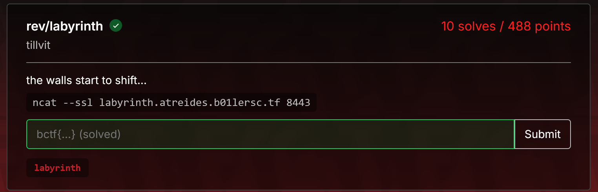
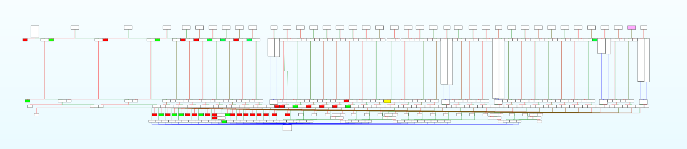

This week I'm playing b0ilersCTF with my college team, `CSI`, but it seems like I'm the only one actually playing, I guess everyone else is busy.
In this post, I’ll walk through my solution to one of the reverse engineering challenges, labyrinth, which I found really interesting (at least to me).

## Initial analysis

First look at the challenge: we’re given a stripped binary.
```sh
└─$ file labyrinth
labyrinth: ELF 64-bit LSB pie executable, x86-64, version 1 (SYSV), dynamically linked, interpreter /lib64/ld-linux-x86-64.so.2, BuildID[sha1]=1857ba55962e5b96dcf4f6e94f883f1c3c506b4d, for GNU/Linux 3.2.0, stripped
```

Running it reveals that this binary is some kind of maze challenge, where you have to move around until you eventually reach the exit or target node.
```sh
└─$ ./labyrinth
Navigate the labyrinth using LDUR. Get to the exit to get the flag.

```

Let’s start decompiling the binary and see how the maze is implemented.
In the main function, we’ll find the relevant logic, some of the functions have already been renamed for clarity.

```c
__int64 __fastcall main(int a1, char **a2, char **a3)
{
  if ( mprotect(
         (char *)checker
       + ((unsigned __int64)((__int64)checker >> 63) >> 52)
       - (((unsigned __int16)checker + ((unsigned __int64)((__int64)checker >> 63) >> 52)) & 0xFFF),
         0x2000u,
         7) )
  {
    puts("An error occured!");
    return 1;
  }
  else
  {
    puts("Navigate the labyrinth using LDUR. Get to the exit to get the flag.");
    if ( (unsigned int)checker() == 1 )
    {
      puts("Success!");
      win_flag();
    }
    else
    {
      puts("Fail!");
    }
    return 0;
  }
}
```

Function win_flag will just read and printed the flag, the real challenge is in checker function,
looking at the decompilation for checker it seems that it's not decompiled very well.

```c
__int64 checker()
{
  read_ldur_input();
  if ( !input )
    JUMPOUT(0x555555555BBCLL);
  return 0;
}
```

> Note that I already rebased the program into 0x555555554000

And function read_ldur_input is just input function that take one char `LDUR` (case insensitive) and map it to number 0,1,2,3.

```c
__int64 read_ldur_input()
{
  __int64 result; // rax

  __isoc99_scanf(" %c", &input);
  result = (unsigned __int8)input;
  if ( input == 'L' || (result = (unsigned __int8)input, input == 'l') )
  {
    input = 0;
  }
  else
  {
    result = (unsigned __int8)input;
    if ( input == 'D' || (result = (unsigned __int8)input, input == 'd') )
    {
      input = 1;
    }
    else
    {
      result = (unsigned __int8)input;
      if ( input == 'U' || (result = (unsigned __int8)input, input == 'u') )
      {
        input = 2;
      }
      else
      {
        result = (unsigned __int8)input;
        if ( input == 'R' || (result = (unsigned __int8)input, input == 'r') )
          input = 3;
        else
          input = -1;
      }
    }
  }
  return result;
}
```

Going back to checker function, let's see the graph of this function to get better view of the function flow.



This colored block doesn't really have any meanings, because at first glance I thought that for example this below block will get us return 1.

```asm
add     r15, 1C80h
mov     rax, 1
push    r15
retn
```

And I just mindlessly coloring each block based on that, until I realize that the `mov rax, <number>` part wasn't used for return value
but I already colored many block green for `mov rax, 1` and red for `mov rax, 0`.

By looking at each block I realize that they had very simillar operation, they'll jump around based on our input char, we can say that one node (our read_ldur_input function) will have 4 child/branches.

```asm
.text:00005555555553C5                 call    read_ldur_input
.text:00005555555553CA                 movzx   eax, cs:input
.text:00005555555553D1                 mov     r15, r13
.text:00005555555553D4                 add     r15, [rsp+10h+var_10]
.text:00005555555553D8                 cmp     al, 0
.text:00005555555553DA                 jnz     short loc_5555555553ED
.text:00005555555553DC                 add     r15, 806h
.text:00005555555553E3                 mov     rax, 0
.text:00005555555553EA                 push    r15
.text:00005555555553EC                 retn
.text:00005555555553ED ; ---------------------------------------------------------------------------
.text:00005555555553ED
.text:00005555555553ED loc_5555555553ED:                       ; CODE XREF: checker+24↑j
.text:00005555555553ED                 cmp     al, 1
.text:00005555555553EF                 jnz     short loc_555555555402
.text:00005555555553F1                 add     r15, 1C80h
.text:00005555555553F8                 mov     rax, 1
.text:00005555555553FF                 push    r15
.text:0000555555555401                 retn
.text:0000555555555402 ; ---------------------------------------------------------------------------
.text:0000555555555402
.text:0000555555555402 loc_555555555402:                       ; CODE XREF: checker+39↑j
.text:0000555555555402                 cmp     al, 2
.text:0000555555555404                 jnz     short loc_555555555417
.text:0000555555555406                 add     r15, 1C80h
.text:000055555555540D                 mov     rax, 0
.text:0000555555555414                 push    r15
.text:0000555555555416                 retn
.text:0000555555555417 ; ---------------------------------------------------------------------------
.text:0000555555555417
.text:0000555555555417 loc_555555555417:                       ; CODE XREF: checker+4E↑j
.text:0000555555555417                 cmp     al, 3
.text:0000555555555419                 jnz     short loc_55555555542C
.text:000055555555541B                 add     r15, 1C80h
.text:0000555555555422                 mov     rax, 0
.text:0000555555555429                 push    r15
.text:000055555555542B                 retn
```

Some of them jump to another operation that call read_ldur_input, another do some stuff first before calling the read_ldur_input, 
and the rest will jump to the end of function which was this block.

```asm
pop     r15
pop     rax
leave
retn
```

Because of this `pop rax` instruction that `mov rax, <num>` instruction is not usefull, but then what makes our checker function return 1?.

## Extracting Maze Out of IDA

To extract each block and where they jumped I use IDA scrip to do it, first i'll extract
all block that do the `jump` using this script.

```python
def find_r15_addrs(start_ea, end_ea):
    matches = []

    ea = start_ea
    while ea < end_ea:
        if idc.print_insn_mnem(ea) == "add":
            op1 = idc.print_operand(ea, 0)
            if op1 == "r15" and idc.get_operand_type(ea, 1) == idc.o_imm:
                op2_val = idc.get_operand_value(ea, 1)

                next1 = idc.next_head(ea, end_ea)
                next2 = idc.next_head(next1, end_ea)
                next3 = idc.next_head(next2, end_ea)
                
                op_rax = idc.get_operand_value(next1, 1)

                if (
                    idc.print_insn_mnem(next1) == "mov"
                    and idc.print_operand(next1, 0) == "rax"
                    and idc.print_insn_mnem(next2) == "push"
                    and idc.print_operand(next2, 0) == "r15"
                    and idc.print_insn_mnem(next3) == "retn"
                ):
                    matches.append((ea, op2_val, op2_val + start_ea,op_rax))

        ea = idc.next_head(ea, end_ea)

    return matches
```

It'll iterate through all the instruction from start address to finish and check for this pattern 

```asm
add     r15, <offset>
mov     rax, <rax num>
push    r15
retn
```

And extract the address, offset / next address, and rax value (In the end i just use the offset for the solve lol).

Next I extract all address that call the read_ldur_input function with this simple script : 

```python
def find_call_instructions(start_ea, end_ea):
    results = []
    ea = start_ea

    while ea < end_ea:
        if idc.print_insn_mnem(ea) == "call":
            results.append(ea)
            
        ea = idc.next_head(ea, end_ea)

    return results
```

After getting this value, I count how many call instruction they had and there's 39 call instructions, but only 155 jump / or push, ret instructions extracted
this mean that there's one block that doesn't specifically follow the pattern, this block.

```asm
add     r15, 1C80h
mov     rax, 1
mov     [rsp+10h+var_8], 1
push    r15
retn
```

And it answer our question, what makes checker return 1?, yep it was this block, so our target is to reach this block.

After that I just manually add this block to the list of instructions I had before, 
then I stitched these extracted values into more readable data structure using this script : 

```python
maps = {}

for i, inp in enumerate(input_addrs):
    l,d,u,r = push_rets[i*4:i*4+4]
    maps[inp] = {
        'l' : l[2],
        'd' : d[2],
        'u' : u[2],
        'r' : r[2],
    }

print(maps)
```

And now we've successfully extracted the maze out of IDA.

## Solving the Maze

Remember that some blocks actually jump to address that not directly call read_ldur_input function, it actually do some patching
mechanism first before calling read_ldur_input function, so before making my solver I'll extract those value first.

I manage to extract those value using this script : 

```python
def extract_r15_r14(start_ea, end_ea):
    matches = []
    test = []
    ea = start_ea
    while ea < end_ea:
        if idc.print_insn_mnem(ea) == "add":
            op1 = idc.print_operand(ea, 0)
            if op1 == "r15" and idc.get_operand_type(ea, 1) == idc.o_imm:
                op2_val = idc.get_operand_value(ea, 1)

                next1 = idc.next_head(ea, end_ea)
                next2 = idc.next_head(next1, end_ea)
                next3 = idc.next_head(next2, end_ea)
                
                op_r15 = idc.get_operand_value(ea, 1)
                op_r14 = idc.get_operand_value(next2, 1)
                cmp_val = idc.get_operand_value(next3, 1)
                
                if (
                    idc.print_insn_mnem(next1) == "add"
                    and idc.print_operand(next1, 0) == "r15"
                    and idc.print_insn_mnem(next2) == "mov"
                    and idc.print_insn_mnem(next3) == "cmp"
                ):
                    if test != []:
                        matches.append(test)
                        test = []
                    
                    test.append((ea-3, cmp_val+start_ea, op_r15 + start_ea))
                
                elif (
                    idc.print_insn_mnem(next1) == "add"
                    and idc.print_operand(next1, 0) == "r15"
                    and idc.print_insn_mnem(next2) == "mov"
                ):
                    test.append((op_r15+start_ea, op_r14+start_ea))

        ea = idc.next_head(ea, end_ea)
    matches.append(test)
    return matches
```

And once again converting to more readable data structure

```python
mper = {
    86: 'r',
    65: 'u',
    44: 'd',
    23: 'l'
}

pp = {}

for patch in data:
    fp = []
    sp = []
    idx = (len(patch) - 1) // 2 + 1

    for p in patch[1:idx]:
        for x in [86, 65, 44, 23]:
            if p[0] - x in input_addrs:
                fp.append((p[0] - x, mper[x], p[1]))
                break

    for p in patch[idx:]:
        for x in [86, 65, 44, 23]:
            if p[0] - x in input_addrs:
                sp.append((p[0] - x, mper[x], p[1]))
                break

    print(len(sp), len(fp))
    for x in [86, 65, 44, 23]:
        if patch[0][2] - x in input_addrs:  
            pp[(patch[0][0],patch[0][1],mper[x])] = {
                    'fp' : fp,
                    'sp' : sp
                }
print(pp)
```

Then converting to actuall python code with help of this script : 

```python
next_read = {
    93824992237565 : 0x0000555555555934,
    93824992239394 : 0x0000555555556225,
    93824992240597 : 0x00005555555567BE,
    93824992242570 : 0x0000555555556C8C,
    93824992242936 : 0x000555555556FCD
}

t_if = "\tif val[%d]['%c'][-1] == %d:\n"

t_else = """\telse:\n"""

final = ""
final_pt2 = ""

for i in data:
    final += "if next_addr == %d:\n" % i[0]
    final_pt2 += "if next_addr == %d:\n" % i[0]
    final += t_if % (data[i]['fp'][0][0], i[2], i[1])
    final_pt2 += t_if % (data[i]['fp'][0][0], i[2], i[1])    
    dd = True
    for x in data[i]:
        for xx in data[i][x]:
            final += "\t\tval[%d]['%c'].append(%d)\n" % xx
            final_pt2 += "\t\tval[%d]['%c'].pop()\n" % (xx[0], xx[1]) 
        if x == 'fp':
            final += t_else
            final_pt2 += t_else
        else:
            final += '\tnext_addr = %d\n\n' % next_read[i[0]]
            final_pt2 +='\n'

final += "explore(next_addr, addr, direction, indent+1, visited)\n\n"
final += final_pt2
```

But it still need some slight adjustment for the final solver.

For my final solver i just code dfs and try to explore all paths available and tracing them, but one thing
that got me stuck is my solution can't get into the targeted node even though I already add the patching mechanism.

Turns out it was because I do cyclic detection wrong for this maze because to reach the targeted node
we need to perform some cycle, and also because of the patching the patch maybe also patch the cycle so
we need to check again if the cycle still exists or it actually open a path to another node.

Another thing that got me stuck is that the patching mechanism node need to be visited in odd number CMIIW
to open the path to the targeted node, but once I fixed the cycle problem it fix this problem also.

This is my final solver : 

```python
val = {
...truncated...
}

def get_graph_state_hash(graph):
    result = ""
    for node in sorted(graph.keys()):
        for direction in ['l', 'd', 'u', 'r']:
            if direction in graph[node]:
                result += f"{node}_{direction}_{graph[node][direction][-1]}|"
    return hash(result)


def explore(addr, prev_addr=None, came_from=None, indent=0, visited=None):
    global did_i_win

    if addr == TARGET:
        did_i_win = True

    if visited is None:
        visited = set()

    state_hash = get_graph_state_hash(val) + addr
    visited.add(state_hash)

    for direction, next_addrs in val.get(addr, {}).items():
        next_addr = next_addrs[-1]

        indent_str = '\t' * indent
        if next_addr == TARGET:
            print(f'{indent_str} {''.join(path)}{direction}d')

        path.append(direction)
        
        if next_addr == 93824992243766:
            print(f"{indent_str}{direction} -> end ({next_addr})")

        elif next_addr not in val:
            print(f"{indent_str}{direction} -> unexplored ({next_addr})")

            cond_1 = next_addr == 93824992237565
            cond_11 = False
            cond_2 = next_addr == 93824992239394
            cond_21 = False
            cond_3 = next_addr == 93824992240597
            cond_31 = False
            cond_4 = next_addr == 93824992242570
            cond_41 = False
            cond_5 = next_addr == 93824992242936
            cond_51 = False

            if cond_1:
               cond_11 = val[93824992242138]['d'][-1] == 93824992236917
               if cond_11:
                  val[93824992239286]['u'].append(93824992243766)
                  val[93824992237349]['d'].append(93824992242138)
                  val[93824992238092]['r'].append(93824992236593)
                  val[93824992237876]['d'].append(93824992242138)
                  val[93824992242138]['d'].append(93824992237349)
                  val[93824992242462]['l'].append(93824992238962) # need this
               else:
                  val[93824992242138]['d'].append(93824992236917)
                  val[93824992239286]['u'].append(93824992237565)
                  val[93824992237349]['d'].append(93824992243766)
                  val[93824992237876]['d'].append(93824992243766)
                  val[93824992242462]['l'].append(93824992243766)
                  val[93824992238092]['r'].append(93824992236917)
               next_addr = 93824992237876

            if cond_2:
               cond_21 = val[93824992237133]['r'][-1] == 93824992243766
               if cond_21:
                  val[93824992237133]['r'].append(93824992239178) # need this
                  val[93824992237457]['u'].append(93824992243766)
                  val[93824992238200]['r'].append(93824992243766)
                  val[93824992238962]['u'].append(93824992239070) # need this
                  val[93824992237133]['u'].append(93824992242936)
                  val[93824992238200]['u'].append(93824992243766)
                  val[93824992236701]['u'].append(93824992241814)
                  val[93824992241922]['u'].append(93824992243766)
                  val[93824992242354]['u'].append(93824992243766)
                  val[93824992240381]['d'].append(93824992243766)
                  val[93824992240165]['l'].append(93824992243766)
                  val[93824992237241]['d'].append(93824992243766)
                  val[93824992241814]['d'].append(93824992236701)
                  val[93824992243661]['d'].append(93824992237133)
                  val[93824992236809]['d'].append(93824992243766)
                  val[93824992240489]['d'].append(93824992243766)
               else:
                  val[93824992237133]['r'].append(93824992243766)
                  val[93824992237457]['u'].append(93824992236809)
                  val[93824992238200]['r'].append(93824992239394)
                  val[93824992238962]['u'].append(93824992243766)
                  val[93824992237133]['u'].append(93824992243766)
                  val[93824992238200]['u'].append(93824992240381)
                  val[93824992236701]['u'].append(93824992243766)
                  val[93824992241922]['u'].append(93824992237241)
                  val[93824992242354]['u'].append(93824992240489)
                  val[93824992240381]['d'].append(93824992238200)
                  val[93824992240165]['l'].append(93824992238200)
                  val[93824992237241]['d'].append(93824992241922)
                  val[93824992241814]['d'].append(93824992243766)
                  val[93824992243661]['d'].append(93824992243766)
                  val[93824992236809]['d'].append(93824992237457)
                  val[93824992240489]['d'].append(93824992242354)
               next_addr = 93824992240165

            if cond_3:
               cond_31 =  val[93824992241814]['l'][-1] == 93824992242246
               if cond_31:
                  val[93824992241814]['l'].append(93824992243766)
                  val[93824992242246]['l'].append(93824992236809)
                  val[93824992240489]['u'].append(93824992243766)
                  val[93824992237241]['l'].append(93824992243766)
                  val[93824992240381]['r'].append(93824992243766)
                  val[93824992242246]['r'].append(93824992243766)
                  val[93824992236809]['r'].append(93824992242246)
                  val[93824992240489]['r'].append(93824992243766)
                  val[93824992238629]['l'].append(93824992243766)
                  val[93824992241598]['d'].append(93824992237241)
                  val[93824992240381]['u'].append(93824992236701)
                  val[93824992241922]['r'].append(93824992243766)
                  val[93824992237457]['r'].append(93824992243766)
                  val[93824992239070]['r'].append(93824992238845) # need this WIN
                  val[93824992237457]['d'].append(93824992243766)
                  val[93824992238200]['l'].append(93824992243766)
                  val[93824992237241]['u'].append(93824992240597)
                  val[93824992243661]['l'].append(93824992243766)
                  val[93824992236701]['d'].append(93824992240381)
                  val[93824992241598]['l'].append(93824992243766)
                  val[93824992241814]['r'].append(93824992243766)
               else:
                  val[93824992241814]['l'].append(93824992242246)
                  val[93824992242246]['l'].append(93824992243766)
                  val[93824992240489]['u'].append(93824992237457)
                  val[93824992237241]['l'].append(93824992240489)
                  val[93824992240381]['r'].append(93824992238629)
                  val[93824992242246]['r'].append(93824992241814)
                  val[93824992236809]['r'].append(93824992243766)
                  val[93824992240489]['r'].append(93824992237241)
                  val[93824992238629]['l'].append(93824992240381)
                  val[93824992241598]['d'].append(93824992243766)
                  val[93824992240381]['u'].append(93824992243766)
                  val[93824992241922]['r'].append(93824992238200)
                  val[93824992237457]['r'].append(93824992240597)
                  val[93824992239070]['r'].append(93824992243766)
                  val[93824992237457]['d'].append(93824992240489)
                  val[93824992238200]['l'].append(93824992241922)
                  val[93824992237241]['u'].append(93824992243766)
                  val[93824992243661]['l'].append(93824992241814)
                  val[93824992236701]['d'].append(93824992243766)
                  val[93824992241598]['l'].append(93824992237457)
                  val[93824992241814]['r'].append(93824992242936)
               next_addr = 93824992241598

            if cond_4:
               cond_41 = val[93824992237984]['d'][-1] == 93824992242570
               if cond_41:
                  val[93824992237984]['d'].append(93824992243766)
                  val[93824992239178]['r'].append(93824992241706) # need this  <-- stuck here
                  val[93824992242828]['l'].append(93824992243766)
                  val[93824992238737]['u'].append(93824992242570)
                  val[93824992242828]['r'].append(93824992237025)
               else:
                  val[93824992237984]['d'].append(93824992242570)
                  val[93824992239178]['r'].append(93824992243766)
                  val[93824992242828]['l'].append(93824992242030)
                  val[93824992238737]['u'].append(93824992243766)
                  val[93824992242828]['r'].append(93824992243766)
               next_addr = 93824992242828

            if cond_5:
               cond_51 = val[93824992238629]['u'][-1] == 93824992237133
               if cond_51:
                  val[93824992238629]['u'].append(93824992243766)
                  val[93824992240381]['l'].append(93824992237241)
                  val[93824992237133]['d'].append(93824992243766)
                  val[93824992237241]['r'].append(93824992240381)
                  val[93824992242354]['r'].append(93824992241922)
                  val[93824992236701]['l'].append(93824992243766)
                  val[93824992241706]['d'].append(93824992242462) # need this
                  val[93824992240165]['u'].append(93824992243766)
                  val[93824992242246]['d'].append(93824992240597)
                  val[93824992238629]['d'].append(93824992243766)
                  val[93824992241922]['l'].append(93824992242354)
                  val[93824992241598]['u'].append(93824992242246)
                  val[93824992236701]['r'].append(93824992237133)
                  val[93824992241598]['r'].append(93824992243766)
                  val[93824992237133]['l'].append(93824992236701)
               else:
                  val[93824992238629]['u'].append(93824992237133)
                  val[93824992240381]['l'].append(93824992243766)
                  val[93824992237133]['d'].append(93824992238629)
                  val[93824992237241]['r'].append(93824992243766)
                  val[93824992242354]['r'].append(93824992243766)
                  val[93824992236701]['l'].append(93824992240597)
                  val[93824992241706]['d'].append(93824992243766)
                  val[93824992240165]['u'].append(93824992238629)
                  val[93824992242246]['d'].append(93824992243766)
                  val[93824992238629]['d'].append(93824992239394)
                  val[93824992241922]['l'].append(93824992243766)
                  val[93824992241598]['u'].append(93824992243766)
                  val[93824992236701]['r'].append(93824992243766)
                  val[93824992241598]['r'].append(93824992236701)
                  val[93824992237133]['l'].append(93824992243766)
               next_addr = 93824992243661

            explore(next_addr, addr, direction, indent+1, visited)

            if cond_1:
               if cond_11:
                    val[93824992239286]['u'].pop()
                    val[93824992237349]['d'].pop()
                    val[93824992238092]['r'].pop()
                    val[93824992237876]['d'].pop()
                    val[93824992242138]['d'].pop()
                    val[93824992242462]['l'].pop()
               else:
                    val[93824992242138]['d'].pop()
                    val[93824992239286]['u'].pop()
                    val[93824992237349]['d'].pop()
                    val[93824992237876]['d'].pop()
                    val[93824992242462]['l'].pop()
                    val[93824992238092]['r'].pop()

            if cond_2:
               if cond_21:
                  val[93824992237133]['r'].pop()
                  val[93824992237457]['u'].pop()
                  val[93824992238200]['r'].pop()
                  val[93824992238962]['u'].pop()
                  val[93824992237133]['u'].pop()
                  val[93824992238200]['u'].pop()
                  val[93824992236701]['u'].pop()
                  val[93824992241922]['u'].pop()
                  val[93824992242354]['u'].pop()
                  val[93824992240381]['d'].pop()
                  val[93824992240165]['l'].pop()
                  val[93824992237241]['d'].pop()
                  val[93824992241814]['d'].pop()
                  val[93824992243661]['d'].pop()
                  val[93824992236809]['d'].pop()
                  val[93824992240489]['d'].pop()
               else:
                  val[93824992237133]['r'].pop()
                  val[93824992237457]['u'].pop()
                  val[93824992238200]['r'].pop()
                  val[93824992238962]['u'].pop()
                  val[93824992237133]['u'].pop()
                  val[93824992238200]['u'].pop()
                  val[93824992236701]['u'].pop()
                  val[93824992241922]['u'].pop()
                  val[93824992242354]['u'].pop()
                  val[93824992240381]['d'].pop()
                  val[93824992240165]['l'].pop()
                  val[93824992237241]['d'].pop()
                  val[93824992241814]['d'].pop()
                  val[93824992243661]['d'].pop()
                  val[93824992236809]['d'].pop()
                  val[93824992240489]['d'].pop()

            if cond_3:
               if cond_31:
                  val[93824992241814]['l'].pop()
                  val[93824992242246]['l'].pop()
                  val[93824992240489]['u'].pop()
                  val[93824992237241]['l'].pop()
                  val[93824992240381]['r'].pop()
                  val[93824992242246]['r'].pop()
                  val[93824992236809]['r'].pop()
                  val[93824992240489]['r'].pop()
                  val[93824992238629]['l'].pop()
                  val[93824992241598]['d'].pop()
                  val[93824992240381]['u'].pop()
                  val[93824992241922]['r'].pop()
                  val[93824992237457]['r'].pop()
                  val[93824992239070]['r'].pop()
                  val[93824992237457]['d'].pop()
                  val[93824992238200]['l'].pop()
                  val[93824992237241]['u'].pop()
                  val[93824992243661]['l'].pop()
                  val[93824992236701]['d'].pop()
                  val[93824992241598]['l'].pop()
                  val[93824992241814]['r'].pop()
               else:
                  val[93824992241814]['l'].pop()
                  val[93824992242246]['l'].pop()
                  val[93824992240489]['u'].pop()
                  val[93824992237241]['l'].pop()
                  val[93824992240381]['r'].pop()
                  val[93824992242246]['r'].pop()
                  val[93824992236809]['r'].pop()
                  val[93824992240489]['r'].pop()
                  val[93824992238629]['l'].pop()
                  val[93824992241598]['d'].pop()
                  val[93824992240381]['u'].pop()
                  val[93824992241922]['r'].pop()
                  val[93824992237457]['r'].pop()
                  val[93824992239070]['r'].pop()
                  val[93824992237457]['d'].pop()
                  val[93824992238200]['l'].pop()
                  val[93824992237241]['u'].pop()
                  val[93824992243661]['l'].pop()
                  val[93824992236701]['d'].pop()
                  val[93824992241598]['l'].pop()
                  val[93824992241814]['r'].pop()

            if cond_4:
               if cond_41:
                  val[93824992237984]['d'].pop()
                  val[93824992239178]['r'].pop()
                  val[93824992242828]['l'].pop()
                  val[93824992238737]['u'].pop()
                  val[93824992242828]['r'].pop()
               else:
                  val[93824992237984]['d'].pop()
                  val[93824992239178]['r'].pop()
                  val[93824992242828]['l'].pop()
                  val[93824992238737]['u'].pop()
                  val[93824992242828]['r'].pop()

            if cond_5:
               if cond_51:
                  val[93824992238629]['u'].pop()
                  val[93824992240381]['l'].pop()
                  val[93824992237133]['d'].pop()
                  val[93824992237241]['r'].pop()
                  val[93824992242354]['r'].pop()
                  val[93824992236701]['l'].pop()
                  val[93824992241706]['d'].pop()
                  val[93824992240165]['u'].pop()
                  val[93824992242246]['d'].pop()
                  val[93824992238629]['d'].pop()
                  val[93824992241922]['l'].pop()
                  val[93824992241598]['u'].pop()
                  val[93824992236701]['r'].pop()
                  val[93824992241598]['r'].pop()
                  val[93824992237133]['l'].pop()
               else:
                  val[93824992238629]['u'].pop()
                  val[93824992240381]['l'].pop()
                  val[93824992237133]['d'].pop()
                  val[93824992237241]['r'].pop()
                  val[93824992242354]['r'].pop()
                  val[93824992236701]['l'].pop()
                  val[93824992241706]['d'].pop()
                  val[93824992240165]['u'].pop()
                  val[93824992242246]['d'].pop()
                  val[93824992238629]['d'].pop()
                  val[93824992241922]['l'].pop()
                  val[93824992241598]['u'].pop()
                  val[93824992236701]['r'].pop()
                  val[93824992241598]['r'].pop()
                  val[93824992237133]['l'].pop()

        elif get_graph_state_hash(val) + next_addr in visited:
            print(f"{indent_str}{direction} -> cycle ({next_addr})")

        else:
            print(f"{indent_str}{direction} -> {next_addr}")

            explore(next_addr, addr, direction, indent + 1, visited)

        path.pop()

paths = []
path = []
TARGET = 93824992238845
src = 93824992236485
explore(src)
```

And this is all the path it explored, it's to big so I put it [here](https://pastebin.com/u6cZKj9K).

The path to targeted node is : `lldrdlulluddululdrrddllrlddrdrurduuullddrurrrdlurd`.

I do realize that this is not the optimal solution, but who cares it gave me da flag, lol.

Flag : `bctf{anti_softlock_jumpscare}`