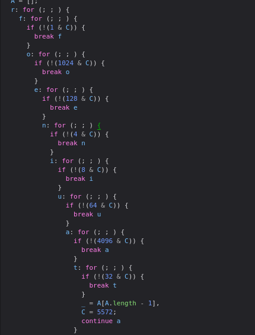
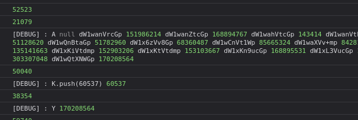
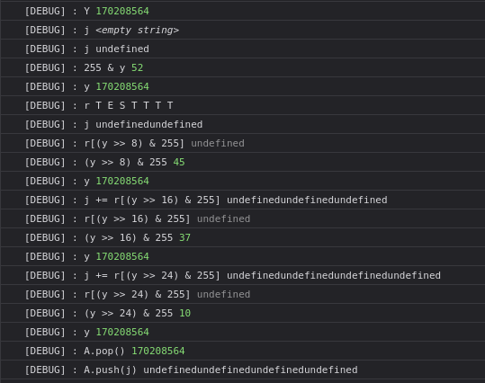
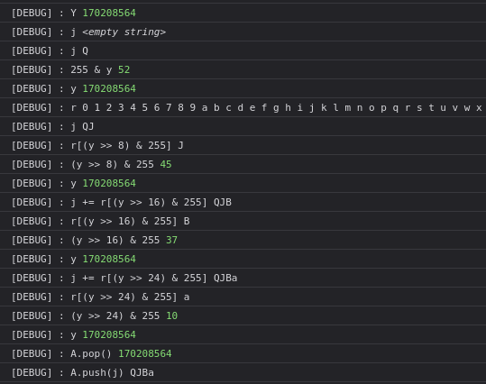
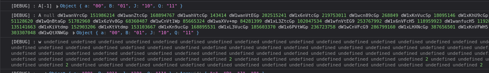
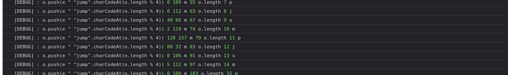
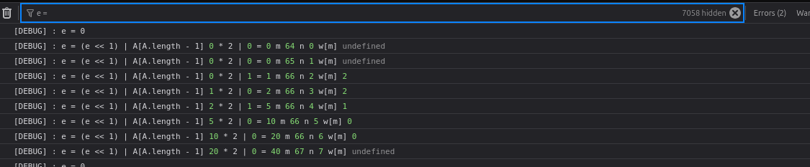
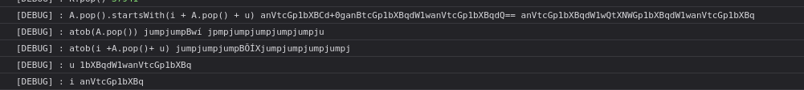

The challenge was hosted online in https://bunny-jumper-web.chal.irisc.tf/, if the link was already dead you can host it with this [html](https://pastebin.com/raw/896WPk8k).

## Common Javascript Obfuscation

Usually when I see an abfuscated JavaScript I always try to deobfuscate it first with some well known online tools, here are some that i usually uses : 

<details>
    <summary>Tools</summary>

- [de4js](https://lelinhtinh.github.io/de4js/)
- [deobfuscate.io](https://deobfuscate.io/)

</details>

And many more (just google it), but for this challenge what the author did was just obfuscated the control flow and hiding all of the instruction inside the nested if and the way it coded looks like a tree, after CTF end author share how he obfuscated it with this [script](https://discord.com/channels/1051808836593397781/1051819252618895400/1325621858908766269) and also the source which you could see also [here](https://discord.com/channels/1051808836593397781/1051819252618895400/1325615370157166643).

So i think there won't be any tools for deobfuscating this control flow obfuscated, but it still do able to trace it and understand it manually.

## Understanding The Flow

Another way to deal with some obfuscated code is to trace the execution, you can do it by overwritting some function or writting logger for each operation, or maybe u want to use browser debugger to see line by line but that's lot of work.

If we take a closer look at the JavaScript code, we can see that the variable C determines which operation will be executed.



>Note that if u see a minified version of js u could click the pretty print button to make it more readable.

Knowing that C is important variable, I just put `console.log` for every assignment of `C`

```javascript
console.log(C), EXEC.push(C);
```

The `EXEC` array was there so I could count how much instruction/operation was executed based on the input, but it's not really important for the solve.

I also log all the operation, so in the end my logger will look like this : 

```javascript
(_ = A[A.length - 1]), (C = 5572);
console.log(C), EXEC.push(C);
console.log("[DEBUG] : A[-1]",_);
console.log("[DEBUG] : A", ...A);
continue a;
```

The only operation i don't log is `A.push` that uses as initialization value because i could just log all the value of `A` at the very end push.



>If you want to see my fully modified code, I have put it [here](https://gist.github.com/UnoArroefy/c656c721bc1dd04747376df5110f4364).

After initialization of `A`, it initialize `j` then use the last value of `A` to get the index



Since it's a 32-bit integer, it can be used to get 4 indices. In the screenshots above, I used a very short input, which is why the value appended to the string j is undefined.

Knowing that also will give us clue about the flag length, just find the largest indices produced from all that integer. Then we got 56, that's mean our flag length should be 57.

Using this input `0123456789abcdefghijklmnopqrstuvwxyzABCDEFGHIJKLMNOPQRSTU` we got this



So that's really indices to get our input.

From here our input get sorted, we could read all the traced operation but that's waste much more time, what i do is i try to look at the input before it get pushes to array `A`



Then just trying some different input, I realise that is not just sort by ascii number but there's some logic for how much the occurence of the char, my reimplementation in python look like this

```python
inp = 'nna}' # 4 char input

def custom_sort(char):
    return (-inp.count(char), ord(char))

sorted_unique = ''.join(sorted(set(inp), key=custom_sort))

print(sorted_unique) 

w = [0]*256
if len(inp) == 1:
    w[ord(inp[0])] = 1
elif len(inp) == 2:
    w[ord(inp[0])] = 1
    w[ord(inp[1])] = 1
elif len(inp) == 3:
    w[ord(inp[0])] = 1
    w[ord(inp[1])] = 2
    w[ord(inp[2])] = 2
elif len(inp) == 4:
    w[ord(inp[0])] = 2
    w[ord(inp[1])] = 2
    w[ord(inp[2])] = 2
    w[ord(inp[3])] = 2
```

`w` variable is important for the encryption later.

After the preprocessing the encryption seems to be just xoring characters, reading the traced operation we could see interesting `o.push`, it pushed value of `e` xored with one of the char in `jump`.



We need to figure out how e is generated.



Although in the code it's not really obvious that `w` related to `e` but after some debugging eventually I realize that this piece of code is responsible for value of `e`

```javascript
for (;;) {
    console.log('[DEBUG] : w', ...w);
    console.log("[DEBUG] CHECKER");
    console.log("[DEBUG] : w[m] || 0", w[m] || 0, m);
    if (
    56088 == (C = -23252 * ((w[m] || 0) <= 0) + 56088)
    )
    {
        console.log(56088), EXEC.push(56088);
        continue i;
    }
    continue o;
}
```

because value we get from w is responsible for our control flow because `e` will get value from `A.pop()` if the `w[m]` is not undefined or 0 the value pushed to `A` is 1, that's how we get the value of `e`.

And the logic for `e` itself seems like binary operation with that `shift` and `or` operation idk and my smoll brain couldn't understand that, at the time of CTF i just reimplement it blindly.

The code was iterating `m` and `n` it xored only if `n` is 8 if and the `w[m]` return a value then `m` will stop incrementing but `n` continue, after 5 increment of `n` `m` was get increment back, the code was pretty confusing for me to explain it this way but overal here's the full code reimplementation in python

```python
inp = 'nna}'

def custom_sort(char):
    return (-inp.count(char), ord(char))

sorted_unique = ''.join(sorted(set(inp), key=custom_sort))

print(sorted_unique) 

w = [0]*256
if len(inp) == 1:
    w[ord(inp[0])] = 1
elif len(inp) == 2:
    w[ord(inp[0])] = 1
    w[ord(inp[1])] = 1
elif len(inp) == 3:
    w[ord(inp[0])] = 1
    w[ord(inp[1])] = 2
    w[ord(inp[2])] = 2
elif len(inp) == 4:
    w[ord(inp[0])] = 2
    w[ord(inp[1])] = 2
    w[ord(inp[2])] = 2
    w[ord(inp[3])] = 2

n = 0
e = 0
m = 0
a = 0
o = 0
enc = []
while m < 256:
    if n > 7:
        print("EEEEE 1", e)
        enc.append(b'jump'[o % 4] ^ e)
        o += 1
        n = 0
        e = 0

    while w[m] != 0:
        a = 1
        e = (e << 1) | a
        a = 0
        print(m,n,e)
        n += 1
        if n > 7:
            print("EEEEE 3", e)
            enc.append(b'jump'[o % 4] ^ e)
            o += 1
            n = 0
            e = 0
        for _ in range(4):
            a = 1 & w[m]
            w[m] = w[m] >> 1
            e = (e << 1) | a
            print(m,n,e)
            a = 0
            n += 1
            if n > 7:
                print("EEEEE 2", e)
                enc.append(b'jump'[o % 4] ^ e)
                o += 1
                n = 0
                e = 0
        if n < 8:
            m += 1

    e = (e << 1) | a
    print(m, n, e)
    m += 1
    n += 1

print(enc)
print(bytes(enc))
```

## Crafting Flag

TBH I don't really have any idea how to reverse the encryption it seem reversible but it's 1 A.M when I try to solve it so my brain wasn't functioning (That's another way to say that i'm skill issued and dumb) I realize that this could be bruteforced with reasonable charset.

Let's take a look at the comparation

```javascript
for (;;) {
    console.log("CHECKER");
    console.log("[DEBUG] : A.pop().startsWith(i + A.pop() + u)", A[A.length - 1], i +A[A.length - 2]+ u);
    console.log("[DEBUG] : atob(A.pop())", atob(A[A.length - 1]));
    console.log("[DEBUG] : atob(i +A.pop()+ u)", atob(i +A[A.length - 2]+ u));
    console.log("[DEBUG] : u", u);
    console.log("[DEBUG] : i", i);
    console.log("[DEBUG] : A[A.length - 2]", A[A.length - 2]);
    console.log("[DEBUG] : A", ...A);
    if (
    54350 ==
    (C =
        -47416 * !A.pop().startsWith(i + A.pop() + u) +
        54350)
    ){
    console.log(C), EXEC.push(C);
    continue r;
    }
    continue i;
}
```



You see that the xored `jump` only possible when input is char from a to }, let's take a look at all compared value

```python
dW1wanVrcGp b'umpjukpj' [38, 32, 15, 9]
dW1wanZtcGp b'umpjvmpj' [47, 33, 17, 10]
dW1wahVtcGp b'umpj\x15mpj' [54, 48, 2, 0]
dW1wanVtEGp b'umpjum\x10j' [41, 35, 18, 12]
dW1x6nVtcGp b'umq\xeaumpj' [51, 42, 25, 13]
dW1wcn89cGp b'umpr\x7f=pj' [49, 26, 4, 0]
dW1xKnVucSp b'umq*unq*' [42, 28, 20, 1]
dW1xKhU9cGp b'umq*\x15=pj' [50, 36, 29, 2]
dW1wOnVsMAp b'ump:ul0\n' [44, 41, 12, 3]
dW1wQnBtaGp b'umpBpmhj' [48, 37, 22, 3]
dW1x6zVv8Gp b'umq\xeb5o\xf0j' [39, 25, 19, 4]
dW1wCnVt1Wp b'ump\num\xd5j' [44, 38, 27, 5]
dW1waXVv b'umpiuo' [55, 8, 6, 5]
dW1xL3ZtcGp b'umq/vmpj' [46, 31, 21, 6]
dW1wfnVtEG9 b'ump~um\x10o' [56, 49, 32, 15]
dW1x6nVFcH5 b'umq\xeauEp~' [51, 47, 23, 7]
dW1wanfucH5 b'umpjw\xeep~' [55, 34, 28, 7]
dW1xKPZtcGp b'umq(\xf6mpj' [31, 25, 14, 8]
dW1xKiVtdmp b'umq*%mvj' [38, 30, 29, 9]
dW1xKtVtdmp b'umq*\xd5mvj' [51, 45, 32, 9]
dW1xKn9ucGp b'umq*\x7fnpj' [43, 36, 17, 10]
dW1xL3VucGp b'umq/unpj' [42, 21, 16, 11]
dW1x6PVtWGp b'umq\xe8\xf5mXj' [46, 30, 28, 14]
dW1wCnVFcG9 b'ump\nuEpo' [56, 53, 24, 17]
dW1xLHXNcGp b'umq,u\xcdpj' [53, 43, 27, 23]
dW1xKnVFWH5 b'umq*uEX~' [55, 34, 20, 19]
dW1xKnVFcS9 b'umq*uEq/' [40, 25, 20, 18]
dW1wQtXNWGp b'umpB\xd5\xcdXj' [52, 45, 37, 10]
```

Yeah so there won't be any capitalize char nor digits or some weird char, so this is bruteforceable.

Btw the charset i used was `_abcdefghijklmnopqrstuvwxyz{}` and I modify a bit of my python implementation to do the bruteforcing.

Then we got this

```python
('_', [51, 42, 25, 13])
('_br', [46, 30, 28, 14])
('_cn', [39, 25, 19, 4])
('_n{', [51, 47, 23, 7])
('a_h', [53, 43, 27, 23])
('f_a', [46, 31, 21, 6])
('n_a', [42, 21, 16, 11])
('f_b', [31, 25, 14, 8])
('u_d', [51, 45, 32, 9])
('e_i', [50, 36, 29, 2])
('u_e', [38, 30, 29, 9])
('n_h', [43, 36, 17, 10])
('_nrw', [55, 34, 20, 19])
('_nwy', [40, 25, 20, 18])
('r_w', [42, 28, 20, 1])
('an}', [56, 53, 24, 17])
('atu', [44, 38, 27, 5])
('yas', [44, 41, 12, 3])
('bdhn', [52, 45, 37, 10])
('sbi', [48, 37, 22, 3])
('chi', [49, 26, 4, 0])
('uc}', [56, 49, 32, 15])
('frt', [55, 8, 6, 5])
('i', [54, 48, 2, 0])
('n', [47, 33, 17, 10])
('rn{', [55, 34, 28, 7])
('u', [38, 32, 15, 9])
('y', [41, 35, 18, 12])
```

This is z3 and again I don't have any brainpower left at that time so I just manually crafted the flag.

I think my solution was unintended because it's not really reversing that weird algorithm, but like what everyone alwasy said `flag is flag`.

flag : `irisctf{funny_bunny_was_a_hare_funny_bunny_had_nice_hair}`