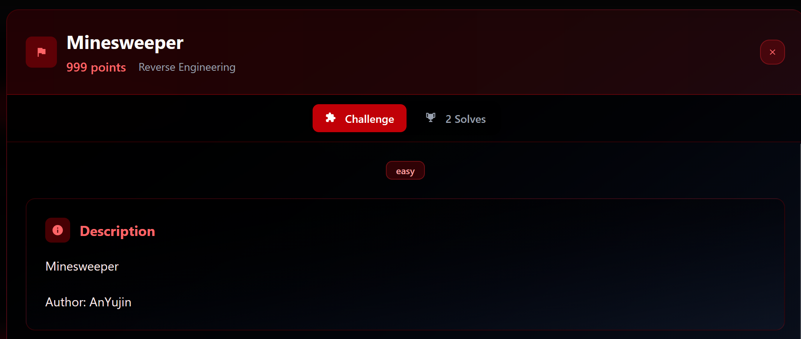
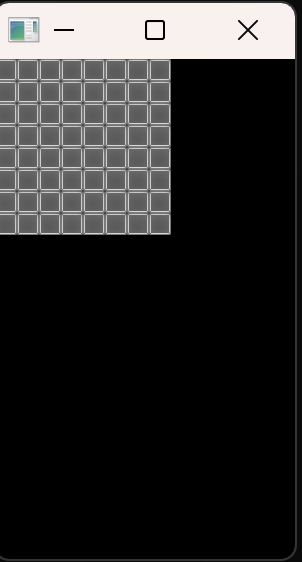
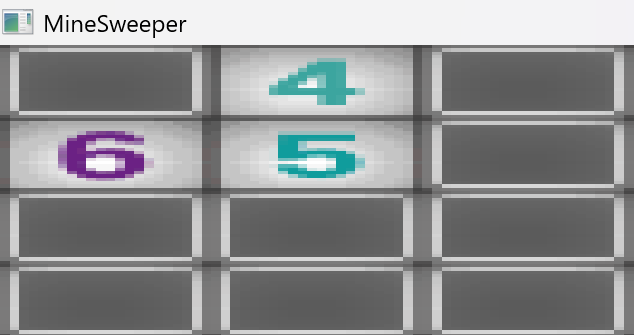
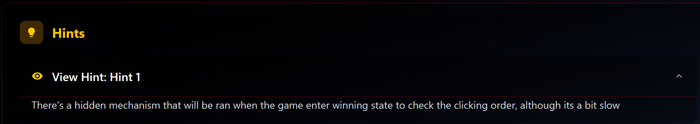
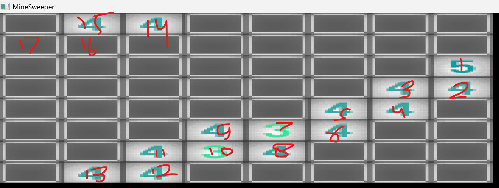
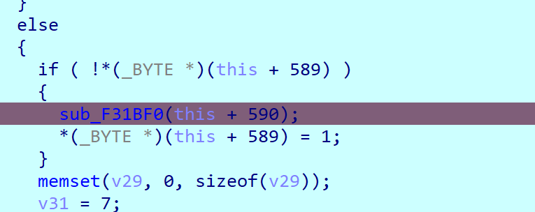
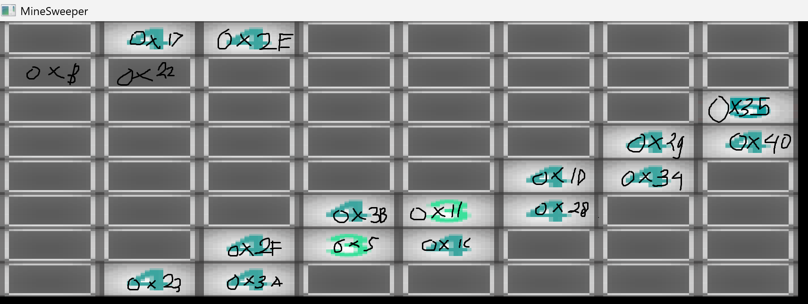
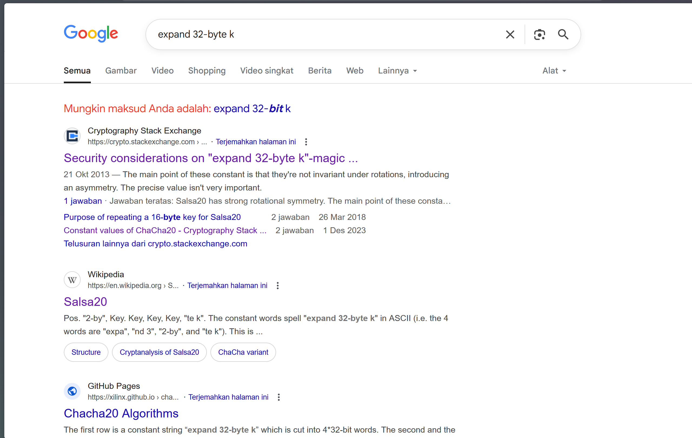
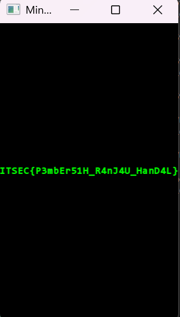

## Probably Unnecessary

Last week I played a local CTF with a unique format similar to BlackHat MEA Finals.
They had a different challenge for each day, and each could only be solved on the day it was released.
After a long time of not playing any CTFs due to exams and projects, I was finally able to enjoy a good one.
Though I'm still in the middle of the [KKN](https://id.wikipedia.org/wiki/Kuliah_kerja_nyata) program, the first day went smoothly.
I was still able to get some flags by solving the rev and pwn categories. On the next day, I was so determined to get the first blood prizes.

Why? Simply because of the money. But in the end, I failed miserably. Oh, and on the last day, I didn't touch any challenges
I was on the bus on my way home (well, not really).

Starting late because of some KKN stuff, there was only one rev challenge that hadn't been solved yet on the second day.



Minesweeper was supposed to be in the easy category (such a big lie, I guess). I thought this challenge wouldn’t stress me out (not knowing what lay ahead).
Well, there was another rev challenge, supposedly easier (also not sure), but I didn’t want to do it because my time was limited and someone had already blooded it
(well, also I don’t think it had a prize).

## The Very First Step

Given the binary `Minesweeper.exe` and contents full of its image assets, running it will give us a classic minesweeper UI.



However the decompilation was pretty confusing because of using many data structure being used, well it's a game afterall

```c
int __cdecl main(int argc, const char **argv, const char **envp)
{
  int v3; // ecx
  int v4; // ecx
  int v6; // [esp+0h] [ebp-2C8h]
  int v7; // [esp+0h] [ebp-2C8h]
  int v8; // [esp+0h] [ebp-2C8h]
  int v9; // [esp+0h] [ebp-2C8h]
  int v10; // [esp+4h] [ebp-2C4h] BYREF
  int v11; // [esp+8h] [ebp-2C0h] BYREF
  int v12; // [esp+Ch] [ebp-2BCh] BYREF
  int v13; // [esp+10h] [ebp-2B8h] BYREF
  _DWORD *v14; // [esp+14h] [ebp-2B4h] BYREF
  _DWORD *v15; // [esp+18h] [ebp-2B0h] BYREF
  _DWORD *v16; // [esp+1Ch] [ebp-2ACh] BYREF
  _DWORD *v17; // [esp+20h] [ebp-2A8h] BYREF
  _DWORD *v18; // [esp+24h] [ebp-2A4h] BYREF
  _DWORD v19[164]; // [esp+28h] [ebp-2A0h] BYREF
  int v20; // [esp+2C4h] [ebp-4h]

  memset(v19, 0, sizeof(v19));
  v19[0] = &Game::`vftable';
  memset(&v19[3], 0, 12);
  sub_F33460();
  v20 = 0;
  sub_F39100((int)&v19[26]);
  LOBYTE(v20) = 1;
  sub_F39100((int)&v19[38]);
  LOBYTE(v20) = 2;
  sub_F39100((int)&v19[50]);
  LOBYTE(v20) = 3;
  sub_F39100((int)&v19[62]);
  memset(&v19[74], 0, 12);
  sub_F33730(&v19[77]);
  LOBYTE(v19[146]) = 0;
  LOBYTE(v20) = 6;
  LOWORD(v19[147]) = 0;
  v19[2] = 0;
  strcpy((char *)&v19[147] + 2, "You win!!");
  sub_F33200(v19);
  sub_F338B0();
  v18 = &v19[62];
  v17 = &v19[74];
  v16 = &v19[50];
  v15 = &v19[38];
  v14 = &v19[26];
  v13 = 16;
  v12 = 48;
  v11 = 8;
  v10 = 8;
  if ( LOBYTE(v19[146]) )
  {
    sub_F34A00(&v19[123], v3);
    LOBYTE(v19[146]) = 0;
  }
  sub_F35700(&v19[123], &v10, &v11, &v12, &v13, (int *)&v14, (int *)&v15, (int *)&v16, (int *)&v17, (int *)&v18);
  v20 = 7;
  while ( (unsigned __int8)sub_F5B360(v19[2]) )
  {
    sub_F33F80(v19);
    sub_F34180(v6, v10);
  }
  v4 = v19[2];
  v19[0] = &Game::`vftable';
  if ( v19[2] )
    (**(void (__thiscall ***)(_DWORD, int))v19[2])(v19[2], 1);
  if ( LOBYTE(v19[146]) )
    sub_F34A00(&v19[123], v4);
  sub_F34880(&v19[74]);
  sub_F391C0(v6, v10);
  sub_F391C0(v7, v10);
  sub_F391C0(v8, v10);
  sub_F391C0(v9, v10);
  sub_F33660(&v19[6]);
  return 0;
}
```

But the one we need to know is the function that initialize the board state, after debugging for a while it seems like `sub_F35700`
responsible for such job, well actually i'm not too sure.

Since it's a game, there has to be a mechanism that keeps the program running, and it seems like that's
handled by this simple while loop:

```c
  while ( (unsigned __int8)sub_F5B360(v19[2]) )
  {
    sub_F33F80(v19);
    sub_F34180(v6, v10);
  }
```

The `sub_F33F80` function seems to handle the core logic of the Minesweeper game. It manages how tile opening works, how flagging works, and other related actions.
Meanwhile, `sub_F34180` appears to check the state of the board to evaluate the player's condition and, apparently, terminate the game when needed.

Actually, reversing the whole game and the logic behind it is time consuming. We don't want to do that, and we don't really need to, because after all,
a game is supposed to be played, right?

## Minesweeper is Minesweeper

Normally, a Minesweeper game ends when you either click on a mine or successfully uncover all the non-mine tiles.
The number on a tile refers to how many mines are adjacent to it. So, if it shows a 4, that means there are 4 mines hidden in the covered tiles surrounding it.
So, we need to be careful.

After playing for a while, I found some weird conditions:

- First, there are mines outside the board



Looking at the tile above, we can see that it's impossible there are supposedly 6 mines, but only 3 tiles are still covered.
This means that the 3 tiles adjacent to the number 6 outside the board must also be mines.

- Second, The game hangs

Well, this one is probably hinted at here:



After clicking 16 times the game will hang and eventually crash, so no flag for you.

- Last, You win by clicking 16 times

<div style="display: flex; justify-content: center; margin: 1rem 0;">
  <video src="/media/itsec_minesweeper_win.mp4" width="240" height="120" controls />
</div>

In the video above i was clicking 16 times outside the board, but it could be applied for the non-mine tiles.

> Note : This was performed after the binary is patched, so it won't hang.

Maybe there's more anomality that could be found by reading the implementation but we don't need to bother with that the other mechanisms seem to work fine.

But our mission in playing the game wasn’t actually to find those things above.
What we needed was to figure out the positions of the number tiles, and here they are.

I managed to find 17 of them just by playing the game.



Each of these tiles has its own value mapped to it, which will later be used to decrypt the encrypted flag.

Inside the function `sub_F34180`, we can see that there are three conditions.

I believe they correspond to: when we lose by clicking a mine, when the game is still ongoing, and when we win and proceed to decrypt the flag.

```c
    if ( !*(_BYTE *)(this + 589) )
    {
      sub_F31BF0(this + 590);
      *(_BYTE *)(this + 589) = 1;
    }
```

This part of the function will only accessed if we finish the game correctly (not by clicking 16 times outside the board).

Let's debug it and see if it's really going to hit that spot, I'll follow the same order as the image above.



Looking inside the function we could see this:

```c 
  v3 = a1;
  v52 = a1;
  v4 = a1 + 20;
  v5 = 0;
  v6 = (v4[1] - *v4) >> 2;
  v53 = 0;
```

After trying various click orders, v4 seems to hold the address of our click order.

```c
debug007:001FFEA8 dd offset unk_C2BF138
debug007:001FFEAC dd offset unk_C2BF178
debug007:001FFEB0 dd offset unk_C2BF184
```

`unk_C2BF138` : 

```c
debug150:0C2BF138 unk_C2BF138 db  35h ; 5                 ; DATA XREF: debug007:001FFEA8↑o
debug150:0C2BF139 db    0
debug150:0C2BF13A db    0
debug150:0C2BF13B db    0
debug150:0C2BF13C db  40h ; @
debug150:0C2BF13D db    0
debug150:0C2BF13E db    0
debug150:0C2BF13F db    0
debug150:0C2BF140 db  29h ; )
debug150:0C2BF141 db    0
debug150:0C2BF142 db    0
debug150:0C2BF143 db    0
debug150:0C2BF144 db  34h ; 4
...snip...
```

After remapping it onto the tiles, it looks pretty much like this:



What’s left for us is to figure out the correct click order.

## Paving the Way to the Flag

So the function `sub_F31BF0` is the most important one, it's the function that produces the flag.
There are three important parts in this function.

```c
  v65 = a2;
  v66 = retaddr;
  v64 = -1;
  v63[4] = &loc_FD0F1D;
  v63[3] = NtCurrentTeb()->NtTib.ExceptionList;
  v63[2] = &v67;
  v3 = a1;
  v52 = a1;
  v4 = a1 + 20;
  v5 = 0;
  v6 = (v4[1] - *v4) >> 2;
  v53 = 0;
  v63[0] = v4;
  if ( v6 )
  {
    do
    {
      v7 = 0;
      v54 = (int)(v5 + 4);
      v8 = (int)v5;
      if ( !__OFSUB__(v5, v5 + 4) )
      {
        do
        {
          v9 = (_DWORD *)(*v4 + 4 * v8++);
          v7 = *v9 | (v7 << 8);
          *v9 = (unsigned __int8)*v9;
        }
        while ( v8 < v54 );
        v5 = (char *)v53;
      }
      v10 = (int)v5;
      v5 = (char *)v54;
      *((_DWORD *)&v61 + v10 / 4) = v7;
      v11 = (v4[1] - *v4) >> 2;
      v53 = (int)v5;
    }
    while ( (unsigned int)v5 < v11 );
    v3 = v52;
  }
```

In this part, the program extracts the click order and converts it into an array of four 32-bit values.
With our click order, we can see that it gets preprocessed into the following array:
```c
[0x35402934,0x1D28111C,0x3B052F3A,0x232E1722]
```

The next part is the checking phase. It uses a custom block encryption algorithm, and the code is obfuscated using Mixed Boolean Arithmetic.
```c 
 v12 = 10;
  v13 = v3[3];
  v14 = v3[16] * v3[17] + 1;
  v45 = v14;
  v47 = v3[15] % v14;
  do
  {
    v46 = v12 - 1;
    v15 = 0xABFDFFBD;
    do
    {
      v13 = v47 * (v13 % v14) % v14;
      --v15;
    }
    while ( v15 );
    v53 = DWORD2(v61);
    v17 = *(_QWORD *)((char *)&v61 + 4);
    LODWORD(v50) = HIDWORD(v17);
    v16 = v17;
    v18 = sub_F31B60(DWORD1(v61), v13);
    v44 = v61 ^ v18;
    DWORD1(v50) = v61 ^ v18;
    v54 = (int)(v61
              - 1123996597
              * (((int)((unsigned __int64)(512866991LL * (int)v61) >> 32) >> 27)
               + ((unsigned int)((unsigned __int64)(512866991LL * (int)v61) >> 32) >> 31))) >> 31;
    DWORD2(v50) = (int)(v53
                      - 1123996597
                      * (((int)((unsigned __int64)(512866991LL * v53) >> 32) >> 27)
                       + ((unsigned int)((unsigned __int64)(512866991LL * v53) >> 32) >> 31)))
                * (__int64)(int)(v61
                               - 1123996597
                               * (((int)((unsigned __int64)(512866991LL * (int)v61) >> 32) >> 27)
                                + ((unsigned int)((unsigned __int64)(512866991LL * (int)v61) >> 32) >> 31)))
                % 1123996597
                * ((v16 + (__int64)SHIDWORD(v61)) % 1123996597)
                % 1123996597;
    v19 = sub_F31B60(v53, v13);
    v20 = DWORD1(v61) ^ v19;
    v12 = v46;
    HIDWORD(v50) = v20;
    v61 = v50;
    v14 = v45;
  }
  while ( v46 );
  if ( v53 == 342066253 && v44 == 686880041 && DWORD2(v50) == 828922036 && v20 == 509868183 )
```

This part specifically slow down the program : 

```c 
    v46 = v12 - 1;
    v15 = 0xABFDFFBD;
    do
    {
      v13 = v47 * (v13 % v14) % v14;
      --v15;
    }
    while ( v15 );
```

if we simplified that expression would be this : 

```py 
v13 = v13 * pow(v47, 0xABFDFFBD, v14) % v14
```

To speed up the binary actually we can just patch the v15 value into 1.

Inside of `sub_F31B60` is also obfuscated : 

```c 
__int64 __stdcall sub_F31B60(int a1, int a2)
{
  unsigned int v2; // ecx

  v2 = 1123996597
     * (((int)((unsigned __int64)(512866991LL * a2) >> 32) >> 27)
      + ((unsigned int)((unsigned __int64)(512866991LL * a2) >> 32) >> 31));
  return ((int)(a2 - v2)
        * (__int64)(int)(a1
                       - 1123996597
                       * (((int)((unsigned __int64)(512866991LL * a1) >> 32) >> 27)
                        + ((unsigned int)((unsigned __int64)(512866991LL * a1) >> 32) >> 31)))
        + a2
        - 1123996597
        * ((int)(a2 - v2)
         * (__int64)(int)(a1
                        - 1123996597
                        * (((int)((unsigned __int64)(512866991LL * a1) >> 32) >> 27)
                         + ((unsigned int)((unsigned __int64)(512866991LL * a1) >> 32) >> 31)))
         / 1123996597))
       % 1123996597;
}
```

To defeat the obfuscation we could try to see what the output with various input, either by debugging it or by reimplementing the algorithm in your favorite language.

But in the end, it’s actually just performing this:

```py 
(a2 * (a1+ 1)) % mod
```

As for `v50`:

```c 
    DWORD2(v50) = (int)(v53
                      - 1123996597
                      * (((int)((unsigned __int64)(512866991LL * v53) >> 32) >> 27)
                       + ((unsigned int)((unsigned __int64)(512866991LL * v53) >> 32) >> 31)))
                * (__int64)(int)(v61
                               - 1123996597
                               * (((int)((unsigned __int64)(512866991LL * (int)v61) >> 32) >> 27)
                                + ((unsigned int)((unsigned __int64)(512866991LL * (int)v61) >> 32) >> 31)))
                % 1123996597
                * ((v16 + (__int64)SHIDWORD(v61)) % 1123996597)
                % 1123996597;
```

It can be simplified to:

```py 
(v53 * v61[0] * (v16 + v61[3])) % mod
```

In the end, the whole algorithm can be rewritten as:

```py
v61 = [0x35402934,0x1D28111C,0x3B052F3A,0x232E1722]
tmp = [0,0,0,0]

for i in range(10):
    v13 = v13 * pow(v47, 0xABFDFFBD, v14) % v14
    tmp[0] = v61[2]
    tmp[1] = ((v13 * (v61[1] + 1)) % mod) ^ v61[0]
    tmp[2] = ((v61[2] % mod) * (v61[0] % mod) * (cc(v61[1] + ci(v61[3]).value).value % mod)) % mod
    tmp[3] = ((v13 * (v61[2] + 1)) % mod) ^ v61[1]
    v61[:] = tmp

print(list(map(hex, v61)), hex(v13))
```

The last important part of the function is the encrypted flag decryption.

TL;DR: it's either `ChaCha20` or `Salsa20`.

```c
{
    v21 = (int *)v63[0];
    v22 = 0;
    v54 = 0;
    do
    {
      v23 = v52[17] * v52[16] + 1;
      v24 = v52[15] % v23 * (*(_DWORD *)(v22 + *v21) % v23) % v23;
      v25 = (int *)v21[1];
      v63[0] = v24;
      if ( v25 == (int *)v21[2] )
      {
        sub_F325F0(v25, v63);
      }
      else
      {
        *v25 = v24;
        v21[1] += 4;
      }
      v22 = v54 + 4;
      v54 = v22;
    }
    while ( v22 < 64 );
    v26 = *v21;
    for ( i = 0; i < 32; i += 4 )
    {
      v60[i] = *(_BYTE *)(v26 + 4 * i);
      v60[i + 1] = *(_BYTE *)(v26 + 4 * i + 4);
      v60[i + 2] = *(_BYTE *)(v26 + 4 * i + 8);
      v60[i + 3] = *(_BYTE *)(v26 + 4 * i + 12);
    }
    v62 = 915433456;
    v63[0] = 392537330;
    *(_QWORD *)((char *)&v61 + 4) = 0;
    v49[0] = 2078981252;
    v49[1] = 406946880;
    v49[2] = -607402235;
    *(_QWORD *)&v50 = 0x9185733C62E8F422uLL;
    *((_QWORD *)&v50 + 1) = 0x4DCD4172D214DB83LL;
    v51 = 200;
    HIDWORD(v61) = 0;
    v52 = 0;
    v53 = (int)operator new(0x1Eu);
    v28 = (_DWORD *)v53;
    DWORD1(v61) = v53;
    v54 = v53 + 30;
    HIDWORD(v61) = v53 + 30;
    memmove((void *)v53, v49, 0x1Eu);
    DWORD2(v61) = v54;
    v29 = v54;
    v52 = v28;
    v64 = 0;
    sub_F313A0(v60, &v62);
    v31 = v29 - (_DWORD)v52;
    v30 = v31 == 0;
    v32 = 64;
    v48 = v31;
    v58 = 64;
    v55 = 0;
    v56 = 0;
    v33 = 0;
    if ( !v30 )
    {
      v34 = v48;
      v35 = 64;
      v36 = v52;
      do
      {
        if ( v35 >= 0x40 )
        {
          sub_F31530(v59);
          for ( j = 0; j < 0x40; j += 16 )
          {
            v38 = *(_DWORD *)&v59[j];
            *(_WORD *)&v57[j] = v38;
            v57[j + 2] = BYTE2(v38);
            v57[j + 3] = HIBYTE(v38);
            v39 = *(_DWORD *)&v59[j + 4];
            *(_WORD *)&v57[j + 4] = v39;
            v57[j + 6] = BYTE2(v39);
            v57[j + 7] = HIBYTE(v39);
            v40 = *(_DWORD *)&v59[j + 8];
            *(_WORD *)&v57[j + 8] = v40;
            v57[j + 10] = BYTE2(v40);
            v57[j + 11] = HIBYTE(v40);
            v41 = *(_DWORD *)&v59[j + 12];
            *(_WORD *)&v57[j + 12] = v41;
            v57[j + 14] = BYTE2(v41);
            v57[j + 15] = HIBYTE(v41);
          }
          v34 = v48;
          v32 = 0;
          v58 = 0;
        }
        *((_BYTE *)v36 + v33++) ^= v57[v32];
        v32 = v58 + 1;
        v58 = v32;
        v35 = v32;
      }
      while ( v33 < v34 );
      v28 = (_DWORD *)v53;
    }
    v42 = v54 - (_DWORD)v28;
    memcpy(a3, v28, v54 - (_DWORD)v28);
    *((_BYTE *)a3 + v42) = 0;
    if ( v28 )
    {
      v43 = (char *)v28;
      if ( (unsigned int)(HIDWORD(v61) - (_DWORD)v28) >= 0x1000 )
      {
        v28 = (_DWORD *)*(v28 - 1);
        if ( (unsigned int)(v43 - (char *)v28 - 4) > 0x1F )
          invalid_parameter_noinfo_noreturn();
      }
      sub_FCF7E3(v28);
    }
  }
}
```

How do i know? Well, if we look at this function `sub_F313A0`, it contains this:

```c 
  qmemcpy(this, "expand 32-byte k", 16);
  this[4] = *a2 | ((a2[1] | (*((unsigned __int16 *)a2 + 1) << 8)) << 8);
```



## Solution

The rest were pretty easy to reverse, but this expression took me quite a while to figure out.

```py 
(v53 * v61[0] * (v16 + v61[3])) % mod
```

I know we could get $$v16 + v61[3]$$ pretty easily and we know the value of $$v16$$, but because of the modulo operation, there will be multiple values that satisfy $$v61[3]$$.

In the end my solution was Brute Force, the value of $$v61[3]$$ is 32 bit and the maximum value that still below 32 bit limit for mod is approximately $$mod * 3$$.

So I do something like this: if

```math
(v16 + v61[3])  \% mod < v16
```

then I branch the current state and try:

```math
v61[3] = v61[3] + mod * x \text{ where } x \in \{1,2,3\}
```


Then I simply run the same algorithm and check if the resulting initial state produces the same final state.

This can be done easily with recursion, like this:

```py 
from ctypes import c_uint32 as cc, c_int32 as ci

v13 = 0x544eec3
v14 = 0x41
v47 = 0xb
mod = 0x42FED3B5

vxx = [0x1463844D, 0x28F0F529, 0x316858B4, 0x1E63F897]
v611 = vxx.copy()
print("="*60)

def check(v61_x_x_input):
    v13 = 0x544eec3
    v14 = 0x41
    v47 = 0xb
    mod = 0x42FED3B5

    v61_x_x = v61_x_x_input.copy()
    tmp = [0, 0, 0, 0]
    for _ in range(10):
        v13 = v13 * pow(v47, 0xABFDFFBD, v14) % v14
        tmp[0] = v61_x_x[2]
        tmp[1] = ((v13 * (v61_x_x[1] + 1)) % mod) ^ v61_x_x[0]
        tmp[2] = ((v61_x_x[2] % mod) * (v61_x_x[0] % mod) * (int(v61_x_x[1] + ci(v61_x_x[3]).value) % mod)) % mod
        tmp[3] = ((v13 * (v61_x_x[2] + 1)) % mod) ^ v61_x_x[1]
        v61_x_x = tmp.copy()

    if v61_x_x == v611:
        print()
        print(list(map(hex,v61_x_x_input)))
        print(list(map(hex,v61_x_x)))
        print()
        return True

def test(v61, iter):
    tmp = [0,0,0,0]
    if iter == 0:
        if check(v61.copy()):
            print(list(map(hex, v61)), "TRUE")
        return v61
    v13 = 0x544eec3 * pow(pow(v47, 0xABFDFFBD, v14), iter, v14) % v14
    tmp[2] = v61[0]
    tmp[1] = ((v13 * (tmp[2] + 1)) % mod) ^ v61[3]
    tmp[0] = ((v13 * (tmp[1] + 1)) % mod) ^ v61[1]
    xx = ((pow(((tmp[2] % mod) * (tmp[0] % mod)),-1,mod) * v61[2]) % mod)
    if xx < tmp[1]:
        for x in range(1,4):
            xxx = xx + mod * x - tmp[1]
            tmp[3] = xxx
            test(tmp.copy(), iter-1)
    else:
        tmp[3] = (xx - tmp[1]) % mod
        test(tmp.copy(), iter-1)


test(vxx.copy(), 10)
```

Well, it produces multiple initial states, but there's only one that fits the mapped tile values, and it's this one:

```py   
[0x233a2e40, 0xb052229, 0x282f3b35, 0x1d173411]
```

After following the correct order we'll see the flag:



Flag : `ITSEC{P3mbEr51H_R4nJ4U_HanD4L}`